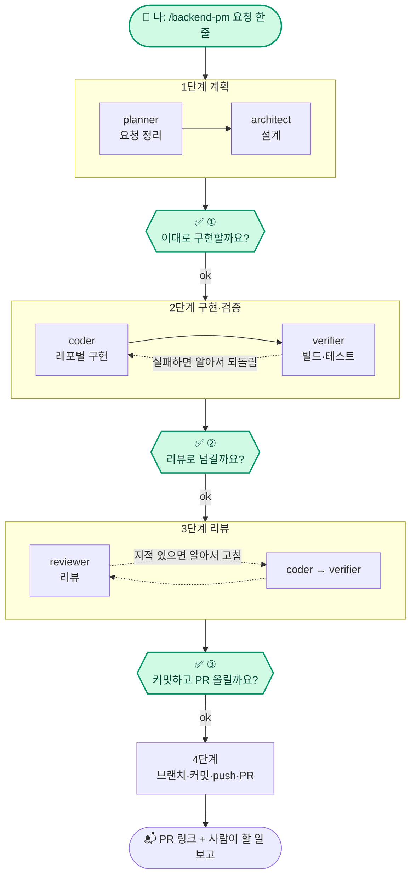

# .github

FreshLink Organization 공통 설정 레포. 여기 있는 파일은 **Organization의 모든 레포에 기본값으로 적용**된다(각 레포에 같은 파일이 없을 때).

| 파일 | 역할 |
| --- | --- |
| [`profile/README.md`](profile/README.md) | https://github.com/sesac-freshlink 첫 화면에 보이는 소개 |
| [`PULL_REQUEST_TEMPLATE.md`](PULL_REQUEST_TEMPLATE.md) | 모든 레포 공통 PR 본문 양식 |
| [`ISSUE_TEMPLATE/`](ISSUE_TEMPLATE) | 기능·버그 이슈 양식 |
| [`docs/기획안-및-설계도.md`](docs/기획안-및-설계도.md) | MVP 기획안(기능·흐름·담당·데이터 모델·메시지 명세) |
| [`docs/aws-리소스-계획.md`](docs/aws-리소스-계획.md) | AWS 리소스 계획(dev·prod 환경, 노드·RDS 산정, 네트워크, 비용, 켜고 끄는 일정, Terraform 모듈) |
| [`docs/기술스택과 선택이유.md`](docs/%EA%B8%B0%EC%88%A0%EC%8A%A4%ED%83%9D%EA%B3%BC%20%EC%84%A0%ED%83%9D%EC%9D%B4%EC%9C%A0.md) | 도구별 선택 이유 (관측성 3-5, 켜고 끄기 3-6, Cognito와 BFF 전환 3-7, Redis·SSE 3-8 등) |
| [`docs/비용-계산.md`](docs/비용-계산.md) | dev + prod 비용 계산 (10/19~11/20), 2차 ElastiCache·도메인 추가분 |
| 팀원 가이드 [1 common](docs/팀원-가이드-1-common.md) · [2 인프라·배포](docs/팀원-가이드-2-인프라-배포.md) · [3 프론트 연동](docs/팀원-가이드-3-프론트-연동.md) · [4 관측성](docs/팀원-가이드-4-관측성.md) · [5 주말 dev 켜기](docs/팀원-가이드-5-주말-dev-켜기.md) | 팀원이 직접 쓰는 방법 |
| [`docs/백엔드-공통작업-인수인계.md`](docs/백엔드-공통작업-인수인계.md) | 백엔드 공통 기준(Java 21·Spring Boot 4.0·프로필·포트 8080), 서비스 레포 Spring 뼈대, common v0.1.0 작업 안내 |
| [`docs/백엔드-공통-규칙.md`](docs/백엔드-공통-규칙.md) | 뼈대 작업 결과와 규칙: 버전, gateway WebMVC, Flyway, 로컬 실행, 환경 변수, 오류 처리, 서비스 간 통신(명령은 큐·조회는 동기), common 가져다 쓰기 |
| [`docs/멘토링-후-사람별-할-일.md`](docs/멘토링-후-사람별-할-일.md) | **2차 범위(10/28 멘토링 후, 11/3까지)** 사람별 할 일: MVP 릴리스, BFF 전환, 알림 서비스(SSE), 선착순 대기열(Redis), 매출 대시보드·판매 순위, 배포 실패 대응, 재시도·DLQ 재처리, 도메인·ACM·CSP |
| [`docs/jina/할일-목록.md`](docs/jina/할일-목록.md) | 김진아 할 일 목록 (MVP까지. 2차는 위 문서) |
| [`docs/주문-결제-흐름과-재고-예약.md`](docs/주문-결제-흐름과-재고-예약.md) | 고객이 보는 주문·결제 흐름과 백엔드 재고 예약(RESERVE·CONFIRM·RELEASE)의 구분, 주문 상태별 고객 화면 문구 |
| [`docs/git-계획.md`](docs/git-계획.md) | Organization·레포 구성, 브랜치·태그·CI/CD·시크릿 규칙 |
| [`docs/architecture/`](docs/architecture) | 아키텍처 구조도(PNG·SVG)와 번호별 흐름 설명, 구조도 계획([`구조도-계획.md`](docs/architecture/구조도-계획.md))과 생성 스크립트 |
| [`docs/프로젝트-보드-사용법.md`](docs/프로젝트-보드-사용법.md) | 프로젝트 보드·이슈·브랜치·커밋 연동 사용법 |
| [`CONTRIBUTING.md`](CONTRIBUTING.md) | 브랜치·커밋·PR·라벨 규칙 |
| [`.claude-plugin/`](.claude-plugin), [`plugins/`](plugins) | 팀 공용 Claude Code 플러그인. **PM에게 한 줄로 맡기면 계획부터 PR까지 진행된다.** 아래 [Claude Code PM 파이프라인](#claude-code-pm-파이프라인) 참고 |
| [`docs/ai-agents.md`](docs/ai-agents.md) | 플러그인 설치, PM에게 맡기는 법, 에이전트별 역할, 수정 방법 |

재사용 워크플로 `.github/workflows/spring-build.yml`(각 서비스 레포가 몇 줄로 불러 쓴다). 2차에 배포 성공·실패 알림 웹훅 단계를 더한다(2026-10-28).

- 담당: 김진아
- 브랜치: `main` ← 작업 브랜치 (배포 없음)

---

## Claude Code PM 파이프라인

> **PM에게 한 줄로 맡기면, 그다음은 PM이 알아서 끝까지 진행한다.**
> 나는 단계가 끝날 때마다 "이대로 진행할까요?"에 **ok만 하면 된다.**

```
/backend-pm S-32 폐기 API 만들어줘. 다른 점포 lot은 403
```

이 한 줄을 치면 지금 대화하는 Claude가 **PM**이 된다. PM은 직접 코드를 짜지 않고, 역할이 정해진 에이전트(직원)들에게 일을 나눠 시키고 결과를 점검한다.

### 전체 흐름



- **초록색 칸(요청 한 줄, ①②③)만 내 차례다.** 나머지 칸은 전부 PM이 묻지 않고 진행한다.
- 점선은 PM이 알아서 도는 고치기 반복이다. 같은 문제로 3번 넘게 막힐 때만 멈추고 묻는다.
- 고칠 점이 있으면 ok 대신 고칠 점을 말한다. PM이 그 부분만 고치게 하고 같은 확인을 다시 보여 준다.

### 누가 무엇을 하나

| | 🙋 내가 하는 일 | 🤖 PM이 알아서 하는 일 |
| --- | --- | --- |
| 시작 | `/backend-pm 요청` 또는 `/infra-pm 요청` 한 줄 | 요청 원문 저장, 작업 폴더(`_workspace/`) 준비 |
| 1단계 계획 | ① 계획 요약 보고 **ok**, 미확정 질문에 답 | planner·architect에게 시키고 빠진 것이 없는지 점검 |
| 2단계 구현·검증 | ② 검증 결과 보고 **ok** | 레포별 coder에게 구현 → verifier로 빌드·테스트 → 실패하면 coder에게 되돌려 고침 |
| 3단계 리뷰 | ③ 리뷰 결과와 커밋 계획 보고 **ok** | reviewer 리뷰 → 지적은 coder가 고치고 다시 검증·리뷰 → README 등 문서 반영 |
| 4단계 커밋·PR | (없음) | 작업 브랜치·커밋·push·PR, PR 링크와 사람이 할 일 보고 |

**"끝까지 쭉"**이라고 답하면 ①②도 건너뛴다. 단, 커밋 전 ③과 사람만 정할 수 있는 것(미확정 사항, 남의 레포 수정, 비용 증가, `terraform plan` 실행)은 그래도 묻는다.

### 시작하기 (3단계)

**1. 설치 (한 번만).** 일반 터미널(cmd, PowerShell)에서 실행한다. 필요한 플러그인만 깔아도 된다.

```bash
claude plugin marketplace add sesac-freshlink/.github
claude plugin install freshlink-backend@freshlink
claude plugin install freshlink-infra@freshlink
```

**2. 레포 폴더에서 내 PC 세션 열기.** Claude 데스크톱 앱에서 새 생성 → 환경을 클라우드가 아닌 **내 PC**로 → 레포 폴더(예: `C:\fresh-link\repos\inventory-service`)를 고른다. 터미널이면 그 폴더에서 `claude`를 실행한다.

**3. PM에게 맡기기.**

| 작업 | 명령 | 예 |
| --- | --- | --- |
| 백엔드 (gateway, 서비스 4개, common) | `/backend-pm <요청>` | `/backend-pm U-21 주문 생성 API 만들어줘` |
| 인프라 (infra, gitops, 워크플로) | `/infra-pm <요청>` | `/infra-pm SQS DLQ 알림 추가해줘` |
| 끊긴 작업 이어 하기 | `/backend-pm 이어서` | 마지막으로 끝난 단계 다음부터 다시 시작 |

> claude.ai 프로젝트 채팅·스레드에서는 `/backend-pm` 같은 명령이 동작하지 않는다. 반드시 **내 PC에서 여는 Claude Code 세션**에서 쓴다.
>
> 이 레포가 바뀌면 `claude plugin marketplace update freshlink`를 한 번 실행하고 새 세션을 연다.

### 지금 있는 플러그인

| 플러그인 | 시작 명령 | PM이 부리는 에이전트 (7개) |
| --- | --- | --- |
| `freshlink-backend` | `/backend-pm` | backend-planner, backend-architect, common-coder, service-coder, gateway-coder, backend-verifier, backend-reviewer |
| `freshlink-infra` | `/infra-pm` | infra-planner, infra-architect, iac-coder, gitops-coder, pipeline-coder, infra-verifier, infra-reviewer |

담당: 김진아. 확인 메시지 모양, 에이전트별 역할, 에이전트 하나만 쓰는 법, 막힐 때 해결법은 [`docs/ai-agents.md`](docs/ai-agents.md)에 있다.

---

## 에이전트·플러그인 쉽게 이해하기

| 비유 | 실제 | 이 레포의 위치 |
| --- | --- | --- |
| 팀장 | **PM** = 지금 대화하는 Claude(메인 세션). `/backend-pm`, `/infra-pm`으로 시작 | `plugins/<플러그인>/commands/*-pm.md` |
| 팀장의 업무 매뉴얼 | 파이프라인 스킬 (단계 순서, 언제 확인받을지) | `plugins/<플러그인>/skills/*-pipeline/SKILL.md` |
| 직무 설명서 | 에이전트 정의 (`.md` 파일 한 장 = 직원 한 명) | `plugins/<플러그인>/agents/*.md` |
| 앱 | 플러그인 (팀장 매뉴얼 + 직원 설명서 묶음) | `plugins/<플러그인>/` |
| 앱스토어 | 마켓플레이스 | `.claude-plugin/marketplace.json` |

- **에이전트(서브에이전트)**: `reviewer.md` 같은 파일에 "너는 리뷰만 해, 이런 걸 잡아내"라고 적어 두면, 그 설명서대로 일하는 Claude 직원이 생긴다. frontend 레포의 `.claude/agents/`(pm, architect, coder, reviewer 등 8개)도 같은 것이다.
- **왜 PM이 메인 세션인가**: 에이전트는 다른 에이전트를 부를 수 없다. 그래서 일을 나눠 주는 팀장 역할은 나와 대화하는 메인 Claude가 맡는다. `backend-planner`처럼 이름에 planner가 붙은 에이전트는 요청을 정리하는 직원일 뿐 PM이 아니다.
- **왜 플러그인인가**: Claude는 지금 열린 레포의 `.claude/agents/`만 읽는다. 인프라·백엔드처럼 여러 레포를 오가는 일은 설명서를 레포마다 복사해야 한다. 플러그인은 레포가 아니라 **내 Claude Code 자체에** 깔려서, 어느 레포를 열어도 같은 팀장과 직원들이 보인다.
- **왜 이 레포가 앱스토어인가**: GitHub 레포에 목록 파일(`.claude-plugin/marketplace.json`)만 넣으면 그 레포가 마켓플레이스가 된다. 우리는 이 `.github` 레포를 쓴다.
