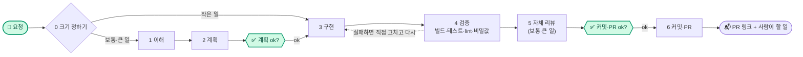

# .github

FreshLink Organization 공통 설정 레포. 여기 있는 파일은 **Organization의 모든 레포에 기본값으로 적용**된다(각 레포에 같은 파일이 없을 때).

| 파일 | 역할 |
| --- | --- |
| [`profile/README.md`](profile/README.md) | https://github.com/sesac-freshlink 첫 화면에 보이는 소개 |
| [`PULL_REQUEST_TEMPLATE.md`](PULL_REQUEST_TEMPLATE.md) | 모든 레포 공통 PR 본문 양식 |
| [`ISSUE_TEMPLATE/`](ISSUE_TEMPLATE) | 기능·버그 이슈 양식 |
| [`docs/README.md`](docs/README.md) | **문서 목차.** 기획·규칙·팀원 가이드·기능이해·인수인계·할일 폴더별 문서 목록과 상태, 문서 관리 규칙 |
| [`CONTRIBUTING.md`](CONTRIBUTING.md) | 브랜치·커밋·PR·라벨 규칙 |
| [`claude-agents/`](claude-agents) | 팀 공용 Claude Code 작업 순서(파이프라인 스킬)·명령·설정 **원본**. 각 레포 `.claude/`에 복사되어 있다. 아래 [Claude Code 작업 방식](#claude-code-작업-방식) 참고 |

재사용 워크플로 `.github/workflows/spring-build.yml`(각 서비스 레포가 몇 줄로 불러 쓴다). dev 배포·prod 승격이 끝나면 성공·실패를 디스코드(또는 슬랙)로 알린다(2026-10-28).

알림 액션 [`actions/notify`](actions/notify/action.yml): 조직 비밀 `DEPLOY_WEBHOOK_URL`로 결과·커밋 7자리·실행 링크를 보내고, 실패면 실패한 단계 이름과 오류 메시지(annotation, 최대 3개)를 붙인다. spring-build, frontend `frontend-deploy`, infra `dev-cluster`(prod-cluster 포함)가 작업 마지막 단계에서 `uses: sesac-freshlink/.github/actions/notify@main`으로 부른다. 비밀이 없으면 알림만 건너뛴다.

- 담당: 김진아
- 브랜치: `main` ← 작업 브랜치 (배포 없음)

---

## Claude Code 작업 방식

> **2026-11-13 변경:** 서브에이전트 여러 개에게 일을 넘기는 방식(`/backend-pm`·`/infra-pm` + 에이전트 7개)을 없앴다. 쉬운 요청도 너무 오래 걸렸다. 지금은 **Claude 하나(Opus 5.5)가 파이프라인 순서대로 직접** 일하고, 단계마다 스스로 검증한다.

- 초록색 칸만 내 차례다. 작은 일은 계획 확인 없이 바로 고치고, 커밋·PR 전에만 묻는다.
- `frontend`는 예외로, 멘토님이 만든 자체 에이전트(`.claude/agents/` 8개)를 그대로 쓴다.
- 따로 명령이 없다. 레포 폴더에서 Claude Code 세션(데스크톱 앱 환경 **내 PC**, 또는 터미널 `claude`)을 열고 평소처럼 부탁한다.
- 서브에이전트는 여러 레포를 동시에 읽기만 할 때, 큰 일에서 독립 리뷰가 필요할 때만 잠깐 쓴다. 에이전트끼리 일을 주고받지 않는다.

| 원본 | 내용 |
| --- | --- |
| `claude-agents/skills/freshlink-pipeline/SKILL.md` | 크기 정하기, 6단계 순서, 언제 묻는지, 절대 규칙 |
| `claude-agents/skills/freshlink-pipeline/{backend,infra,frontend}.md` | 영역별 팀 결정·검증 명령·리뷰 점검표 (그 영역을 고칠 때만 읽는다) |
| `claude-agents/commands/` | `/reread`, `/api-table`, `/message-check`, `/cost-check`, `/plan-summary` |
| `claude-agents/settings.json` | 모델 기본값 `claude-opus-5-5` |

담당: 김진아(원본 관리). 복사·갱신 명령, 예전 파일 지우기, 막힐 때 해결법은 [`docs/팀원-가이드/ai-agents.md`](docs/팀원-가이드/ai-agents.md)에 있다.
