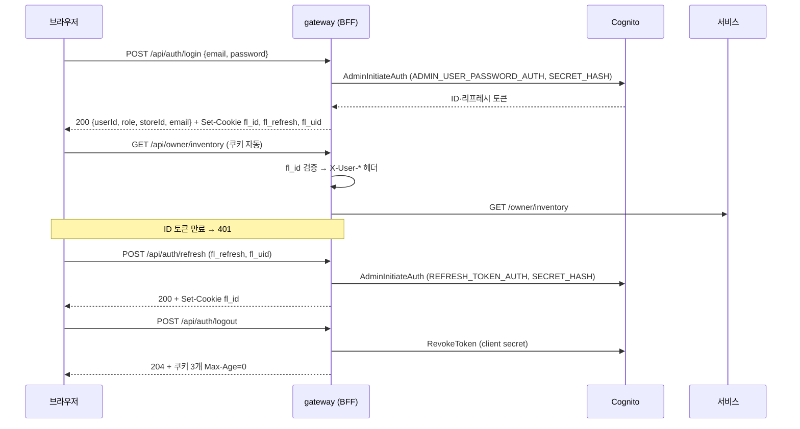

# BFF 인수인계: gateway가 로그인을 대신 하고 토큰은 HttpOnly 쿠키에

받는 분: 경우님 · 작성: 김진아 · 2026-10-29

> **맡아 주실 일은 두 가지입니다.** gateway에 BFF 로그인 API(`/api/auth/*`)를 만들고, 프론트에서 Amplify를 빼고 그 API를 쓰게 바꿉니다. 할 일 목록은 [멘토링-후-사람별-할-일.md](멘토링-후-사람별-할-일.md)의 "김경우 → BFF gateway 로직·BFF 프론트 로직·구글 로그인 화면"과 같습니다. 이 문서는 그 일을 혼자 할 수 있게 인프라가 준비한 값과 규칙을 모은 것입니다.
>
> 인프라(Cognito `bff` 클라이언트, 시크릿, gateway IRSA, ArgoCD·gitops 값, 구글 로그인)는 김진아가 끝냈습니다(infra README 4-17). **dev는 10/29에 gateway 토큰 검증 값을 `bff`로 바꿨습니다.** 그래서 경우님 BFF가 올라올 때까지 dev는 로그인이 안 되고, dev 화면은 가짜(mock) 로그인입니다. prod는 아직 `web`이고 경우님 코드가 main에 릴리스될 때 바꿉니다(8장).

---

## 1. 무엇이 바뀌고 무엇이 그대로인가

지금은 브라우저의 Amplify가 Cognito에 직접 로그인하고, 토큰을 **localStorage**에 두고, ID 토큰을 `Authorization: Bearer`로 붙입니다. BFF로 바꾸면 로그인·갱신·로그아웃을 **gateway가 대신** 하고, 토큰은 JS가 읽을 수 없는 **HttpOnly 쿠키**에만 둡니다. 새 서비스는 만들지 않습니다. CloudFront `/api/*`가 이미 gateway로 가서 프론트와 같은 주소라 쿠키가 그대로 붙습니다.

| 바뀐다 | 그대로다 |
| --- | --- |
| 프론트: Amplify(`aws-amplify`)와 `cognitoClient.ts`가 빠지고 `/api/auth/*`를 부른다. `Authorization` 헤더 대신 쿠키 | member·inventory·order 서비스 코드. 서비스는 지금처럼 `X-User-Id`·`X-User-Role`·`X-Store-Id`만 믿는다 |
| gateway: `AuthController`(`/auth/**`)가 생기고, 토큰을 헤더가 없으면 쿠키 `fl_id`에서 읽는다 | 토큰 검증 방식(JWKS, `iss`·`token_use=id`·`aud`), 경로별 역할, `UserHeaderFilter` |
| Cognito: 시크릿이 있는 서버용 클라이언트 `bff`로 로그인한다 | User Pool, 그룹(OWNER·CUSTOMER·ADMIN), `custom:storeId`, 가입 확인 Lambda, 시드 계정 |



## 2. 인프라가 준비한 값

계정 값(User Pool ID, 클라이언트 ID)은 공개 레포라 여기 적지 않습니다. 클러스터 파드에는 ArgoCD가 환경 변수로 넣어 줍니다.

| 환경 변수 (gateway 파드) | 내용 | 넣는 곳 |
| --- | --- | --- |
| `COGNITO_ISSUER_URI` | `https://cognito-idp.ap-northeast-2.amazonaws.com/<UserPoolId>` (지금과 같다) | infra root |
| `COGNITO_CLIENT_ID` | 토큰 `aud` 확인용. **dev는 `bff`(10/29 전환)**, prod는 아직 `web`이고 릴리스 때 `bff`로 바뀐다 | infra root |
| `COGNITO_USER_POOL_ID` | User Pool ID (`AdminInitiateAuth`에 넣는다) | infra root |
| `COGNITO_BFF_CLIENT_ID` | `bff` 클라이언트 ID (`freshlink-<env>-bff`) | infra root |
| `COGNITO_CLIENT_SECRET` | `bff` 클라이언트 시크릿. **파일·로그에 쓰지 않는다** | gitops `extraSecrets` ← Secrets Manager `freshlink-<env>/gateway/cognito`(JSON `clientId`·`clientSecret`) |
| `COGNITO_DOMAIN_URL` | 로그인 도메인 `https://freshlink-<env>-auth.auth.ap-northeast-2.amazoncognito.com` (구글 로그인) | infra root |
| `FRONTEND_URL` | 프론트 주소 `https://<id>.cloudfront.net` (구글 콜백 `redirect_uri`, 로그인 뒤 돌아갈 곳) | infra root |
| `AWS_REGION` | `ap-northeast-2` | infra root |

| 항목 | 값 |
| --- | --- |
| gateway 서비스 계정 | `freshlink/gateway`, IRSA Role `freshlink-<env>-gateway-irsa` |
| IRSA로 허용된 작업 | `cognito-idp:AdminInitiateAuth` (이 User Pool만). 로그인·갱신에 쓴다 |
| IAM 없이 시크릿만으로 되는 작업 | `SignUp`, `ConfirmSignUp`, `ResendConfirmationCode`, `ForgotPassword`, `ConfirmForgotPassword`, `RevokeToken`, 로그인 도메인 `/oauth2/token` |
| `bff` 클라이언트 | 시크릿 있음, `ALLOW_ADMIN_USER_PASSWORD_AUTH`·`ALLOW_REFRESH_TOKEN_AUTH`, 토큰 취소 켬, ID 토큰 1시간·리프레시 1일, 읽기 속성 `email`·`email_verified`·`custom:storeId`, 쓰기 속성 `email` |
| OAuth (구글) | code 흐름, 범위 `openid email profile`, IdP `COGNITO`·`Google` |
| 콜백 주소 | dev `https://<dev 프론트>/api/auth/callback`, `http://localhost:5173/api/auth/callback` · prod `https://<prod 프론트>/api/auth/callback` |
| 로그아웃 주소 | 콜백 주소의 `/api/auth/callback` 자리에 `/login` |
| 가입 확인 Lambda | 직접 가입(`PostConfirmation_ConfirmSignUp`)이면 **무조건 `CUSTOMER`**. 화면이 넘기는 `clientMetadata.role`은 보지 않는다(자기 가입으로 점주가 되는 것을 막는다). 그래서 `ClientMetadata`는 넘기지 않아도 된다. 서버 가입·구글 첫 로그인도 `CUSTOMER`가 되는 것을 확인했다(10/29 dev: 서버 가입 → CUSTOMER, 구글 첫 로그인 → CUSTOMER와 <UserPoolId>_Google) |

**PC에서 gateway를 dev Cognito에 붙여 시험하기.** 팀원 프로필 `freshlink-dev`에 dev 시크릿 읽기와 dev User Pool `AdminInitiateAuth`가 있습니다. 쿠버네티스 값은 `kubectl`로 읽습니다(보기 권한).

```powershell
$env:AWS_PROFILE = "freshlink-dev"
aws eks update-kubeconfig --name freshlink-dev-eks --region ap-northeast-2
$envs = kubectl -n freshlink get deploy gateway -o jsonpath="{range .spec.template.spec.containers[0].env[*]}{.name}={.value}{'\n'}{end}"
$envs | Select-String "COGNITO|AWS_REGION"          # 값 확인
foreach ($line in $envs) { if ($line -match '^(COGNITO_[A-Z_]+|AWS_REGION)=(.+)$') { Set-Item "env:$($Matches[1])" $Matches[2] } }
$env:COGNITO_CLIENT_SECRET = (aws secretsmanager get-secret-value --secret-id freshlink-dev/gateway/cognito --query SecretString --output text | ConvertFrom-Json).clientSecret
$env:FRONTEND_URL = "http://localhost:5173"          # 구글 콜백이 Vite(5173) → 로컬 gateway(8080)로 온다
.\gradlew.bat bootRun --args="--spring.profiles.active=dev"
```

## 3. gateway에 추가할 것

참고할 지금 파일: `security/SecurityConfig.java`(경로별 역할, 401·403 응답), `security/CognitoJwtValidators.java`(iss·token_use·aud), `security/CognitoProperties.java`(설정 값), `filter/UserHeaderFilter.java`(사용자 헤더), 가짜 JWKS로 토큰을 만드는 기존 테스트.

1. **의존성** (`build.gradle`): `software.amazon.awssdk:cognitoidentityprovider`, `runtimeOnly 'software.amazon.awssdk:sts'`(IRSA 자격 증명). 버전은 AWS SDK BOM으로 맞춘다.
2. **설정** (`application.yml` `freshlink.cognito`): 지금 `issuer-uri`·`client-id`에 더한다. 값은 모두 환경 변수, 기본값은 빈 문자열.
   ```yaml
   freshlink:
     cognito:
       issuer-uri: ${COGNITO_ISSUER_URI:}
       client-id: ${COGNITO_CLIENT_ID:}            # aud 확인 (dev는 bff, prod는 릴리스 때 bff)
       bff-client-id: ${COGNITO_BFF_CLIENT_ID:}
       client-secret: ${COGNITO_CLIENT_SECRET:}    # 파일에 쓰지 않는다
       user-pool-id: ${COGNITO_USER_POOL_ID:}
       domain-url: ${COGNITO_DOMAIN_URL:}
     frontend-url: ${FRONTEND_URL:}
   ```
3. **aud는 지금처럼 `client-id` 하나만 본다** (`CognitoJwtValidators` 그대로): dev는 이미 `COGNITO_CLIENT_ID`가 bff라 web·bff를 "둘 다 받기"는 필요 없다. prod도 경우님 코드와 같은 릴리스에서 bff로 바뀐다.
4. **`AuthController`** (`/auth/**`, 밖에서는 `/api/auth/**`). 라우트로 넘기지 않고 gateway가 직접 처리한다.

   | 경로 | Cognito 호출 | 응답 |
   | --- | --- | --- |
   | `POST /auth/login` | `AdminInitiateAuth` `ADMIN_USER_PASSWORD_AUTH` (USERNAME = 입력한 이메일, PASSWORD, SECRET_HASH) | 200 사용자 정보 + 쿠키 3개. 비밀번호가 틀리면 401(공통 오류 형식), 이메일 미인증이면 403 `USER_NOT_CONFIRMED` |
   | `POST /auth/signup` | `SignUp` (SecretHash, 속성 `email`만) | 201. 이미 있으면 409 |
   | `POST /auth/confirm` | `ConfirmSignUp` (SecretHash, 코드) | 204. 코드가 틀리면 400 |
   | `POST /auth/refresh` | `AdminInitiateAuth` `REFRESH_TOKEN_AUTH` (REFRESH_TOKEN = `fl_refresh`, SECRET_HASH = **`fl_uid`** 기준) | 200 + 새 `fl_id`. 실패하면 401 + 쿠키 3개 삭제 |
   | `POST /auth/logout` | `RevokeToken` (`fl_refresh`, ClientSecret) | 204 + 쿠키 3개 `Max-Age=0`. Cognito 실패여도 쿠키는 지운다 |
   | `GET /auth/me` | 없음 (`fl_id` 검증만) | 200 `{userId, role, storeId, email}`. 새로 고침 뒤 로그인 복원 |
   | `GET /auth/google` | 없음 | 302 → 로그인 도메인 (6장) |
   | `GET /auth/callback` | 로그인 도메인 `/oauth2/token` | 302 → `FRONTEND_URL` + 쿠키 3개 (6장) |

5. **`SECRET_HASH`** = Base64(HMAC-SHA256(키 = 클라이언트 시크릿, 메시지 = 사용자 이름 + bff 클라이언트 ID)). **사용자 이름이 호출마다 다르다**:
   - 가입·인증 코드·로그인: 사용자가 입력한 이메일
   - 갱신: 토큰의 `cognito:username`(이메일 가입자는 sub UUID, 구글 가입자는 `google_<숫자>`). 이메일을 넣으면 `Unable to verify secret hash`가 난다. 갱신할 때는 `fl_id`가 이미 만료돼 없을 수 있어서 로그인 때 `cognito:username`을 `fl_uid` 쿠키에 따로 둔다.
6. **`SecurityConfig`**
   - `BearerTokenResolver`: `Authorization` 헤더가 있으면 그것, 없으면 `fl_id` 쿠키. 헤더는 PowerShell 시험용으로 남겨도 된다(bff 토큰만 통과한다).
   - 공개 경로에 `/api/auth/login`, `signup`, `confirm`, `refresh`, `logout`, `google`, `callback`을 더한다. `/api/auth/me`는 로그인 필요.
   - **CSRF**: POST·PUT·PATCH·DELETE는 `X-Requested-With: freshlink` 헤더가 없으면 403. 다른 사이트의 폼·이미지는 이 헤더를 붙일 수 없다(붙이려면 CORS 사전 요청이 필요한데 gateway는 CORS를 열지 않는다). `GET /auth/google`·`/auth/callback`은 브라우저 이동이라 검사하지 않는다.
7. **`UserHeaderFilter`**: 구글 사용자의 `cognito:groups`에는 Cognito가 자동으로 넣는 `<UserPoolId>_Google` 그룹이 같이 온다. `X-User-Role`에는 `OWNER`·`CUSTOMER`·`ADMIN`만 남긴다(서비스가 모르는 값을 받지 않게).
8. **테스트**: 로그인 성공·실패, 쿠키 속성, 쿠키로 보호 경로 통과, 헤더 없는 POST 403, 리프레시 성공·실패, 로그아웃 뒤 쿠키 삭제, 구글 콜백(state 불일치 400), 구글 그룹 거르기. `CognitoIdentityProviderClient`와 `/oauth2/token` 호출은 가짜로 바꾼다.
9. **README** JWT 규칙에 쿠키 규칙과 `/api/auth/*` 표를 더한다.

## 4. 쿠키 규칙

| 쿠키 | 값 | Path | 만료 | 속성 |
| --- | --- | --- | --- | --- |
| `fl_id` | ID 토큰 | `/api` | ID 토큰 만료(`expires_in`, 1시간) | `HttpOnly; Secure; SameSite=Strict` |
| `fl_refresh` | 리프레시 토큰 | `/api/auth` | 리프레시 기간(1일) | `HttpOnly; Secure; SameSite=Strict` |
| `fl_uid` | `cognito:username` (갱신 SECRET_HASH용) | `/api/auth` | 리프레시 기간(1일) | `HttpOnly; Secure; SameSite=Strict` |
| `fl_oauth` | 구글 로그인 `state`·PKCE `code_verifier` | `/api/auth` | 10분 | `HttpOnly; Secure; SameSite=**Lax**` (6장) |

- `Domain`은 붙이지 않는다(그 CloudFront 주소에만).
- 브라우저는 `localhost`를 안전한 곳으로 봐서 PC(Vite 5173 → gateway 8080)에서도 `Secure` 쿠키가 붙는다.
- 응답 본문에 토큰을 넣지 않는다. 로그에도 쿠키·토큰을 찍지 않는다.
- ID 토큰·리프레시 기간은 infra `modules/cognito` `id_token_validity_hours`·`refresh_token_validity_days`가 정한다. 바꾸면 김진아에게 알려 주세요(쿠키 만료는 Cognito 응답의 `expires_in`을 그대로 쓰면 따로 고칠 것이 없다).

## 5. 프론트에 바꿀 것

1. `src/shared/auth/bffClient.ts`: 지금 `AuthClient` 인터페이스(`types.ts`의 `signIn`, `signUp`, `confirmSignUp`, `signOut`, `restore`, `getToken`)를 `/api/auth/*` 호출로 구현한다. `restore`는 `GET /api/auth/me`, `getToken`은 쿠키를 쓰므로 `null`. `confirmSignUp`의 `role` 인자는 Lambda가 보지 않으므로 서버로 넘기지 않아도 된다(`types.ts` 주석도 고친다).
2. `src/shared/auth/index.ts`에서 bff 클라이언트를 쓰게 바꾸고 `cognitoClient.ts`와 `aws-amplify` 의존성을 지운다.
3. `src/shared/api/client.ts`: `Authorization`을 붙이는 부분을 지우고 모든 요청에 `X-Requested-With: freshlink`. 401이면 `POST /api/auth/refresh`를 **한 번만** 부르고 원래 요청을 다시 보낸다(동시에 여러 요청이 401이면 갱신은 하나만, 나머지는 그 결과를 기다린다). 갱신도 401이면 "다시 로그인해 주세요" 안내 후 로그인 화면.
4. 구글 로그인 버튼(member A5): `window.location.href = '/api/auth/google'`. 처음 들어온 구글 사용자는 member 프로필이 없으므로 프로필 등록 화면으로 보낸다.
5. MSW 핸들러와 `mockClient.ts`에 `/api/auth/*`, `.env.example`에서 `VITE_COGNITO_*`를 지운다.
6. 다 옮기면 김진아에게 알려 주세요. `frontend-deploy.yml`의 `VITE_COGNITO_*` 주입과 `web` 클라이언트를 지웁니다(8장).

## 6. 구글 로그인 (BFF 방식)

1. 화면이 `/api/auth/google`로 이동한다.
2. gateway가 `state`(무작위)와 PKCE `code_verifier`를 만들어 `fl_oauth` 쿠키에 두고 302:
   ```
   {COGNITO_DOMAIN_URL}/oauth2/authorize?identity_provider=Google&client_id={COGNITO_BFF_CLIENT_ID}
     &response_type=code&scope=openid+email+profile&redirect_uri={FRONTEND_URL}/api/auth/callback
     &state={state}&code_challenge={S256(code_verifier)}&code_challenge_method=S256
   ```
   `identity_provider=Google`을 붙이면 Cognito 화면 없이 바로 구글로 간다.
3. 구글 로그인 뒤 Cognito가 `{FRONTEND_URL}/api/auth/callback?code=...&state=...`로 보낸다. 이 이동은 다른 사이트(Cognito 도메인)에서 오는 것이라 `SameSite=Strict` 쿠키는 붙지 않는다. **그래서 `fl_oauth`만 `Lax`다.**
4. gateway가 `state`를 `fl_oauth`와 비교하고(다르면 400), 코드를 토큰으로 바꾼다.
   ```
   POST {COGNITO_DOMAIN_URL}/oauth2/token
   Authorization: Basic Base64({bff 클라이언트 ID}:{시크릿})
   Content-Type: application/x-www-form-urlencoded

   grant_type=authorization_code&client_id={bff ID}&code={code}&redirect_uri={FRONTEND_URL}/api/auth/callback&code_verifier={code_verifier}
   ```
   응답 `id_token`·`refresh_token`·`expires_in`으로 4장 쿠키를 굽고, `fl_oauth`를 지우고 `FRONTEND_URL`(또는 `/`)로 302. 코드는 5분 안에 한 번만 쓸 수 있다.
5. 구글 첫 로그인 사용자는 Cognito에 `google_<숫자>` 이름으로 생기고 가입 확인 Lambda가 `CUSTOMER`에 넣는다. ID 토큰에 `email`은 있고 이름은 없다(Cognito에는 이메일만 둔다, 10/21 결정). 이름은 프로필 등록 화면에서 member DB에 받는다.
6. **같은 이메일로 이미 이메일 가입한 사람**이 구글로 들어오면 Cognito에는 다른 사용자(다른 sub)로 생긴다. 막을지, 두 계정을 이을지(`AdminLinkProviderForUser`, IRSA 권한 추가 필요)는 경우님이 정해서 알려 주세요.
7. 구글 사용자의 로그아웃은 3장 `logout`과 같다. 구글 세션까지 끊으려면 쿠키를 지운 뒤 `{COGNITO_DOMAIN_URL}/logout?client_id={bff ID}&logout_uri={FRONTEND_URL}/login`으로 보낸다(안 하면 다음 구글 로그인이 계정 선택 없이 바로 된다).

## 7. dev에서 확인하기 (PowerShell)

gateway BFF가 dev에 올라온 뒤 칩니다. 실패하면 Grafana(Loki)에서 `{app="gateway"}` 로그, Cognito 콘솔의 사용자·그룹을 봅니다.

```powershell
$base = "https://<dev 프론트 주소>"     # infra README 4-8의 frontend_url
$h = @{ "X-Requested-With" = "freshlink" }
$body = @{ email = "<시드 점주 이메일>"; password = "<비밀번호>" } | ConvertTo-Json

# 1) 로그인 → 쿠키 3개
$r = Invoke-WebRequest -Uri "$base/api/auth/login" -Method Post -Headers $h -ContentType "application/json" -Body $body -SessionVariable s -UseBasicParsing
$r.StatusCode                                         # 200
$r.Headers["Set-Cookie"]                              # fl_id(Path=/api)·fl_refresh·fl_uid(Path=/api/auth), HttpOnly; Secure; SameSite=Strict
$s.Cookies.GetCookies("$base/api/auth") | Select-Object Name, Path, HttpOnly, Secure

# 2) 쿠키로 보호 API (CloudFront가 쿠키를 gateway까지 넘기는지)
(Invoke-WebRequest -Uri "$base/api/auth/me" -WebSession $s -UseBasicParsing).Content          # 200 사용자 정보
(Invoke-WebRequest -Uri "$base/api/owner/inventory" -WebSession $s -UseBasicParsing).StatusCode  # 200

# 3) CSRF: 헤더 없는 POST는 403
try { Invoke-WebRequest -Uri "$base/api/auth/refresh" -Method Post -WebSession $s -UseBasicParsing } catch { $_.Exception.Response.StatusCode.value__ }   # 403

# 4) 갱신 → 새 fl_id
(Invoke-WebRequest -Uri "$base/api/auth/refresh" -Method Post -Headers $h -WebSession $s -UseBasicParsing).StatusCode   # 200

# 5) 로그아웃 → 쿠키 삭제, 그 뒤 보호 API 401
(Invoke-WebRequest -Uri "$base/api/auth/logout" -Method Post -Headers $h -WebSession $s -UseBasicParsing).StatusCode    # 204
try { Invoke-WebRequest -Uri "$base/api/auth/me" -WebSession $s -UseBasicParsing } catch { $_.Exception.Response.StatusCode.value__ }   # 401
```

브라우저에서는 개발자 도구 → 애플리케이션 → 쿠키에서 `fl_*` 3개가 HttpOnly로 보이고, Local Storage에 토큰이 없으면 성공입니다.

## 8. 전환 (dev는 10/29 완료)

1. **dev (10/29, 김진아 완료):** infra에서 gateway `COGNITO_CLIENT_ID`를 bff로 바꿨고, frontend에서 dev 빌드의 `VITE_COGNITO_*` 주입과 `DEV_COGNITO_*` 변수를 지웠다. 지금 dev는 Amplify 토큰이 401이고, dev 화면은 Cognito 값이 없어 가짜(mock) 로그인이다(`store.ts`). 경우님 BFF gateway·프론트가 dev에 올라가면 7장으로 확인한다.
2. **prod (경우님 코드 릴리스 때, 김진아):** dev→main 릴리스와 같은 날 infra `envs/prod/cluster/helm.tf`의 `COGNITO_CLIENT_ID`를 bff로 바꾸고, `frontend-deploy.yml`의 main용 `PROD_COGNITO_*` 주입과 변수를 지운다. 경우님 코드 없이 main에 릴리스하면 prod 로그인이 깨지므로 이 순서를 지킨다.
3. 며칠 문제없으면 김진아가 `web` 클라이언트를 지운다(infra README 4-7의 시험 토큰 명령도 bff 클라이언트로 바꾼다).

## 9. 알아 둘 한계

- **CloudFront → ALB 구간은 아직 HTTP(80)**입니다(브라우저 → CloudFront는 HTTPS). 쿠키가 AWS 구간에서 평문으로 갑니다. 지금 Authorization 헤더도 같은 처지이고, 김진아의 도메인·ACM 할 일에서 ALB에 HTTPS를 붙여 막습니다.
- Cognito 기본 메일은 하루 50통이고 Gmail 스팸함에 들어갈 수 있습니다(가입 인증 코드).
- 구글 OAuth 앱은 아직 "테스트" 상태라 테스트 사용자로 넣은 Gmail(김진아·경우님·태우님)만 구글 로그인이 됩니다. 다른 계정을 시험하려면 김진아에게 추가를 부탁해 주세요. 프로덕션 게시는 도메인을 산 뒤 홈페이지·개인정보처리방침 페이지와 함께 합니다.
