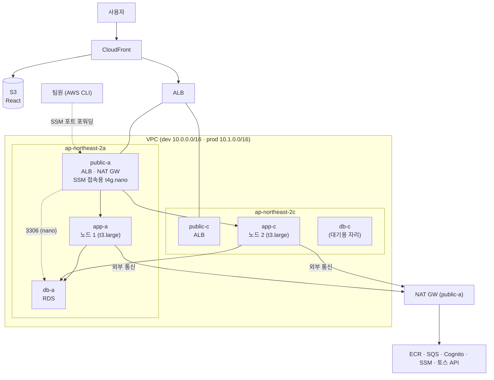

# AWS 리소스 계획

작성일: 2026-10-08 · 개정: 2026-10-20 (6-4에 묶음별로 실제 들어 있는 것 추가, 2장 노드 최소 0·일정 갱신, 6-5-2 관측 데이터가 남는 기간 추가) · 2026-10-17 (원칙 칸 추가: Terraform과 EventBridge가 맡는 일, 주말에만 클러스터를 지우는 이유 갱신, 6-4) · 2026-10-14 (dev·prod 두 환경, 켜는 시간 평일 09:00\~21:00, 관측성·Cognito·Secrets Manager·SSM 반영) · 기준: [기획안-및-설계도.md](기획안-및-설계도.md)의 서비스 구성

MVP를 EKS 위 MSA로 띄울 때 필요한 AWS 리소스의 종류, 크기, 수량을 정리했다. 결론은 **환경마다 EKS 워커 노드 t3.large 2대 + RDS db.t4g.small 1대**다. 이 구성이면 앱 파드를 서비스별로 1\~2개씩 띄우고 관측성 스택까지 올려도 여유가 남는다. 환경은 **dev와 prod 두 개**이고, 같은 Terraform 모듈을 변수만 바꿔 두 번 만든다.

---

## 원칙: 누가 무엇을 바꾸나

> **자원을 만들고 지우는 것, 설정을 바꾸는 것은 Terraform. Terraform이 신경 안 쓰는 상태(켜짐/꺼짐, 비워 둔 숫자 칸)만 EventBridge.**

| 하는 일 | 맡는 것 | 예 |
| --- | --- | --- |
| 자원 생성·삭제, 설정 변경 | Terraform (사람이 직접, 또는 GitHub Actions가 대신 `terraform apply`) | 클러스터 생성·삭제, NAT 생성·삭제 |
| Terraform 기록에 없는 상태 바꾸기 | EventBridge Scheduler | RDS·nano 중지·시작, 노드 그룹 desired 0·2 (`ignore_changes`로 비워 둔 칸) |

이 원칙을 지키면 Terraform 기록(state)과 실제 AWS가 어긋나지 않는다. 일정은 6-5에 있다.

---

## 1. 전제

| 항목 | 가정 |
| --- | --- |
| 환경 | **dev, prod 2개.** 개발도 처음부터 AWS dev 환경(RDS·SQS·Cognito)에서 한다. 같은 Terraform 모듈을 환경 변수(env, CIDR, 이름 접두사)만 바꿔 두 번 부른다 |
| 배포 | `dev` 브랜치 → dev 환경, `main` → prod 환경. prod는 다시 빌드하지 않고 dev에서 검증한 **같은 이미지 태그**를 올린다 |
| 예산 | 새싹 지원금 50만 원(약 360 USD, 1 USD ≈ 1,380원 가정) 안에서 두 환경을 운영한다 (6-6 참고) |
| 리전 | 서울 (ap-northeast-2), 가용 영역 2개 사용 (ap-northeast-2a, 2c) |
| 트래픽 | 시연 수준 + 동시 주문 100건 테스트(dev에서만). 대용량 부하 테스트는 2순위라 고려하지 않는다 |
| 구매 방식 | 온디맨드. 시연 중 노드가 회수되면 안 되므로 스팟은 쓰지 않는다 |
| 관측성 | Prometheus·Grafana·Loki·Zipkin(I-03)을 MVP에 넣는다. 용량은 3장에 포함해 계산했다 |
| 실시간 재고 | 프론트가 3초마다 조회한다(TanStack Query 폴링). 서버가 연결을 붙잡고 있는 방식이 아니라서 ALB·CloudFront에 따로 맞출 설정이 없다 |

---

## 2. 전체 리소스 목록

아래 수량은 **환경 1개 기준**이다. dev와 prod가 같은 구성을 하나씩 가진다. ECR, GitHub OIDC 공급자, Terraform state 저장소만 두 환경이 같이 쓴다(`global` 묶음).

| 구분 | 리소스 | 타입·크기 | 수량 | 용도 |
| --- | --- | --- | --- | --- |
| 컴퓨팅 | EKS 클러스터 (컨트롤 플레인) | 관리형 | 1 | 쿠버네티스 마스터. AWS가 운영 |
| 컴퓨팅 | EKS 관리형 노드 그룹 | **t3.large** (2 vCPU, 8 GiB) | **2** (최소 0, 최대 3) | 모든 앱·시스템 파드 실행 |
| DB | RDS MySQL 8.4 | **db.t4g.small** (2 vCPU, 2 GiB), gp3 20 GiB, 단일 AZ | **1** | member·inventory·order 스키마 3개 |
| DB 접속 | EC2 (SSM 접속용) | **t4g.nano**, SSM 에이전트만, 인바운드 없음 | 1 | SSM Session Manager 포트 포워딩으로 RDS에 접속하는 통로. RDS와 같이 켜고 끈다 |
| 메시징 | SQS | 공용 세트 FIFO 1 + 표준 1 + DLQ 2. dev는 개발자별 세트를 더 둔다 | 4 (+ dev 개발자별) | 서비스 간 쪽지. 큐 이름에 환경 접두사(`dev-`, `prod-`)를 붙인다 |
| 네트워크 | VPC | dev `10.0.0.0/16`, prod `10.1.0.0/16` | 1 | 환경마다 따로. 5장 참고 |
| 네트워크 | 서브넷 | 퍼블릭 2 + 앱 프라이빗 2 + DB 프라이빗 2 (AZ마다 3계층) | 6 | 5장 참고 |
| 네트워크 | NAT Gateway | - | 1 | 프라이빗 노드의 외부 통신 (ECR, 토스 API 등) |
| 네트워크 | S3 Gateway 엔드포인트 | - | 1 | S3·ECR 이미지 레이어 다운로드를 NAT 없이 (무료) |
| 진입 | ALB | AWS Load Balancer Controller가 생성 | 1 | `/api/*` → Gateway |
| 진입 | CloudFront + S3 | - | 1 + 1 | React 정적 파일 배포 |
| 이미지 | ECR | 리포지토리 | 5 (두 환경 공용) | gateway, member-service, inventory-service, order-service, logistics-simulator |
| 보안 | IRSA (IAM Role) | 서비스별 | 4 | SQS 접근 권한 분리 (gateway 제외, 자기 환경 큐만). member-service Role에는 User Pool 속성 변경 권한만 추가 |
| 보안 | Secrets Manager | 비밀 | 앱 DB 비밀번호 3 + 토스 테스트 키 1 | External Secrets Operator가 읽어 파드의 Kubernetes Secret으로 넣는다 |
| 인증 | Amazon Cognito User Pool | 그룹 3(OWNER, CUSTOMER, ADMIN), 앱 클라이언트 1 (시크릿 없음) | 1 | 회원가입·로그인·JWT 발급 ([기술스택과 선택이유.md](기술스택과%20선택이유.md) 3-7) |
| 인증 | Lambda (Cognito 트리거) | Python, 128 MB | 1 | 가입 확인 시 CUSTOMER 그룹 배정 (일반 가입은 고객만) |
| 운영 | EventBridge Scheduler | 일정 | 여러 개 | RDS·노드 그룹·SSM 접속용 인스턴스를 정해진 시각에 켜고 끈다. 클러스터 생성·삭제와 NAT 켜고 끄기 워크플로도 Lambda를 거쳐 정해진 시각에 실행한다 (6-5) |
| 비용 | AWS Budgets | - | 1 (계정 전체) | 금액 초과 알림. 첫 리소스보다 먼저 만든다 |
| 관측성 | S3 버킷 (Loki 로그 저장) | 수명 주기 14일 | 1 | 유지 묶음에 둬서 주말 클러스터 삭제 뒤에도 로그가 남는다 |
| 관측성 | EBS gp3 볼륨 (Prometheus 저장) | 10 GiB | 1 | EBS CSI 드라이버 애드온이 만든다. 지표는 3일만 보관 |

리소스 이름은 `freshlink-<env>-<이름>` 규칙을 따른다(예: `freshlink-dev-mysql`, `freshlink-prod-eks`). 서비스는 큐 이름·DB 주소·Cognito ID를 코드에 박지 않고 설정 값(환경 변수)으로 받는다.

**Bastion 서버는 두지 않는다.** 노드 접속은 SSM Session Manager로 한다. RDS는 인터넷에 열리지 않으므로, DB 접속은 app 서브넷의 **t4g.nano 인스턴스를 거친 SSM Session Manager 포트 포워딩**으로 한다. 이 인스턴스는 보안 그룹 인바운드가 하나도 없고 SSH 포트도 열지 않는다. 팀원 IAM 권한은 dev 리소스로만 좁히고, prod는 읽기 권한도 주지 않는다.

---

## 3. EKS 노드 산정

### 3-1. 파드 목록과 리소스 요청량

Spring Boot는 JVM 때문에 메모리를 많이 쓴다. 파드당 메모리 요청 512 MiB를 기본으로 잡았다.

CPU 요청은 파드당 150m로 잡는다. 처음에는 250m였는데, 관측성 스택까지 올리면 CPU 요청 합계가 노드 2대의 할당 가능량을 거의 다 채워 롤링 배포 때 새 파드가 뜰 자리가 없어진다(3-2 참고). 시연 수준 트래픽에서 Spring 파드가 평소에 쓰는 CPU는 이보다 훨씬 적고, CPU 상한(limit)은 두지 않으므로 기동할 때는 노드의 남는 CPU를 빌려 쓴다.

| 파드 | 개수 | CPU 요청 | 메모리 요청 | 메모리 상한 | 비고 |
| --- | --- | --- | --- | --- | --- |
| gateway | 2 | 150m | 512Mi | 768Mi | 모든 요청의 입구라 2개 |
| member-service | 1 | 150m | 512Mi | 768Mi |  |
| inventory-service | 2 | 150m | 640Mi | 1Gi | 재고 조회·스케줄러 |
| order-service | 2 | 150m | 512Mi | 768Mi | 결제·스케줄러 |
| logistics-simulator | 1 | 100m | 256Mi | 512Mi | 시연 때만 사용 |
| **앱 합계** | **8** | **약 1.15 vCPU** | **약 4.1 GiB** |  |  |
| ArgoCD | 6 | 약 0.5 vCPU | 약 1 GiB |  | server, repo-server, controller 등 |
| AWS Load Balancer Controller | 2 | 0.1 vCPU | 약 0.3 GiB |  |  |
| CoreDNS, metrics-server | 3 | 0.2 vCPU | 약 0.3 GiB |  |  |
| aws-node, kube-proxy | 노드당 1씩 | 노드당 0.1 vCPU | 노드당 약 0.1 GiB |  | 데몬셋 |
| EBS CSI 드라이버 | 2 + 노드당 1 | 약 0.05 vCPU | 약 0.2 GiB |  | Prometheus 볼륨용 EKS 애드온 |
| External Secrets Operator | 3 | 약 0.05 vCPU | 약 0.2 GiB |  | Secrets Manager 값을 Kubernetes Secret으로 옮긴다 |
| **시스템 합계** |  | **약 1.1 vCPU** | **약 2.2 GiB** |  |  |
| Prometheus | 1 | 200m | 1Gi | 1.5Gi | 보관 3일, gp3 10 GiB 볼륨 |
| Prometheus Operator, kube-state-metrics | 2 | 150m | 256Mi |  | kube-prometheus-stack. Alertmanager는 끈다 |
| node-exporter | 노드당 1 | 노드당 50m | 노드당 64Mi |  | 데몬셋 |
| Grafana | 1 | 100m | 256Mi | 512Mi | 대시보드·데이터 소스는 gitops에 코드로 둔다 |
| Loki | 1 | 100m | 512Mi | 1Gi | 단일 바이너리 모드, 저장소는 S3 |
| Grafana Alloy | 노드당 1 | 노드당 50m | 노드당 128Mi |  | 로그 수집 데몬셋 |
| Zipkin | 1 | 100m | 512Mi | 768Mi | 메모리 저장(재시작하면 추적 기록이 사라진다) |
| **관측성 합계** | **10** | **약 0.85 vCPU** | **약 2.9 GiB** |  |  |

**총 요청량: 약 3.1 vCPU, 9.2 GiB** (파드 40개, 환경 1개 기준)

t3.large 1대에서 파드가 실제로 쓸 수 있는 양(할당 가능량)은 kubelet·OS 예약분을 빼고 **약 1.93 vCPU, 7.1 GiB**다. 2대면 약 3.86 vCPU, 14.2 GiB이므로 **CPU 80%, 메모리 65%**를 요청으로 채운다. 파드 수는 40개로 한도(35 × 2 = 70)의 절반이다.

### 3-2. 노드 타입 비교

| 안 | 구성 | vCPU / 메모리 합계 | 노드당 최대 파드 수 | 판단 |
| --- | --- | --- | --- | --- |
| 최소 | t3.medium × 3 | 6 / 12 GiB | 17 | 노드당 메모리 4 GiB라 Spring 파드 몇 개만 올라가도 꽉 찬다. 배포 중 새 파드가 뜰 자리가 부족해지기 쉽다 |
| **권장** | **t3.large × 2** | **4 / 16 GiB** | **35** | 관측성까지 넣어도 CPU 80%, 메모리 65%로 들어간다. 단, 앱 CPU 요청을 150m로 잡아야 한다 |
| 여유 | t3.large × 3 | 6 / 24 GiB | 35 | 노드 1대가 죽어도 모든 파드가 남은 노드에 다시 뜬다. 장애 훈련을 할 때 늘린다 |

**t3.large × 2를 고른 이유**

- **메모리가 기준이다.** 이 프로젝트는 CPU보다 JVM 메모리가 먼저 찬다. t3.large는 같은 vCPU의 t3.medium보다 메모리가 2배다.
- **파드 개수 한도.** EKS 기본 네트워크(VPC CNI)는 인스턴스 타입마다 띄울 수 있는 파드 수가 정해져 있다. t3.medium은 17개, t3.large는 35개다. 시스템 파드까지 합치면 t3.medium은 금방 한도에 닿는다.
- **배포 여유.** 롤링 배포는 새 파드를 먼저 띄우고 옛 파드를 지운다. 잠깐 동안 파드가 늘어나므로 요청량보다 넉넉한 공간이 필요하다.
- **AZ 분산.** 2대를 서로 다른 가용 영역에 두고, 같은 서비스의 파드 2개가 다른 노드에 뜨도록 topologySpreadConstraints를 건다.

**관측성을 넣어도 3번째 노드는 필요 없다**

- 관측성 스택은 파드 10개, CPU 약 0.85 vCPU, 메모리 약 2.9 GiB를 더한다. 메모리는 14.2 GiB 중 9.2 GiB라 여유가 있다.
- **먼저 차는 것은 CPU 요청이다.** 앱 CPU 요청을 처음 값(250m)으로 두면 합계가 약 3.85 vCPU로 할당 가능량(3.86)에 거의 닿는다. 이러면 롤링 배포 때 새 파드가 Pending에 걸린다. 앱 CPU 요청을 150m로 낮춰 약 3.1 vCPU(80%)로 맞추고, 남는 약 0.75 vCPU를 배포 여유로 쓴다.
- 노드 그룹 최대값이 이미 3이므로, 아래 경우에만 desired를 3으로 올린다. 켜 두는 시간(310시간)에만 켜면 5주에 약 30 USD가 더 든다.
  - 앱 CPU 요청을 150m로 낮출 수 없을 때 (예: 실제 사용량을 보니 150m로는 응답이 느릴 때)
  - 동시 주문 100건 테스트나 장애 훈련(노드 1대 강제 종료)을 할 때. 2대 구성에서는 노드 1대가 죽으면 남은 1대에 모든 파드가 다시 뜰 수 없다
- 관측성 파드에는 PriorityClass를 앱보다 낮게 준다. 자리가 모자라면 Grafana·Zipkin이 먼저 밀려나고 앱은 계속 뜬다.

### 3-3. 노드와 서비스의 관계

**노드는 서비스별로 나눠 주는 것이 아니다.** 노드 2대는 모든 파드가 같이 쓰는 **공용 자원**이고, 어떤 파드를 어느 노드에 올릴지는 쿠버네티스 스케줄러가 남은 CPU·메모리를 보고 정한다. 같은 서비스의 파드 2개는 서로 다른 노드에 흩어 놓는다.

배치 예시 (실제 배치는 스케줄러가 정한다):

| 노드 1 (2a) | 노드 2 (2c) |
| --- | --- |
| gateway #1 | gateway #2 |
| inventory #1 | inventory #2 |
| order #1 | order #2 |
| member #1 | logistics-simulator |
| ArgoCD 일부, CoreDNS #1 | ArgoCD 일부, CoreDNS #2, LB Controller |

이렇게 하면 노드 1대가 죽어도 모든 서비스가 반대쪽 노드에서 계속 응답한다. 서비스마다 서버를 1대씩 주면 서버가 하나만 죽어도 그 서비스 전체가 멈추고, 사용률이 낮은 서버가 여러 대 생겨 비용도 늘어난다.

MSA에서 서비스를 나눈다는 것은 **배포 단위(컨테이너 이미지, 파드)를 나누는 것**이지 서버를 나누는 것이 아니다. 특정 서비스만 전용 노드에 올리는 경우(nodeSelector, taint)는 GPU가 필요하거나 Kafka처럼 디스크·성능을 독점해야 할 때뿐이고, 이 프로젝트에는 해당하지 않는다.

Graviton(t4g.large)은 약 20% 싸지만 arm64 이미지를 따로 빌드해야 한다. 초보 팀원이 많은 MVP에서는 t3로 가고, 여유가 생기면 바꿔 보는 개선 과제로 남긴다.

---

## 4. RDS 산정

**MySQL 인스턴스 1대에 스키마 3개**(member, inventory, orders)를 만들고, 서비스마다 DB 사용자를 따로 둬서 자기 스키마만 접근하게 한다. 서비스별로 RDS를 3대 띄우면 비용이 3배가 되는데 MVP에서 얻는 것이 적다.

| 항목 | 값 | 이유 |
| --- | --- | --- |
| 인스턴스 | db.t4g.small (2 GiB) | DB 커넥션 수 때문. 아래 계산 참고 |
| 스토리지 | gp3 20 GiB | 더미 데이터 수준 |
| 배포 | 단일 AZ | 다중 AZ는 비용 2배. 장애 조치 시연이 필요할 때만 켠다 |
| 백업 | 자동 백업 1일 |  |

**커넥션 계산**: 앱 파드 7개(시뮬레이터 제외) × 커넥션 풀 10개 = 최대 70개. MySQL 최대 커넥션 수는 인스턴스 메모리에 비례해서, 1 GiB인 db.t4g.micro는 이 숫자에 빠듯하다. 2 GiB인 small로 잡는다. micro를 쓰려면 각 서비스의 HikariCP 최대 풀 크기를 5로 줄인다.

---

## 5. 네트워크 구성

### 5-1. 가용 영역

**ap-northeast-2a와 2c 두 곳**을 쓴다. 서울 리전에는 가용 영역이 4개(2a\~2d) 있지만, 노드 2대와 RDS 서브넷 그룹 조건(최소 2개 AZ)을 맞추는 데는 2개면 충분하다. Terraform으로 만들기 전에 `aws ec2 describe-instance-type-offerings`로 두 AZ 모두 t3.large를 지원하는지 확인한다.

### 5-2. 서브넷 설계 (3계층)

AZ마다 **퍼블릭, 앱 프라이빗, DB 프라이빗** 3개씩, 총 6개를 만든다. 계층을 나누면 "누가 어디에 있고, 무엇이 인터넷과 통하는지"가 라우팅 테이블과 보안 그룹만 봐도 드러난다.

| 서브넷 | AZ | CIDR | 사용 가능 IP | 들어가는 것 | 라우팅 |
| --- | --- | --- | --- | --- | --- |
| public-a | 2a | 10.0.0.0/24 | 251 | ALB, NAT Gateway | 0.0.0.0/0 → IGW |
| public-c | 2c | 10.0.1.0/24 | 251 | ALB | 0.0.0.0/0 → IGW |
| app-a | 2a | 10.0.16.0/20 | 4,091 | EKS 노드 1, 파드 | 0.0.0.0/0 → NAT (2a) |
| app-c | 2c | 10.0.32.0/20 | 4,091 | EKS 노드 2, 파드 | 0.0.0.0/0 → NAT (2a) |
| db-a | 2a | 10.0.48.0/24 | 251 | RDS 기본 인스턴스 | VPC 내부만 (인터넷 경로 없음) |
| db-c | 2c | 10.0.49.0/24 | 251 | (다중 AZ 시 대기 인스턴스) | VPC 내부만 |

위 표는 dev(`10.0.0.0/16`) 기준이다. prod는 같은 배치를 `10.1.0.0/16`에 그대로 쓴다(예: public-a `10.1.0.0/24`, app-a `10.1.16.0/20`, db-a `10.1.48.0/24`). 두 VPC의 대역이 겹치지 않으므로 나중에 피어링이 필요해도 막히지 않는다. 남는 대역(`x.x.64.0` 이후)은 나중에 서브넷을 추가할 때 쓴다.

SSM 접속용 t4g.nano는 **public-a 서브넷에 공인 IP를 붙여** 둔다. NAT는 클러스터 묶음에 있어 밤·주말·클러스터를 만들기 전에는 없으므로, app 서브넷에 두면 SSM 에이전트가 AWS에 닿지 못한다. 보안 그룹 인바운드가 하나도 없어 밖에서 들어올 길은 없고, 공인 IPv4 요금(시간당 0.005 USD)은 켜져 있는 동안만 붙는다. 켜고 끄는 시간은 RDS와 같다(6-5). (2026-10-15 변경: app-a → public-a)

RDS는 **MySQL 8.4(LTS)** 를 쓴다. RDS MySQL 8.0은 2026-07-31에 표준 지원이 끝나 그 뒤로는 Extended Support 요금(vCPU 시간당 과금)이 붙는다. 백엔드 테스트(Testcontainers)도 8.4를 쓴다.

**앱 서브넷을 /20으로 크게 잡은 이유**: EKS 기본 네트워크(VPC CNI)는 **파드마다 VPC의 실제 IP를 하나씩** 준다. 게다가 노드는 파드가 빨리 뜨도록 IP를 미리 여러 개 확보해 둔다. 그래서 노드 몇 대만으로도 IP를 수십 개씩 쓴다. /24(251개)로 잡으면 노드를 늘리거나 2순위 기능을 붙일 때 IP가 바닥날 수 있다. 서브넷 크기는 비용과 상관없으니 넉넉히 잡는다.

**DB 서브넷을 따로 둔 이유**: DB 서브넷 라우팅 테이블에는 NAT 경로가 아예 없다. RDS가 인터넷으로 나갈 길 자체가 없어서, 보안 그룹을 잘못 열어도 외부에 노출되지 않는다. RDS를 단일 AZ로 띄워도 서브넷 그룹에는 2개 AZ의 서브넷이 있어야 해서 db-c도 만든다.

### 5-3. EKS가 서브넷을 알아보게 하는 태그

AWS Load Balancer Controller는 태그를 보고 ALB를 어느 서브넷에 만들지 정한다. 태그를 빠뜨리면 Ingress를 만들어도 ALB가 생성되지 않는다.

| 서브넷 | 태그 |
| --- | --- |
| public-a, public-c | `kubernetes.io/role/elb = 1` |
| app-a, app-c | `kubernetes.io/role/internal-elb = 1` |

### 5-4. 보안 그룹

| 보안 그룹 | 받는 트래픽 (인바운드) | 붙는 곳 |
| --- | --- | --- |
| alb-sg | 443·80, CloudFront 관리형 접두사 목록에서만 | ALB |
| node-sg | alb-sg에서 앱 포트, 같은 node-sg끼리 전체, EKS 컨트롤 플레인에서 443·10250 | EKS 노드·파드 |
| ssm-access-sg | 없음 (나가는 트래픽만) | SSM 접속용 t4g.nano |
| rds-sg | 3306, node-sg와 ssm-access-sg에서만 | RDS |

ALB 대상 유형은 `ip`로 해서 ALB가 노드를 거치지 않고 Gateway 파드로 바로 보낸다.

### 5-5. 전체 그림



- 인터넷에서 직접 들어올 수 있는 건 ALB뿐이고, ALB도 CloudFront를 거친 요청만 받는다.
- **NAT Gateway는 public-a에 1개만** 둔다. AZ마다 두는 것이 정석이지만 비용이 2배다. 2a에 장애가 나면 app-c 노드의 외부 통신도 끊긴다는 점을 알고 선택한 것이며, 장애 훈련 문서에 적어 둔다.
- **S3 Gateway 엔드포인트**를 app 라우팅 테이블에 연결한다. 무료이고, ECR 이미지 레이어 다운로드가 NAT를 거치지 않아 데이터 처리 비용이 줄어든다.

---

## 6. 예상 비용

> 2026-10-20: 아래는 10/08 계획 때의 어림값이다. 실제 Terraform 구성과 서울 리전 단가로 dev + prod를 10/19\~11/20 기준으로 다시 계산한 값은 [비용-계산.md](비용-계산.md)에 있다.

### 6-1. 사용 시간

6-1\~6-5는 **환경 1개(dev)** 기준이다. dev와 prod를 합친 금액은 6-6에 있다.

| 구분 | 계산 | 시간 |
| --- | --- | --- |
| 전체 기간 | 5주 × 168시간 | 840시간 |
| 켜 두는 시간 | 5주 × 5일 × 12시간 (월\~금 09:00\~21:00) | 300시간 |
| 추가 개발 (21:00 이후) | 기간 전체 합계 | 10시간 |
| **실제 사용** |  | **310시간** (전체의 약 37%) |

**나머지 530시간(63%)은 아무도 쓰지 않는 시간이다.** 이 시간에 무엇을 끌 수 있는지가 비용을 좌우한다.

### 6-2. 리소스별 시간당 요금

서울 리전 온디맨드 기준의 **대략적인 값**이다. 실제 금액은 AWS 요금 계산기로 다시 확인한다.

| 리소스 | 시간당 (USD) | 끌 수 있나 |
| --- | --- | --- |
| EKS 컨트롤 플레인 | 약 0.10 | 클러스터를 지워야만 멈춘다 |
| t3.large × 2 | 약 0.21 | 노드 그룹 desired를 0으로 |
| RDS db.t4g.small | 약 0.05 | 중지 가능 (스토리지 요금은 계속) |
| NAT Gateway | 약 0.06 + 데이터 처리 | 지웠다가 다시 만들기 (Terraform) |
| ALB | 약 0.02 + 사용량 | 클러스터와 함께 지울 때만 |
| 퍼블릭 IPv4 3개 (NAT 1, ALB 2) | 약 0.015 | 붙은 리소스를 지우면 같이 사라짐 |
| 기타 (RDS·EBS 스토리지, CloudFront, S3, SQS, ECR) | 기간 전체 약 8 | 거의 고정 |
| 관측성 추가분 (Prometheus gp3 10 GiB, Loki S3, 외부 이미지를 NAT로 받는 데이터 요금) | 기간 전체 약 5 | 거의 고정. 관측성 파드는 기존 노드 2대에 올라가므로 노드 요금은 늘지 않는다 |
| SSM 접속용 t4g.nano + Secrets Manager 비밀 4개 | 기간 전체 약 3 | nano는 RDS와 같이 켜고 끈다(310시간에 약 1.3). Secrets Manager는 비밀 1개당 월 0.40 |
| Cognito User Pool + 트리거 Lambda | 기간 전체 약 0 | 월간 활성 사용자 1만 명까지 무료 구간, Lambda도 무료 사용량 안. 클러스터 밖이라 노드 요금도 늘지 않는다 (Keycloak을 EKS에 띄웠다면 3번째 노드로 약 +20) |

### 6-3. 운영 방식별 5주 비용

| 방식 | 하는 일 | 5주 예상 (USD) |
| --- | --- | --- |
| A. 계속 켜 두기 | 아무것도 끄지 않는다 | **약 400** |
| B. 노드·RDS만 끄기 | 개발 시간 외에 노드 0대, RDS 중지 | **약 265** |
| C. B + NAT도 끄기 | B에 더해 NAT Gateway를 개발 시간 외에 삭제 | **약 225** |
| **D. C + 주말엔 클러스터 삭제 (권장)** | C에 더해 금요일 저녁에 EKS·ALB까지 지우고 월요일 아침에 다시 만든다 | **약 195** |
| E. 매일 전부 삭제 | 매일 저녁 전부 지우고 매일 아침 다시 만든다 | 약 155 |

**계산 근거 (A → D)**

- A: 모든 리소스 840시간 → EKS 84 + 노드 175 + RDS 42 + NAT 53 + ALB 21 + IPv4 13 + 기타 8 ≈ 400
- B: 노드와 RDS만 310시간 → 노드 65, RDS 16으로 줄어 약 265
- C: NAT도 310시간 → NAT 20, NAT의 IPv4도 줄어 약 225
- D: 주말 4번 × 60시간(금 21시\~월 9시) = 240시간 동안 EKS·ALB·ALB IPv4까지 없음 → 약 30 절약해 약 195
- 관측성을 넣으면 위 금액에 약 5가 더해진다 (D안 약 200). 3번째 노드를 켜 두는 시간에 같이 켜면 약 30이 더 든다.

### 6-4. 권장: D안

**E안(매일 전부 삭제)은 권장하지 않는다.** 아침 대기 시간은 생성 시각을 앞당기면 피할 수 있으므로 이유로 삼지 않는다. E안이 D안보다 한 달에 약 26 USD(EKS 기본료 시간당 0.10 USD 기준 추정)를 더 아끼지만, 노드는 이미 밤마다 0대로 줄이므로 노드 비용 차이는 없고 아래 문제가 매일 생긴다. (2026-10-17 변경: 대기 시간 이유를 빼고 아래 세 가지로 바꿨다)

- **매일 주소가 바뀐다.** 클러스터를 새로 만들면 ALB 주소와 IRSA용 OIDC 공급자 주소가 새로 생긴다. 그래서 CloudFront 오리진, IAM 역할 신뢰 정책 같은 연결을 매일 다시 맞춰야 한다. 자동화해도 하루 한 번씩 깨질 기회가 생긴다.
- **정리 실패 위험이 주 1번에서 주 5번으로 는다.** ALB·ENI·EBS 볼륨은 Terraform이 아니라 클러스터 안의 컨트롤러가 만든다. 클러스터를 지울 때 이것들이 남으면 요금이 계속 나가고, VPC·서브넷 삭제나 다음 생성이 막힐 수 있다(아래 표).
- **어제 기록을 못 본다.** Prometheus 지표가 매일 사라져서 "어제 저녁부터 느려졌다" 같은 것을 다음 날 확인할 수 없다. 로그는 Loki가 S3에 저장해서 남는다.

| 리소스 | 누가 만드나 | 지우기 전에 할 일 |
| --- | --- | --- |
| ALB | AWS Load Balancer Controller가 Ingress를 보고 만든다 | Ingress를 먼저 지우고 ALB가 사라질 때까지 기다린다 |
| ENI | VPC CNI가 파드에 IP를 주려고 노드마다 만든다 | 노드가 지워지면 대부분 따라 지워진다. 남은 `available` 상태 ENI가 서브넷 삭제를 막으면 지운다 |
| EBS 볼륨 | EBS CSI 드라이버가 PVC(Prometheus 등)를 보고 만든다 | PVC를 먼저 지운다. 드라이버가 사라진 뒤에는 볼륨이 남아 요금이 나간다(7장 "주말 삭제 전 볼륨 정리") |

이 세 가지는 클러스터를 만들 때마다 새로 생기고 지울 때마다 정리해야 하므로, 금요일 삭제 작업은 Ingress·PVC 삭제 → 남은 ALB·EBS·ENI 확인 → `terraform destroy` 순서로 한다.

**D안은 주말에만 클러스터를 지운다.** 일주일에 한 번 `terraform destroy`와 `terraform apply`를 하게 되는데, 이 자체가 **"코드만으로 인프라를 언제든 똑같이 다시 만들 수 있다"를 매주 검증하는 일**이 된다. 비용도 줄고, 인프라 담당으로서 보여 줄 수 있는 근거도 생긴다.

D안을 하려면 Terraform을 환경마다 두 묶음으로 나누고, 두 환경이 같이 쓰는 것은 `global` 묶음에 둔다. 폴더는 `infra/global`, `infra/envs/{dev,prod}/{persistent,cluster}`이고, state 키도 이 다섯 개(`global`, `dev/persistent`, `dev/cluster`, `prod/persistent`, `prod/cluster`)다. dev와 prod는 같은 모듈을 부르고 변수 파일만 다르다.

| 묶음 | 포함 리소스 | 주말에 |
| --- | --- | --- |
| 공용 묶음 (global) | ECR 리포지토리 5개, GitHub OIDC 공급자, Terraform state 저장소, Budgets | 그대로 둔다 |
| 유지 묶음 (envs/<env>/persistent) | VPC·서브넷, RDS, SSM 접속용 t4g.nano, Secrets Manager, S3·CloudFront, SQS, IAM, EventBridge Scheduler, Loki 로그 버킷(S3), Cognito User Pool·트리거 Lambda | 그대로 둔다 (RDS·nano는 중지) |
| 클러스터 묶음 (envs/<env>/cluster) | EKS, 노드 그룹, NAT Gateway, Helm으로 설치하는 것들(ArgoCD, LB Controller, metrics-server, External Secrets Operator). 관측성 스택은 ArgoCD가 `gitops` 레포에서 다시 설치한다 | 금요일에 삭제, 월요일에 생성 |

RDS는 유지 묶음, ECR은 공용 묶음에 두기 때문에 DB 데이터와 이미지는 주말 동안 그대로 남는다. Cognito User Pool도 유지 묶음이라 회원 계정이 남는다. Loki 로그도 S3에 있어서 남는다. Prometheus 지표(EBS 볼륨)는 주말마다, Zipkin 추적(메모리)은 매일 밤 노드가 0대가 될 때마다 사라진다(6-5-2). dev는 그 주 지표만 보면 되므로 받아들인다(지표를 남기려면 Thanos 같은 S3 보관 장치가 더 필요하다).


**묶음별로 실제 들어 있는 것** (2026-10-20 `infra` 코드 기준)

persistent는 dev cluster·prod cluster와 나란히 있는 것이 아니라, 환경마다 persistent와 cluster가 한 쌍씩 있다. 두 환경이 같이 쓰는 것은 global에 둔다.

```
infra/
├─ global/                 두 환경 공용, 한 번 만들고 계속 둔다
└─ envs/
   ├─ dev/
   │  ├─ persistent/       dev 유지 묶음 (계속 둔다)
   │  └─ cluster/          dev 클러스터 (금요일 삭제, 월요일 생성)
   └─ prod/
      ├─ persistent/       prod 유지 묶음 (dev와 같은 모듈, 이름·IP 대역·일정만 다르다)
      └─ cluster/          prod 클러스터 (확인·리허설·시연 날만 켠다)
```

유지 묶음(persistent)은 지우면 데이터나 주소가 날아가서 다시 만들기 번거로운 것을 모았다. 클러스터를 지웠다 만들어도 그대로라, 월요일에 클러스터가 다시 떠도 DB 내용, 회원 계정, 프론트 주소가 남는다. 껐다 켜는 것은 RDS와 SSM 접속용 nano뿐이고 나머지는 쓴 만큼만 요금이 나와 그대로 둔다.

| persistent 안 모듈 | 들어 있는 것 | 쉽게 말하면 |
| --- | --- | --- |
| `network` | VPC, 서브넷 3종(public·app·db), 인터넷 게이트웨이, 라우팅 테이블, S3 엔드포인트 | 땅과 도로. NAT만 빠져 있다(cluster 쪽) |
| `rds` | RDS MySQL, 보안 그룹, 앱 DB 비밀번호 3개(member·inventory·order), SSM 접속용 t4g.nano | 데이터베이스와 PC에서 DB에 붙는 통로 |
| `scheduler` | EventBridge 일정: RDS·nano 켜고 끄기, 노드 0대·2대, 23:00 안전 끄기 | 상태만 바꾸는 알람 시계 |
| `cluster_dispatch` | EventBridge 일정 + Lambda: 정해진 시각에 클러스터 켜고 끄기 워크플로를 실행 | GitHub 예약이 늦거나 빠져서 시각을 AWS 쪽에서 지킨다 |
| `cluster_actions` | GitHub Actions가 빌려 쓰는 IAM Role | 클러스터를 만들고 지우는 출입증 |
| `cognito` | User Pool, 그룹 OWNER·CUSTOMER·ADMIN, 앱 클라이언트, 가입 확인 Lambda, member용 권한, 시드 계정 비밀 | 회원 로그인 |
| `messaging` | SQS 큐 4개(명령·결과와 각 DLQ). dev는 공용 `dev-` 세트 외에 개발자별 세트도 둔다 | 서비스끼리 주고받는 우편함 |
| `frontend` | S3 버킷, CloudFront(`/api/*`는 gateway ALB로), 프론트 배포용 Role | 프론트 화면이 올라가는 곳 |
| `observability` | Loki 로그용 S3 버킷(14일 보관) | 주말에 클러스터를 지워도 로그가 남는 곳 |
| toss 비밀 | Secrets Manager 비밀 1개 | 토스 테스트 키 보관함 |

| 다른 묶음 | 들어 있는 것 |
| --- | --- |
| global (두 환경 공용) | Terraform state 저장용 S3, ECR(이미지 저장소), GitHub OIDC 연결과 CI가 ECR에 push하는 Role, 팀원 IAM 사용자·그룹, 예산 알림, 매일 비용 메일 |
| cluster (환경마다) | EKS, 노드 그룹, NAT, IRSA Role들, Helm으로 설치하는 ArgoCD·LB Controller·metrics-server·External Secrets Operator. 지워도 다시 만들면 똑같이 돌아온다 |

### 6-5. 켜고 끄는 일정

사람이 손으로 끄면 반드시 잊는 날이 생긴다. 일을 성격에 따라 둘로 나눠 자동화한다.

- **AWS API 한 번으로 끝나는 일 → EventBridge Scheduler.** RDS 중지·시작(`StopDBInstance`/`StartDBInstance`), SSM 접속용 t4g.nano 중지·시작(`StopInstances`/`StartInstances`, RDS와 같은 시각), 노드 그룹 0대·2대(`UpdateNodegroupConfig`의 desired 변경). Lambda 없이 스케줄러가 API를 직접 부르고, 시간대를 `Asia/Seoul`로 지정한다. Terraform 유지 묶음에 정의한다.
- **Terraform을 돌려야 하는 일 → 시각은 EventBridge Scheduler, 실행은 GitHub Actions.** NAT 삭제·생성, 금요일 클러스터 삭제, 월요일 클러스터 생성. EKS 생성만 15\~20분이라 Lambda(최대 15분)로는 Terraform을 못 돌리고, Terraform state도 다뤄야 해서 실행은 GitHub Actions(infra `dev-cluster.yml`)가 맡는다. 다만 **언제 돌릴지는 EventBridge Scheduler가 정한다.** 정해진 시각에 작은 Lambda `freshlink-dev-workflow-dispatch`가 GitHub API(workflow_dispatch)로 워크플로의 **Run workflow** 버튼을 대신 누른다. 이 Lambda는 1초 안에 끝난다. (2026-10-20 변경, 아래 6-5-1)

| 시각 (한국) | 작업 | 방식 |
| --- | --- | --- |
| 월 08:40 | 클러스터 묶음 생성(노드 2대·NAT 포함) | EventBridge → GitHub Actions (생성에 15\~20분이 걸려 09:00 전후에 켜진다. 월요일은 노드 그룹이 apply 뒤에 생기므로 한 번에 처리) |
| 화·수·목·금 08:50 | NAT 생성 | EventBridge → GitHub Actions (09:10 노드보다 먼저) |
| 월\~금 09:00 | RDS·nano 시작 | EventBridge Scheduler |
| 화\~금 09:10 | 노드 그룹 desired 2 | EventBridge Scheduler (NAT가 생긴 뒤라 이미지를 받을 수 있다) |
| 월\~목 21:00 | 노드 그룹 desired 0 | EventBridge Scheduler |
| 월\~금 21:00 | RDS·nano 중지 | EventBridge Scheduler |
| 월·화·수·목 21:10 | NAT 삭제 | EventBridge → GitHub Actions |
| 금 21:05 | 클러스터 묶음 삭제 | EventBridge → GitHub Actions |
| 매일 23:00 | 켜져 있으면 끄기 (RDS·nano 중지, 노드 0대) | EventBridge Scheduler (추가 개발 후 잊었을 때 대비) |
| 매일 23:05 | NAT가 남아 있으면 삭제 | EventBridge → GitHub Actions |
| 추가 개발 시 | "인프라 켜기" / "인프라 끄기" | 수동 실행 버튼 (workflow_dispatch) |

노드가 0대에서 다시 뜨고 Spring 앱이 모두 준비되기까지 5\~10분이 걸리므로, 화\~금은 08:50에 NAT를 만들고 09:10에 노드를 띄워 09:20쯤 앱이 준비된다. 월요일은 클러스터 생성(15\~20분)을 감안해 08:40에 시작한다. (2026-10-14 변경: 켜 두는 시간을 09:30\~17:30에서 09:00\~21:00으로 늘렸다. 비용은 6-3 D안 기준 약 150 → 약 195 USD.) EventBridge Scheduler는 시간대(`Asia/Seoul`)를 지정하므로 한국 시각 그대로 적는다.

#### 6-5-1. EventBridge가 누르는 워크플로 일정 5개 (2026-10-20)

**바꾼 이유.** 처음에는 Terraform 일을 GitHub Actions 예약(`schedule`, UTC cron)에 맡기고 "몇 분 늦을 수 있다"고만 가정했다. 실제로는 2026-10-19 21:10 NAT 삭제가 다음 날 03:41에, 23:00 NAT 정리가 04:34에야 돌았고, 2026-10-20 화 09:00 NAT 생성은 아예 돌지 않았다. GitHub는 붐빌 때(특히 정각) 예약 실행을 몇 시간 늦추거나 건너뛴다. 그날 09:10 노드 일정(EventBridge)은 정시에 돌았지만 NAT가 없어 노드가 클러스터에 붙지 못했고 dev `/api`가 모두 503이었다. 그래서 시각은 정시에 도는 EventBridge Scheduler가 지키고, Terraform 실행만 GitHub Actions에 남겼다. 경위는 infra `docs/troubleshooting/2026-10-20-nat-예약-빠짐-노드-안-붙음.md`.

**흐름.** EventBridge Scheduler(일정 그룹 `freshlink-dev-workflow-dispatch`) → Lambda `freshlink-dev-workflow-dispatch` → Secrets Manager `freshlink-dev-workflow-dispatch-token`에서 GitHub 토큰을 읽는다 → `POST /repos/sesac-freshlink/infra/actions/workflows/dev-cluster.yml/dispatches` (`ref: main`, `inputs.action`) → GitHub Actions `dev-cluster`가 Terraform을 돌린다.

| 일정 이름 | 시각 (한국, cron) | 워크플로 action | 하는 일 | 이미 된 상태면 |
| --- | --- | --- | --- | --- |
| `freshlink-dev-workflow-dispatch-create` | 월 08:40 `cron(40 8 ? * MON *)` | `create` | 주말에 지운 클러스터 묶음 전체를 `terraform apply`로 만든다(EKS, 노드 그룹 2대, NAT, Helm으로 ArgoCD·LB Controller·metrics-server·ESO). 끝에 노드 2대를 맞추고 ArgoCD가 떴는지 보고, CloudFront `/api/*` 오리진을 새 ALB로 맞춘다. 15\~20분 | 클러스터가 이미 있으면 바뀌는 것이 없다 |
| `freshlink-dev-workflow-dispatch-nat-on` | 화·수·목·금 08:50 `cron(50 8 ? * TUE-FRI *)` | `nat-on` | NAT 세 개(EIP, NAT Gateway, app 서브넷 기본 경로)만 `-target`으로 만든다. 09:10에 노드가 뜰 때 EKS API·ECR에 닿을 수 있게 20분 먼저 돈다. 3\~5분 | NAT가 있으면 변경 없음, 클러스터가 없으면 건너뜀 |
| `freshlink-dev-workflow-dispatch-nat-off` | 월·화·수·목 21:10 `cron(10 21 ? * MON-THU *)` | `nat-off` | NAT 세 개만 지운다. 21:00에 노드가 0대가 된 뒤라 쓰는 곳이 없다. 클러스터는 남겨 둔다(ALB 주소·OIDC가 바뀌지 않게) | NAT가 없으면 변경 없음 |
| `freshlink-dev-workflow-dispatch-destroy` | 금 21:05 `cron(5 21 ? * FRI *)` | `destroy` | 주말 동안 클러스터 묶음 전체를 지운다. 먼저 Ingress·PVC·ExternalSecret을 지워 ALB·EBS를 정리하고, `terraform destroy` 뒤 남은 ALB·ENI·EBS가 없는지 확인한다. 15분쯤 | 클러스터가 없으면 정리 단계를 건너뛰고 빈 state로 끝난다 |
| `freshlink-dev-workflow-dispatch-nat-off-late` | 매일 23:05 `cron(5 23 * * ? *)` | `nat-off` | 안전장치. 사람이 낮에 `nat-on`을 누르거나 21:10이 실패해 NAT가 남아 있으면 지운다(NAT는 켜 두기만 해도 시간당 요금이 나간다) | NAT가 없으면 변경 없음 |

- **두 번 돌아도 괜찮다.** 워크플로는 concurrency 그룹 `dev-cluster`로 한 번에 하나씩만 돌고, 각 작업은 이미 원하는 상태면 바뀌는 것이 없다. 진행 중인 실행은 취소하지 않는다(destroy 도중 취소는 state 잠금을 남긴다).
- **GitHub 예약은 예비로 남긴다.** `dev-cluster.yml` 안의 cron(08:50·09:25 NAT 생성, 21:10 NAT 삭제, 21:05·22:35 삭제, 23:05 NAT 정리, 월 08:40 생성. 정각은 피함)도 그대로 둔다. 늦게 온 예약은 한국 시각을 보고 맞지 않으면 아무것도 하지 않는다: NAT 생성은 평일 8시부터 20시까지, NAT 삭제는 21시부터 다음 날 8시까지, 클러스터 생성은 월요일 8시부터 20시까지, 삭제는 금요일 21시부터 일요일까지만 한다. 그래서 늦게 온 NAT 삭제가 낮에 NAT를 지우지 않는다. 수동 버튼은 언제든 돈다.
- **토큰.** GitHub fine-grained 토큰으로, `sesac-freshlink/infra` 저장소 하나에 Actions 읽기·쓰기만 준다(코드 읽기·쓰기 없음). 값은 Terraform에 넣지 않고 김진아가 `aws secretsmanager put-secret-value`로 넣는다(state에 남지 않게). 토큰이 만료되면 Lambda 로그에 `HTTP 401`이 남고 GitHub 예약(예비)만 돈다. 새 토큰을 만들어 같은 명령으로 넣는다(infra README 4-11).
- **실패 처리.** Scheduler는 Lambda 호출을 최대 2번 다시 시도하고(15분 안), Lambda는 GitHub가 오류를 내면 예외로 끝나 다시 시도된다.
- **비용.** 비밀 1개 월 0.4 USD. Lambda·Scheduler는 무료 한도 안이다.
- **Terraform 위치.** infra `modules/workflow-dispatch`, dev 유지 묶음(`envs/dev/persistent`)의 `module "cluster_dispatch"`. `scheduler_enabled = false`면 RDS 일정과 함께 멈춘다.

주의할 것:
- 노드 그룹의 `scaling_config.desired_size`는 Terraform `lifecycle { ignore_changes }`에 넣는다. 안 그러면 다음 `apply` 때 스케줄러가 바꾼 값이 되돌아간다.
- 스케줄러가 쓰는 IAM Role에는 해당 RDS 인스턴스와 노드 그룹에 대한 `rds:StopDBInstance`, `rds:StartDBInstance`, `ec2:StopInstances`, `ec2:StartInstances`(nano 한 대만), `eks:UpdateNodegroupConfig`만 준다.
- 주말에는 클러스터가 없어 노드 그룹 일정이 실패하므로 노드 일정은 평일에만 둔다. RDS는 중지 후 7일이 지나면 자동으로 켜지지만 평일마다 껐다 켜므로 문제없다.
- 위 일정은 dev 기준이다. **prod는 같은 워크플로·스케줄을 `env=prod`로 쓰되, 클러스터를 평소에 꺼 두고 릴리스 확인·리허설·시연 날만 켠다.** prod RDS도 쓰지 않는 날은 중지해 둔다. 오래 꺼 두면 7일 뒤 자동으로 켜지는데, 매일 23:00 안전 끄기가 다시 끈다.

#### 6-5-2. 관측 데이터가 남는 기간 (dev, 2026-10-20)

위 일정 때문에 관측 데이터마다 남는 기간이 다르다.

| 종류 | 어디에 | 얼마나 |
| --- | --- | --- |
| 서비스 로그 (에러 로그 포함) | Loki → S3 | 14일. 클러스터를 지워도 남는다 |
| 요청 수·응답 시간·JVM 같은 지표 | Prometheus (클러스터 디스크, EBS 10 GiB) | 3일. 밤에 노드가 0대가 돼도 남지만 금요일 클러스터 삭제 때 사라진다 |
| traceId 추적 (Zipkin) | Zipkin 메모리 | Zipkin 파드가 다시 뜨면 사라진다 (최대 10만 건). 사실상 **그날 하루치만** 남는다 |
| Lambda 로그 (가입 확인, 비용 메일, 켜고 끄기) | CloudWatch Logs | 14일 |

**Zipkin 파드가 다시 뜨는 때.**

- **매일 밤 (예정).** 월\~목 21:00 노드 그룹이 0대가 되면 Zipkin 파드도 내려가고, 화\~금 09:10 노드가 뜰 때 빈 상태로 다시 뜬다. 금요일은 21:05 클러스터 삭제로 사라지고 월요일 08:40 생성 뒤 다시 뜬다. 그래서 추적은 켜져 있는 09:10\~21:00 사이에 본다. 전날 오류의 traceId는 Loki 로그에는 남지만 Zipkin에서는 찾을 수 없다.
- **예정에 없는 때.** 메모리 상한(768Mi)을 넘겨 OOMKilled될 때, 노드 자리가 모자라 앱에 밀려날 때(PriorityClass `freshlink-observability`가 -100이라 관측성 파드가 먼저 밀려난다), `gitops`의 `platform/observability/manifests/zipkin.yaml`을 바꿔 ArgoCD가 다시 배포할 때, 노드가 바뀔 때. 지금 몇 번 재시작했는지는 `kubectl -n observability get pod -l app.kubernetes.io/name=zipkin`의 `RESTARTS`와 `AGE`로 본다.

설정 위치: Loki `gitops` `platform/observability/values/loki.yaml`의 `retention_period: 336h`와 infra `modules/observability` S3 수명 주기(15일, 남은 것 정리용), Prometheus `values/kube-prometheus-stack.yaml`의 `retention: 3d`, Zipkin `manifests/zipkin.yaml`의 `STORAGE_TYPE=mem`·`MEM_MAX_SPANS=100000`, Lambda 로그 infra `modules/{cognito,cost-report,workflow-dispatch}`의 로그 보관 14일. Loki는 WAL을 파드 안 임시 디스크에 두므로 밤에 노드가 내려갈 때 아직 S3로 올라가지 않은 몇 분 치 로그를 잃을 수 있다.

### 6-6. dev·prod 합계 (지원금 50만 원 안)

| 환경 | 운영 방식 | 예상 (USD) |
| --- | --- | --- |
| dev (약 4주) | D안: 평일 09:00\~21:00만 노드·RDS·NAT 켬, 주말 클러스터 삭제 | 약 150\~160 |
| prod (약 2주) | D안과 같게. 단 릴리스 확인·리허설·시연 날만 클러스터를 켠다 | 약 40\~60 |
| 공용 | ECR(두 환경 공용), CloudFront 2개, S3, SQS, Cognito, 관측성 스토리지, SSM 접속용 인스턴스 | 약 15\~20 |
| **합계** |  | **약 205\~240 (약 28\~33만 원)** |

dev를 5주 내내 D안으로 돌리면 약 195(관측성 포함 약 200)인데, 실제로는 첫 주에 dev 기반을 만들면서 켜는 시간이 짧아 4주분으로 잡았다. 남는 약 17만 원은 3번째 노드(부하 시험), 예측 실패, 시연 직전 상시 가동 대비 여유다. **두 환경을 상시로 켜 두면 5주에 약 800 USD라 지원금을 넘는다.** 그래서 끄는 장치(EventBridge Scheduler, 주말 삭제)는 빼면 안 된다. AWS Budgets는 10월·11월 월 예산 합계가 360 USD를 넘지 않게 나누고, 50·80·100%와 예측 초과 때 세 사람에게 메일을 보낸다.

## 7. 이 구성에서 꼭 챙길 것

| 항목 | 내용 | 담당 |
| --- | --- | --- |
| 스케줄러 중복 실행 | inventory·order를 2개씩 띄우면 유통기한 스케줄러와 10분 미결제 스케줄러가 **두 번씩 돈다.** ShedLock으로 한 파드만 실행되게 한다 | 이태우, 김경우 |
| JVM 메모리 설정 | 컨테이너 메모리 상한에 맞추도록 `-XX:MaxRAMPercentage=75`를 준다. 안 주면 상한을 넘어 파드가 강제 종료(OOMKilled)될 수 있다 | 김진아 (공통 Dockerfile) |
| 기동 시간 | Spring Boot는 뜨는 데 20\~40초 걸린다. readinessProbe 초기 지연을 넉넉히 줘서, 준비 안 된 파드로 요청이 가지 않게 한다 | 김진아 (Helm 템플릿) |
| 오토스케일링 | MVP에서는 HPA·노드 오토스케일러를 쓰지 않고 파드 수를 고정한다. 노드 그룹 최대 3은 수동 증설용이다 | 김진아 |
| Outbox와 추적 | Outbox 발행기는 별도 스케줄러 스레드에서 쪽지를 보내므로, 그냥 두면 주문 요청의 추적이 큐 앞에서 끊긴다. outbox 표에 `trace_parent` 칸을 두고 저장할 때 현재 추적 정보를 넣고, 발행기가 SQS 메시지 속성(`traceparent`)으로 실어 보낸다. 받는 쪽 리스너는 이 값을 이어받는다 | 김진아 (공통 모듈) |
| Actuator 노출 | Actuator는 앱 포트에 둔다(관리 포트를 따로 두지 않는다). dev·prod 모두 모든 컨테이너가 8080 하나를 쓰고(차트가 `SERVER_PORT=8080`을 넣는다), probe는 `/actuator/health/liveness`·`readiness`, ServiceMonitor는 `/actuator/prometheus`를 8080에서 본다. 밖으로 나가지 않게 ALB Ingress·CloudFront는 `/api/*`만 gateway로 넘기고, gateway는 `/actuator` 라우트를 두지 않으며 외부 `/actuator` 요청을 Spring Security로 막는다(health만 열거나 클러스터 안 요청만) | 김진아 (Helm 템플릿) |
| Loki 차트 기본값 | Loki Helm 차트는 기본으로 캐시(memcached)와 canary 파드를 크게 띄운다. 단일 바이너리 모드에서 `chunksCache`, `resultsCache`, `lokiCanary`, `gateway`를 끄지 않으면 메모리 수 GiB를 요청해서 노드 2대에 들어가지 않는다 | 김진아 |
| 주말 삭제 전 볼륨 정리 | 클러스터를 지우기 전에 Prometheus 볼륨(PVC)을 먼저 지운다. EBS CSI 드라이버가 사라진 뒤에는 EBS 볼륨이 지워지지 않고 남아 요금이 나간다. 금요일 삭제 작업 첫 단계에 넣는다 | 김진아 |
| GitHub 예약 실행 누락 | GitHub Actions 예약(schedule)은 몇 시간씩 늦거나 아예 빠질 수 있다. 2026-10-20(화) 09:00 NAT 생성 예약이 돌지 않아 dev 전체가 503이었다. 빠진 예약은 run도 로그도 오류도 남기지 않아 GitHub 화면·`gh`·API 어디에서도 원인을 볼 수 없다. 그래서 시각이 중요한 켜고 끄기는 GitHub 예약에 맡기지 않고 EventBridge Scheduler가 workflow_dispatch로 실행한다(6-5, infra `docs/troubleshooting/2026-10-20-nat-예약-빠짐-노드-안-붙음.md`) | 김진아 |

---

## 8. Terraform 모듈 구성

| 모듈 | 만드는 것 |
| --- | --- |
| `network` | VPC, 서브넷 6개(EKS 태그 포함), IGW, NAT Gateway, 라우팅 테이블 3종(public, app, db), S3 Gateway 엔드포인트 |
| `eks` | EKS 클러스터, 관리형 노드 그룹, OIDC 공급자, 애드온(VPC CNI, CoreDNS, kube-proxy, EBS CSI 드라이버) |
| `irsa` | 서비스별 IAM Role과 SQS 권한 정책(member-service는 User Pool `AdminUpdateUserAttributes`만 추가), Load Balancer Controller용 Role, EBS CSI 드라이버용 Role, External Secrets Operator용 Role(자기 환경 비밀 읽기), Loki용 Role(로그 버킷 읽기·쓰기) |
| `rds` | RDS MySQL, DB 서브넷 그룹(db-a, db-c), 보안 그룹 (노드·SSM 접속용 보안 그룹에서만 3306 허용), 앱 DB 비밀번호 3개(Secrets Manager), SSM 접속용 t4g.nano(인바운드 없는 보안 그룹, SSM 정책 Role) |
| `scheduler` | EventBridge Scheduler 일정(RDS·nano 시작·중지, 노드 그룹 desired, 23:00 안전 끄기)과 실행 Role. RDS를 만드는 같은 변경에 넣는다 |
| `messaging` | 환경 접두사가 붙은 SQS 큐 4개(FIFO, 표준, DLQ 2개)와 재시도 정책. 개발자별 큐 세트는 변수 목록(`developers`)으로 만들고 prod는 빈 목록 |
| `frontend` | S3 버킷, CloudFront 배포, OAC, CloudFront Function, ACM 인증서(us-east-1). `/api/*` 동작은 캐싱 끔, 오리진 요청 정책으로 `Authorization`·`Idempotency-Key` 헤더와 쿼리를 ALB까지 넘긴다 (`Idempotency-Key`는 order 주문 생성 중복 방지용) |
| `ecr` | 리포지토리 5개와 이미지 보관 개수 정책 (`global` 묶음, 두 환경 공용) |
| `budget` | AWS Budgets 알림 (`global` 묶음, 알림 메일은 tfvars 변수로 두고 실값은 커밋하지 않는다) |
| `cognito` | 환경마다 User Pool 1개(이메일 로그인), 그룹 OWNER·CUSTOMER·ADMIN, 사용자 속성 `custom:storeId`, 브라우저용 앱 클라이언트(시크릿 없음), 가입 확인 트리거 Lambda와 실행 Role (유지 묶음) |
| `observability` | Loki 로그용 S3 버킷과 14일 수명 주기 정책 (유지 묶음) |

Helm으로 설치하는 것

| 차트 | 설치 주체 | 비고 |
| --- | --- | --- |
| ArgoCD | Terraform (cluster 묶음) | 나머지를 설치하는 주체라 Terraform이 먼저 올린다 |
| AWS Load Balancer Controller | Terraform (cluster 묶음) |  |
| metrics-server | Terraform (cluster 묶음) |  |
| External Secrets Operator | Terraform (cluster 묶음) | IRSA로 자기 환경의 Secrets Manager만 읽는다 |
| kube-prometheus-stack | ArgoCD (`gitops/platform/observability`) | Prometheus, Operator, kube-state-metrics, node-exporter, Grafana. Alertmanager 끔 |
| loki | ArgoCD | 단일 바이너리 모드, S3 저장, 캐시·canary·gateway 끔 |
| alloy | ArgoCD | 데몬셋. 파드 로그를 읽어 Loki로 보낸다 |
| zipkin | ArgoCD | 차트 대신 Deployment·Service 매니페스트로 둬도 된다 |

관측성 스택을 Terraform이 아니라 ArgoCD로 설치하는 이유: 값(보관 기간, 리소스, 대시보드)을 자주 바꾸게 되는데, 그때마다 `infra` 레포와 `terraform apply`를 거치지 않고 `gitops` PR 하나로 끝난다. 월요일에 클러스터를 다시 만들면 ArgoCD가 앱과 함께 관측성 스택도 자동으로 다시 올린다.

모든 모듈은 `env`, `cidr`, `name_prefix` 같은 변수만 받고 prod 전용 분기를 두지 않는다. prod는 dev와 같은 모듈을 변수 파일만 바꿔 부른다.
