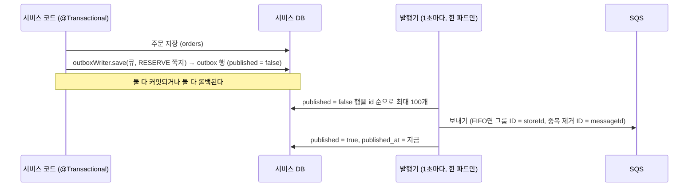

# common v0.2.0 인수인계: Outbox 발행기 + 멱등 처리

받는 분: 영훈님 · 작성: 김진아 · 2026-10-16

> **10/16 변경:** 영훈님이 10/16까지만 참여하게 되어 이 작업은 **김진아가 직접 10/17(토)에** 한다. 내용은 아래 그대로 따른다. '맡아 주실'·'영훈님' 같은 표현은 처음 쓴 문장 그대로 둔다.

> **맡아 주실 일은 하나입니다.** `common` v0.2.0에 **Outbox 발행기(E-03)** 와 **멱등 처리(E-04)** 를 넣습니다.
> 목표 완료일은 **10/17(토)** 입니다(처음엔 10/20). 경우님이 10/21에 order 단독 시험을 하고, 태우님이 RESERVE 처리(10/26~)에 바로 붙여 씁니다.
>
> 버전·환경·이름 규칙은 [백엔드-공통작업-인수인계.md](백엔드-공통작업-인수인계.md) 1장, 정해진 버전과 오류 처리는 [백엔드-공통-규칙.md](백엔드-공통-규칙.md)를 그대로 따릅니다. 쪽지 형식(인수인계 3-3)은 **이번에 바꾸지 않습니다.**

---

## 1. 왜 필요한가

inventory-service와 order-service는 "DB를 바꾸고 쪽지를 보내는" 일을 계속 합니다. 이 두 동작을 그냥 이어서 하면 두 가지 사고가 납니다.

| 사고 | 예 | 막는 방법 |
|---|---|---|
| DB는 바뀌었는데 쪽지가 안 감 | 주문은 `RESERVING`으로 저장됐는데 SQS 호출이 실패해서 RESERVE가 안 감. 주문이 영원히 "확인 중" | **Outbox (E-03).** 쪽지를 같은 트랜잭션으로 `outbox` 표에 적고, 발행기가 따로 꺼내 보낸다 |
| 같은 쪽지를 두 번 반영 | SQS는 "적어도 한 번" 전달이라 같은 RESERVE가 두 번 올 수 있다. 재고가 두 번 잡힘 | **멱등 처리 (E-04).** 처리한 `messageId`를 `processed_message`에 적고, 이미 있으면 건너뛴다 |

두 서비스가 똑같은 코드를 쓰므로 common에 한 번만 만듭니다. 각자 만들면 한쪽만 고쳐지는 사고가 납니다(git-계획 1장).

## 2. 범위

| 이번에 한다 (v0.2.0) | 이번에 안 한다 |
|---|---|
| `outbox` 표 정의 (`trace_parent` 칸 포함, 값 채우기는 v0.3.0) | SQS 메시지 속성 `traceparent` 보내고 이어받기 (v0.3.0, 17번 관측성과 같이) |
| 같은 트랜잭션 안에서 쪽지를 저장하는 `OutboxWriter` | SQS 리스너(`@SqsListener`) 코드. 받는 쪽은 각 서비스가 쓴다 |
| 1초마다 꺼내 보내는 발행기 (FIFO 그룹 ID·중복 제거 ID 포함) | 발행 완료 행 정리(삭제) 작업 |
| 파드 2개가 같은 쪽지를 같이 보내지 않게 하는 잠금 (ShedLock) | 발행 실패 횟수 세기·알림 (DLQ와 로그로 본다) |
| `processed_message` 표 + `ProcessedMessages.markIfNew(messageId)` | 쪽지 형식 변경, 새 쪽지 종류 |
| Spring Boot 자동 설정 (속성 하나로 켬) | `GlobalExceptionHandler`를 common으로 옮기기 (공통 규칙 6장 그대로) |
| 테스트 (Testcontainers MySQL + SQS 목) + dev 큐 실제 확인 | logistics-simulator 연동 (DB가 없어 Outbox를 쓰지 않는다. SQS로 바로 보낸다) |

**내가 정한 기본값 (다르게 하고 싶으면 PR에서 말해 주세요):**
- DB 접근은 **JPA가 아니라 `JdbcTemplate`** 으로 합니다. 라이브러리 안의 엔티티는 서비스의 엔티티 스캔 범위 밖이라 설정이 꼬이기 쉽고, 쿼리 두세 개면 끝나는 일입니다.
- 두 파드 중복 발행 대책은 **`SKIP LOCKED`가 아니라 ShedLock** 으로 합니다. `SKIP LOCKED`는 두 파드가 같은 점포의 쪽지를 나눠 가져가 **순서가 뒤바뀔 수 있습니다.** ShedLock은 한 번에 한 파드만 보내므로 저장한 순서(`id` 순)가 그대로 지켜집니다. inventory·order는 스케줄러 때문에 이미 ShedLock을 씁니다(aws-리소스-계획 7장).

## 3. 표 정의

표는 **각 서비스가 자기 Flyway 파일로** 만듭니다(공통 규칙 3장). common은 아래 DDL을 README에 싣고, 서비스 담당자가 그대로 복사해 `V<n>__outbox_processed_message.sql`로 넣습니다. common이 Flyway 파일을 들고 다니면 서비스 마이그레이션 번호와 섞여서 헷갈립니다.

```sql
CREATE TABLE outbox (
    id           BIGINT AUTO_INCREMENT PRIMARY KEY,
    message_id   VARCHAR(36)  NOT NULL,          -- 쪽지 messageId. FIFO 중복 제거 ID로도 쓴다
    message_type VARCHAR(30)  NOT NULL,          -- RESERVE, RESERVED … (로그·조회용)
    queue_name   VARCHAR(200) NOT NULL,          -- 실제 큐 이름. 예: dev-inventory-commands.fifo
    group_id     VARCHAR(64)  NULL,              -- FIFO면 storeId 문자열, 표준 큐면 NULL
    payload      TEXT         NOT NULL,          -- MessageJson.toJson(쪽지)
    trace_parent VARCHAR(55)  NULL,              -- v0.3.0에서 채운다. v0.2.0은 항상 NULL
    published    BOOLEAN      NOT NULL DEFAULT FALSE,
    created_at   DATETIME(6)  NOT NULL,
    published_at DATETIME(6)  NULL,
    UNIQUE KEY uk_outbox_message_id (message_id),
    KEY idx_outbox_unpublished (published, id)
);

CREATE TABLE processed_message (
    message_id   VARCHAR(36) PRIMARY KEY,
    processed_at DATETIME(6) NOT NULL
);
```

- 기획안 7장의 outbox 칸(id, queue_name, group_id, payload, published, created_at)에 `message_id`, `message_type`, `trace_parent`, `published_at`을 더했습니다. 기획안 7장도 같이 고칩니다.
- `trace_parent`를 지금 넣는 이유: v0.3.0에서 칸을 추가하면 두 서비스가 Flyway 파일을 한 번 더 써야 합니다. 비어 있는 칸 하나는 비용이 없습니다.
- `shedlock` 표는 common 범위가 아닙니다. 각 서비스가 자기 Flyway에 이미 넣거나 넣을 예정입니다.

## 4. 동작

### 4-1. 보내는 쪽 (Outbox)



- **`OutboxWriter.save(String queueName, BaseMessage message)`**
  - 트랜잭션 전파는 `MANDATORY`입니다. 트랜잭션 밖에서 부르면 바로 예외가 납니다. "같은 트랜잭션"을 실수로 빼먹지 못하게 하려는 것입니다.
  - `queueName`이 `.fifo`로 끝나면 `group_id = message.messageGroupId()`, 아니면 `NULL`.
  - `payload = MessageJson.toJson(message)`.
- **발행기**
  - common이 가진 스케줄러 스레드 1개로 돕니다. 서비스의 `@EnableScheduling`에 기대지 않습니다.
  - 매 회차를 ShedLock `LockingTaskExecutor`로 감쌉니다. 잠금 이름 `freshlink-outbox-publisher`, `lockAtMostFor` 30초. 서비스에 `LockProvider` 빈이 없으면 앱이 뜰 때 실패하게 합니다(조용히 두 파드가 같이 보내는 것보다 낫습니다).
  - 보내기는 Spring Cloud AWS의 `SqsTemplate`으로 합니다. 본문은 이미 JSON 문자열이므로 문자열 그대로 보냅니다.
  - 한 행을 보낼 때마다 `published = true`로 바꿉니다. **보내다 실패하면 그 회차를 거기서 멈춥니다.** 다음 행을 먼저 보내면 같은 점포 안에서 순서가 바뀝니다. 실패한 행은 다음 회차(1초 뒤)에 다시 보냅니다. 실패는 `WARN` 로그에 `message_id`, `queue_name`과 함께 남깁니다.
- **같은 쪽지가 두 번 나갈 수 있습니다.** 보냈는데 `published = true`로 바꾸기 전에 파드가 죽으면 다음 회차에 또 보냅니다. FIFO 큐는 5분 안의 같은 중복 제거 ID를 걸러 주지만, 표준 큐(`inventory-results`)는 그렇지 않습니다. 그래서 받는 쪽 멱등 처리(4-2)가 꼭 필요합니다. "Outbox = 적어도 한 번, 멱등 = 정확히 한 번 반영"으로 짝을 이룹니다.

### 4-2. 받는 쪽 (멱등)

- **`ProcessedMessages.markIfNew(String messageId)` → `boolean`**
  - 처음 보는 `messageId`면 `processed_message`에 적고 `true`, 이미 있으면 `false`.
  - 트랜잭션 전파는 `MANDATORY`입니다. **기록과 비즈니스 처리가 한 트랜잭션이어야** 처리 중 실패하면 기록도 같이 롤백되고, SQS가 다시 보낸 쪽지를 정상으로 처리합니다.
  - 구현은 `INSERT IGNORE INTO processed_message …` 후 **영향받은 행 수(1이면 새것, 0이면 중복)** 로 판단합니다.
  - ⚠ 중복 키 예외(`DuplicateKeyException`)를 잡아서 판단하는 방식은 쓰지 않습니다. 예외가 `@Transactional` 경계를 지나면 바깥 트랜잭션이 롤백 전용으로 표시되어, 건너뛰려던 쪽지 처리가 커밋 단계에서 실패합니다.
  - ⚠ `INSERT … ON DUPLICATE KEY UPDATE`도 쓰지 않습니다. MySQL 드라이버 기본 설정에서는 중복이어도 행 수 1을 돌려줄 수 있습니다.
- 두 파드가 같은 쪽지를 동시에 받으면, 뒤에 온 쪽의 `INSERT IGNORE`가 앞 트랜잭션이 끝날 때까지 기다립니다. 앞이 커밋하면 뒤는 0(건너뜀), 앞이 롤백하면 뒤는 1(처리)입니다. 따로 잠글 필요가 없습니다.

### 4-3. 서비스에서 쓰는 모습

```java
// 받기: 리스너는 얇게, 처리는 @Transactional 서비스 메서드에서
@SqsListener("${app.queue.commands}")
void onCommand(String body) {
    reservationService.handle(MessageJson.fromJson(body));
}

@Transactional
public void handle(BaseMessage message) {
    if (!processedMessages.markIfNew(message.messageId())) {
        return;                                   // 이미 처리한 쪽지
    }
    if (message instanceof ReserveMessage r) {
        // FEFO로 재고를 잡는다 …
        outboxWriter.save(resultsQueue, ReservedMessage.of(/* … */));   // 같은 트랜잭션
    }
}
```

```java
// 보내기만 할 때 (order: 주문 저장 + RESERVE)
@Transactional
public Order create(...) {
    Order order = orderRepository.save(...);
    outboxWriter.save(commandsQueue, ReserveMessage.of(order.getId(), storeId, productId, quantity));
    return order;
}
```

- `commandsQueue`, `resultsQueue`는 `@Value("${app.queue.commands}")`처럼 설정 값으로 받습니다(인수인계 1-3). common은 큐 이름을 모릅니다.
- 처리 중 예외가 나면 트랜잭션이 롤백되고, 쪽지는 확인(ack)되지 않아 SQS가 다시 보냅니다. 계속 실패하면 DLQ로 갑니다. 쪽지 형식이 틀려서 절대 성공할 수 없는 경우도 같은 길로 DLQ에 쌓이게 둡니다.

### 4-4. 켜는 방법

```yaml
freshlink:
  messaging:
    enabled: true            # 기본 false. inventory·order만 켠다
    outbox:
      publish-interval: 1s   # 기본 1s
      batch-size: 100        # 기본 100
```

- `freshlink.messaging.enabled=true`일 때만 `OutboxWriter`, 발행기, `ProcessedMessages` 빈이 생깁니다. member-service와 logistics-simulator는 지금처럼 DTO·오류 응답만 씁니다.
- 자동 설정은 `META-INF/spring/org.springframework.boot.autoconfigure.AutoConfiguration.imports`에 등록합니다.

## 5. 클래스 구성과 빌드

```
com.freshlink.common
├── message/ …                     # v0.1.x 그대로
├── error/ …                       # v0.1.x 그대로
├── outbox/
│   ├── OutboxWriter               # save(queueName, message). 전파 MANDATORY
│   ├── OutboxPublisher            # 1초 회차, ShedLock, SqsTemplate
│   └── OutboxProperties           # publish-interval, batch-size
├── idempotency/
│   └── ProcessedMessages          # markIfNew(messageId). 전파 MANDATORY
└── autoconfigure/
    └── MessagingAutoConfiguration # freshlink.messaging.enabled=true일 때만
```

**의존성 원칙이 바뀝니다.** v0.1.x는 "Spring 의존성 없음"이었습니다. v0.2.0부터 Spring을 쓰지만 **전부 `compileOnly`** 로 둡니다. 서비스는 이미 이 의존성들을 갖고 있고, 버전은 같은 Boot 4.0.8 BOM이 맞춥니다. member-service·logistics-simulator에 JDBC·SQS가 끌려 들어가지 않습니다.

| 의존성 | 범위 | 비고 |
|---|---|---|
| `tools.jackson.core:jackson-databind` | `api` | 지금 그대로 |
| `spring-boot-autoconfigure`, `spring-jdbc`, `spring-tx` | `compileOnly` | Boot 4.0.8 BOM |
| `io.awspring.cloud:spring-cloud-aws-starter-sqs` | `compileOnly` | 4.x 중 Boot 4.0과 호환되는 최신. 정한 버전을 PR에 적는다 |
| `net.javacrumbs.shedlock:shedlock-spring` | `compileOnly` | 서비스가 쓰는 버전과 맞춘다. 태우님·경우님께 확인 |
| Testcontainers MySQL 8.4, Spring Boot Test | `testImplementation` | |

- 쓰려는 서비스는 `spring-cloud-aws-starter-sqs`, `spring-boot-starter-jdbc`(JPA를 쓰면 이미 있음), ShedLock(`shedlock-spring` + `shedlock-provider-jdbc-template`)을 갖고 있어야 합니다. README에 적어 주세요.
- `build.gradle`의 SNAPSHOT 기본값을 `0.2.0-SNAPSHOT`으로, `pom.description`에 Outbox·멱등 처리를 더합니다.

## 6. 테스트

DB는 Testcontainers MySQL 8.4, SQS는 `SqsTemplate` 목으로 합니다. CI(`build.yml`)에서 그대로 돕니다.

**Outbox**
- 트랜잭션 안에서 `save` → 커밋하면 `outbox` 행 1개, `published = false`.
- 같은 트랜잭션이 롤백되면 `outbox` 행이 없다.
- 트랜잭션 밖에서 `save`를 부르면 예외.
- FIFO 큐 이름이면 `group_id = "1"`(storeId 1), 표준 큐면 `NULL`.
- 발행기 한 회차 → `SqsTemplate`에 저장 순서대로 보내고, 그룹 ID·중복 제거 ID(= messageId)가 맞고, `published = true`.
- 세 행 중 두 번째에서 보내기 실패 → 첫 번째만 `published = true`, 세 번째는 시도하지 않음. 다음 회차에 두 번째부터 다시 보냄.
- 잠금을 다른 쪽이 잡고 있으면 그 회차는 아무것도 보내지 않는다.

**멱등**
- 같은 `messageId`로 `markIfNew` 두 번 → `true`, `false`.
- `markIfNew` 후 트랜잭션 롤백 → 다시 부르면 `true`.
- 중복이어서 `false`가 나와도 바깥 트랜잭션이 정상 커밋된다(롤백 전용으로 바뀌지 않는다).

**자동 설정**
- `freshlink.messaging.enabled`가 없으면 빈이 하나도 생기지 않는다.
- 켰는데 `LockProvider`가 없으면 앱이 뜰 때 실패한다.

**dev 큐 실제 확인 (한 번, 손으로)**
- 시험용 앱(테스트 코드나 태우님 inventory 브랜치)에서 `dev-taewoo-inventory-commands.fifo`로 쪽지 하나를 Outbox로 보내고, AWS 콘솔이나 CLI로 받아 본문·그룹 ID를 확인합니다. 개인 큐 사용법은 [개발환경-접속.md](개발환경-접속.md)에 있습니다. 영훈님 IAM 사용자로 이 큐에 권한이 없으면 김진아에게 말해 주세요.

## 7. 완료 기준

- `./gradlew build`가 통과하고, 6장 테스트가 모두 있습니다.
- README 2장 "v0.2.0에 들어올 것"을 "들어 있는 것"으로 바꾸고, 3장 DDL·4-3 사용 예·4-4 설정·필요한 의존성을 싣습니다.
- `v0.2.0`이 GitHub Packages에 있습니다(태그는 김진아).
- 태우님·경우님이 각자 서비스에 `implementation 'com.freshlink:common:0.2.0'`을 넣고 dev 큐로 쪽지 한 바퀴를 확인합니다(E-03·E-04 완료 기준).

## 8. 올리는 순서

1. `common`의 `dev`에서 브랜치 `feat/E-03-outbox-idempotency`를 만듭니다.
2. `dev` 대상 PR을 엽니다. PR 설명에 정한 Spring Cloud AWS·ShedLock 버전과 2장 기본값을 바꿨는지 적습니다. 쪽지 형식은 안 바뀌므로 `message-spec` 라벨은 붙이지 않습니다.
3. 김진아가 리뷰하고 합친 뒤 `v0.2.0` 태그를 push합니다.
4. 김진아가 태우님·경우님께 버전이 나왔다고 알립니다. 두 분은 3장 DDL을 자기 Flyway에 넣고 4-4 설정을 켭니다.
5. 서비스가 SQS로 보내려면 IRSA 역할에 해당 큐의 `sqs:SendMessage` 권한이 있어야 합니다. 이건 infra 쪽 일이라 김진아가 맞춥니다.

## 9. 하지 말아 주세요

- 쪽지 형식(인수인계 3-3) 바꾸기. 이번 범위가 아닙니다.
- 큐 이름을 코드에 넣기. 항상 설정 값으로 받습니다.
- `OutboxWriter`·`ProcessedMessages`를 트랜잭션 없이도 돌게 만들기(`REQUIRED`·`REQUIRES_NEW`로 바꾸기). 이 라이브러리의 핵심이 "같은 트랜잭션"입니다.
- 발행 실패 시 다음 행으로 넘어가기. 같은 점포 안에서 순서가 바뀝니다.
- Spring·SQS 의존성을 `api`·`implementation`으로 두기. 쓰지 않는 서비스까지 끌려옵니다.
- `main`·`dev`에 직접 push, force push, 태그 만들기.

## 10. Claude Code로 진행한다면

(선택) `common` 레포 `.claude/`에 백엔드 에이전트를 복사해 두었다면([ai-agents.md](ai-agents.md) 2장, 2026-10-28부터 플러그인 대신 이 방식), `common` 레포 폴더에서 Claude Code를 열고 이렇게 시작하면 됩니다.

```
.github 레포 docs/common-v0.2.0-인수인계.md 를 읽어.
backend-pipeline 스킬 순서대로 common v0.2.0(Outbox·멱등)을 진행해.
2장 기본값, 4장 동작, 9장 금지 사항을 그대로 지키고, 커밋·push·PR은 내가 말할 때만 해.
```

## 11. 물어볼 곳

- inventory에서 쪽지를 받고 결과를 보내는 흐름, ShedLock 설정, 개인 큐: 이태우
- order에서 주문 저장과 RESERVE·CONFIRM·RELEASE를 보내는 흐름, 10/21 시험: 김경우
- 범위, 기본값 변경, 버전·태그, IAM·큐 권한, 그 밖의 모든 것: 김진아
