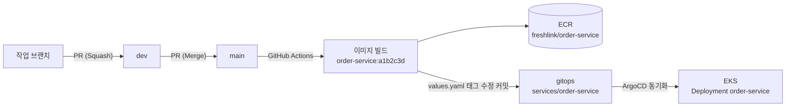

# FreshLink Git 계획

작성일: 2026-10-12 · 기준: [기획안-및-설계도.md](./기획안-및-설계도.md)

GitHub Organization을 만들고 MSA 서비스별로 레포를 나눌 때 쓸 이름과 규칙을 정리했다. 결론은 **Organization `sesac-freshlink` + 레포 10개 + 기존 브랜치 규칙(`main` ← `dev` ← `feat/기능ID-설명`) 유지**다.

이름을 정할 때 지킨 원칙은 세 가지다.

1. **하나의 이름이 끝까지 간다.** 레포 이름 = ECR 리포지토리 = Docker 이미지 = Helm 릴리스 = K8s Deployment·Service = ArgoCD Application. 어디서 보든 같은 이름이면 "이 파드는 어느 레포 코드냐"를 따로 찾을 필요가 없다.
2. **전부 영어 소문자 + 하이픈(kebab-case).** 한글·대문자·언더스코어는 쓰지 않는다. K8s 리소스 이름과 ECR 이름 규칙이 이걸 요구한다.
3. **Organization이 이미 `freshlink`를 말해 주므로 레포 이름에는 접두사를 붙이지 않는다.** `sesac-freshlink/order-service`이지 `sesac-freshlink/freshlink-order-service`가 아니다.

---

## 1. Organization 이름

**결정: `sesac-freshlink`** (2026-10-12 생성). 주소는 https://github.com/orgs/sesac-freshlink 이고, 레포는 `sesac-freshlink/<레포 이름>` 경로가 된다.

아래는 정하기 전에 검토했던 후보다.

| 후보 | 장점 | 단점 |
| --- | --- | --- |
| `freshlink` | 가장 짧고 깔끔하다 | 이미 누가 쓰고 있을 가능성이 높다 |
| `freshlink-dev` | 짧고, '개발 조직'이라는 뜻이 분명하다. 흔히 쓰는 패턴이라 어색하지 않다 | 없음 |
| `freshlink-team` | 팀 프로젝트라는 느낌이 산다 | 조금 길다 |
| `freshlink-msa` | 아키텍처를 이름에서 드러낸다 | 구조가 바뀌면 이름이 어색해진다 |
| `team-freshlink` | 의미는 같다 | 목록에서 `team-`으로 정렬돼 찾기 어렵다 |

Organization 표시 이름(Display name)은 `FreshLink`로 둔다. URL에 쓰이는 계정 이름과 화면에 보이는 이름은 따로다.

---

## 2. 레포 목록

| 레포 | 내용 | 담당 | 배포 대상 |
| --- | --- | --- | --- |
| `gateway` | Spring Cloud Gateway, 라우팅·JWT 검증(Cognito JWKS, RS256) | 김진아 | ECR → EKS |
| `member-service` | 회원 프로필·점포 (로그인·토큰 발급은 Amazon Cognito) | 김경우 | ECR → EKS |
| `inventory-service` | 상품·재고·입고·예약·폐기 | 이태우 | ECR → EKS |
| `order-service` | 주문·결제·Saga | 김경우 | ECR → EKS |
| `logistics-simulator` | 가상 물류센터, INBOUND 쪽지 발행 | 김진아 | ECR → EKS |
| `frontend` | React (점주 `/owner`, 고객 `/customer`) | 공통 (레이아웃: 김진아) | S3 + CloudFront |
| `common` | 공통 모듈: Outbox 발행기, 멱등 처리, 메시지 DTO | 김진아 | GitHub Packages (Maven) |
| `infra` | Terraform (persistent / cluster 묶음) | 김진아 | `terraform apply` |
| `gitops` | Helm 차트 + 서비스별 values + ArgoCD Application | 김진아 | ArgoCD가 읽어 감 |
| `.github` | Organization 소개(README), 공통 PR·이슈 템플릿, 공통 GitHub Actions 워크플로 | 김진아 | 없음 |

### 2-1. 이렇게 나눈 이유

- **서비스 5개는 각자 레포.** MSA에서 서비스를 나눈다는 건 배포 단위를 나누는 것이다. 레포가 나뉘어야 "order만 고쳐서 order만 배포"가 된다.
- **`common`은 별도 레포 + 라이브러리 배포.** inventory와 order가 같은 Outbox·멱등 코드를 쓴다. 복사해서 쓰면 한쪽만 고쳐지는 사고가 난다. `common`을 GitHub Packages에 버전을 붙여 올리고, 각 서비스는 `build.gradle`에서 버전을 지정해 가져다 쓴다.
- **`infra`와 `gitops`를 나눈다.** `infra`는 "AWS에 무엇이 있는가"(VPC, EKS, RDS, SQS), `gitops`는 "클러스터 안에 무엇이 떠 있는가"(파드 개수, 이미지 버전, 환경 변수)다. 바뀌는 주기와 위험도가 다르다. 이미지 태그 하나 바꿀 때마다 Terraform 레포를 건드리지 않게 한다.
- **`frontend`는 하나.** 점주·고객 화면이 한 React 앱 안에서 라우팅으로 나뉘어 있으므로 레포도 하나다.

### 2-2. 레포 안 폴더 구조 (서비스 외)

```
infra/
├── modules/           # network, eks, irsa, rds, messaging, frontend, ecr, budget, observability, scheduler, cognito
├── persistent/        # 유지 묶음: VPC, RDS, ECR, S3·CloudFront, SQS, IAM, Budgets, Cognito
└── cluster/           # 클러스터 묶음: EKS, 노드 그룹, NAT, Helm(ArgoCD, LB Controller)

gitops/
├── charts/
│   └── spring-service/     # 서비스 5개가 같이 쓰는 Helm 차트 (probe, JVM 옵션, 리소스 기본값)
├── services/
│   ├── gateway/values.yaml
│   ├── member-service/values.yaml
│   ├── inventory-service/values.yaml
│   ├── order-service/values.yaml
│   └── logistics-simulator/values.yaml
└── argocd/
    ├── root-app.yaml       # App of Apps
    └── apps/               # 서비스별 Application
```

`persistent`와 `cluster`는 Terraform state 키를 따로 둔다(`persistent/terraform.tfstate`, `cluster/terraform.tfstate`). 그래야 금요일에 `cluster`만 지워도 RDS·ECR은 그대로 남는다.

### 2-3. PC 폴더 배치

모든 레포를 한 폴더 아래에 나란히 받는다.

```
C:\fresh-link\
├── gateway\
├── member-service\
├── inventory-service\
├── order-service\
├── logistics-simulator\
├── frontend\
├── common\
├── infra\
├── gitops\
└── docs\              # 기획안·설계도 (레포 아님, 또는 .github 레포로 옮김)
```

---

## 3. 이름을 맞춰야 하는 곳

레포 이름 하나가 아래 전부에 그대로 쓰인다.

| 위치 | 이름 | 예 (`order-service`) |
| --- | --- | --- |
| GitHub 레포 | 레포 이름 | `sesac-freshlink/order-service` |
| ECR 리포지토리 | 레포 이름 | `freshlink/order-service` |
| 이미지 태그 | `<git 커밋 7자리>` | `freshlink/order-service:a1b2c3d` |
| Helm 릴리스 · Deployment · Service | 레포 이름 | `order-service` |
| ArgoCD Application | 레포 이름 | `order-service` |
| K8s 네임스페이스 | `freshlink` (전체 공통) | `freshlink` |
| IRSA IAM Role | `freshlink-<레포>-irsa` | `freshlink-order-service-irsa` |
| ServiceAccount | 레포 이름 | `order-service` |
| Spring `application.name` | 레포 이름 | `order-service` |
| Java 패키지 | `com.freshlink.<서비스 짧은 이름>` | `com.freshlink.order` |
| DB 스키마 · DB 사용자 | 서비스 짧은 이름 | `orders` · `order_app` |

> **설계도 수정 필요:** 설계도 2장의 ECR 리포지토리는 `gateway, member, inventory, order, simulator`로 줄인 이름이다. 위 원칙대로 `gateway, member-service, inventory-service, order-service, logistics-simulator`로 바꾸는 것을 권장한다. Terraform `ecr` 모듈을 만들기 전에 정해야 나중에 이름을 옮기는 일이 없다.

DB 스키마만 짧은 이름을 쓰는 이유: 하이픈이 들어간 MySQL 스키마 이름은 매번 백틱으로 감싸야 한다. `order`는 SQL 예약어라 `orders`로 둔다(설계도 4장과 같음).

AWS 리소스 이름은 접두사 `freshlink-`를 붙인다. 한 AWS 계정에 다른 실습 리소스가 섞여도 구분된다.

| 리소스 | 이름 |
| --- | --- |
| EKS 클러스터 | `freshlink-eks` |
| RDS | `freshlink-mysql` |
| SQS | `inventory-commands.fifo`, `inventory-results`, `inventory-commands-dlq.fifo`, `inventory-results-dlq` (기획안 5장과 같음) |
| S3 (프론트) | `freshlink-frontend-<계정ID 끝 4자리>` (S3 이름은 전 세계에서 유일해야 함) |
| S3 (Terraform state) | `freshlink-tfstate-<계정ID 끝 4자리>` |

---

## 4. 브랜치 규칙

### 4-1. 기본 흐름 (서비스 5개, `frontend`, `common`)

기존 규칙을 그대로 쓴다.

```
main (배포)  ←  dev (통합)  ←  feat/기능ID-설명
```

| 브랜치 | 용도 | 누가 만드나 | 지워지나 |
| --- | --- | --- | --- |
| `main` | EKS에 배포된 코드. 합치면 자동 배포 | 레포 생성 시 | 영구 |
| `dev` | 기능을 모아 통합 테스트하는 곳 | 레포 생성 시 | 영구 |
| `feat/<기능ID>-<설명>` | 기능 개발 | 각자 | 합치면 자동 삭제 |
| `fix/<기능ID>-<설명>` | 버그 수정 | 각자 | 합치면 자동 삭제 |
| `refactor/<설명>` | 동작은 그대로, 코드 정리 | 각자 | 합치면 자동 삭제 |
| `chore/<설명>` | 빌드 설정, 의존성, CI 등 기능 외 작업 | 각자 | 합치면 자동 삭제 |
| `docs/<설명>` | README, 문서 | 각자 | 합치면 자동 삭제 |
| `hotfix/<설명>` | `main`에서 바로 고쳐야 하는 긴급 수정. `main`에서 따고, 합친 뒤 `dev`에도 반영 | 레포 담당자 | 합치면 자동 삭제 |

### 4-2. 브랜치 이름 쓰는 법

- **기능 ID는 기획안 6장의 ID를 그대로** 쓴다. 대문자 + 하이픈: `S-32`, `U-21`, `E-03`, `I-01`.
- **설명은 영어 소문자 kebab-case, 2~4단어.** 한글은 쓰지 않는다. 터미널·URL에서 깨지기 쉽다.
- 기능 ID가 없는 작업(빌드 설정, 리팩터링)은 ID를 빼고 설명만 쓴다.

| 좋은 예 | 나쁜 예 | 이유 |
| --- | --- | --- |
| `feat/S-32-disposal` | `feat/폐기처리` | 한글 |
| `feat/U-21-create-order` | `feat/u21_CreateOrder` | ID 형식, 대문자·언더스코어 |
| `fix/E-04-duplicate-message` | `fix/bug` | 무엇을 고쳤는지 모름 |
| `chore/gradle-common-dependency` | `jina-work` | 종류·내용 없음, 사람 이름 |

### 4-3. 레포별 예외

| 레포 | 브랜치 | 이유 |
| --- | --- | --- |
| `infra` | `main` ← `feat/I-xx-설명` (dev 없음) | 클러스터가 하나뿐이라 '통합 환경'이 따로 없다. PR에 `terraform plan` 결과를 붙이고, 합친 뒤 `apply`한다 |
| `gitops` | `main`만 | `main`이 곧 '클러스터에 떠 있어야 할 상태'다. 이미지 태그 변경은 CI가 자동으로 커밋하고, 사람이 바꾸는 값(파드 수, 환경 변수)은 담당자가 직접 커밋한다 |
| `.github` | `main` ← 작업 브랜치 | 배포가 없다 |

### 4-4. 브랜치 보호 (레포마다 규칙 세트로 건다)

**결정 (2026-10-12): PR과 승인은 필수가 아니다.** MSA라 레포마다 담당자가 끝까지 책임지기로 했다. 담당자는 `main`·`dev`에 직접 push할 수 있다. PR은 리뷰를 받고 싶을 때나 남의 레포를 고칠 때 쓴다. 쪽지 형식이 바뀌는 변경(`message-spec`)은 push 전에 상대 담당자에게 꼭 알린다.

| 브랜치 | 규칙 |
| --- | --- |
| `main` | 직접 push 가능, PR·승인 필수 없음. 강제 push·브랜치 삭제만 금지 |
| `dev` | 직접 push 가능, PR·승인 필수 없음. 강제 push·브랜치 삭제만 금지 |
| 작업 브랜치 | 제한 없음. 합치면 자동 삭제 (레포 설정 'Automatically delete head branches' 켜기) |

합치는 방식은 **작업 브랜치 → `dev`: Squash merge**, **`dev` → `main`: Merge commit**으로 한다. 기능 하나가 `dev`에 커밋 하나로 남아 이력이 깔끔해지고, `main`에는 '언제 배포했는지'가 머지 커밋으로 남는다.

---

## 5. 커밋 메시지 · PR · 이슈

### 5-1. 커밋 메시지

```
<종류>(<기능ID>): <한글 요약>
```

| 예 | 설명 |
| --- | --- |
| `feat(S-32): 폐기 API 추가` | 기능 |
| `fix(E-04): 같은 messageId 중복 반영 수정` | 버그 |
| `refactor: 재고 계산 로직 분리` | ID 없는 작업 |
| `chore: common 0.2.0으로 올림` | 설정·의존성 |
| `docs: dev 환경 실행 방법 추가` | 문서 |

종류(`feat`, `fix`, `refactor`, `chore`, `docs`, `test`)는 브랜치 접두사와 같은 단어를 쓴다. 요약은 한글로 써도 된다. 브랜치 이름과 달리 커밋 메시지는 사람이 읽는 글이다.

### 5-2. PR

- **제목:** 커밋 메시지와 같은 형식. `feat(S-32): 폐기 처리`. Squash merge하면 PR 제목이 `dev`의 커밋 메시지가 된다.
- **본문:** `.github` 레포의 공통 PR 템플릿을 쓴다. 항목은 `관련 기능 ID`, `무엇을 바꿨나`, `확인 방법`(Swagger 캡처, 로그 등), `남길 말`. 승인 없이 담당자가 직접 합친다.
- **`dev` → `main` PR 제목:** `release: 2026-10-24 배포` (날짜로 쓴다).

### 5-3. 이슈 · 프로젝트 보드

- 이슈 제목: `[S-32] 폐기 처리`. 기능 하나 = 이슈 하나.
- Organization 단위 GitHub Project 보드 `FreshLink MVP`를 하나 만들고 모든 레포의 이슈를 모은다. 열은 `Todo` / `In Progress` / `Review` / `Done`.
- PR 본문에 `Closes sesac-freshlink/inventory-service#12`처럼 쓰면 합칠 때 이슈가 자동으로 닫힌다.

### 5-4. 라벨 (Organization 기본 라벨로 등록)

| 라벨 | 용도 |
| --- | --- |
| `feat`, `fix`, `refactor`, `chore`, `docs` | 작업 종류 (브랜치 접두사와 같음) |
| `priority:mvp` | 1순위 기능 |
| `blocked` | 다른 사람 작업을 기다리는 중 |
| `message-spec` | 쪽지 형식이 바뀌는 PR. 이태우·김경우 둘 다 리뷰해야 함 |

---

## 6. 버전 · 태그

| 대상 | 규칙 | 예 |
| --- | --- | --- |
| `common` 라이브러리 | SemVer 태그 `vMAJOR.MINOR.PATCH`. 태그를 달면 GitHub Packages에 배포 | `v0.1.0` → `v0.2.0` |
| 서비스 이미지 | git 커밋 7자리. `latest`는 쓰지 않는다 | `order-service:a1b2c3d` |
| 서비스 릴리스 (선택) | 시연 전 `main`에 날짜 태그 | `release-2026-11-07` |

`common` Maven 좌표는 `com.freshlink:common:<버전>`으로 한다. `common` 0.x 버전 동안은 쪽지 형식이 바뀔 수 있으므로, 버전을 올릴 때 inventory·order 담당자에게 알린다(기획안 8-2 '메시지 명세' 규칙과 같음).

`latest`를 쓰지 않는 이유: ArgoCD는 values의 이미지 태그가 바뀌어야 새 버전을 배포한다. 태그가 계속 `latest`면 변경을 감지하지 못하고, 어느 코드가 떠 있는지도 알 수 없다.

---

## 7. CI/CD 흐름과 이름의 연결



- 공통 빌드 워크플로는 `.github` 레포에 재사용 워크플로(`spring-build.yml`, `frontend-deploy.yml`)로 두고, 각 서비스 레포는 몇 줄로 불러 쓴다. 서비스 5개가 같은 빌드 파일을 복사해 두면 하나 고칠 때 다섯 번 고쳐야 한다.
- 이미지를 올린 뒤 `gitops` 레포의 `services/<레포>/values.yaml` 이미지 태그를 바꾸는 커밋을 CI가 자동으로 만든다. 커밋 메시지는 `chore(order-service): image a1b2c3d`.
- `frontend`는 `main`에 합치면 빌드 → S3 업로드 → CloudFront 무효화 순서로 바로 배포한다(기획안 3-5와 같음).

---

## 8. 권한 · 팀

| GitHub 팀 | 사람 | 권한 |
| --- | --- | --- |
| `maintainers` | 김진아 | Organization Owner, 모든 레포 Admin |
| `backend` | 이태우, 김경우, 김진아 | 서비스 5개·`common`·`frontend` Write |
| `infra` | 김진아 (+ 리뷰용으로 이태우, 김경우 Read) | `infra`·`gitops` Write |

각 레포에 `CODEOWNERS`를 둬서 레포 담당자를 표시한다. PR을 열 경우 담당자가 리뷰어로 자동 지정되어 알림을 받는다.

| 레포 | CODEOWNERS |
| --- | --- |
| `inventory-service` | 이태우 |
| `member-service`, `order-service` | 김경우 |
| `gateway`, `logistics-simulator`, `common`, `infra`, `gitops` | 김진아 |
| `frontend` | `/src/owner/inventory/**` 이태우 · `/src/customer/order/**` 김경우 · 나머지 김진아 |

PR 필수, 승인 필수, CODEOWNERS 승인 필수는 걸지 않는다. 담당자가 자기 레포에 직접 push한다(기획안 8-2 규칙, 2026-10-12 결정).

시크릿(AWS 키, 토스 테스트 키)은 **Organization Secret**으로 한 번만 등록하고, 쓰는 레포에만 공개한다. AWS는 키 대신 GitHub OIDC로 IAM Role을 맡게 하는 것을 권장한다. JWT 서명 키는 없다. 로그인 토큰은 Amazon Cognito가 서명하고 Gateway는 공개 키(JWKS)로 검증하므로 공유할 비밀 키가 없다(2026-10-13 변경). User Pool ID와 앱 클라이언트 ID는 비밀이 아니므로 설정 값으로 둔다.

---

## 9. 만드는 순서

1. Organization `sesac-freshlink` 생성(2026-10-12 완료), 팀원 초대, 팀 3개 생성
2. `.github` 레포: Organization README, PR·이슈 템플릿, 라벨
3. 레포마다 `main`·`dev` 보호 규칙 적용 (강제 push·브랜치 삭제 금지만. 직접 push 허용)
4. `common`, `infra`, `gitops` 생성 (1~2주 차에 김진아가 먼저 끝낼 것들)
5. 서비스 5개 + `frontend` 생성, 각 레포에 `dev` 브랜치 만들고 기본 브랜치를 `dev`로 설정
6. 설계도 2장 ECR 이름을 3장 표대로 수정
7. Project 보드 `FreshLink MVP` 생성, 기획안 6장 기능 ID마다 이슈 등록

> 기본 브랜치를 `dev`로 두면 PR을 열 때 대상이 자동으로 `dev`가 되어 실수로 `main`에 PR을 올리는 일이 줄어든다. `infra`, `gitops`는 `main`이 기본 브랜치다.
