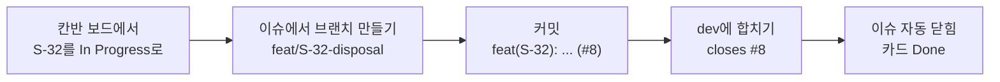

# FreshLink 프로젝트 보드 사용법

작성일: 2026-10-12 · 보드: [FreshLink MVP](https://github.com/orgs/sesac-freshlink/projects/1)

이 문서는 GitHub 프로젝트 보드를 **Jira처럼** 쓰는 방법을 정리한 것이다. 이슈, 브랜치, 커밋, 보드를 어떻게 연결하는지, 그리고 매일 어떤 순서로 쓰면 되는지를 담았다.

**결론부터:** 연동된다. 커밋 메시지에 이슈 번호를 쓰면 이슈에 커밋이 자동으로 붙고, `closes #8`처럼 쓰면 push할 때 이슈가 닫히면서 보드 카드가 **Done**으로 옮겨진다. 이슈 화면에서 브랜치를 만들면 그 브랜치도 이슈에 연결된다.

---

## 1. 보드 구성

### 1-1. 무엇이 들어 있나

- 기획안 6장의 기능 **30개가 이슈 하나씩** 등록되어 있다. 이슈는 담당 레포에 있다(예: `[S-32] 폐기 처리`는 inventory-service).
- 모든 이슈에는 담당자, `feat`·`priority:mvp` 라벨이 달려 있다.
- 보드 하나가 레포 10개의 이슈를 모아서 보여 준다.

### 1-2. 칸(필드)

| 칸 | 값 | 쓰는 법 |
| --- | --- | --- |
| Status | Todo / In Progress / Review / Done | 진행 상태. 칸반 보드에서 카드를 끌어 옮긴다 |
| 마감일 | 날짜 | 언제까지 끝낼지. 로드맵 화면에서 일정표로 보인다 |
| Assignees | 담당자 | 이슈에 지정된 사람 |
| Labels | `feat`, `fix`, `priority:mvp`, `blocked`, `message-spec` 등 | 이슈 라벨이 그대로 보인다 |
| Repository | 레포 이름 | 어느 서비스의 일인지 |

### 1-3. 화면(뷰)

| 화면 | 용도 |
| --- | --- |
| 표 | 30개를 한 번에 보고, 칸을 바로 고칠 때 |
| 칸반 보드 | 매일 아침 진행 상황 확인. 카드를 끌어 Status를 바꾼다 |
| 로드맵 | 마감일 기준 일정표. 누가 언제 무엇을 끝내는지 한눈에 |

### 1-4. Jira와 비교

| Jira | GitHub 프로젝트 |
| --- | --- |
| 프로젝트 | 프로젝트 보드 (`FreshLink MVP`) |
| 이슈 키 `FL-12` | 레포 + 번호 `inventory-service#8`. 제목 앞에 기능 ID `[S-32]` |
| 이슈 상태 | Status 칸 |
| Due date | 마감일 칸 |
| 담당자, 라벨 | Assignees, Labels |
| 브랜치·커밋 연동 (Development 패널) | 이슈 오른쪽 **Development** 영역 |
| 스마트 커밋 `FL-12 #done` | 커밋 메시지의 `closes #8` (닫기만 된다. 4-3 참고) |
| 자동화 규칙 | 보드의 **Workflows** (2장) |
| 보드 / 타임라인 | 칸반 보드 / 로드맵 화면 |

---

## 2. 처음 한 번 해 둘 설정 (김진아)

> **⚠️ 꼭 먼저 할 것:** 카드 자동 이동을 쓰려면 화면에서 한 번 켜야 한다. **GitHub API로는 켤 수 없다.** 2026-10-12 기준 보드의 자동화가 대부분 꺼져 있어서, **이대로면 이슈가 닫혀도 카드가 Done으로 가지 않는다.** 보드 오른쪽 위 `···` → **Workflows**에서 **Item closed**(→ Done)부터 켠다.

보드 오른쪽 위 `···` → **Workflows**에서 아래를 켠다. 하나씩 눌러 오른쪽 위 **Edit** → 상태값 선택 → **Save and turn on workflow**.

2026-10-12 현재 상태:

| 워크플로 | 현재 |
| --- | --- |
| Auto-add sub-issues to project | 켜짐 |
| Item closed | **꺼짐** |
| Pull request merged | 꺼짐 |
| Item added to project | 꺼짐 |
| Pull request linked to issue | 꺼짐 |
| Auto-close issue | 꺼짐 |

켜야 할 것:

| 워크플로 | 하는 일 | 설정 |
| --- | --- | --- |
| **Item closed** | 이슈가 닫히면 카드를 Done으로 | 켜기, Status = Done |
| **Pull request merged** | PR이 합쳐지면 Done으로 | 켜기, Status = Done |
| **Item added to project** | 새로 넣은 카드를 Todo로 | 켜기, Status = Todo |
| **Pull request linked to issue** | 이슈에 PR이 연결되면 Review로 | 켜기, Status = Review |
| **Auto-add to project** | 새 이슈를 자동으로 보드에 넣기 | 켜기, 레포 선택, 필터 `is:issue` |

> 무료 플랜에서는 Auto-add 워크플로를 레포 하나에만 걸 수 있다. 나머지 레포의 새 이슈는 이슈 화면 오른쪽 **Projects**에서 `FreshLink MVP`를 골라 넣는다.

---

## 3. 이슈와 브랜치 연결하기

### 3-1. 이슈 화면에서 브랜치 만들기 (추천)

1. 이슈를 연다 (예: inventory-service `[S-32] 폐기 처리`).
2. 오른쪽 **Development** → **Create a branch**를 누른다.
3. 이름을 규칙대로 고친다: `feat/S-32-disposal`. 기본 브랜치(`dev`)에서 딴다.
4. 안내대로 내 PC에 받는다.

```bash
git fetch origin
git checkout feat/S-32-disposal
```

이렇게 만든 브랜치는 이슈의 Development 영역에 **연결된 브랜치**로 표시된다.

### 3-2. 터미널에서 같은 일 하기

```bash
gh issue develop 8 -R sesac-freshlink/inventory-service --name feat/S-32-disposal --base dev --checkout
```

### 3-3. `dev`에 바로 push하지 않는다

우리 팀은 PR이 필수다(2026-10-16). 항상 작업 브랜치에서 PR을 열고, CI 빌드가 통과하면 합친다(AI 리뷰는 선택)(`CONTRIBUTING.md` 3장). 커밋 메시지에 이슈 번호를 쓰면 이슈와 연결된다(4장).

---

## 4. 커밋과 이슈 연결하기

### 4-1. 이슈 번호를 적으면 연결된다

커밋 메시지에 `#번호`를 쓰면, push했을 때 그 이슈 기록에 커밋이 자동으로 붙는다.

```bash
git commit -m "feat(S-32): 폐기 API 추가 (#8)"
```

- `#8`은 **같은 레포**의 8번 이슈다.
- 다른 레포 이슈는 전체 이름으로 쓴다: `sesac-freshlink/order-service#2`

### 4-2. 커밋으로 이슈 닫기 (보드에서 Done으로)

커밋 메시지에 아래 단어 중 하나와 이슈 번호를 쓴다.

`close`, `closes`, `closed`, `fix`, `fixes`, `fixed`, `resolve`, `resolves`, `resolved`

```bash
git commit -m "feat(S-32): 폐기 처리 완료

closes #8"
git push origin dev
```

**주의: 이슈가 닫히는 건 이 커밋이 레포의 기본 브랜치에 들어갔을 때뿐이다.**

| 레포 | 기본 브랜치 | 이슈가 닫히는 때 |
| --- | --- | --- |
| 서비스 5개, `frontend`, `common` | `dev` | `dev`에 push했을 때 |
| `infra`, `gitops`, `.github` | `main` | `main`에 push했을 때 |

작업 브랜치(`feat/...`)에 push한 것만으로는 닫히지 않는다. `dev`에 합친 순간 닫힌다.

### 4-3. Jira 스마트 커밋과 다른 점

GitHub는 커밋 메시지로 **이슈 닫기만** 할 수 있다. Jira의 `#in-progress`처럼 커밋으로 Status를 중간 단계로 옮기는 기능은 없다. 그래서 Todo → In Progress는 **칸반 보드에서 카드를 직접 끌어** 옮긴다.

### 4-4. PR을 쓸 때

PR 본문에 `Closes #8`을 쓰면 이슈와 연결되고(보드에서 Review), 기본 브랜치로 합치면 이슈가 닫힌다(Done).

---

## 5. 하루 사용 순서 (예: 이태우, S-32 폐기 처리)



1. **아침:** 칸반 보드에서 오늘 할 카드를 Todo → **In Progress**로 옮긴다.
2. **시작:** 이슈 화면에서 브랜치를 만든다(또는 `dev`에서 바로 작업).
3. **작업 중:** 커밋마다 메시지 끝에 `(#8)`을 붙인다. 이슈에 진행 기록이 쌓인다.
4. **막히면:** 카드에 `blocked` 라벨을 달고, 이슈에 무엇을 기다리는지 댓글로 남긴다.
5. **확인 받고 싶으면:** 카드를 **Review**로 옮기고 팀원을 이슈 댓글에서 `@아이디`로 부른다.
6. **끝:** `closes #8`이 들어간 커밋을 `dev`에 push(또는 브랜치를 `dev`에 합침). 이슈가 닫히고 카드가 **Done**으로 간다.

---

## 6. 자주 쓰는 필터

보드 위쪽 필터 칸에 입력한다.

| 보고 싶은 것 | 필터 |
| --- | --- |
| 내 일만 | `assignee:@me` |
| 재고 서비스 일만 | `repo:sesac-freshlink/inventory-service` |
| 막힌 일 | `label:blocked` |
| 아직 안 끝난 일 | `-status:Done` |
| 마감이 지난 일 | `마감일:<@today -status:Done` |

마감일 순서로 보려면 표 화면에서 **마감일** 칸 제목을 눌러 정렬한다.

---

## 7. 새 이슈 만들 때

- 제목: `[기능ID] 기능 이름` (예: `[S-32] 폐기 처리`). 기능 ID가 없으면 `[chore] 설명`.
- 이슈 템플릿(기능 / 버그)을 고르면 칸이 미리 채워져 있다.
- 오른쪽에서 Assignees, Labels, **Projects → FreshLink MVP**를 지정하고, 보드에서 마감일을 넣는다.

터미널로 만들 때:

```bash
gh issue create -R sesac-freshlink/inventory-service \
  -t "[S-33] 폐기 사유 입력" -l feat -a @me --project "FreshLink MVP"
```

---

## 8. 참고

- 브랜치·커밋 규칙: [CONTRIBUTING.md](https://github.com/sesac-freshlink/.github/blob/main/CONTRIBUTING.md)
- GitHub 문서: [이슈와 커밋·PR 연결](https://docs.github.com/ko/issues/tracking-your-work-with-issues/using-issues/linking-a-pull-request-to-an-issue), [Projects 자동화](https://docs.github.com/ko/issues/planning-and-tracking-with-projects/automating-your-project/using-the-built-in-automations)
