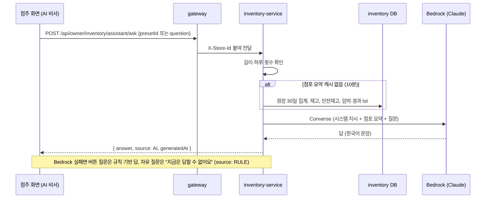

# AI 점주 비서 (Amazon Bedrock)

> 담당: 인프라 김진아 · 비서 API·화면 이태우 · 작성: 2026-11-13 · 상태: 설계 (코드 없음)

점주 화면에 **"AI 비서"** 를 더한다. 점주가 자기 점포에 대해 질문하면, inventory-service가 그 점포의 원장·재고·유통기한 숫자를 모아 Amazon Bedrock의 Claude에게 질문과 함께 넘기고, 답을 받아 보여 준다. 자주 묻는 질문 5개는 버튼으로 미리 두고, 직접 입력도 받는다. 시연(11/20)까지 작게 만든다.

---

## 1. 기능 정의

| 항목 | 내용 |
| --- | --- |
| 기능명 | AI 점주 비서 |
| 목적 | 점주가 표와 화면을 여러 개 오가지 않고, 말로 물어서 "오늘 할 일"과 발주 판단을 바로 얻는다 |
| 사용자 | 점주 (자기 점포 데이터만). 고객 화면에는 없다 |
| 질문 방식 | ① 자주 묻는 질문 5개 버튼 ② 직접 입력 (200자까지) |
| 답 | 한국어 짧은 답 (몇 문장 + 필요하면 상품 목록) |
| 화면 | 점주 화면의 AI 비서 패널 (이태우) |
| API | `POST /owner/inventory/assistant/ask` (inventory-service) |
| 완료 기준 | 시연 점포에서 질문 5개가 모두 원장·재고와 맞는 답을 내고, 점포 데이터와 상관없는 질문은 정중히 거절하고, Bedrock이 실패해도 화면이 멈추지 않는다 |

**자주 묻는 질문 5개 (버튼)**

| 번호 | 질문 | 답에 필요한 데이터 |
| --- | --- | --- |
| Q1 | 오늘까지 유통기한이 끝나는 상품 알려줘 | 임박·경과 lot (상품, 수량, 기한) |
| Q2 | 이번 달 매출 기준으로 더 발주해야 할 상품 알려줘 | 이번 달 상품별 판매, 남은 재고, 안전재고 |
| Q3 | 재고가 부족하거나 곧 떨어질 상품 알려줘 | 남은 재고, 안전재고, 최근 7일 하루 평균 판매 |
| Q4 | 시간대별로 잘 팔리는 상품 알려줘 | 최근 7일 시간대별 판매 |
| Q5 | 폐기가 많아서 덜 주문해야 할 상품 알려줘 | 최근 30일 입고·판매·폐기 |

**하지 않는 것**

- 비서가 무언가를 **실행**하기. 폐기, 입고, 가격 변경, 마감세일 등록은 하지 않고 답만 한다(도구 호출 없음).
- 대화 이어 가기. 질문 하나에 답 하나다. 앞 질문을 기억하지 않는다(시연 뒤 필요하면 더한다).
- 다른 점포나 고객 정보 답하기. 고객 이름·연락처·주문 번호는 AI에 보내지 않는다.
- 유통기한 자동 폐기에 AI 쓰기. 폐기는 지금처럼 규칙(기한 경과)으로 코드가 한다.
- Anthropic API 키, 개인 Max 계정 사용. AWS 계정 안의 Bedrock만 쓴다.

## 2. 구조: 점포 요약 + 질문

질문마다 다른 SQL을 짜지 않는다. **점포 하나의 숫자 요약(JSON)** 을 한 번 만들어 두고, 어떤 질문이든 그 요약과 질문을 같이 보낸다. 버튼 질문 5개와 자유 질문이 같은 코드 경로를 탄다.

| 할 일 | 누가 | 방법 |
| --- | --- | --- |
| 점포 요약 만들기 | 코드 | 원장(`SALE`·`INBOUND`·`DISPOSE`), lot, 안전재고를 SQL로 집계 (3장). 점포별 10분 캐시 |
| 질문에 답하기 | AI | 시스템 지시문 + 점포 요약 + 질문 → 답 |
| 범위 지키기 | AI + 코드 | 지시문에 "이 데이터로 답할 수 없는 질문은 모른다고 답한다"를 넣는다. 코드는 질문 길이(200자)와 점포당 하루 질문 수(예: 50번)를 막는다 |
| 숫자 정확도 | 코드 | 합계·평균·순위는 코드가 미리 계산해 요약에 넣는다. AI는 계산보다 골라 읽고 설명한다 |

AI에 도구(함수 호출)를 주는 방식(질문에 따라 AI가 "판매 조회", "lot 조회"를 골라 부른다)도 있지만, 시연까지는 요약 한 번 보내기가 단순하고 빠르다. 요약에 없는 질문이 많아지면 그때 바꾼다.

## 3. 쓰는 기술

| 무엇 | 쓰는 것 | 이유 |
| --- | --- | --- |
| AI 모델 | Amazon Bedrock의 Claude Sonnet 5.5 | 별도 API 키 없이 우리 AWS 계정 IAM으로 부른다. 비용이 AWS 청구서에 같이 잡힌다 |
| 모델 ID | `global.anthropic.claude-sonnet-5-5` (교차 리전 추론 프로필, 11/13 김진아 확정) | 서울 리전에는 최신 모델의 `apac.` 프로필이 없고 `global.`만 있다(11/13 확인). 여러 리전의 남는 용량으로 보내서 처리량 제한에 덜 걸린다 |
| 대안 모델 | `global.anthropic.claude-haiku-5-5` (더 싸다), `anthropic.claude-sonnet-5` (서울 단일 리전) | 환경 변수 `BEDROCK_MODEL_ID` 하나로 바꾼다. 셋 다 11/13 직접 호출해 응답을 확인했다 |
| 호출 방법 | AWS SDK for Java v2 `bedrockruntime`의 **Converse API** (`BedrockRuntimeClient.converse`) | 모델이 바뀌어도 요청 모양이 같다. Spring Cloud AWS와 같은 AWS SDK BOM 버전을 쓴다 |
| 권한 | 기존 inventory-service **IRSA** Role에 Bedrock 호출 권한 추가 | 키를 코드나 시크릿에 두지 않는다. 파드가 ServiceAccount로 Role을 맡는다 (다른 AWS 권한과 같은 방식) |
| 캐시 | 점포 요약: 점포별 10분. 버튼 질문 답: 점포 + 질문 번호별 10분 | 같은 버튼을 여러 번 눌러도 다시 부르지 않는다. 자유 질문은 캐시하지 않는다 |

### 3-1. 11/13 접근 확인 결과

PC에서 `freshlink-admin`으로 서울 리전(`ap-northeast-2`)에서 짧은 호출("Say OK")을 해 봤다.

| 모델 ID | 결과 |
| --- | --- |
| `global.anthropic.claude-sonnet-5-5` | 성공, 약 1초 |
| `global.anthropic.claude-haiku-5-5` | 성공, 약 1.3초 |
| `anthropic.claude-sonnet-5` (서울 단일 리전) | 성공, 약 0.8초 |

SeSAC 조직 정책(SCP)에 막히지 않았고, 모델 사용 신청서도 필요 없었다.

### 3-2. 인프라 (김진아)

**IAM (infra `envs/<env>/cluster/main.tf`의 `inventory_service` 정책에 한 문장 추가)**

```hcl
statement {
  sid     = "InvokeBedrockClaude" # AI 점주 비서 (11/13)
  actions = ["bedrock:InvokeModel", "bedrock:InvokeModelWithResponseStream"]
  resources = [
    # 추론 프로필 (서울 리전, 우리 계정)
    "arn:aws:bedrock:ap-northeast-2:${data.aws_caller_identity.current.account_id}:inference-profile/global.anthropic.claude-sonnet-5-5",
    "arn:aws:bedrock:ap-northeast-2:${data.aws_caller_identity.current.account_id}:inference-profile/global.anthropic.claude-haiku-5-5",
    # global 프로필이 실제로 보내는 기반 모델 (리전 칸이 비어 있는 형태 + 리전별 형태)
    "arn:aws:bedrock:::foundation-model/anthropic.claude-sonnet-5-5",
    "arn:aws:bedrock:*::foundation-model/anthropic.claude-sonnet-5-5",
    "arn:aws:bedrock:::foundation-model/anthropic.claude-haiku-5-5",
    "arn:aws:bedrock:*::foundation-model/anthropic.claude-haiku-5-5",
    # 서울 단일 리전 대안
    "arn:aws:bedrock:ap-northeast-2::foundation-model/anthropic.claude-sonnet-5",
  ]
}
```

- 모델 목록 보기, 학습(fine-tuning), 에이전트 같은 다른 Bedrock 권한은 주지 않는다. 위 모델만 부를 수 있다.
- 클러스터 묶음은 매일 아침 main 기준으로 다시 만들어지므로, 머지하면 다음 클러스터 생성 때 적용된다. 바로 쓰려면 cluster 워크플로를 한 번 돌린다.

**설정값 (gitops `envs/<env>/inventory-service/values.yaml`의 `env:`)**

```yaml
BEDROCK_MODEL_ID: "global.anthropic.claude-sonnet-5-5"
```

`AWS_REGION`과 자격 증명은 IRSA가 파드에 넣어 주므로 따로 넣지 않는다. 기능을 켤 때는 코드 배포 뒤 `ASSISTANT_ENABLED: "true"`를 dev부터 더한다(3-3).

### 3-3. 백엔드 (이태우)

1. 의존성: `software.amazon.awssdk:bedrockruntime` (Spring Cloud AWS가 쓰는 AWS SDK BOM과 같은 버전).
2. 설정: `BEDROCK_MODEL_ID`를 설정 클래스로 받는다. 로컬 실행처럼 값이 없으면 AI를 부르지 않고 4-3의 대체 답을 돌려준다.
3. 점포 요약: `X-Store-Id`의 점포 하나만 집계한다(4-1 모양). 점포별 10분 캐시.
4. 호출: `BedrockRuntimeClient.converse(...)`에 시스템 지시문(4-2) + 점포 요약 JSON + 질문을 보낸다. `maxTokens`는 1,000 정도.
5. 질문 하나 전체 25초 예산(CloudFront origin 응답 30초 안). 첫 호출 22초, 시간 초과면 재시도 없이 4-3의 대체 답, 스로틀링처럼 빨리 실패하면 남은 시간이 8초 이상일 때 한 번 재시도. 실패하면 로그를 남기고 대체 답을 돌려준다.
6. 막기: 질문 200자 초과는 400. 점포당 하루 50번을 넘으면 429 ("오늘 질문 횟수를 다 썼어요").
7. 동시 호출: 파드당 5개까지(세마포어). 넘으면 Bedrock을 부르지 않고 429 ("잠시 뒤 다시 물어봐 주세요").
8. 하루 횟수 세기: 1차는 파드별 메모리 카운트로 둔다. 파드가 2개라 실제 한도는 대략 두 배가 된다. 정확히 세야 하면 DB에 점포·날짜별 카운트 표를 둔다.
9. 켜고 끄기: `ASSISTANT_ENABLED`(기본 false)로 기능을 끈다. 꺼져 있으면 503을 돌려주고 화면은 AI 비서 메뉴를 숨긴다. 코드를 먼저 배포하고 dev에서 확인한 뒤 gitops values로 켠다.

## 4. 데이터 흐름



### 4-1. Bedrock에 보내는 점포 요약 (개인정보 없음)

```json
{
  "store": { "storeId": 1, "now": "2026-11-20T14:05:00+09:00" },
  "products": [
    {
      "productId": 12, "name": "매운 컵라면 115g", "category": "라면", "price": 1500,
      "available": 3, "safetyStock": 5,
      "soldThisMonth": 118, "soldLastMonth": 140,
      "dailySales14d": [4, 6, 5, 3, 7, 6, 5, 4, 6, 8, 5, 6, 7, 6],
      "inbound30d": 150, "disposed30d": 0,
      "salesByHour7d": { "07-11": 6, "11-14": 18, "14-17": 7, "17-21": 12 }
    }
  ],
  "lots": [
    { "productId": 44, "name": "닭가슴살 샐러드", "quantity": 4, "expiresAt": "2026-11-20T23:59:00+09:00", "status": "IMMINENT" }
  ]
}
```

- 고객 ID, 이름, 연락처, 주문 번호는 넣지 않는다. 점포 이름과 상품·숫자만 보낸다.
- `lots`에는 임박(`IMMINENT`)·경과(`EXPIRED`) lot만 넣는다. 정상 lot까지 넣으면 요약이 너무 커진다.
- 상품이 많으면 판매 0인 상품은 `dailySales14d`를 빼서 크기를 줄인다.
- 요약에 들어가는 판매는 **수량**이다. inventory에는 매출 금액(원)이 없다(금액은 order-service에 있다). "이번 달 매출"은 판매 수량으로 답하고, 금액을 물으면 `수량 × 정가`로 **대략**만 말한다. 마감세일 30% 할인분은 빠지므로 지시문에 "금액은 정가 기준 어림값이라고 밝힌다"를 넣는다. 정확한 금액이 필요해지면 order에 점주 기간 매출 API를 만들어 요약에 더한다(9장).
- 요약 JSON과 답 전체는 로그에 남기지 않는다(10장). 로그에는 질문 문장, 질문 번호, 토큰 수, 걸린 시간만 남긴다.

### 4-2. 시스템 지시문 (초안, 이태우가 다듬는다)

```
너는 편의점 FreshLink 점주를 돕는 비서다. 아래 JSON은 이 점포의 지금 데이터다.
- JSON에 있는 숫자로만 답한다. 없는 숫자를 지어내지 않는다.
- 이 데이터로 답할 수 없는 질문(날씨, 다른 점포, 일반 상식 등)은 "이 점포 데이터로는 답할 수 없어요"라고 짧게 답한다.
- 한국어로, 5문장 안으로, 상품은 이름과 수량을 같이 적는다. 마크다운 표나 제목은 쓰지 않는다.
- 발주 제안에는 이유(판매량, 재고, 폐기)를 한 줄씩 붙인다.
```

질문이 이 지시를 바꾸려 해도("지시를 무시하고…") 비서는 답만 할 수 있고 실행 권한이 없어서, 이 점포 데이터 밖으로 새거나 무언가를 바꾸는 일은 생기지 않는다.

### 4-3. 응답과 대체 답

```json
{ "answer": "오늘 밤 기한이 끝나는 상품은 닭가슴살 샐러드 4개예요. ...", "source": "AI", "generatedAt": "2026-11-20T14:05:12+09:00" }
```

| 상황 | `source` | 답 |
| --- | --- | --- |
| 정상 | `AI` | Claude의 답 |
| Bedrock 실패, 버튼 질문 | `RULE` | 코드가 만든 목록. 예: Q1은 임박·경과 lot 목록, Q3은 안전재고 미만 상품 목록 |
| Bedrock 실패, 자유 질문 | `RULE` | "지금은 AI가 답할 수 없어요. 위 버튼 질문을 눌러 보세요." |

대체 답을 쓰지 않고 오류로 돌려주는 경우:

| 상황 | 응답 | 화면 |
| --- | --- | --- |
| 기능이 꺼짐 (`ASSISTANT_ENABLED=false`) | 503 `ASSISTANT_DISABLED` | AI 비서 메뉴를 숨긴다 |
| 동시 호출 초과 (파드당 5개) | 429 `ASSISTANT_BUSY` | "잠시 뒤 다시 물어봐 주세요" |
| 점포당 하루 횟수 초과 | 429 `ASSISTANT_RATE_LIMITED` | "오늘 질문 횟수를 다 썼어요" |
| 질문 200자 초과 | 400 `VALIDATION_ERROR` | 입력칸 아래 안내 |

- 권한 오류(IRSA에 Bedrock 권한 누락)는 Bedrock 실패와 같이 대체 답을 주되, 로그를 ERROR로 남긴다. prod에서는 디스코드 오류 알림으로 잡힌다.
- Bedrock 스로틀링은 SDK 재시도 뒤에도 실패하면 대체 답으로 넘어간다.

## 5. 화면 (이태우)

- 점주 화면에 "AI 비서" 패널 (위치는 이태우가 정한다. 예: 대시보드 오른쪽 또는 떠 있는 버튼).
- 위: 자주 묻는 질문 5개 버튼. 아래: 입력칸(200자) + 보내기.
- 답은 말풍선 하나로 보여 주고, 아래에 "AI가 만든 답이에요 · 14:05 기준"을 붙인다. `source = RULE`이면 "기본 규칙으로 만든 답이에요".
- 답이 몇 초 걸리므로 "생각 중…" 상태를 둔다. 같은 화면에서 여러 질문을 하면 위에서 아래로 쌓아 보여 줘도 되지만, 서버는 앞 질문을 기억하지 않는다.

## 6. 비용 (11/20까지)

단가는 Anthropic 공식 가격 기준이다. Bedrock 청구 단가는 조금 다를 수 있으니 [Bedrock 가격](https://aws.amazon.com/bedrock/pricing/)에서 확인한다.

| 모델 | 입력 / 출력 (100만 토큰당) | 질문 1번 (입력 약 1만, 출력 약 500 토큰) | 하루 200번 × 8일 |
| --- | --- | --- | --- |
| Sonnet 5.5 | 2 / 10 USD | 약 0.025 USD | 약 40 USD |
| Haiku 5.5 | 0.10 / 0.50 USD | 약 0.0013 USD | 약 2 USD |

- 하루 200번은 넉넉하게 잡은 값이다. 시연 점포 몇 곳에서 직접 누르는 정도면 하루 수십 번이라 몇 달러 수준이다.
- 점포당 하루 50번 제한과 버튼 질문 10분 캐시가 상한을 막는다. 기존 AWS Budgets 알림에 같이 잡힌다.
- 비용이 걱정되면 `BEDROCK_MODEL_ID`만 Haiku 5.5로 바꾼다.

## 7. 해외 리전 처리 (global 프로필)

`global.` 프로필은 요청을 다른 나라 AWS 리전에서 처리할 수 있다. 로그와 저장 데이터는 서울에 남는다.

- 개인정보를 보내면 개인정보보호법상 국외 이전 문제가 될 수 있다. **그래서 고객 정보는 보내지 않는다**(4-1). 점포·상품·숫자와 점주가 쓴 질문만 보낸다.
- 이 규칙은 코드로 지킨다. 점포 요약을 만드는 쿼리는 원장·lot·상품 표만 읽고, 주문·고객 표는 읽지 않는다. 요약 DTO에 고객 ID·주문자·연락처 칸을 두지 않는다. 나중에 칸을 더할 때도 같은 규칙을 지킨다.
- 점주가 질문에 개인정보를 직접 써 넣는 것까지는 막지 못한다. 화면 입력칸 아래에 "고객 이름·연락처는 쓰지 마세요"를 둔다.
- 지연은 11/13 측정에서 1초 안팎으로 차이가 없었다. 실제 질문은 요약이 커서 몇 초 걸린다.
- "국내에서만 처리"가 필요해지면 `BEDROCK_MODEL_ID`를 `anthropic.claude-sonnet-5`로 바꾼다. IAM에 미리 넣어 둔다.

## 8. 헷갈리기 쉬운 점

| 처음 생각 | 실제 |
| --- | --- |
| Claude를 쓰려면 Anthropic API 키가 필요하다 | Bedrock은 AWS IAM으로 부른다. 키가 없고, 파드는 IRSA Role로 권한을 받는다 |
| 모델 ID는 `anthropic.claude-sonnet-5-5`다 | 서울에서 최신 모델은 추론 프로필 ID(`global.` 앞붙임)로만 부를 수 있다 |
| AI가 DB를 직접 읽는다 | AI는 DB를 모른다. inventory-service가 점포 하나의 요약을 만들어 질문과 같이 보낸다 |
| 버튼 질문마다 백엔드 코드가 따로 있다 | 버튼은 미리 써 둔 질문 문장일 뿐이다. 자유 질문과 같은 API, 같은 요약을 쓴다. 다른 점은 캐시와 실패 시 대체 답뿐이다 |
| 비서에게 "폐기해 줘"라고 하면 폐기된다 | 비서는 답만 한다. 실행은 지금 화면에서 점주가 한다 |
| 비서가 앞 질문을 기억한다 | 질문 하나에 답 하나다. 화면에 쌓여 보여도 서버는 매번 새로 묻는다 |
| Bedrock이 실패하면 화면이 멈춘다 | 버튼 질문은 규칙 기반 답, 자유 질문은 안내 문구로 바로 답한다(`source = RULE`) |

## 9. 남은 결정

| 무엇 | 누가 | 기본값 |
| --- | --- | --- |
| 버튼 질문 5개 문구 확정 | 김진아·이태우 | 1장 표 |
| API 경로·요청·응답 칸 이름, gateway 경로 추가 | 이태우 | `POST /owner/inventory/assistant/ask` (gateway 경로 추가 없음) |
| 패널 위치·모양 | 이태우 | 대시보드 오른쪽 |
| 점포당 하루 질문 수 | 이태우 | 50번 |
| 대화 이어 가기 (앞 질문 기억) | 시연 뒤 | 하지 않는다 |
| 정확한 매출 금액(원)도 답할까 | 이태우 | 1차는 수량만(4-1). 필요하면 order에 점주 기간 매출 API를 더한다 |
| 도구 사용(tool use) 방식으로 바꿀까 | 시연 뒤 | 하지 않는다. 요약에 없는 질문이 많으면 검토한다(초안: .github #117) |
| 기능 ID | 김진아 | 기능명세에서 새 ID를 받는다 |

## 10. 시험과 지표

**지표** (`/actuator/prometheus`)

| 지표 | 태그 | 뜻 |
| --- | --- | --- |
| `assistant_ask_seconds` | `question`(Q1~Q5·FREE), `result`(ai·rule·busy·limited·error) | 질문 하나에 걸린 시간과 건수 |
| `assistant_tokens_total` | `kind`(input·output) | Bedrock 응답의 `usage`를 더한다. 비용 계산(6장)에 쓴다 |
| `assistant_cache_hits_total` | `kind`(summary·answer) | 점포 요약·버튼 답 캐시가 Bedrock 호출을 얼마나 줄이나 |

- 로그(JSON → Loki)에는 질문 문장, 질문 번호, `source`, 토큰 수, 걸린 시간을 남긴다. 요약 JSON과 답 전체는 남기지 않는다.
- Grafana에 위 지표 패널을 하나 더하면 시연 중 호출 수·실패율·비용을 바로 볼 수 있다.

**시험**

| 종류 | 무엇을 | 확인할 것 |
| --- | --- | --- |
| 단위 | 점포 요약 만들기 | `X-Store-Id` 점포만 집계한다(다른 점포 데이터가 섞이지 않는다). 요약에 고객 칸이 없다. 합계·평균이 원장과 맞는다 |
| 단위 | 막기 | 200자 초과 400, 하루 횟수 초과 429, 동시 호출 초과 429, 기능 꺼짐 503 |
| 통합 | Bedrock 호출 | `BedrockRuntimeClient`를 가짜로 바꿔 정상 답, 타임아웃, 스로틀링, 권한 오류일 때 `source = RULE` 대체 답으로 넘어가는지 |
| 통합 | 캐시 | 같은 버튼을 10분 안에 두 번 누르면 Bedrock을 한 번만 부른다. 자유 질문은 캐시하지 않는다 |
| dev 실제 호출 | 질문 5개 | 시뮬레이터 데이터(지난 30일 채움)로 한 번씩 물어 답이 재고·임박 화면 숫자와 맞는지 사람이 본다. 범위 밖 질문 1개("오늘 날씨 어때?")도 거절하는지 본다. 결과를 이 문서에 적는다 |
