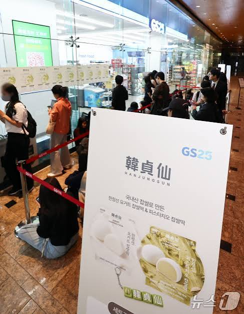
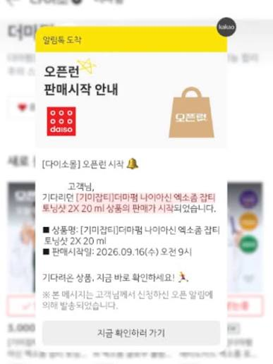
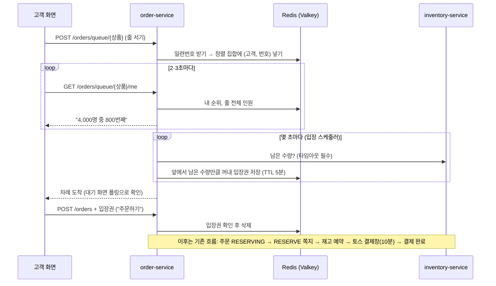

# 선착순 구매 (오픈런) 이해하기

작성: 김진아 · 2026-10-30 · 기준 문서: [기획안-및-설계도.md](../기획/기획안-및-설계도.md) 1-3·6장, [기획/기술스택과-선택이유.md](../%EA%B8%B0%ED%9A%8D/%EA%B8%B0%EC%88%A0%EC%8A%A4%ED%83%9D%EA%B3%BC-%EC%84%A0%ED%83%9D%EC%9D%B4%EC%9C%A0.md) 3-8, [할일/2차-사람별-할-일.md](../할일/2차-사람별-할-일.md)

2차(10/28 멘토링 후)에 더하는 **선착순 구매(대기열)** 기능을 처음 보는 사람도 이해할 수 있게 정리했다. 설계를 이해하면서 헷갈렸던 점을 6장에 따로 모았다. 아직 코드는 없고 설계만 정해진 상태다.

---

## 1. 배경: 오픈런

인기 한정 상품은 판매 시작 시각에 사람이 한꺼번에 몰린다. 오프라인에서는 매장 앞에 줄이 생기고, 온라인에서는 "오픈런" 판매로 접속이 몰린다.



*GS25 한정 상품 판매 날 매장 앞 줄. 출처: [뉴스1](https://www.news1.kr/photos/8149688)*



*다이소몰 "오픈런" 판매 시작 알림. 정해진 시각에 한정 상품 판매가 열린다.*

더 볼 것: [세븐일레븐 신상품 오픈런 관련 글 (네이버 블로그)](https://m.blog.naver.com/nsy604/224444597724)

FreshLink는 편의점 재고·주문 서비스라서 같은 상황이 생긴다.

**규모 가정 (10/30 확정): 고객 3,000~4,000명이 재고 100개를 사려고 몰린다.** 예: "딸기 찹쌀떡 한정 100개, 10시 오픈". 10시 정각 몇 초 안에 4,000명이 "주문하기"를 누르면, 대기열이 없을 때 이런 일이 생긴다.

- 우리 주문은 order가 주문을 먼저 저장하고(RESERVING) inventory가 재고를 잡는 구조라, **주문 4,000건이 DB에 생기고 재고 예약(RESERVE) 쪽지가 4,000개** 나간다. inventory는 100건만 성공시키고 3,900건은 "재고 없음"으로 돌려보내고, order는 그 3,900건을 다시 실패 처리한다. 어차피 못 살 사람의 일이 전체의 97%다.
- 같은 점포 쪽지는 FIFO 큐에서 한 줄로 처리되므로, 4,000번째 고객은 앞 3,999개가 끝난 뒤에야 "품절"을 받는다. 그동안 화면은 "주문 확인 중"이다.
- 그동안 DB 연결(파드당 기본 10개)과 큐가 꽉 차서, 이 상품과 상관없는 일반 주문이나 점주 재고 화면까지 느려진다.
- 내가 몇 번째인지 안 보여서 불공평하게 느껴지고, 새로 고침을 연타해 서버를 더 괴롭힌다.

대기열이 있으면 4,000명은 Redis에 줄만 선다. 입장권은 남은 재고만큼(100장)만 나가고 입장권이 있어야 주문 API가 받아 주므로, **DB에는 주문이 100건 남짓만 생긴다.** 나머지는 줄에서 바로 순번이나 "품절"을 본다. 대기열의 가장 큰 역할은 공정한 순서보다 **"어차피 못 살 사람을 DB 앞에서 돌려보내기"** 다.

| 같은 1~2초 안에 누르는 사람 | 대기열 필요성 (부하 테스트 전 추정) |
| --- | --- |
| 수백 명 | 낮다. 지금 RDS로 버틴다 |
| **수천 명 (우리 가정)** | **있다.** 헛주문이 DB·큐를 채워 다른 기능까지 느려진다 |
| 수만 명 (다이소몰·콘서트 예매) | 사실상 필수 |

그래서 **주문 앞단에 줄을 세우고, 차례가 온 사람에게만 짧은 시간 주문할 권리(입장권)를 준다.** 놀이공원 줄과 입장권, 콘서트 예매 대기열과 같은 개념이다.

## 2. 기능 명세

| 항목 | 내용 |
| --- | --- |
| 기능명 | 선착순 구매 (대기열) |
| 목적 | 수량이 적고 사람이 몰리는 상품을 **한도 넘게 팔지 않고, 먼저 온 순서대로** 판다 |
| 적용 대상 | 점주가 "선착순, 한도 N개"로 지정한 상품만. **일반 상품은 대기열 없이 지금처럼 바로 주문한다** |
| 사용자 | 점주(선착순 지정), 고객(줄 서기·구매) |
| API | `POST /orders/queue/{productId}`(줄 서기), `GET /orders/queue/{productId}/me`(내 순번·앞에 남은 사람 수), `DELETE /orders/queue/{productId}/me`(줄에서 빠지기). 주문은 기존 `POST /orders`에 입장권을 더해 보낸다 |
| 완료 기준 | 한도를 넘게 팔리지 않고, 입장권이 없으면 선착순 상품 주문이 거절된다 (기획안 6장) |
| 담당 | 김진아 = Redis(Valkey) 인프라·비용·접속 정보, 김경우 = 대기열 API·대기 화면·입장 처리, 이태우 = 선착순 한도 설정·남은 수량 API |

**단계별 흐름**

| 단계 | 누가 | 무엇을 | 담당 |
| --- | --- | --- | --- |
| 1. 지정 | 점주 | 상품에 "선착순, 한도 100개" 설정 | 이태우 |
| 2. 진입 | 고객 | 상품 상세에서 "구매하기" → 선착순 상품이면 주문 화면 대신 **대기 화면**으로 간다 | 김경우 |
| 3. 줄 서기 | 고객 | 대기 화면에 들어오면 줄에 선다. 같은 사람은 한 번만 | 김경우 |
| 4. 대기 | 고객 | 2·3초마다 "내 순번, 앞에 남은 사람 수"를 새로 받아 본다(폴링). 언제든 "그만 기다리기" 가능 | 김경우 |
| 5. 입장 | 시스템 | 몇 초마다 남은 수량을 확인하고 그만큼 앞사람에게 **입장권(예: 5분)** 을 준다. 대기 화면이 "차례예요"로 바뀐다 | 김경우, 이태우(남은 수량) |
| 6. 주문 | 고객 | 주문 화면에서 5분 안에 "주문하기" → 이후는 기존 흐름(재고 예약, 토스 결제창, 결제 10분) | 김경우 |

**규칙**

- 입장권이 없으면 선착순 상품 주문은 거절한다.
- 입장권 5분 안에 "주문하기"를 누르지 않으면 입장권이 사라지고, 그 자리는 다음 사람에게 간다. 이 사람에게는 다시 줄 서기를 안내한다.
- 주문 후 10분 안에 결제를 끝내지 않으면 주문이 만료(`EXPIRED`)되고 잡아 둔 재고가 풀린다. 그만큼 다음 사람이 입장한다.
- 한도를 넘는 재고 예약은 지금처럼 거절한다(재고 음수 금지).
- 한도만큼 모두 결제가 끝나면 남은 사람에게 "품절"을 알리고 대기열을 닫는다.

**아직 정하지 않은 것** (만들 때 김경우·이태우가 정한다)

- 판매 시작 시각을 따로 둘지(예: "10시 오픈"), 오픈 전 알림 신청(다이소몰처럼)을 받을지
- 한 사람이 몇 개까지 살 수 있는지
- 입장권 시간(5분은 기획안의 예시 값)
- 대기 화면에 남은 재고도 보여 줄지
- 버튼 없이 탭을 닫고 나간 사람을 줄에서 뺄지(예: 일정 시간 순번 조회가 없으면 뺀다)

## 3. 원리: 기술 스택과 선택 이유

### 3-1. 왜 Redis인가

| 필요한 것 | Redis에서 | 
| --- | --- |
| 줄 순서 | **정렬 집합(Sorted Set)**. 값(고객 ID)마다 점수를 붙이면 점수 순으로 자동 정렬된다 |
| 내가 몇 번째인지 | 정렬 집합에 "이 고객은 몇 번째?"를 물으면 명령 한 번에 답한다 |
| 앞에서 N명 입장 | 정렬 집합의 맨 앞에서 N명을 꺼낸다 |
| 입장권 5분 뒤 자동 삭제 | 값마다 **유효 시간(TTL)** 을 걸면 Redis가 알아서 지운다 |
| 수천 명이 동시에 줄 서기 | Redis는 명령을 한 번에 하나씩 처리해서, 동시에 와도 순서가 꼬이지 않는다 |

- 메모리 저장소라 빠르다. 가장 작은 크기로도 초당 수만 건의 단순 명령을 받아서, 4,000명이 몇 초 안에 줄을 서고 2·3초마다 순번을 물어도(초당 약 1,300~2,000건) 여유가 있고 DB에는 부담이 가지 않는다.
- 줄과 입장권은 **잠깐 쓰고 버리는 값**이다. 지워져도 다시 줄 서면 되므로 복제·백업 없이 가장 작은 `cache.t4g.micro` 1대로 충분하다.

### 3-1-1. 왜 ElastiCache인가 (관리형)

ElastiCache는 AWS가 EC2 위에 Redis를 깔아 대신 운영해 주는 서비스다. 우리는 서버에 접속하거나 OS를 볼 수 없고, 주소(엔드포인트)와 포트 6379만 받는다.

- **AWS가 하는 일**: 서버 준비, OS·Redis 보안 패치, 장애 시 교체, 스냅샷 백업, CloudWatch 지표(메모리, 연결 수).
- **우리가 정하는 것**: 크기, 서브넷, 보안 그룹(노드에서 6379만), 전송 암호화(TLS).
- 클러스터 노드에 파드를 더 올리지 않는다(노드 CPU 요청이 이미 약 80%).
- `cache.t4g.micro`: `cache.`는 ElastiCache용 크기 표시(RDS는 `db.`), `t4g`는 EC2 t4g와 같은 ARM(Graviton) 계열로 평소엔 적게 쓰고 순간 성능을 끌어 쓰는 종류, `micro`는 메모리 약 0.5GB. 서울 시간당 0.0192 USD, 계속 켜면 월 약 14 USD.

### 3-1-2. 왜 Valkey인가

Valkey는 Redis의 쌍둥이다. 2024년 Redis 회사가 라이선스를 바꿔 클라우드 회사가 자유롭게 서비스하기 어려워지자, 리눅스 재단이 바뀌기 직전 버전을 이어 만든 오픈소스다.

- 명령어와 접속 방식이 Redis와 같아서 Spring의 Redis 라이브러리를 그대로 쓰고 코드는 바뀌지 않는다.
- ElastiCache에서 Valkey가 Redis보다 싸다.
- 그래서 문서에서 "Redis"라고 쓰면 실제로는 Valkey를 말한다.


### 3-2. 다른 방법을 쓰지 않은 이유

| 대안 | 안 맞는 이유 |
| --- | --- |
| **SQS** | 넣고 꺼내는 기능뿐이다. "이 쪽지가 몇 번째인가"를 들여다볼 수 없고(꺼내야만 보인다), 줄 중간에서 한 사람을 뺄 수 없고, 입장권을 따로 보관할 곳이 또 필요하다. FIFO도 한 번에 10개씩만 꺼낸다. "줄"이 아니라 "작업 배달"용 도구다 |
| **RDS 표로 줄 세우기** | 순번 계산, 입장권 만료 정리를 직접 짜야 하고, 수천 명의 순번 폴링이 DB에 몰린다 |
| **클러스터 안 Redis 파드** | 노드 자리가 빠듯하고, 주말에 클러스터를 지우면 같이 사라진다(관리형도 켜고 끄기는 비용을 보고 정한다) |

### 3-3. 인프라 구성 (김진아)

- ElastiCache for Valkey(Redis 호환) `cache.t4g.micro` 1대, 복제 없음, 전송 암호화(TLS), 앱 프라이빗 서브넷, EKS 노드 보안 그룹에서 6379만 허용. infra `modules/cache`로 dev·prod에 붙인다.
- 접속 정보는 Secrets Manager `freshlink-<env>/order/redis` → External Secrets → order-service 환경 변수 `REDIS_HOST`, `REDIS_PORT`.
- ElastiCache는 RDS처럼 중지할 수 없다. 클러스터 묶음에 넣어 주말에 같이 지울지, 계속 켤지는 비용을 보고 정한다.

## 4. 흐름



4,000명이 몰리고 재고가 100개일 때:

```
10시 오픈 → "구매하기" → 대기 화면(누구나, 줄 서기) → 차례 오면 입장권 → 주문 화면 → 결제창 → 결제 완료

1번부터 100번     : 입장권을 받고 각자 동시에 주문·결제
101번부터 4,000번 : 대기 화면에서 순번을 보며 기다림
누가 5분 안에 주문 안 함 / 10분 안에 결제 안 함 → 그 자리만큼 101번, 102번… 입장
100개 모두 결제 완료 → 남은 사람에게 "품절", 대기열 닫기
```

## 5. 시간 두 개: 입장권 5분과 결제 10분

고객 화면 흐름은 **주문하기 → 결제창(토스) → 결제 완료**다. 두 시간은 이어지는 다른 단계다.

| 시간 | 언제부터 언제까지 | 넘기면 |
| --- | --- | --- |
| **입장권 5분** | 입장권을 받은 순간부터 **"주문하기"를 누를 때까지** | 입장권만 사라진다. 주문이 없으니 취소할 것도 없다. 다음 사람 입장 |
| **결제 10분** (기존 정책) | "주문하기"로 주문이 생긴 순간부터 **토스 결제창에서 결제를 끝낼 때까지** | 주문이 만료되고 잡아 둔 재고가 풀린다. 다음 사람 입장 |

"주문하기"를 누르면 그때 주문이 만들어지고 재고 1개가 이 사람 몫으로 잡힌 뒤 토스 결제창이 열린다. 사용자 눈에는 "결제하러 가는 버튼"과 같다. 입장권은 이때 쓰이고 지워진다.

## 6. 헷갈리기 쉬운 점

| 처음 생각 | 실제 |
| --- | --- |
| 모든 상품 결제에 대기열을 쓴다 | **점주가 선착순으로 지정한 상품에만** 쓴다. 일반 상품은 지금처럼 바로 주문한다 |
| 입장권이 있어야 대기 화면에 들어간다 | 반대다. **대기 화면은 누구나** 들어가 줄을 서고, **차례가 오면 입장권**을 받아 주문 화면으로 간다. 입장권은 대기 화면을 통과하는 표다 |
| 재고 100개면 입장권은 딱 100명만 받는다 | 한 번에 받는 사람은 남은 수량만큼(처음 100명)이다. 누가 포기하거나 결제를 안 하면 자리가 나는 만큼 더 받는다. **동시에 살 권리를 가진 사람이 남은 수량을 넘지 않는 것**이 핵심이다 |
| 1번이 결제하는 동안 2번은 기다린다 | 입장권을 받은 100명은 **동시에, 각자** 주문·결제한다. 같은 점포 재고 예약은 FIFO로 한 줄 처리되지만 한 건이 밀리초 단위라 사용자에겐 거의 동시다 |
| 대기열을 쓰면 뒤쪽 사람도 빨리 산다 | 모두가 빨리 사는 것이 아니라 **헛기다림이 없어진다.** 4,000번째 고객은 누르자마자 "4,000명 중 4,000번째, 남은 100개"를 보고 기다릴지 포기할지 고른다. 입장한 100명은 헛주문 3,900개와 섞이지 않아 빨리 처리된다 |
| 밀리초까지 같은 시각에 누른 사람이 100명이 넘으면 순서를 못 정한다 | Redis는 명령을 하나씩 처리하므로 Redis 안에 진짜 "동시"는 없다. 점수를 시계 값이 아니라 **Redis 카운터(`INCR`)로 받은 일련번호**로 주면 겹치지 않는다. 시계 값을 점수로 쓰면 같은 점수끼리 ID 글자 순으로 정렬돼 불공평해진다(기술스택 3-8의 "들어온 시각" 표현보다 일련번호를 권장). 1등은 Redis에 먼저 **도착한** 요청이고, 그 순서는 네트워크 차이로 사실상 운이다. 콘서트 예매와 같다 |
| 몇 번째인지는 화면에 보여 주는 용도뿐이다 | 화면 표시(4,000명 중 800번째) 외에도 **누구를 입장시킬지, 빈자리를 누구에게 넘길지** 정하는 장부다 |
| Redis 안에 SQS 같은 큐가 들어 있다 | Redis는 메모리 저장소이고, 대기열은 그 안의 **정렬 집합** 자료구조 하나다. 입장권도 유효 시간이 걸린 값 하나(`token:{상품}:{고객}`)다 |
| SQS로는 앞 100명 입장이 아예 안 된다 | 꺼내는 것 자체는 된다. 하지만 순번 조회, 줄에서 빼기, 입장권 자동 만료를 모두 따로 만들어야 해서 Redis 하나로 하는 것이 훨씬 단순하다 |
| 5분은 결제 시간이다 | 5분은 **"주문하기"를 누를 때까지**의 입장권 시간이고, 결제 완료까지는 기존 정책대로 주문 후 10분이다 |
| 대기 화면에서 나가면 입장권이 바로 사라진다 | "그만 기다리기"를 누르면 줄에서 빠진다. 이미 받은 입장권은 5분이 지나야 사라지고, 그 안에 돌아오면 주문할 수 있다. 버튼 없이 나간 사람 처리 규칙은 아직 정하지 않았다(2장) |
| 대기 화면은 실시간이다 | 2·3초마다 다시 묻는 **폴링**이라 거의 실시간이다. 차례 도착 알림(SSE)은 따로 보내지 않는다(10/30 결정: 적은 재고가 입장권 받은 사람 안에서 끝나 실효성이 없다) |
