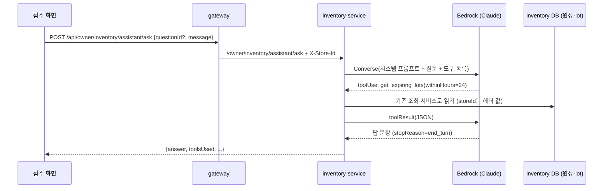

# 점주 AI 비서 (Amazon Bedrock)

> 담당: 김진아 · 갱신: 2026-11-13 · 상태: 현재 (설계 초안, 구현 전)

점주가 재고·판매·유통기한을 **말로 물어보면** AI가 우리 원장 데이터를 직접 찾아보고 답하는 기능이다. 처음에는 "AI 추천 발주"로 생각했지만(11/13) 발주만 답하는 화면보다 **자주 묻는 질문 5개 + 자유 질문**으로 여는 비서가 점주에게 더 쓸모 있다고 보고 방향을 바꿨다. 백엔드 구조는 같다: 질문을 받고 → AI가 필요한 데이터를 고르고 → 서버가 원장에서 읽어 주고 → AI가 답을 쓴다.

이 문서는 무엇을 만들지(기능 정의), 무엇으로 만들지(기술), 어디까지 할지(세부 규칙)를 정한다. 아직 정하지 않은 것은 9장에 모았다.

## 1. 한 줄 정의

**점주 화면의 "AI 비서"에서 미리 정한 질문 5개 중 하나를 누르거나 직접 질문을 쓰면, inventory-service가 Amazon Bedrock의 Claude 모델에게 우리 점포의 재고·판매·폐기 데이터를 도구(tool)로 읽게 해서 한국어로 답해 준다.**

- AI는 데이터를 **읽기만** 한다. 발주·폐기·추천 설정 같은 변경은 하지 않는다. 답에 "발주하세요"가 나와도 점주가 기존 화면에서 직접 한다.
- AI는 **자기 점포 데이터만** 본다. 점포 ID는 AI가 정하지 않고 gateway가 붙인 `X-Store-Id`로 서버가 고정한다.
- 숫자는 AI가 지어내지 않고 도구가 돌려준 값만 쓴다. 화면에도 "AI 답은 틀릴 수 있어요. 숫자는 재고 화면에서 확인해 주세요"를 둔다.

## 2. 미리 정한 질문 5개

점주가 매일 여는 화면(재고 목록, 임박 목록, 통계)을 보고 가장 자주 할 질문을 골랐다. 버튼(칩)으로 보여 주고, 누르면 그 문장이 그대로 질문이 된다. 서버는 `questionId`도 받아 지표와 시험에 쓴다.

| # | `questionId` | 버튼 문구 | AI가 주로 쓰는 도구 (5장) | 답에 들어갈 것 |
| --- | --- | --- | --- | --- |
| 1 | `EXPIRING_TODAY` | 오늘까지 유통기한이 끝나는 상품 알려줘 | `get_expiring_lots` | 상품·lot·남은 수량·마감 시각. 마감세일 시간(06:00\~23:00) 안이면 "마감세일로 팔리는 중", 이미 지난 lot은 "폐기 필요" |
| 2 | `REORDER_BY_MONTH` | 이번 달 판매를 보고 더 발주해야 할 상품 알려줘 | `get_sales_ranking`, `get_inventory` | 이번 달 많이 팔린 상품 중 남은 일수(`daysOfStock`)가 짧거나 안전재고보다 적은 상품, 하루 평균 판매로 본 권장 수량과 이유 |
| 3 | `LOW_STOCK` | 곧 품절될 것 같은 상품 알려줘 | `get_inventory` | 안전재고 부족(`lowStock`)과 3일 안에 떨어질 상품(`daysOfStock` ≤ 3), 이미 품절인 상품 |
| 4 | `DISPOSAL_REVIEW` | 이번 주 폐기가 많은 상품과 줄이는 방법 알려줘 | `get_stats` | 폐기 수량·폐기율 높은 순, "입고를 줄이기·마감세일 활용" 같은 제안 |
| 5 | `WEEKLY_BEST` | 이번 주 잘 팔린 상품 5개를 지난주와 비교해 줘 | `get_sales_ranking` (기간 두 번) | 이번 주 TOP 5, 지난주 순위·판매 수량과의 차이 |

자유 질문은 같은 입력칸에 쓴다(500자까지). 예: "컵라면 종류 재고 어때?", "어제 제일 많이 팔린 게 뭐야?", "다음 주 월요일에 기한 끝나는 거 있어?".

**하지 않는 것:** 대화 기억(앞 질문을 이어 묻기, 1차는 한 번 묻고 한 번 답), 고객 정보·주문자 정보 답하기, 다른 점포 비교, 발주·폐기를 대신 실행하기, 금액(원) 정확한 매출 답하기(아래 4-3).

## 3. 흐름



1. 점주가 질문을 보낸다. gateway 라우트 `/api/owner/inventory/**`는 이미 inventory로 가고 OWNER 그룹만 통과하므로 **gateway는 고칠 것이 없다.**
2. inventory가 Bedrock Converse API를 부른다. 시스템 프롬프트에 지금 한국 시각, 점포 이름, 규칙(6장)을 넣고 도구 목록(5장)을 같이 준다.
3. 모델이 도구를 부르면(`stopReason=tool_use`) inventory가 **이미 있는 조회 서비스**(S-10, S-30, S-42, 판매 순위)를 그대로 불러 JSON으로 돌려준다. 이 왕복은 한 질문에 최대 5번.
4. 모델이 답을 끝내면(`end_turn`) 답 문장과 쓴 도구 이름을 화면에 준다.

## 4. 기술과 선택 이유

### 4-1. 어디에 넣나: inventory-service 안의 `assistant` 패키지

| 선택지 | 장점 | 단점 | 결정 |
| --- | --- | --- | --- |
| **inventory-service 안에 넣기** | 데이터(원장·lot·통계)와 조회 코드가 이미 여기 있다. 새 레포·ECR·ArgoCD 앱·DB가 필요 없다. gateway 라우트도 그대로 | inventory 파드가 AI 응답(수 초)을 기다리는 동안 요청 스레드를 쓴다 | **이걸로 간다** |
| 새 `assistant-service` 만들기 | 장애·부하를 재고 처리와 떼어 놓는다 | 레포·배포·IRSA·gateway 라우트를 새로 만들어야 하고, 데이터는 결국 inventory API를 HTTP로 다시 불러야 한다 | 사용량이 커지면 그때 뗀다 |

재고 처리(SQS 쪽지 소비)는 리스너 스레드에서 돌고, AI 비서는 웹 요청 스레드에서 돌아서 서로 막지 않는다. 그래도 AI 호출은 **동시에 몇 개까지만** 받도록 제한한다(6장).

### 4-2. AI: Amazon Bedrock Converse API + 도구 사용(tool use)

- **SDK:** AWS SDK for Java v2 `bedrockruntime` (`BedrockRuntimeClient.converse`). 인증은 다른 AWS 호출과 같이 IRSA 기본 자격 증명을 쓴다. 키를 따로 두지 않는다.
- **왜 Converse API인가:** 모델이 바뀌어도 요청 모양이 같고, 도구 사용을 표준 모양(`toolConfig`, `toolUse`, `toolResult`)으로 쓸 수 있다.
- **왜 도구 사용인가:** 원장 전체를 프롬프트에 붙이면 길고 비싸고, 질문마다 필요한 데이터가 다르다. 도구로 주면 모델이 필요한 것만 골라 읽고, 숫자를 우리 DB에서 그대로 가져온다. 자유 질문이 와도 같은 도구 몇 개로 답할 수 있어서 **질문 5개와 자유 질문이 같은 코드**다.
- **스트리밍:** 1차는 한 번에 받는다(`converse`). 답이 3\~5초 걸려도 화면은 "찾아보는 중…"을 보여 준다. 느리다는 말이 나오면 2차에 `converseStream` + SSE로 바꾼다(화면 알림에서 SSE를 이미 쓰고 있다).

### 4-3. 쓸 수 있는 데이터와 한계

| 데이터 | 어디서 | 비고 |
| --- | --- | --- |
| 재고·안전재고·하루 평균 판매·남은 일수 | S-10 `InventorySearchRepository` | `dailySales` = 최근 7일 순판매 ÷ 7 |
| 유통기한별 lot, 임박·경과 | S-30, 유통기한 달력 | 상태는 지금 시각으로 계산 |
| 판매·폐기·조정 수량, 폐기율 | S-42 `InventoryStatsService` | 기간 지정 가능 |
| 상품별 판매 순위 | 판매 순위 API | 기간·개수 지정 가능 |
| **매출 금액(원)** | order-service | inventory에는 **수량만** 있다. "이번 달 매출"은 판매 수량으로 답하고, 금액이 필요하면 `수량 × 정가`로 **대략**만 말한다(마감세일 30% 할인분은 빠짐). 정확한 금액이 꼭 필요하면 order 점주 매출 API를 도구로 더한다(9장) |

### 4-4. 모델과 리전 (11/13 계정에서 직접 호출해 확인)

| 후보 | 어디서 처리 | 11/13 호출 결과 | 특징 |
| --- | --- | --- | --- |
| `global.anthropic.claude-haiku-5-5` | 전 세계 리전 중 한 곳 | 성공 (약 1.3초) | 빠르고 싸다. 질문 5개 같은 정해진 일에 충분할 가능성이 크다 |
| `global.anthropic.claude-sonnet-5-5` | 전 세계 리전 중 한 곳 | 성공 (약 1.0초) | 자유 질문·여러 도구를 섞는 답이 더 정확하다 |
| `anthropic.claude-sonnet-5` | 서울(ap-northeast-2)만 | 성공 (약 0.8초) | 데이터가 국내에서만 처리된다. 한 세대 전 모델 |

- 모델 ID는 코드에 박지 않고 환경 변수 `BEDROCK_MODEL_ID`(gitops values)로 둔다. dev에서 바꿔 보며 고른다.
- **국외 처리(global)에 대해:** 이 기능이 보내는 것은 상품명·수량·유통기한·판매 수량뿐이고 **고객 개인정보는 없다.** 그래서 global 프로필을 써도 개인정보 국외 이전 문제는 없다고 본다. 도구가 주문자·고객 정보를 돌려주지 않게 하는 것을 규칙으로 둔다(6장). 저장되는 로그(CloudTrail 등)는 서울에 남는다.
- **추천 기본값:** dev는 `global.anthropic.claude-haiku-5-5`로 시작하고, 자유 질문 답이 부족하면 Sonnet 5.5로 올린다. 최종은 9장에서 정한다.

### 4-5. 인프라 (infra·gitops)

| 할 것 | 어디 | 내용 |
| --- | --- | --- |
| IRSA 권한 | infra `envs/{dev,prod}/cluster/main.tf`의 `inventory_service` 정책 | `bedrock:InvokeModel`(스트리밍을 하면 `bedrock:InvokeModelWithResponseStream`도). 대상은 고른 **추론 프로필 ARN**(`arn:aws:bedrock:ap-northeast-2:<계정>:inference-profile/global.anthropic.…`)과 **모델 ARN**. global 프로필은 요청이 다른 리전으로 가므로 모델 ARN을 리전 없이(`arn:aws:bedrock:::foundation-model/anthropic.…`) 허용해야 한다. 11/13 시험은 관리자 계정이었으니 앱 Role로 dev에서 다시 확인한다 |
| 환경 변수 | gitops `envs/{dev,prod}/inventory-service/values.yaml` | `BEDROCK_MODEL_ID`, `ASSISTANT_ENABLED`(기본 false, 켜고 끄기) |
| 네트워크 | 없음 | 파드는 이미 NAT로 밖에 나간다. Bedrock VPC 엔드포인트는 시간당 요금이 붙어 1차에는 두지 않는다 |
| 모델 사용 신청 | 없음 | 11/13에 계정에서 호출이 되는 것을 확인했다 |
| 켜고 끄기 | 없음 | Bedrock은 쓴 만큼만 내므로 클러스터를 끄면 비용도 0이다 |

### 4-6. 화면 (frontend)

- 경로 `/owner/assistant`, 점주 메뉴에 "AI 비서".
- 위에 질문 버튼 5개, 아래에 입력칸과 "물어보기". 보내면 버튼을 잠그고 "데이터를 찾아보는 중…".
- 답은 문단 + 목록으로 보여 준다(서버가 마크다운 일부(목록·굵게)만 쓰게 하고 화면은 그것만 그린다). 답 아래에 "참고한 데이터: 임박 목록, 판매 순위"처럼 쓴 도구를 한국어로 보여 주고, 해당 화면으로 가는 링크를 단다(예: 임박 목록 → `/owner/expiring`).
- 한 화면 안에서는 주고받은 질문·답을 위에서 아래로 쌓아 보여 주지만, 서버에는 매번 질문 하나만 보낸다(대화 기억 없음).

## 5. 도구 (AI가 부를 수 있는 함수)

모두 **읽기 전용**이고, 입력에 점포 ID가 없다. 서버가 헤더의 점포 ID를 넣어 기존 서비스를 부른다. 돌려주는 JSON은 필요한 칸만 남기고 많아야 50줄로 자른다(토큰 절약).

| 도구 | 입력 | 부르는 기존 코드 | 돌려주는 것 |
| --- | --- | --- | --- |
| `get_inventory` | `q`(상품명, 선택), `status`(LOW_STOCK·SOLD_OUT·IMMINENT·EXPIRED, 선택), `limit`(기본 30) | S-10 재고 목록 | 상품명·카테고리·구매 가능 수량·안전재고·부족 여부·하루 평균 판매·남은 일수 |
| `get_expiring_lots` | `withinHours`(1\~168, 기본 24), `includeExpired`(기본 true) | S-30 임박 목록 / 유통기한 달력 | 상품명·lot 유통기한·남은 수량·예약 수량·상태(임박·경과) |
| `get_sales_ranking` | `from`, `to`(한국 날짜), `limit`(1\~30) | 판매 순위 | 순위·상품명·판매 수량·비중 |
| `get_stats` | `from`, `to`(한국 날짜) | S-42 판매·폐기 통계 | 상품별 입고·판매·폐기·조정·환불 수량, 폐기율 |

- 날짜를 모델이 정할 수 있게 시스템 프롬프트에 "지금은 2026-11-13(금) 15:10 KST, 이번 달은 11/1\~오늘, 이번 주는 월요일부터"를 넣는다.
- 기간은 최대 92일로 막는다(긴 기간을 반복 호출하지 않게).

## 6. 세부 규칙

**안전·범위**

1. 시스템 프롬프트: "너는 FreshLink 편의점 점주의 재고 비서다. 재고·판매·유통기한·폐기에 관한 질문만 답한다. 숫자는 도구 결과에 있는 것만 쓴다. 모르면 모른다고 한다. 고객 개인정보는 다루지 않는다. 한국어 존댓말, 짧게 쓴다."
2. 범위 밖 질문(날씨, 코딩, 잡담)은 "재고·판매 관련 질문만 도와드릴 수 있어요"로 답한다.
3. 프롬프트 주입("앞의 지시를 무시해")이 와도 도구가 읽기 전용이고 점포 ID가 고정이라 **다른 점포 데이터를 보거나 무언가를 바꿀 수 없다.** 최악의 경우가 이상한 답이다.
4. 도구 결과에 고객 ID·주문자 정보를 넣지 않는다(지금 도구 4개는 원래 그런 칸이 없다).

**한도**

| 항목 | 값 | 이유 |
| --- | --- | --- |
| 질문 길이 | 500자 | 400 `VALIDATION_ERROR` |
| 답 길이 | `maxTokens` 1,000 | 화면 한 장 분량 |
| 도구 왕복 | 질문 하나에 5번 | 넘으면 거기까지 모은 것으로 답하라고 한 번 더 부르고 끝낸다 |
| 시간 | 전체 30초 | 넘으면 504 `ASSISTANT_TIMEOUT` |
| 동시 호출 | 파드당 5개 (세마포어) | 넘으면 429 `ASSISTANT_BUSY` "잠시 뒤 다시 물어봐 주세요" |
| 점포당 횟수 | 1시간 30번 (9장에서 확정) | 비용 상한. 넘으면 429 `ASSISTANT_RATE_LIMITED` |

**오류**

| 상황 | 응답 | 화면 |
| --- | --- | --- |
| 기능이 꺼짐(`ASSISTANT_ENABLED=false`) | 503 `ASSISTANT_DISABLED` | 메뉴를 숨긴다 |
| Bedrock 오류·스로틀링 | 503 `ASSISTANT_UNAVAILABLE` (SDK 재시도 2번 뒤) | "AI 비서가 잠시 쉬고 있어요". 질문 1·3번은 기존 화면 링크(임박 목록·재고 목록)를 대신 보여 준다 |
| 권한 오류(IRSA 누락) | 503 + 로그 ERROR | 위와 같음. 디스코드 prod 오류 알림으로 잡힌다 |

## 7. API (inventory-service)

`POST /owner/inventory/assistant/ask` (브라우저는 `/api/owner/inventory/assistant/ask`). 헤더 `X-Store-Id`·`X-User-Id`(gateway가 붙임).

```json
// 요청
{ "questionId": "EXPIRING_TODAY", "message": "오늘까지 유통기한이 끝나는 상품 알려줘" }
```

```json
// 응답 200
{
  "answer": "오늘 23:59까지 기한이 끝나는 상품은 3개예요.\n- **매운 컵라면 115g** 4개 (마감세일 중)\n- ...",
  "toolsUsed": ["get_expiring_lots"],
  "questionId": "EXPIRING_TODAY",
  "elapsedMs": 3120
}
```

- `questionId`는 선택이다. 자유 질문이면 빼거나 `FREE`.
- `GET /owner/inventory/assistant/questions` → 질문 5개 목록(`questionId`, 문구). 화면이 버튼을 서버에서 받아 그리면 문구를 바꿀 때 프론트 배포가 필요 없다.
- 상태를 바꾸지 않으므로 쪽지(SQS)·Outbox·멱등 처리는 없다. 같은 질문을 두 번 보내면 두 번 묻는다.

## 8. 관측성·비용·시험

**지표** (`/actuator/prometheus`)

| 지표 | 태그 | 뜻 |
| --- | --- | --- |
| `assistant_ask_seconds` | `question`(질문 5개·FREE), `result`(ok·timeout·busy·error) | 질문 하나에 걸린 시간·건수 |
| `assistant_tokens_total` | `kind`(input·output) | Bedrock 응답의 `usage`를 더한다. 비용 계산에 쓴다 |
| `assistant_tool_calls_total` | `tool` | 어떤 도구를 많이 부르나 |

로그에는 질문 문장, 쓴 도구, 토큰 수, 걸린 시간을 남긴다(JSON 로그 → Loki). 도구 결과 전체는 남기지 않는다.

**비용 어림**

- 질문 하나 ≈ 입력 3,000\~6,000토큰(시스템 프롬프트·도구 설명·도구 결과, 도구 왕복마다 다시 보냄) + 출력 300\~800토큰.
- 월 비용 ≈ (하루 질문 수 × 30) × (입력 토큰 × 입력 단가 + 출력 토큰 × 출력 단가). 단가는 모델마다 달라 [Bedrock 요금 페이지](https://aws.amazon.com/bedrock/pricing/)에서 고른 모델로 계산해 [비용-계산.md](../기획/비용-계산.md)에 더한다.
- 시연·테스트 규모(하루 수십 번)면 다른 AWS 비용보다 훨씬 작다. 점포당 횟수 한도(6장)가 상한 역할을 한다.

**시험**

- 단위: 도구 4개가 헤더 점포만 읽는지(다른 점포 ID를 넣어도 무시), 입력 범위(기간 92일, limit) 검사.
- 통합: `BedrockRuntimeClient`를 가짜로 바꿔 "tool_use → toolResult → end_turn" 왕복, 왕복 5번 초과, 시간 초과, 스로틀링 오류를 확인.
- dev 실제 호출: 질문 5개를 시뮬레이터 데이터(지난 30일 채움)로 한 번씩 물어 답이 화면 숫자와 맞는지 사람이 본다. 결과를 이 문서에 적는다.

## 9. 정할 것

| # | 질문 | 제안 |
| --- | --- | --- |
| 1 | 모델: Haiku 5.5(global) / Sonnet 5.5(global) / Sonnet 5(서울만) | dev에서 질문 5개를 셋 다 물어 보고 정확도·속도로 고른다. 개인정보가 없어 global도 된다 |
| 2 | 정확한 매출 금액(원)도 답할까 | 1차는 수량만. 필요하면 order에 점주 기간 매출 API를 만들고 도구 `get_revenue`를 더한다 |
| 3 | 점포당 횟수 한도 | 1시간 30번. 파드 2개라 정확히 세려면 DB 카운트 표가 필요하고, 1차는 파드별 메모리 카운트(대략 60번)로 둔다 |
| 4 | 대화 이어 묻기 | 1차는 안 한다. 하게 되면 화면이 앞 질문·답 2\~3쌍을 같이 보낸다 |
| 5 | 스트리밍(글자가 흘러나오게) | 1차는 안 한다. 답이 5초를 자주 넘으면 SSE로 |
| 6 | 담당 | inventory 코드·화면: 이태우님과 상의, infra IRSA·gitops values: 김진아 |
| 7 | 기능 ID | 기능명세에 새 ID(예: S-60)를 받는다 |

## 10. 작업 순서

1. **infra:** dev `inventory_service` IRSA에 Bedrock 권한 추가 → plan·apply. (prod는 dev 확인 뒤)
2. **inventory-service:** `assistant` 패키지(컨트롤러, Bedrock 클라이언트 설정, 도구 4개, 한도·오류), 테스트. `ASSISTANT_ENABLED` 기본 false.
3. **gitops:** dev values에 `BEDROCK_MODEL_ID`, `ASSISTANT_ENABLED=true`.
4. **dev 확인:** 질문 5개 실제 호출, 모델 고르기(9-1), 이 문서 갱신.
5. **frontend:** `/owner/assistant` 화면.
6. **prod:** infra 권한 → gitops prod values → 같은 태그 승격.
