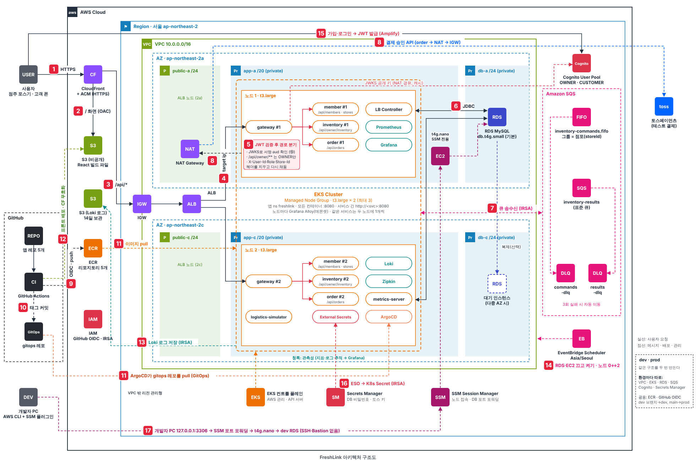

# FreshLink 아키텍처 흐름

> 원본: [architecture.svg](architecture.svg) · 실선 = 사용자 요청, 점선 = 메시지·배포·관리. 번호는 그림의 빨간 배지와 같다.
> 그림은 환경 하나만 그렸다. dev와 prod는 같은 구조를 두 번 만든다(아래 11장).
> 그림은 MVP 구성이다. 2026-10-28에 정한 2차 변경(BFF, 알림 서비스, Redis, 도메인)은 그림에 아직 없고 아래 12장에 적었다. 구현이 끝나면 그림을 다시 만든다.

## 한 줄 요약

화면은 **CloudFront + S3**, API는 **CloudFront → ALB → EKS(gateway)** 로 들어오고, 재고를 바꾸는 모든 일은 **SQS FIFO 큐 하나(그룹 = 점포)** 를 거쳐 순서대로 처리된다. 배포는 **GitHub Actions(CI)가 이미지를 만들고, ArgoCD(CD)가 `gitops` 레포를 보고 클러스터에 맞춘다.**

## 0. Kubernetes (EKS) 안

- **컨트롤 플레인:** AWS가 관리하는 EKS API 서버. VPC 밖에 있고, 우리는 노드 그룹만 운영한다.
- **노드:** 관리형 노드 그룹 t3.large × 2(최대 3), app 서브넷 2a·2c에 1대씩. 노드마다 Grafana Alloy가 데몬셋으로 뜬다.
- **앱 파드:** 네임스페이스 `freshlink`. gateway·member·inventory·order는 두 노드에 1개씩(노드 1대가 죽어도 응답), logistics-simulator는 1개. **모든 컨테이너는 8080** 하나를 쓰고(Actuator도 같은 포트), 서비스끼리는 K8s DNS `http://<svc>:8080`으로 부른다.
- **플랫폼 파드:** AWS Load Balancer Controller(ALB 생성), ArgoCD(⑪), External Secrets Operator(⑯), metrics-server, 관측성(⑬, 청록색).
- **권한:** 파드는 AWS 키 없이 IRSA로 서비스 계정마다 IAM Role을 맡는다(SQS, Secrets Manager, Loki 버킷 등).

## 1. 사용자 요청 (①~⑥)

| 번호 | 흐름 | 핵심 |
| --- | --- | --- |
| ① | 사용자 → CloudFront | 점주 포스기·고객 폰 모두 HTTPS 주소 하나로 접속 (ACM 인증서) |
| ② | CloudFront → S3 | `/` 화면 요청은 비공개 S3의 React 빌드 파일을 OAC로 읽어 준다 |
| ③ | CloudFront → IGW → ALB | `/api/*` 요청만 EKS로 넘긴다. 화면과 API가 같은 주소라 CORS가 필요 없다 |
| ④ | ALB → gateway 파드 | 대상 유형 `ip`로 노드를 거치지 않고 두 AZ의 gateway 파드로 바로 보낸다 |
| ⑤ | gateway → member · inventory · order | ① Cognito 공개 키(JWKS, NAT 경유로 받아 캐시)로 ID 토큰의 서명·만료·`aud`를 확인하고(⑮와 연결), ② `/api/owner/**`는 `cognito:groups`에 OWNER가 있어야 통과시키고, ③ 클라이언트가 보낸 `X-User-*`·`X-Store-Id`를 지우고 토큰 값으로 다시 채운 뒤, ④ 경로별로 나눠 보낸다: `/api/members/**`·`/api/stores` → member, `/api/owner/inventory/**` 등 → inventory, `/api/orders/**` → order. 서비스 주소는 K8s DNS `http://<svc>:8080` |
| ⑥ | 서비스 ↔ RDS MySQL | 인스턴스 1대에 서비스별 스키마·DB 사용자를 나눴다. DB 서브넷엔 인터넷 경로가 없다 |

## 2. 재고 처리 (⑦)

- **보내는 쪽:** logistics-simulator(입고), order-service(예약·확정·해제), inventory-service(폐기)가 `inventory-commands.fifo`에 쪽지를 넣는다.
- **처리:** inventory-service가 점포(메시지 그룹)별로 한 번에 하나씩 꺼내 처리한다. 동시 주문 100건에도 재고가 음수가 되지 않는다.
- **결과:** 예약 성공·실패는 `inventory-results`(표준 큐)로 order-service에 돌려준다.
- **실패:** 3번 실패한 쪽지는 각 큐의 DLQ로 옮겨져 전체 처리를 막지 않는다.
- 큐 권한은 IRSA로 서비스마다 따로 준다(gateway는 권한 없음).

## 3. 결제 (⑧)

order-service가 토스페이먼츠 결제 승인 API를 호출한다. 프라이빗 서브넷의 파드는 **NAT Gateway(2a) → IGW**를 거쳐 밖으로 나간다.

## 4. 배포 (⑨~⑫)

| 번호 | 흐름 | 핵심 |
| --- | --- | --- |
| ⑨ | GitHub Actions → ECR | 앱 레포 5개의 이미지를 빌드해 푸시. AWS 키 없이 GitHub OIDC로 IAM Role을 맡는다 |
| ⑩ | GitHub Actions → `gitops` 레포 | 새 이미지 태그를 커밋한다. CI는 여기서 끝나고 클러스터에 손대지 않는다 |
| ⑪ | ArgoCD ← `gitops`, 노드 ← ECR | 클러스터 안의 ArgoCD가 `gitops`를 끌어와(pull) 상태를 맞추고, 노드가 ECR에서 이미지를 받는다 |
| ⑫ | GitHub Actions → S3 · CloudFront | 프론트는 `npm run build` → S3 업로드 → CloudFront 캐시 무효화 |

## 5. 관측성 (⑬, 청록색 파드)

- **지표:** 서비스 5종이 Actuator·Micrometer로 `/actuator/prometheus`를 내보내고 Prometheus가 수집한다 (EBS gp3 10 GiB, 3일 보관).
- **로그:** 노드마다 뜬 Grafana Alloy(데몬셋)가 파드 로그를 읽어 Loki로 보낸다. Loki는 로그를 **S3에 14일** 저장해서 주말 클러스터 삭제 뒤에도 남는다(⑬, IRSA로 버킷 권한).
- **추적:** Micrometer Tracing이 Zipkin으로 보낸다. 주문 한 건이 gateway → order → SQS → inventory를 지나간 경로를 traceId 하나로 본다.
- **화면:** Grafana 하나에서 지표·로그·추적을 함께 보고, 로그의 traceId를 누르면 Zipkin 추적으로 넘어간다. 외부에 열지 않고 `kubectl port-forward`로 접속한다.
- **설치:** `gitops/platform/observability`의 ArgoCD Application으로 올린다(namespace `observability`).

## 6. 켜고 끄기 (⑭)

- **EventBridge Scheduler(⑭):** 평일 아침 RDS·SSM 접속용 EC2 시작과 노드 그룹 2대, 저녁 노드 0대·RDS·EC2 중지, 매일 23:00 안전 끄기. Lambda 없이 AWS API를 직접 부르고 시간대는 `Asia/Seoul`.
- **GitHub Actions:** Terraform이 필요한 NAT 삭제·생성, 금요일 클러스터 삭제, 월요일 클러스터 생성(노드 2대 포함). 일정표는 [aws-리소스-계획.md](../aws-리소스-계획.md) 6-5.

## 7. 가입·로그인 (⑮)

- **Amazon Cognito User Pool:** 화면이 Amplify Auth로 Cognito에 바로 가입·로그인하고, Cognito가 RS256으로 서명한 ID 토큰(그룹 OWNER/CUSTOMER, 점주는 `custom:storeId`)을 받아 API 요청에 붙인다. gateway를 거치지 않는다.
- **검증:** gateway는 공유 비밀 키 없이 Cognito 공개 키(JWKS)로 토큰을 확인한다. 공개 키는 NAT를 거쳐 한 번 받아 캐시한다.
- **위치:** AWS 관리형이라 VPC·클러스터 밖에 있고, Terraform 유지 묶음이라 주말 클러스터 삭제 뒤에도 회원 계정이 남는다. Keycloak 대신 고른 이유는 [기획/기술스택과-선택이유.md](../%EA%B8%B0%EC%88%A0%EC%8A%A4%ED%83%9D%EA%B3%BC-%EC%84%A0%ED%83%9D%EC%9D%B4%EC%9C%A0.md) 3-7.

## 8. 네트워크 배치

- 서울 리전, AZ 2개(2a·2c). AZ마다 **public / app / db** 3계층 서브넷.
- public: ALB(두 AZ), NAT Gateway(2a에 1개). app: EKS 노드 t3.large 1대씩, 2a에 SSM 접속용 t4g.nano 1대. db: RDS 기본(2a), 2c는 다중 AZ용 대기 자리.
- 같은 서비스 파드를 두 노드에 나눠 띄워서 노드 1대가 죽어도 모든 서비스가 계속 응답한다.

## 9. 비밀값 (⑯)

- **Secrets Manager:** DB 비밀번호(서비스별 DB 사용자), 토스페이먼츠 키를 환경마다 따로 저장한다.
- **전달:** 클러스터 안의 External Secrets Operator가 IRSA로 Secrets Manager를 읽어 `freshlink` 네임스페이스에 K8s Secret을 만들고, 앱 파드는 그 Secret을 환경 변수로 받는다. 이미지·`gitops` 레포에 비밀값이 들어가지 않는다.
- Cognito 로그인에는 공유 비밀 키가 없다(JWKS 공개 키 검증). CI의 AWS 접근도 키 없이 GitHub OIDC를 쓴다.

## 10. 운영 접속 (⑰)

- **SSM Session Manager:** SSH 포트도 Bastion도 없다. 노드에 들어갈 일이 있으면 Session Manager로 접속한다(노드 Role에 SSM 정책).
- **DB 접속:** RDS는 인터넷에 열리지 않는다. app 서브넷의 t4g.nano(SSM 에이전트만, 보안 그룹 인바운드 없음)를 거쳐 **SSM 포트 포워딩**으로 개발자 PC의 `127.0.0.1:3306`을 dev RDS에 잇는다. 이 인스턴스는 ⑭ 스케줄러가 RDS와 같이 켜고 끈다.
- 개발자 IAM 사용자는 dev 리소스만(SSM 세션 시작, dev Secrets Manager 읽기, dev 큐 등) 쓸 수 있다.

## 11. dev · prod

- 그림은 환경 하나다. **dev와 prod는 같은 Terraform 모듈로 같은 구조를 두 번 만든다.**
- 환경마다 따로: VPC, EKS 클러스터, RDS, SQS 큐, Cognito User Pool, Secrets Manager 비밀값.
- 공용: ECR, GitHub OIDC, Terraform 상태(tfstate).
- `dev` 브랜치 → dev, `main` → prod(같은 이미지 태그를 승격, 다시 빌드하지 않는다).

## 12. 2차에 바뀌는 것 (2026-10-28 결정, 그림에 아직 없음)

| 번호 | 바뀌는 것 |
| --- | --- |
| ⑤·⑮ | **BFF:** 사용자 → Cognito 직접 화살표가 없어진다. 가입·로그인도 CloudFront → ALB → gateway `/api/auth/**`를 거치고, gateway가 Cognito(`AdminInitiateAuth` 등, IRSA·클라이언트 시크릿)를 부른 뒤 토큰을 HttpOnly 쿠키로 내려 준다. API 요청의 토큰은 `Authorization` 대신 쿠키로 온다. 검증(JWKS)과 헤더 재작성은 그대로 |
| ⑤ | gateway → notification-service 경로 `/api/notifications/**` 추가. SSE라 응답 타임아웃을 늘리고 버퍼링을 끈다 |
| ⑦ | order·inventory → 알림 큐 `<env>-notification-events`(+DLQ) → notification-service. DLQ마다 CloudWatch 경보 → 웹훅 |
| 새 | order-service ↔ ElastiCache for Valkey(앱 서브넷, 6379, TLS). 선착순 대기열과 입장 토큰 |
| ①·⑫ | Route 53 도메인 → CloudFront 별칭, ACM 인증서(us-east-1), 응답 헤더 정책(CSP·HSTS) |
| ⑨~⑪ | 배포 성공·실패와 ArgoCD 동기화 실패를 웹훅(디스코드 또는 슬랙)으로 알린다. ECR 리포지토리에 `notification-service` 추가 |
| ⑯ | Secrets Manager에 gateway Cognito 클라이언트 시크릿, order Redis 접속 정보, notification DB 비밀번호 추가 |
