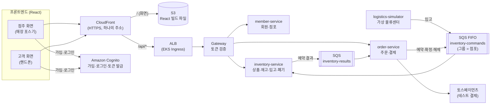
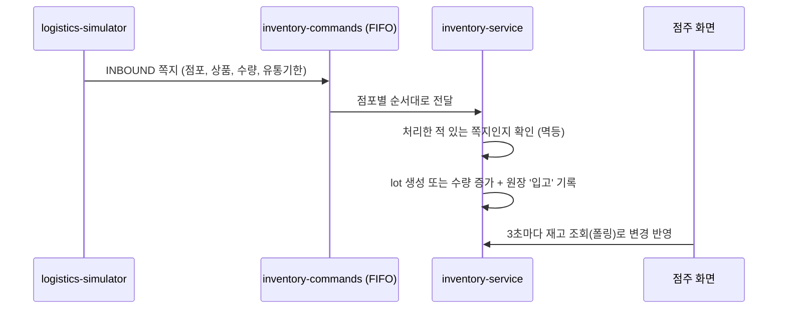
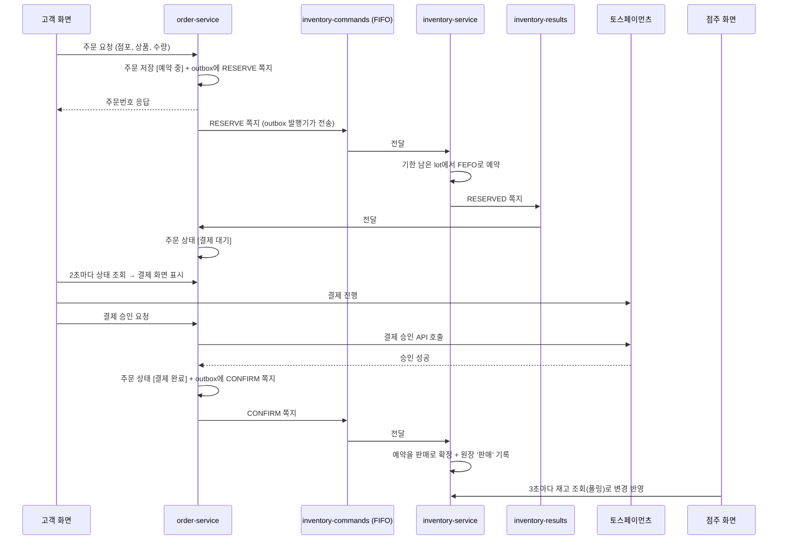
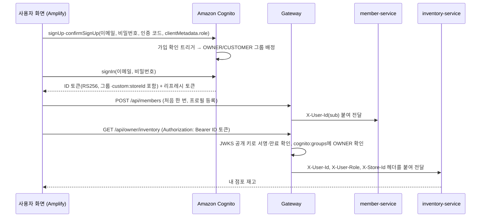
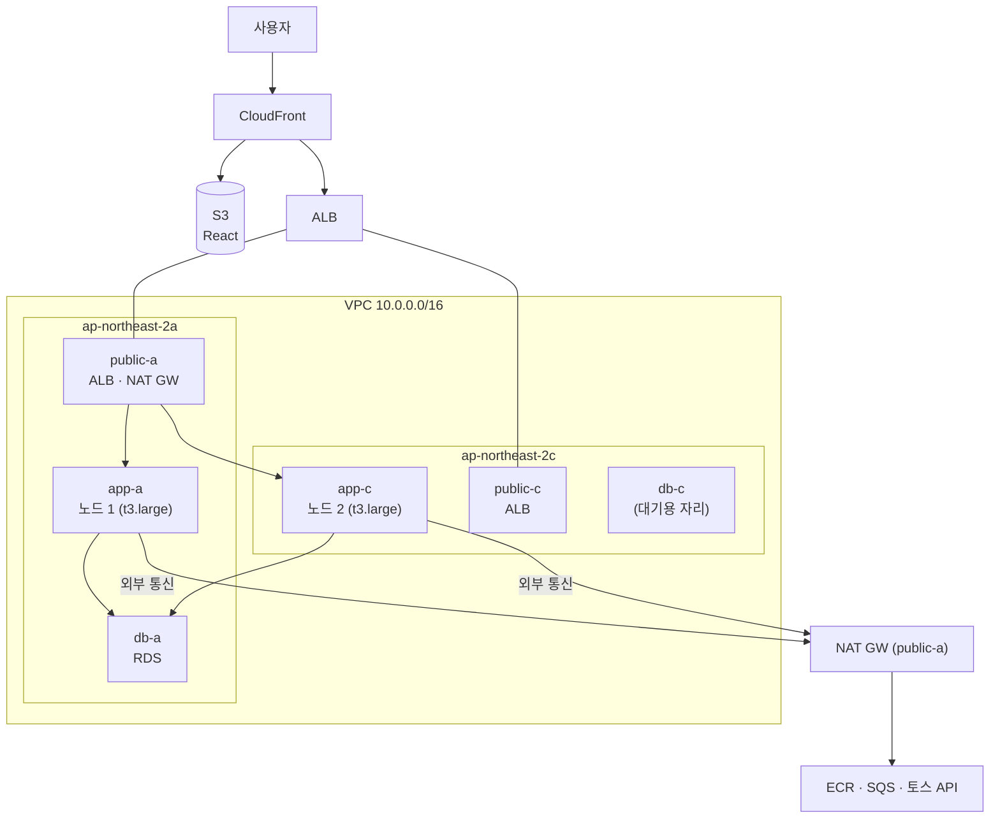

# FreshLink MVP 기획안 및 설계도

> 원본은 김진아 PC의 [기획안-및-설계도.md](./기획안-및-설계도.md). 팀원이 볼 수 있게 Markdown으로 옮겼다. 앞부분은 기능·흐름·담당(기획안), 뒷부분은 AWS 리소스·비용(인프라 산정)이다.

작성일: 2026-10-08 · 개발 기간: 5주 · 인원: 3명

이번 프로젝트는 **1순위(MVP) 기능만 개발**한다. 이 문서는 MVP에서 무엇을 만들고, 기능들이 어떻게 이어지며, 누가 무엇을 맡는지를 정리한 것이다. 개발이 처음인 팀원도 이 문서 하나로 전체 그림을 잡을 수 있도록 썼다.

---

## 1. MVP 한눈에 보기

### 1-1. 우리가 만드는 것

편의점 점주와 고객이 **같은 재고 데이터**를 보는 서비스다. 핵심 약속은 두 가지다.

1. 고객이 결제하면 점주 화면의 재고가 **정확하게** 줄어든다. 동시에 여러 명이 사도 재고가 음수가 되지 않는다.
2. **유통기한이 지난 상품은 고객에게 팔리지 않는다.**

### 1-2. MVP가 완성되면 이렇게 동작한다

> 새벽 5시, 물류 시뮬레이터가 역삼점에 컵라면 20개(유통기한 10월 20일)와 우유 10개(유통기한 10월 9일) 입고 정보를 보낸다.
> 
> 
> 점주가 출근해 로그인하면 재고 화면에 상품이 **유통기한별로** 들어와 있고, 변동 이력에 '입고 +20'이 찍혀 있다. 임박 목록에서 오늘이 기한인 우유를 확인하고 2개를 폐기 처리하면 재고에서 빠진다.
> 
> 점심시간, 고객이 핸드폰으로 가입한 뒤 '역삼점'을 검색한다. 상품 목록에는 유통기한이 남은 수량만 보인다. 컵라면 1개를 주문하고 결제하면 주문 상태가 '결제 완료'가 된다. 같은 순간 점주 화면의 컵라면 재고가 20에서 19로 바뀌고, 신규 주문 목록에 주문이 뜬다.
> 
> 재고보다 많이 주문하면 거절되고, 결제에 실패하거나 10분 안에 결제하지 않으면 잡아 두었던 재고가 자동으로 돌아온다.
> 

### 1-3. MVP에서 하지 않는 것

장바구니(바로 구매만), 배송(매장 픽업만), 주문 취소·주문 내역, 점주의 주문 상태 변경, 알림 푸시, 매출 분석·추천 발주, 선착순 이벤트, 대용량 부하 테스트는 하지 않는다. 전체 목록은 [FreshLink 전체 기능 리스트업] 문서의 2·3순위와 보류 항목에 있다.

---

## 2. 먼저 알아둘 용어

처음 보는 단어가 많을 수 있다. 개발하면서 계속 나오는 말이니 이것만은 꼭 익히고 시작한다.

| 용어 | 쉬운 설명 | 우리 프로젝트에서는 |
| --- | --- | --- |
| lot (로트) | 같은 상품이라도 **유통기한이 같은 묶음** | '컵라면, 10월 20일까지, 20개'가 lot 하나 |
| FEFO | 유통기한이 **빨리 끝나는 것부터** 판다 (First Expired, First Out) | 주문이 오면 기한이 가장 가까운 lot부터 뺀다 |
| 재고 예약 | 결제 전에 상품을 **잠깐 잡아 두는 것** | 주문 → 예약 → 결제 성공 시 확정, 실패 시 예약 해제 |
| 원장 (ledger) | 재고가 **왜 바뀌었는지** 남기는 기록장 | 입고 +20, 판매 −1, 폐기 −2 같은 이력 |
| 메시지 큐 (SQS) | 서비스끼리 일을 **쪽지로 주고받는 우체통**. 받는 쪽은 자기 속도로 꺼내 처리 | 주문 서비스가 "재고 1개 예약해 줘" 쪽지를 재고 서비스 우체통에 넣는다 |
| FIFO 큐·메시지 그룹 | 넣은 **순서대로** 꺼내 주는 큐. 같은 그룹의 쪽지는 한 번에 하나씩만 처리 | 그룹 = 점포. 같은 점포 재고는 한 줄로 서서 처리되니 꼬이지 않는다 |
| Saga | 여러 서비스에 걸친 작업을 **단계별로 진행하고, 중간에 실패하면 앞 단계를 되돌리는** 방식 | 예약 → 결제 → 확정. 결제 실패 시 예약 해제 |
| Outbox | DB 저장과 쪽지 보내기를 **함께 성공시키는** 방법. 쪽지를 먼저 DB 표에 적어 두고, 별도 일꾼이 꺼내 보낸다 | 주문은 저장됐는데 쪽지가 안 가는 사고를 막는다 |
| 멱등 처리 | 같은 쪽지가 **두 번 와도 한 번만** 반영되게 하는 것 | 처리한 쪽지 번호를 기록해 두고, 이미 처리한 번호면 무시 |
| DLQ | 여러 번 처리에 실패한 쪽지를 **따로 모아 두는 우체통** | 이상한 쪽지 때문에 전체가 멈추지 않게 한다 |
| 폴링 | 화면이 **일정 간격으로 서버에 다시 물어보는** 방식 | 점주 재고 화면은 3초마다, 고객 주문 상세는 2초마다 다시 조회해 새로고침 없이 갱신된다 |

---

## 3. 시스템 구성

### 3-1. MVP 구성도

MVP는 

- 서비스 3개
- 시뮬레이터 1개
- 게이트웨이 1개로 구성한다.

사용자는 하나의 주소(CloudFront)로 접속하고, 화면 파일은 S3에서, API는 EKS에서 받는다.


    

**가장 중요한 규칙: 재고를 바꾸는 일은 전부 `inventory-commands` 큐를 거친다.** 

입고, 예약, 확정, 해제, 폐기 모두 쪽지로 들어와서, 점포별로 한 줄로 서서 처리된다. 

그래서 DB 락 없이도 같은 점포 재고가 꼬이지 않는다.

### 3-2. 서비스별 역할

| 서비스 | 하는 일 | 가진 데이터 |
| --- | --- | --- |
| CloudFront + S3 | 화면(React 빌드 파일)을 S3에 올리고 CloudFront로 전 세계에 빠르게 전달한다. `/api/*` 요청은 EKS로 넘긴다 | React 빌드 파일 |
| Amazon Cognito | 회원가입·로그인·로그인 토큰(JWT) 발급. AWS 관리형이라 클러스터 밖에서 돈다 | 계정(이메일, 비밀번호), 그룹(OWNER/CUSTOMER) |
| Gateway | 모든 API 요청의 입구. Cognito가 발급한 로그인 토큰(JWT)을 확인하고 사용자 정보를 뒤 서비스에 넘긴다 | 없음 |
| member-service | 회원 프로필, 점포 정보·점포 검색 (비밀번호와 토큰은 다루지 않는다) | 회원 프로필, 점포 |
| inventory-service | 상품·재고 조회, 입고·예약·확정·해제·폐기 처리, 유통기한 확인, 점주 재고 조회 | 상품, lot, 예약, 원장, 입고 |
| order-service | 주문 생성, 결제, 주문 상태 관리, Saga 진행 | 주문, 결제 |
| logistics-simulator | 물류센터 역할. 점포별 입고 쪽지를 큐에 넣는다 | 없음 (더미 입고 데이터 생성) |

### 3-3. 기획안 대비 MVP에서 단순화한 것

기획안은 2순위까지 고려한 구조다. MVP에서는 처음 개발하는 팀원 기준으로 아래처럼 줄였다. 2순위를 하게 되면 그때 다시 나눈다.

| 기획안 | MVP | 이유 |
| --- | --- | --- |
| payment-service 별도 | order-service 안에서 결제 | 서비스 수를 줄이고, 토스 결제 승인 API 호출만 하면 된다 |
| notification-service 별도 | 두지 않음 | 알림 기능 자체가 2순위 |
| 점주 재고 실시간 푸시(SSE) | 점주 재고 화면이 3초마다 재고 조회(폴링) | inventory-service 파드가 2개라, SSE로 밀어 주려면 결제를 처리한 파드가 다른 파드에 붙은 점주 연결까지 알려야 한다(Redis pub/sub 필요). 2순위에서 Redis와 함께 SSE로 전환한다 |
| store-query-service (CQRS) | inventory-service가 고객 조회까지 처리 | 조회 폭주 대응은 2순위 |
| SNS로 여러 서비스에 전파 | SQS 큐 2개로 충분 | 예약 결과를 받는 곳이 order-service 하나뿐 |
| ElastiCache(Redis) | 사용 안 함 | 선착순·조회 캐시가 2순위 |
| 고객 주문 상태 실시간 푸시 | 2초마다 주문 상태 조회(폴링) | 단순하고 MVP 시연에 충분 |

---

## 4. 전체 흐름

### 4-1. 입고: 물류센터 → 재고



### 4-2. 주문 성공: 예약 → 결제 → 확정



### 4-3. 주문 실패: 세 가지 경우

| 경우 | 무슨 일이 일어나나 | 결과 |
| --- | --- | --- |
| 재고 부족 | inventory-service가 예약 실패(RESERVE_FAILED) 쪽지를 보낸다 | 주문 상태 [재고 부족으로 취소], 고객 화면에 안내 |
| 결제 실패 | order-service가 해제(RELEASE) 쪽지를 보낸다 | 예약 재고 복원, 주문 상태 [결제 실패] |
| 10분 안에 결제 안 함 | order-service 스케줄러가 오래된 [결제 대기] 주문을 찾아 RELEASE 쪽지를 보낸다 | 예약 재고 복원, 주문 상태 [시간 초과 취소] |

### 4-4. 유통기한·폐기

1. inventory-service 스케줄러가 매일 자정(시연 중에는 1분마다)에 lot을 확인한다.
2. 유통기한이 **24시간 이내**면 '임박', **지났으면** '경과'로 표시한다.
3. 경과 lot은 고객 화면의 구매 가능 수량에서 빠진다. 예약할 때도 제외된다.
4. 점주가 임박·경과 lot을 골라 폐기하면, inventory-service가 DISPOSE 쪽지를 큐에 넣고 처리한다. 원장에 '폐기'가 기록된다.

**재고 계산 공식**: 고객에게 보이는 구매 가능 수량 = 유통기한이 지나지 않은 lot들의 (수량 − 예약된 수량) 합계.

---

### 3-4. 기술 스택

| 영역 | 기술 |
| --- | --- |
| 프론트엔드 | React (점주 화면 `/owner`, 고객 화면 `/customer`를 한 앱에서 라우팅으로 분리) |
| 프론트 배포 | S3(비공개 버킷) + CloudFront(OAC), ACM 인증서로 HTTPS |
| 백엔드 | Spring Boot, Spring Data JPA, Spring Security(OAuth2 Resource Server), Spring Cloud Gateway, Spring Cloud AWS(SQS) |
| 인증 | Amazon Cognito User Pool (가입·로그인·토큰 발급), 프론트는 AWS Amplify Auth, Gateway는 Cognito 공개 키(JWKS)로 RS256 검증 (자세한 이유는 [기술스택과 선택이유.md](https://github.com/sesac-freshlink/infra/blob/main/docs/%EA%B8%B0%EC%88%A0%EC%8A%A4%ED%83%9D%EA%B3%BC%20%EC%84%A0%ED%83%9D%EC%9D%B4%EC%9C%A0.md) 3-7) |
| DB | Amazon RDS MySQL (서비스마다 스키마 분리, 서로의 표를 직접 조회하지 않는다) |
| 메시징 | Amazon SQS (FIFO 1개, 표준 1개, 각각 DLQ) |
| 결제 | 토스페이먼츠 테스트 키 |
| 백엔드 배포 | AWS EKS, AWS Load Balancer Controller(ALB Ingress), Terraform, GitHub Actions, ArgoCD |
| 로컬 개발 | Docker Compose (MySQL + LocalStack으로 SQS 흉내) |
| 관측성 | Prometheus(지표) + Grafana(화면) + Loki(로그) + Zipkin(분산 추적). 서비스는 Spring Boot Actuator·Micrometer로 지표를 내보내고, Micrometer Tracing으로 Zipkin에 추적을 보낸다. 로그는 Grafana Alloy가 모아 Loki로 보낸다 (자세한 이유는 [기술스택과 선택이유.md](https://github.com/sesac-freshlink/infra/blob/main/docs/%EA%B8%B0%EC%88%A0%EC%8A%A4%ED%83%9D%EA%B3%BC%20%EC%84%A0%ED%83%9D%EC%9D%B4%EC%9C%A0.md) 3-5) |

### 3-5. 프론트엔드 배포 구조 (CloudFront + S3)

React는 빌드하면 HTML·JS·CSS 정적 파일만 남는다. 정적 파일은 서버를 띄울 필요 없이 **S3에 올리고 CloudFront로 전달하는 것이 AWS의 정석 구성**이다. 서버 관리가 없고, 비용이 적고, HTTPS와 캐싱이 기본으로 된다.

| 경로 | 보내는 곳 | 설정 |
| --- | --- | --- |
| `/*` (기본) | S3 버킷 | 버킷은 비공개, CloudFront만 읽을 수 있게 OAC 설정. 정적 파일은 캐싱 |
| `/api/*` | ALB → EKS Gateway | 캐싱 끔, 로그인 토큰 헤더·쿼리 그대로 전달 |

화면과 API를 **같은 CloudFront 주소**로 묶으면 CORS 설정이 필요 없고, HTTPS 인증서도 한 곳에서 관리한다.

설정할 때 주의할 점은 두 가지다.

1. **화면 주소 새로고침:** `/owner/inventory`에서 새로고침하면 S3에 그런 파일이 없어 오류가 난다. CloudFront Function으로 확장자 없는 경로를 `/index.html`로 바꿔 준다. CloudFront의 '사용자 정의 오류 응답'은 API 오류까지 바꿔 버리므로 쓰지 않는다.
2. **배포:** GitHub Actions에서 `npm run build` → S3 업로드 → CloudFront 캐시 무효화(`/index.html`) 순서로 실행한다. CloudFront용 ACM 인증서는 us-east-1 리전에서 발급한다.

---

### 3-6. 로그인과 토큰 검증

한 줄로 말하면 **Amazon Cognito가 JWT를 발급하고, Gateway가 그 JWT를 검증한다.**

> **변경 (2026-10-13):** 처음에는 member-service가 비밀번호를 저장하고 HS256 JWT를 직접 발급하기로 했으나, AWS 관리형 인증 서비스인 Cognito로 바꿨다. Keycloak도 검토했지만 AWS 관리형이 아니라 EKS에 직접 띄워야 하고(메모리 1 GiB 이상 + 전용 DB), 노드가 빠듯하고 주말마다 클러스터를 지우는 구조와 맞지 않았다. 비교와 이유는 [기술스택과 선택이유.md](https://github.com/sesac-freshlink/infra/blob/main/docs/%EA%B8%B0%EC%88%A0%EC%8A%A4%ED%83%9D%EA%B3%BC%20%EC%84%A0%ED%83%9D%EC%9D%B4%EC%9C%A0.md) 3-7.

|  | 가입·로그인 (Cognito, 화면은 김경우) | 검증 (Gateway, 김진아) |
| --- | --- | --- |
| 언제 | 처음 한 번 (이후 토큰 갱신은 Amplify가 자동으로) | 그 뒤 모든 API 요청마다 |
| 받는 것 | 이메일 + 비밀번호 | 요청 헤더의 ID 토큰 (`Authorization: Bearer ...`) |
| 하는 일 | 비밀번호를 확인하고, 맞으면 Cognito 개인 키로 서명한 JWT(RS256)를 발급 | Cognito 공개 키(JWKS)로 서명이 위조되지 않았는지, 만료되지 않았는지 확인 |
| DB 조회 | Cognito가 자기 사용자 저장소를 본다. 우리 DB는 보지 않는다 | 안 함 (공개 키만 있으면 됨) |

비유하면 로그인은 놀이공원 매표소(신분증 확인 후 손목띠 채우기), 검증은 놀이기구 입구 직원(손목띠가 진짜인지, 오늘 날짜인지만 확인)이다. 매표소를 우리가 직접 운영하지 않고 AWS에 맡긴 셈이다.


    

**ID 토큰에서 쓰는 정보**: `sub`(Cognito 사용자 ID, UUID), `cognito:groups`(OWNER/CUSTOMER), `custom:storeId`(점주만), `aud`(앱 클라이언트 ID), `exp`(만료 시각). `custom:storeId`가 ID 토큰에만 들어가므로 API에는 ID 토큰을 보낸다. 비밀번호 같은 민감 정보는 들어가지 않는다. JWT 내용은 누구나 열어 볼 수 있고, 서명은 '위조 방지'만 해 준다.

**Gateway가 하는 일**

1. **라우팅:** `/api/members/**`, `/api/stores`는 member, `/api/owner/inventory/**`·`/api/stores/{id}/products`·`/api/owner/disposals`는 inventory, `/api/orders/**`·`/api/owner/orders`는 order로 보낸다.
2. **공개 경로 예외:** 점포 검색, 점포 상품 목록은 토큰 없이 통과시킨다. 회원가입·로그인은 브라우저가 Cognito로 바로 가므로 Gateway를 거치지 않는다.
3. **토큰 검증:** Cognito 공개 키(JWKS)로 RS256 서명, 만료, 발급자(`iss`), `token_use = id`, `aud`(= 앱 클라이언트 ID)를 확인하고, 잘못되면 401을 돌려준다. 공개 키는 받아서 캐시해 두므로 요청마다 Cognito에 묻지 않는다.
4. **역할 1차 확인:** `/api/owner/**`는 `cognito:groups`에 OWNER가 있어야 통과시키고, 아니면 403을 돌려준다.
5. **사용자 정보 전달:** 토큰에서 꺼낸 정보를 `X-User-Id`(=`sub`), `X-User-Role`(=그룹), `X-Store-Id`(=`custom:storeId`) 헤더로 붙여 넘긴다. `X-User-Id`는 UUID 문자열이므로 다른 서비스의 사용자 ID 칸은 `VARCHAR(36)`으로 둔다.
6. **위조 헤더 제거:** 클라이언트가 보낸 `X-User-*`, `X-Store-Id` 헤더는 먼저 지우고 다시 채운다. 이걸 빠뜨리면 다른 사람인 척 요청할 수 있다.
**각 서비스가 하는 일 (소유권 확인)**: Gateway는 '로그인한 점주인지'까지만 안다. '이 lot이 내 점포 것인지', '이 주문이 내 주문인지'는 각 서비스가 헤더 값과 DB를 비교해 확인하고, 아니면 403을 돌려준다. 점주 API는 점포 ID를 요청 주소로 받지 않고 항상 `X-Store-Id`를 쓴다.

**1주 차에 김경우와 김진아가 정할 것**

| 항목 | MVP 결정안 |
| --- | --- |
| 발급 | Amazon Cognito User Pool `freshlink-users` (Terraform `cognito` 모듈, 유지 묶음). member-service는 토큰을 발급하지 않는다 |
| 서명 방식 | RS256. Cognito가 개인 키로 서명하고 Gateway는 공개 키(JWKS)로 검증한다. 공유하는 비밀 키가 없다 |
| 역할·점포 | 그룹 `OWNER`/`CUSTOMER`. 화면이 `signUp`·`confirmSignUp`에 `clientMetadata.role`로 넘기면 가입 확인 트리거가 배정한다. 점주의 점포는 사용자 속성 `custom:storeId`(ID 토큰에 들어간다) |
| 보내는 토큰 | ID 토큰 (`Authorization: Bearer`). Gateway는 `aud`가 앱 클라이언트 ID인지 확인한다 |
| 만료 시간 | ID 토큰 1시간, 리프레시 토큰 1일. 갱신은 Amplify가 자동으로 한다 |
| 로그아웃 | Amplify `signOut()`. 리프레시 토큰은 무효가 되고, 이미 받은 ID 토큰은 만료까지 유효하다 |
| 토큰 보관 | Amplify 기본값(localStorage) (MVP 기준 단순화) |
| 프론트 라이브러리 | AWS Amplify Auth (`aws-amplify`). 가입·로그인 화면은 우리가 직접 만든다. 환경 변수 `VITE_COGNITO_USER_POOL_ID`, `VITE_COGNITO_CLIENT_ID` |

--
### 8-1. 담당 영역

한 사람이 **서비스 하나를 화면부터 DB까지 끝까지** 책임진다. 그래야 기능이 어디서 막혔는지 바로 알 수 있고, 각자 '내가 만든 서비스'를 설명할 수 있다.

| 담당 | 서비스 | 화면 | 기능 ID |
| --- | --- | --- | --- |
| 김진아 (팀장·인프라) | Gateway(라우팅·JWT 검증), Cognito User Pool(Terraform·Lambda 트리거), logistics-simulator, 공통 모듈(Outbox 발행기·멱등 처리), 인프라 전체 | 공통 레이아웃·라우팅 | C-03, E-03, E-04, E-12, E-13, I-01, I-02, I-03, I-09, I-10, I-11 |
| 이태우 | inventory-service | 점주 재고·lot 상세·이력·임박·폐기, 고객 점포 상품 목록 | S-10, S-11, S-13, S-15, S-20, S-30~32, U-10, E-01, E-09 |
| 김경우 | member-service, order-service | 로그인·가입(Amplify Auth), 고객 홈(점포 검색), 고객 주문·결제·주문 상세, 점주 신규 주문 목록 | C-01, C-02, U-01, U-21~23, U-31, S-50, E-02 |

**인증은 둘로 나눴다.** 

1. 토큰 **발급**은 Amazon Cognito가 한다(2026-10-13 변경). User Pool·그룹·Lambda 트리거를 Terraform으로 만드는 일은 인프라라 김진아가 맡는다.
2. 가입·로그인 **화면**(Amplify Auth)과 회원 프로필·점포를 다루는 member-service는 김경우가 맡는다. member-service는 비밀번호와 토큰을 다루지 않고 Cognito `sub`를 키로 프로필만 저장한다.
3. 모든 요청에서 토큰을 **검증**하고 서비스로 길을 나눠 주는 일(Gateway)은 ALB·CloudFront 경로 설계와 맞물려 있어 김진아가 맡는다. 김경우와 김진아는 1주 차에 토큰에서 쓸 정보(그룹, `storeId` 클레임)를 함께 확정한다(3-6 결정안).
4. 이태우는 기능 개수가 가장 많지만 대부분 조회 화면이다. 
5. 김경우는 회원 기능이 쉬운 CRUD인 대신 결제 연동과 Saga 실패 처리처럼 흐름이 까다로운 부분을 맡는다. 
6. 김진아는 인프라 전체와, 모두가 쓰는 공통 모듈을 맡는다.
7. 이태우와 김경우는 서비스 사이가 쪽지로 이어져 있어 **메시지 명세(5장)를 같이 정하고 같이 테스트**한다. 
8. 김진아의 공통 모듈(Outbox·멱등 처리)은 이태우와 김경우가 그대로 가져다 쓰므로 2주 차 안에 먼저 끝낸다.

### 8-2. 같이 지킬 규칙

- **브랜치:** `main`(배포) ← `dev`(통합) ← `feat/기능ID-설명`(예: `feat/S-32-disposal`). `main`에 직접 올리지 않는다.
- **PR:** 필수가 아니다. MSA라 각자 자기 레포를 끝까지 책임지고, 담당자가 `main`·`dev`에 직접 push한다. 리뷰가 필요하면 PR을 열어 요청하고, 쪽지 형식이 바뀌는 변경은 상대 담당자에게 꼭 알린다.
- **API 명세:** 각 서비스는 Swagger로 API 문서를 자동 생성한다. 프론트는 이 문서를 보고 개발한다.
- **메시지 명세:** 쪽지 형식을 바꾸면 이 문서 5장을 먼저 고치고 상대 담당자에게 알린다.
- **막히면:** 30분 넘게 혼자 막혀 있으면 팀 채널에 질문한다. 막힌 것을 공유하는 것도 진행 상황이다.

--
'완료 기준'을 모두 만족해야 그 기능이 끝난 것으로 본다. '담당'은 그 기능의 화면·API·DB를 끝까지 책임지는 사람이다. 화면이 없는 기능은 API나 로그로 확인한다.

### 6-1. 회원·점포 (member-service, Gateway)

| ID | 기능 | 담당 | 화면 | API | 완료 기준 |
| --- | --- | --- | --- | --- | --- |
| C-01 | 회원가입 | 김경우 | 공통 가입 화면 | Cognito `signUp`·`confirmSignUp` (Amplify), `POST /members`(프로필 등록) | 점주/고객 유형을 골라 가입하고 이메일 인증 코드로 확인된다. 유형에 맞는 그룹(OWNER/CUSTOMER)에 들어간다. 이메일 중복 가입은 Cognito가 막는다 |
| C-02 | 로그인·로그아웃 | 김경우 | 공통 로그인 화면 | Cognito `signIn`·`signOut` (Amplify) | 로그인하면 Cognito 토큰을 받고, 그룹에 따라 점주·고객 화면으로 이동한다. 로그아웃하면 토큰이 지워진다 |
| C-03 | 역할별 권한 분리 | 김진아 | 전체 | Gateway | 고객이 점주 API를 부르면 403이 나온다. 로그인 없이, 또는 위조·만료된 토큰으로 부르면 401이 나온다 |
| U-01 | 점포 검색 | 김경우 | 고객 홈 | `GET /stores?keyword=` | 점포명·주소 일부로 검색하면 목록이 나온다 |
| E-12 | 더미 데이터 | 김진아 | 없음 | 초기 SQL + Cognito 시드 스크립트 | 점포 3개, 상품 30개, 점주 계정 3개가 기본으로 들어가 있다. 점주 계정은 Cognito에 OWNER 그룹·`custom:storeId`와 함께 만들어져 있다 |

### 6-2. 재고·입고·폐기 (inventory-service)

| ID | 기능 | 담당 | 화면 | API | 완료 기준 |
| --- | --- | --- | --- | --- | --- |
| S-10 | 재고 목록 조회 | 이태우 | 점주 재고 화면 | `GET /owner/inventory` | 내 점포 상품별 총 수량·예약 수량·구매 가능 수량이 나온다 |
| S-11 | lot별 재고 조회 | 이태우 | 점주 재고 상세 | `GET /owner/inventory/{productId}/lots` | 상품을 누르면 유통기한별 수량이 나온다 |
| S-13 | 재고 변동 이력 | 이태우 | 점주 이력 화면 | `GET /owner/inventory/ledger` | 입고·판매·폐기가 시간순으로 나오고, 이력 합계가 현재 재고와 같다 |
| S-15 | 실시간 재고 반영 | 이태우 | 점주 재고 화면 | `GET /owner/inventory` (3초 폴링) | 고객 결제·입고·폐기 후 3초 안에 점주 화면이 새로고침 없이 바뀐다 |
| S-20 | 입고 처리 | 이태우 | 없음 (이력에서 확인) | INBOUND 쪽지 | 쪽지를 받으면 lot이 생기고 원장에 '입고'가 남는다. 같은 shipmentId는 두 번 반영되지 않는다 |
| S-30 | 임박 목록 | 이태우 | 점주 임박 화면 | `GET /owner/inventory/expiring` | 유통기한 24시간 이내·경과 lot이 구분되어 나온다 |
| S-31 | 기한 경과 판매 차단 | 이태우 | 고객 상품 목록 | 내부 로직 | 경과 lot은 구매 가능 수량에서 빠지고, 예약에도 쓰이지 않는다 |
| S-32 | 폐기 처리 | 이태우 | 점주 임박 화면 | `POST /owner/disposals` | 폐기하면 해당 lot 수량이 줄고 원장에 '폐기'가 남는다 |
| U-10 | 점포 상품 목록 | 이태우 | 고객 점포 화면 | `GET /stores/{storeId}/products` | 상품명, 가격, 구매 가능 수량이 나온다. 0개인 상품은 '품절'로 표시된다 |
| E-01 | 점포별 순서 처리 | 이태우 | 없음 | FIFO 큐 소비 | 같은 점포에 동시에 예약 100건을 넣어도 재고가 음수가 되지 않는다 |
| E-09 | 유통기한 스케줄러 | 이태우 | 없음 | 스케줄러 | 정해진 주기마다 lot의 임박·경과 상태가 갱신된다 |

### 6-3. 주문·결제 (order-service)

| ID | 기능 | 담당 | 화면 | API | 완료 기준 |
| --- | --- | --- | --- | --- | --- |
| U-21 | 주문 생성 | 김경우 | 고객 상품 화면 [바로 구매] | `POST /orders` | 주문이 [예약 중]으로 저장되고 RESERVE 쪽지가 나간다 |
| U-22 | 결제 | 김경우 | 고객 결제 화면 | `POST /orders/{id}/payment/confirm` | 토스 테스트 결제가 승인되면 [결제 완료]가 되고 CONFIRM 쪽지가 나간다 |
| U-23 | 재고 부족 시 거절 | 김경우 | 고객 주문 화면 | 내부 로직 | 재고보다 많이 주문하면 [재고 부족으로 취소]와 안내 문구가 나온다 |
| U-31 | 주문 상태 확인 | 김경우 | 고객 주문 상세 | `GET /orders/{id}` | 예약 중 → 결제 대기 → 결제 완료(또는 취소) 상태가 화면에 보인다 |
| S-50 | 신규 주문 목록 | 김경우 | 점주 주문 화면 | `GET /owner/orders` | 결제 완료된 주문이 최신순으로 나온다 |
| E-02 | 주문 Saga | 김경우 | 없음 | 쪽지 흐름 | 결제 실패·10분 미결제 시 RELEASE가 나가고 예약 재고가 돌아온다 |

### 6-4. 공통 모듈·인프라

| ID | 기능 | 담당 | 완료 기준 |
| --- | --- | --- | --- |
| E-03 | Outbox 발행기 | 김진아 | 서비스는 쪽지를 outbox 표에 저장만 하고, 발행기가 1초마다 꺼내 보낸다. 보낸 건은 '발행 완료'로 바뀐다 |
| E-04 | 멱등 처리 | 김진아 | 같은 messageId 쪽지를 두 번 보내도 재고·주문이 한 번만 바뀐다 |
| E-13 | logistics-simulator | 김진아 | 명령 한 번으로 점포 3곳에 입고 쪽지를 보낼 수 있다. 시연 시 버튼이나 API로 실행한다 |
| I-01 | 인프라 코드화 | 김진아 | Terraform 명령으로 VPC·EKS·RDS·IRSA가 생성·삭제된다 |
| I-10 | 메시징 인프라 | 김진아 | Terraform으로 SQS 큐 2개와 DLQ 2개가 생성된다 |
| I-02 | CI/CD | 김진아 | main 브랜치에 합치면 이미지 빌드 후 EKS에 자동 배포된다 |
| I-11 | 프론트엔드 배포 | 김진아 | CloudFront 주소로 접속하면 React 화면이 뜨고, `/api/*` 요청이 EKS로 전달된다. 새로고침해도 `/owner/inventory` 같은 화면 주소가 깨지지 않는다. `main`에 합치면 S3 업로드와 캐시 무효화가 자동으로 된다 |
| I-09 | 비용 알림 | 김진아 | 정한 금액을 넘으면 팀원 메일로 알림이 온다 |
| I-03 | 관측성 | 김진아 | Grafana 한 화면에서 서비스별 요청 수·응답 시간·에러율과 JVM 메모리를 보고, 서비스 로그를 검색하고, 로그의 traceId를 눌러 주문 한 건이 Gateway → order → inventory를 지나간 흐름을 Zipkin에서 확인할 수 있다 |

---

## 7. 데이터 모델

서비스마다 자기 표만 가진다. 다른 서비스의 데이터가 필요하면 API나 쪽지로 받는다.

| 서비스 | 표 | 주요 컬럼 |
| --- | --- | --- |
| member | member | sub(PK, Cognito 사용자 ID), email, name, role(OWNER/CUSTOMER), created_at. 비밀번호는 Cognito에만 있고 여기에는 없다 |
| member | store | id, store_code, name, address, owner_id(=member.sub) |
| inventory | product | id, product_code, name, category, price |
| inventory | inventory_lot | id, store_id, product_id, expiry_date, quantity, reserved_quantity |
| inventory | reservation | id, order_id, lot_id, quantity, status(RESERVED/CONFIRMED/RELEASED) |
| inventory | ledger | id, store_id, lot_id, type(INBOUND/SALE/DISPOSE), quantity, ref_id, created_at |
| inventory | inbound | id, shipment_id(유니크), store_id, received_at |
| order | orders | id, customer_id(=Cognito sub), store_id, product_id, quantity, amount, status, created_at |
| order | payment | id, order_id, payment_key, amount, status |
| inventory, order 공통 | outbox | id, queue_name, group_id, payload, published(true/false), created_at |
| inventory, order 공통 | processed_message | message_id(PK), processed_at |

주문 상태는 `RESERVING`(예약 중) → `PAYMENT_WAITING`(결제 대기) → `PAID`(결제 완료)로 진행한다. 실패하면 `OUT_OF_STOCK`, `PAYMENT_FAILED`, `EXPIRED` 중 하나로 끝난다.

--

## 5. 메시지 명세

모든 쪽지는 JSON이며, 공통으로 `messageId`(중복 확인용)와 `type`을 가진다.

`storeId`는 숫자 `store.id`(BIGINT)다. 쪽지·토큰 `custom:storeId`·DB·URL 모두 같은 값을 쓰고, FIFO `MessageGroupId`에 쓸 때만 문자열로 변환한다.

| 큐 | 종류 | type | 보내는 곳 | 내용 |
| --- | --- | --- | --- | --- |
| `inventory-commands.fifo` | SQS FIFO, 그룹 = storeId | INBOUND | logistics-simulator | storeId, shipmentId, 상품코드, 수량, 유통기한 목록 |
|  |  | RESERVE | order-service | orderId, storeId, productId, 수량 |
|  |  | CONFIRM | order-service | orderId, storeId |
|  |  | RELEASE | order-service | orderId, storeId |
|  |  | DISPOSE | inventory-service | storeId, lotId, 수량 |
| `inventory-results` | SQS 표준 | RESERVED | inventory-service | orderId, 예약된 lot 목록 |
|  |  | RESERVE_FAILED | inventory-service | orderId, 사유(재고 부족 등) |
| `*-dlq` | 각 큐의 DLQ | 원본 그대로 | 3번 실패 시 자동 이동 | 담당자가 원인 확인 |

예시 (RESERVE):

```json
{
  "messageId": "b3f1c2e0-7a1d-4c55-9e0a-1f2a3b4c5d6e",
  "type": "RESERVE",
  "orderId": 1024,
  "storeId": 1,
  "productId": 15,
  "quantity": 1,
  "createdAt": "2026-10-08T12:30:00+09:00"
}
```

---
# 인프라 산정 (AWS 리소스·비용)

작성일: 2026-10-08 · 기준: [FreshLink MVP 기능 명세서]의 서비스 구성

MVP를 EKS 위 MSA로 띄울 때 필요한 AWS 리소스의 종류, 크기, 수량을 정리했다. 결론은 **EKS 워커 노드 t3.large 2대 + RDS db.t4g.small 1대**다. 이 구성이면 앱 파드를 서비스별로 1~2개씩 띄우고도 여유가 남는다.

---

## 1. 전제

| 항목 | 가정 |
| --- | --- |
| 환경 | 시연·개발 겸용 클러스터 **1개**. 개인 개발은 로컬 Docker Compose로 한다 |
| 리전 | 서울 (ap-northeast-2), 가용 영역 2개 사용 (ap-northeast-2a, 2c) |
| 트래픽 | 시연 수준 + 동시 주문 100건 테스트. 대용량 부하 테스트는 2순위라 고려하지 않는다 |
| 구매 방식 | 온디맨드. 시연 중 노드가 회수되면 안 되므로 스팟은 쓰지 않는다 |
| 관측성 | Prometheus·Grafana·Loki·Zipkin(I-03)을 MVP에 넣는다. 용량은 3장에 포함해 계산했다 |

---

## 2. 전체 리소스 목록

| 구분 | 리소스 | 타입·크기 | 수량 | 용도 |
| --- | --- | --- | --- | --- |
| 컴퓨팅 | EKS 클러스터 (컨트롤 플레인) | 관리형 | 1 | 쿠버네티스 마스터. AWS가 운영 |
| 컴퓨팅 | EKS 관리형 노드 그룹 | **t3.large** (2 vCPU, 8 GiB) | **2** (최소 2, 최대 3) | 모든 앱·시스템 파드 실행 |
| DB | RDS MySQL 8.0 | **db.t4g.small** (2 vCPU, 2 GiB), gp3 20 GiB, 단일 AZ | **1** | member·inventory·order 스키마 3개 |
| 메시징 | SQS | FIFO 1 + 표준 1 + DLQ 2 | 4 | 서비스 간 쪽지 |
| 네트워크 | VPC | 10.0.0.0/16 | 1 | 5장 참고 |
| 네트워크 | 서브넷 | 퍼블릭 2 + 앱 프라이빗 2 + DB 프라이빗 2 (AZ마다 3계층) | 6 | 5장 참고 |
| 네트워크 | NAT Gateway | - | 1 | 프라이빗 노드의 외부 통신 (ECR, 토스 API 등) |
| 네트워크 | S3 Gateway 엔드포인트 | - | 1 | S3·ECR 이미지 레이어 다운로드를 NAT 없이 (무료) |
| 진입 | ALB | AWS Load Balancer Controller가 생성 | 1 | `/api/*` → Gateway |
| 진입 | CloudFront + S3 | - | 1 + 1 | React 정적 파일 배포 |
| 이미지 | ECR | 리포지토리 | 5 | gateway, member, inventory, order, simulator |
| 보안 | IRSA (IAM Role) | 서비스별 | 4 | SQS 접근 권한 분리 (gateway 제외). member-service Role에는 User Pool 속성 변경 권한만 추가 |
| 인증 | Amazon Cognito User Pool | 그룹 2(OWNER, CUSTOMER), 앱 클라이언트 1 (시크릿 없음) | 1 | 회원가입·로그인·JWT 발급 (기술스택 문서 3-7) |
| 인증 | Lambda (Cognito 트리거) | Python, 128 MB | 1 | 가입 확인 시 `clientMetadata.role`대로 그룹 배정 |
| 비용 | AWS Budgets | - | 1 | 금액 초과 알림 |
| 관측성 | S3 버킷 (Loki 로그 저장) | 수명 주기 14일 | 1 | 유지 묶음에 둬서 주말 클러스터 삭제 뒤에도 로그가 남는다 |
| 관측성 | EBS gp3 볼륨 (Prometheus 저장) | 10 GiB | 1 | EBS CSI 드라이버 애드온이 만든다. 지표는 3일만 보관 |

**Bastion 서버는 두지 않는다.** 노드 접속은 SSM Session Manager로 하고, DB 접속이 필요하면 클러스터 안에 MySQL 클라이언트 파드를 잠깐 띄워 쓴다. 서버 하나가 줄고, SSH 포트를 열 필요도 없다.

---

## 3. EKS 노드 산정

### 3-1. 파드 목록과 리소스 요청량

Spring Boot는 JVM 때문에 메모리를 많이 쓴다. 파드당 메모리 요청 512 MiB를 기본으로 잡았다.

CPU 요청은 파드당 150m로 잡는다. 처음에는 250m였는데, 관측성 스택까지 올리면 CPU 요청 합계가 노드 2대의 할당 가능량을 거의 다 채워 롤링 배포 때 새 파드가 뜰 자리가 없어진다(3-2 참고). 시연 수준 트래픽에서 Spring 파드가 평소에 쓰는 CPU는 이보다 훨씬 적고, CPU 상한(limit)은 두지 않으므로 기동할 때는 노드의 남는 CPU를 빌려 쓴다.

| 파드 | 개수 | CPU 요청 | 메모리 요청 | 메모리 상한 | 비고 |
| --- | --- | --- | --- | --- | --- |
| gateway | 2 | 150m | 512Mi | 768Mi | 모든 요청의 입구라 2개 |
| member-service | 1 | 150m | 512Mi | 768Mi |  |
| inventory-service | 2 | 150m | 640Mi | 1Gi | 재고 조회·스케줄러 |
| order-service | 2 | 150m | 512Mi | 768Mi | 결제·스케줄러 |
| logistics-simulator | 1 | 100m | 256Mi | 512Mi | 시연 때만 사용 |
| **앱 합계** | **8** | **약 1.15 vCPU** | **약 4.1 GiB** |  |  |
| ArgoCD | 6 | 약 0.5 vCPU | 약 1 GiB |  | server, repo-server, controller 등 |
| AWS Load Balancer Controller | 2 | 0.1 vCPU | 약 0.3 GiB |  |  |
| CoreDNS, metrics-server | 3 | 0.2 vCPU | 약 0.3 GiB |  |  |
| aws-node, kube-proxy | 노드당 1씩 | 노드당 0.1 vCPU | 노드당 약 0.1 GiB |  | 데몬셋 |
| EBS CSI 드라이버 | 2 + 노드당 1 | 약 0.05 vCPU | 약 0.2 GiB |  | Prometheus 볼륨용 EKS 애드온 |
| **시스템 합계** |  | **약 1.05 vCPU** | **약 2 GiB** |  |  |
| Prometheus | 1 | 200m | 1Gi | 1.5Gi | 보관 3일, gp3 10 GiB 볼륨 |
| Prometheus Operator, kube-state-metrics | 2 | 150m | 256Mi |  | kube-prometheus-stack. Alertmanager는 끈다 |
| node-exporter | 노드당 1 | 노드당 50m | 노드당 64Mi |  | 데몬셋 |
| Grafana | 1 | 100m | 256Mi | 512Mi | 대시보드·데이터 소스는 gitops에 코드로 둔다 |
| Loki | 1 | 100m | 512Mi | 1Gi | 단일 바이너리 모드, 저장소는 S3 |
| Grafana Alloy | 노드당 1 | 노드당 50m | 노드당 128Mi |  | 로그 수집 데몬셋 |
| Zipkin | 1 | 100m | 512Mi | 768Mi | 메모리 저장(재시작하면 추적 기록이 사라진다) |
| **관측성 합계** | **10** | **약 0.85 vCPU** | **약 2.9 GiB** |  |  |

**총 요청량: 약 3.05 vCPU, 9 GiB** (파드 37개)

t3.large 1대에서 파드가 실제로 쓸 수 있는 양(할당 가능량)은 kubelet·OS 예약분을 빼고 **약 1.93 vCPU, 7.1 GiB**다. 2대면 약 3.86 vCPU, 14.2 GiB이므로 **CPU 79%, 메모리 64%**를 요청으로 채운다. 파드 수는 37개로 한도(35 × 2 = 70)의 절반이다.

### 3-2. 노드 타입 비교

| 안 | 구성 | vCPU / 메모리 합계 | 노드당 최대 파드 수 | 판단 |
| --- | --- | --- | --- | --- |
| 최소 | t3.medium × 3 | 6 / 12 GiB | 17 | 노드당 메모리 4 GiB라 Spring 파드 몇 개만 올라가도 꽉 찬다. 배포 중 새 파드가 뜰 자리가 부족해지기 쉽다 |
| **권장** | **t3.large × 2** | **4 / 16 GiB** | **35** | 관측성까지 넣어도 CPU 79%, 메모리 64%로 들어간다. 단, 앱 CPU 요청을 150m로 잡아야 한다 |
| 여유 | t3.large × 3 | 6 / 24 GiB | 35 | 노드 1대가 죽어도 모든 파드가 남은 노드에 다시 뜬다. 장애 훈련을 할 때 늘린다 |

**t3.large × 2를 고른 이유**

- **메모리가 기준이다.** 이 프로젝트는 CPU보다 JVM 메모리가 먼저 찬다. t3.large는 같은 vCPU의 t3.medium보다 메모리가 2배다.
- **파드 개수 한도.** EKS 기본 네트워크(VPC CNI)는 인스턴스 타입마다 띄울 수 있는 파드 수가 정해져 있다. t3.medium은 17개, t3.large는 35개다. 시스템 파드까지 합치면 t3.medium은 금방 한도에 닿는다.
- **배포 여유.** 롤링 배포는 새 파드를 먼저 띄우고 옛 파드를 지운다. 잠깐 동안 파드가 늘어나므로 요청량보다 넉넉한 공간이 필요하다.
- **AZ 분산.** 2대를 서로 다른 가용 영역에 두고, 같은 서비스의 파드 2개가 다른 노드에 뜨도록 topologySpreadConstraints를 건다.

**관측성을 넣어도 3번째 노드는 필요 없다**

- 관측성 스택은 파드 10개, CPU 약 0.85 vCPU, 메모리 약 2.9 GiB를 더한다. 메모리는 14.2 GiB 중 9 GiB라 여유가 있다.
- **먼저 차는 것은 CPU 요청이다.** 앱 CPU 요청을 처음 값(250m)으로 두면 합계가 약 3.8 vCPU로 할당 가능량(3.86)에 거의 닿는다. 이러면 롤링 배포 때 새 파드가 Pending에 걸린다. 앱 CPU 요청을 150m로 낮춰 약 3.05 vCPU(79%)로 맞추고, 남는 약 0.8 vCPU를 배포 여유로 쓴다.
- 노드 그룹 최대값이 이미 3이므로, 아래 경우에만 desired를 3으로 올린다. 개발 시간(195시간)에만 켜면 5주에 약 20 USD가 더 든다.
  - 앱 CPU 요청을 150m로 낮출 수 없을 때 (예: 실제 사용량을 보니 150m로는 응답이 느릴 때)
  - 동시 주문 100건 테스트나 장애 훈련(노드 1대 강제 종료)을 할 때. 2대 구성에서는 노드 1대가 죽으면 남은 1대에 모든 파드가 다시 뜰 수 없다
- 관측성 파드에는 PriorityClass를 앱보다 낮게 준다. 자리가 모자라면 Grafana·Zipkin이 먼저 밀려나고 앱은 계속 뜬다.

### 3-3. 노드와 서비스의 관계

**노드는 서비스별로 나눠 주는 것이 아니다.** 노드 2대는 모든 파드가 같이 쓰는 **공용 자원**이고, 어떤 파드를 어느 노드에 올릴지는 쿠버네티스 스케줄러가 남은 CPU·메모리를 보고 정한다. 같은 서비스의 파드 2개는 서로 다른 노드에 흩어 놓는다.

배치 예시 (실제 배치는 스케줄러가 정한다):

| 노드 1 (2a) | 노드 2 (2c) |
| --- | --- |
| gateway #1 | gateway #2 |
| inventory #1 | inventory #2 |
| order #1 | order #2 |
| member #1 | logistics-simulator |
| ArgoCD 일부, CoreDNS #1 | ArgoCD 일부, CoreDNS #2, LB Controller |

이렇게 하면 노드 1대가 죽어도 모든 서비스가 반대쪽 노드에서 계속 응답한다. 서비스마다 서버를 1대씩 주면 서버가 하나만 죽어도 그 서비스 전체가 멈추고, 사용률이 낮은 서버가 여러 대 생겨 비용도 늘어난다.

MSA에서 서비스를 나눈다는 것은 **배포 단위(컨테이너 이미지, 파드)를 나누는 것**이지 서버를 나누는 것이 아니다. 특정 서비스만 전용 노드에 올리는 경우(nodeSelector, taint)는 GPU가 필요하거나 Kafka처럼 디스크·성능을 독점해야 할 때뿐이고, 이 프로젝트에는 해당하지 않는다.

Graviton(t4g.large)은 약 20% 싸지만 arm64 이미지를 따로 빌드해야 한다. 초보 팀원이 많은 MVP에서는 t3로 가고, 여유가 생기면 바꿔 보는 개선 과제로 남긴다.

---

## 4. RDS 산정

**MySQL 인스턴스 1대에 스키마 3개**(member, inventory, orders)를 만들고, 서비스마다 DB 사용자를 따로 둬서 자기 스키마만 접근하게 한다. 서비스별로 RDS를 3대 띄우면 비용이 3배가 되는데 MVP에서 얻는 것이 적다.

| 항목 | 값 | 이유 |
| --- | --- | --- |
| 인스턴스 | db.t4g.small (2 GiB) | DB 커넥션 수 때문. 아래 계산 참고 |
| 스토리지 | gp3 20 GiB | 더미 데이터 수준 |
| 배포 | 단일 AZ | 다중 AZ는 비용 2배. 장애 조치 시연이 필요할 때만 켠다 |
| 백업 | 자동 백업 1일 |  |

**커넥션 계산**: 앱 파드 7개(시뮬레이터 제외) × 커넥션 풀 10개 = 최대 70개. MySQL 최대 커넥션 수는 인스턴스 메모리에 비례해서, 1 GiB인 db.t4g.micro는 이 숫자에 빠듯하다. 2 GiB인 small로 잡는다. micro를 쓰려면 각 서비스의 HikariCP 최대 풀 크기를 5로 줄인다.

---

## 5. 네트워크 구성

### 5-1. 가용 영역

**ap-northeast-2a와 2c 두 곳**을 쓴다. 서울 리전에는 가용 영역이 4개(2a~2d) 있지만, 노드 2대와 RDS 서브넷 그룹 조건(최소 2개 AZ)을 맞추는 데는 2개면 충분하다. Terraform으로 만들기 전에 `aws ec2 describe-instance-type-offerings`로 두 AZ 모두 t3.large를 지원하는지 확인한다.

### 5-2. 서브넷 설계 (3계층)

AZ마다 **퍼블릭, 앱 프라이빗, DB 프라이빗** 3개씩, 총 6개를 만든다. 계층을 나누면 "누가 어디에 있고, 무엇이 인터넷과 통하는지"가 라우팅 테이블과 보안 그룹만 봐도 드러난다.

| 서브넷 | AZ | CIDR | 사용 가능 IP | 들어가는 것 | 라우팅 |
| --- | --- | --- | --- | --- | --- |
| public-a | 2a | 10.0.0.0/24 | 251 | ALB, NAT Gateway | 0.0.0.0/0 → IGW |
| public-c | 2c | 10.0.1.0/24 | 251 | ALB | 0.0.0.0/0 → IGW |
| app-a | 2a | 10.0.16.0/20 | 4,091 | EKS 노드 1, 파드 | 0.0.0.0/0 → NAT (2a) |
| app-c | 2c | 10.0.32.0/20 | 4,091 | EKS 노드 2, 파드 | 0.0.0.0/0 → NAT (2a) |
| db-a | 2a | 10.0.48.0/24 | 251 | RDS 기본 인스턴스 | VPC 내부만 (인터넷 경로 없음) |
| db-c | 2c | 10.0.49.0/24 | 251 | (다중 AZ 시 대기 인스턴스) | VPC 내부만 |

남는 대역(10.0.64.0 이후)은 나중에 서브넷을 추가할 때 쓴다.

**앱 서브넷을 /20으로 크게 잡은 이유**: EKS 기본 네트워크(VPC CNI)는 **파드마다 VPC의 실제 IP를 하나씩** 준다. 게다가 노드는 파드가 빨리 뜨도록 IP를 미리 여러 개 확보해 둔다. 그래서 노드 몇 대만으로도 IP를 수십 개씩 쓴다. /24(251개)로 잡으면 노드를 늘리거나 2순위 기능을 붙일 때 IP가 바닥날 수 있다. 서브넷 크기는 비용과 상관없으니 넉넉히 잡는다.

**DB 서브넷을 따로 둔 이유**: DB 서브넷 라우팅 테이블에는 NAT 경로가 아예 없다. RDS가 인터넷으로 나갈 길 자체가 없어서, 보안 그룹을 잘못 열어도 외부에 노출되지 않는다. RDS를 단일 AZ로 띄워도 서브넷 그룹에는 2개 AZ의 서브넷이 있어야 해서 db-c도 만든다.

### 5-3. EKS가 서브넷을 알아보게 하는 태그

AWS Load Balancer Controller는 태그를 보고 ALB를 어느 서브넷에 만들지 정한다. 태그를 빠뜨리면 Ingress를 만들어도 ALB가 생성되지 않는다.

| 서브넷 | 태그 |
| --- | --- |
| public-a, public-c | `kubernetes.io/role/elb = 1` |
| app-a, app-c | `kubernetes.io/role/internal-elb = 1` |

### 5-4. 보안 그룹

| 보안 그룹 | 받는 트래픽 (인바운드) | 붙는 곳 |
| --- | --- | --- |
| alb-sg | 443·80, CloudFront 관리형 접두사 목록에서만 | ALB |
| node-sg | alb-sg에서 앱 포트, 같은 node-sg끼리 전체, EKS 컨트롤 플레인에서 443·10250 | EKS 노드·파드 |
| rds-sg | 3306, node-sg에서만 | RDS |

ALB 대상 유형은 `ip`로 해서 ALB가 노드를 거치지 않고 Gateway 파드로 바로 보낸다.

### 5-5. 전체 그림



- 인터넷에서 직접 들어올 수 있는 건 ALB뿐이고, ALB도 CloudFront를 거친 요청만 받는다.
- **NAT Gateway는 public-a에 1개만** 둔다. AZ마다 두는 것이 정석이지만 비용이 2배다. 2a에 장애가 나면 app-c 노드의 외부 통신도 끊긴다는 점을 알고 선택한 것이며, 장애 훈련 문서에 적어 둔다.
- **S3 Gateway 엔드포인트**를 app 라우팅 테이블에 연결한다. 무료이고, ECR 이미지 레이어 다운로드가 NAT를 거치지 않아 데이터 처리 비용이 줄어든다.

---

## 6. 예상 비용

### 6-1. 사용 시간

| 구분 | 계산 | 시간 |
| --- | --- | --- |
| 전체 기간 | 5주 × 168시간 | 840시간 |
| 정규 개발 | 5주 × 5일 × 7시간 (월~금 10:00~17:00) | 175시간 |
| 추가 개발 | 기간 전체 합계 | 20시간 |
| **실제 사용** |  | **195시간** (전체의 약 23%) |

**나머지 645시간(77%)은 아무도 쓰지 않는 시간이다.** 이 시간에 무엇을 끌 수 있는지가 비용을 좌우한다.

### 6-2. 리소스별 시간당 요금

서울 리전 온디맨드 기준의 **대략적인 값**이다. 실제 금액은 AWS 요금 계산기로 다시 확인한다.

| 리소스 | 시간당 (USD) | 끌 수 있나 |
| --- | --- | --- |
| EKS 컨트롤 플레인 | 약 0.10 | 클러스터를 지워야만 멈춘다 |
| t3.large × 2 | 약 0.21 | 노드 그룹 desired를 0으로 |
| RDS db.t4g.small | 약 0.05 | 중지 가능 (스토리지 요금은 계속) |
| NAT Gateway | 약 0.06 + 데이터 처리 | 지웠다가 다시 만들기 (Terraform) |
| ALB | 약 0.02 + 사용량 | 클러스터와 함께 지울 때만 |
| 퍼블릭 IPv4 3개 (NAT 1, ALB 2) | 약 0.015 | 붙은 리소스를 지우면 같이 사라짐 |
| 기타 (RDS·EBS 스토리지, CloudFront, S3, SQS, ECR) | 기간 전체 약 8 | 거의 고정 |
| 관측성 추가분 (Prometheus gp3 10 GiB, Loki S3, 외부 이미지를 NAT로 받는 데이터 요금) | 기간 전체 약 5 | 거의 고정. 관측성 파드는 기존 노드 2대에 올라가므로 노드 요금은 늘지 않는다 |
| Cognito User Pool + 트리거 Lambda | 기간 전체 약 0 | 월간 활성 사용자 1만 명까지 무료 구간, Lambda도 무료 사용량 안. 클러스터 밖이라 노드 요금도 늘지 않는다 (Keycloak을 EKS에 띄웠다면 3번째 노드로 약 +20) |

### 6-3. 운영 방식별 5주 비용

| 방식 | 하는 일 | 5주 예상 (USD) |
| --- | --- | --- |
| A. 계속 켜 두기 | 아무것도 끄지 않는다 | **약 400** |
| B. 노드·RDS만 끄기 | 개발 시간 외에 노드 0대, RDS 중지 | **약 230** |
| C. B + NAT도 끄기 | B에 더해 NAT Gateway를 개발 시간 외에 삭제 | **약 190** |
| **D. C + 주말엔 클러스터 삭제 (권장)** | C에 더해 금요일 저녁에 EKS·ALB까지 지우고 월요일 아침에 다시 만든다 | **약 150** |
| E. 매일 전부 삭제 | 매일 저녁 전부 지우고 매일 아침 다시 만든다 | 약 110 |

**계산 근거 (A → D)**

- A: 모든 리소스 840시간 → EKS 84 + 노드 175 + RDS 42 + NAT 53 + ALB 21 + IPv4 13 + 기타 8 ≈ 400
- B: 노드와 RDS만 195시간 → 노드 41, RDS 10으로 줄어 약 230
- C: NAT도 195시간 → NAT 15, NAT의 IPv4도 줄어 약 190
- D: 주말 4번 × 65시간(금 17시~월 10시) = 260시간 동안 EKS·ALB·ALB IPv4까지 없음 → 약 35 절약해 약 150
- 관측성을 넣으면 위 금액에 약 5가 더해진다 (D안 약 155). 3번째 노드를 개발 시간에 켜 두면 약 20이 더 든다.

### 6-4. 권장: D안

**E안(매일 전부 삭제)은 권장하지 않는다.** EKS 클러스터를 새로 만드는 데 15~20분이 걸리고, 그 위에 ArgoCD와 앱을 다시 올리는 시간까지 더하면 매일 아침 30분 이상을 기다린다. 팀원 3명이 5주 동안 기다리는 시간이 아끼는 돈보다 비싸다.

**D안은 주말에만 클러스터를 지운다.** 일주일에 한 번 `terraform destroy`와 `terraform apply`를 하게 되는데, 이 자체가 **"코드만으로 인프라를 언제든 똑같이 다시 만들 수 있다"를 매주 검증하는 일**이 된다. 비용도 줄고, 인프라 담당으로서 보여 줄 수 있는 근거도 생긴다.

D안을 하려면 Terraform을 두 묶음으로 나눈다.

| 묶음 | 포함 리소스 | 주말에 |
| --- | --- | --- |
| 유지 묶음 (persistent) | VPC·서브넷, RDS, ECR, S3·CloudFront, SQS, IAM, Budgets, Loki 로그 버킷(S3), Cognito User Pool·트리거 Lambda | 그대로 둔다 (RDS는 중지) |
| 클러스터 묶음 (cluster) | EKS, 노드 그룹, NAT Gateway, Helm으로 설치하는 것들(ArgoCD, LB Controller). 관측성 스택은 ArgoCD가 `gitops` 레포에서 다시 설치한다 | 금요일에 삭제, 월요일에 생성 |

RDS와 ECR을 유지 묶음에 두기 때문에 DB 데이터와 이미지는 주말 동안 그대로 남는다. Cognito User Pool도 유지 묶음이라 회원 계정이 남는다. Loki 로그도 S3에 있어서 남는다. Prometheus 지표(EBS 볼륨)와 Zipkin 추적(메모리)은 주말마다 사라지지만, 3일·당일만 보는 용도라 문제없다.

### 6-5. 켜고 끄는 일정

사람이 손으로 끄면 반드시 잊는 날이 생긴다. 일을 성격에 따라 둘로 나눠 자동화한다.

- **AWS API 한 번으로 끝나는 일 → EventBridge Scheduler.** RDS 중지·시작(`StopDBInstance`/`StartDBInstance`), 노드 그룹 0대·2대(`UpdateNodegroupConfig`의 desired 변경). Lambda 없이 스케줄러가 API를 직접 부르고, 시간대를 `Asia/Seoul`로 지정한다. Terraform 유지 묶음에 정의한다.
- **Terraform을 돌려야 하는 일 → GitHub Actions.** NAT 삭제·생성, 금요일 클러스터 삭제, 월요일 클러스터 생성. EKS 생성만 15~20분이라 Lambda(최대 15분)로는 안 되고, Terraform state도 다뤄야 한다.

| 시각 (한국) | 작업 | 방식 |
| --- | --- | --- |
| 월 09:20 | 클러스터 묶음 생성(노드 2대 포함) + RDS 시작 | GitHub Actions (월요일은 노드 그룹이 apply 뒤에 생기므로 한 번에 처리) |
| 화~금 09:30 | NAT 생성 | GitHub Actions |
| 화~금 09:30 | RDS 시작 | EventBridge Scheduler |
| 화~금 09:40 | 노드 그룹 desired 2 | EventBridge Scheduler (NAT가 생긴 뒤라 이미지를 받을 수 있다) |
| 월~목 17:30 | 노드 그룹 desired 0 | EventBridge Scheduler |
| 월~금 17:30 | RDS 중지 | EventBridge Scheduler |
| 월~목 17:40 | NAT 삭제 | GitHub Actions |
| 금 17:30 | 클러스터 묶음 삭제 | GitHub Actions |
| 매일 23:00 | 켜져 있으면 끄기 (RDS 중지, 노드 0대) | EventBridge Scheduler (추가 개발 후 잊었을 때 대비) |
| 매일 23:00 | NAT가 남아 있으면 삭제 | GitHub Actions |
| 추가 개발 시 | "인프라 켜기" / "인프라 끄기" | 수동 실행 버튼 (workflow_dispatch) |

노드가 0대에서 다시 뜨고 Spring 앱이 모두 준비되기까지 5~10분이 걸리므로, 시작 작업은 10시보다 앞당겨 둔다. EventBridge Scheduler는 시간대를 지정하므로 한국 시각 그대로 적고, GitHub Actions 예약 작업은 UTC 기준이라 9시간을 빼서 적는다(Actions 예약 작업은 수 분 늦게 돌 수 있어 여유를 둔다).

주의할 것:
- 노드 그룹의 `scaling_config.desired_size`는 Terraform `lifecycle { ignore_changes }`에 넣는다. 안 그러면 다음 `apply` 때 스케줄러가 바꾼 값이 되돌아간다.
- 스케줄러가 쓰는 IAM Role에는 해당 RDS 인스턴스와 노드 그룹에 대한 `rds:StopDBInstance`, `rds:StartDBInstance`, `eks:UpdateNodegroupConfig`만 준다.
- 주말에는 클러스터가 없어 노드 그룹 일정이 실패하므로 노드 일정은 평일에만 둔다. RDS는 중지 후 7일이 지나면 자동으로 켜지지만 평일마다 껐다 켜므로 문제없다.

## 7. 이 구성에서 꼭 챙길 것

| 항목 | 내용 | 담당 |
| --- | --- | --- |
| 스케줄러 중복 실행 | inventory·order를 2개씩 띄우면 유통기한 스케줄러와 10분 미결제 스케줄러가 **두 번씩 돈다.** ShedLock으로 한 파드만 실행되게 한다 | 이태우, 김경우 |
| JVM 메모리 설정 | 컨테이너 메모리 상한에 맞추도록 `-XX:MaxRAMPercentage=75`를 준다. 안 주면 상한을 넘어 파드가 강제 종료(OOMKilled)될 수 있다 | 김진아 (공통 Dockerfile) |
| 기동 시간 | Spring Boot는 뜨는 데 20~40초 걸린다. readinessProbe 초기 지연을 넉넉히 줘서, 준비 안 된 파드로 요청이 가지 않게 한다 | 김진아 (Helm 템플릿) |
| 오토스케일링 | MVP에서는 HPA·노드 오토스케일러를 쓰지 않고 파드 수를 고정한다. 노드 그룹 최대 3은 수동 증설용이다 | 김진아 |
| Outbox와 추적 | Outbox 발행기는 별도 스케줄러 스레드에서 쪽지를 보내므로, 그냥 두면 주문 요청의 추적이 큐 앞에서 끊긴다. outbox 표에 `trace_parent` 칸을 두고 저장할 때 현재 추적 정보를 넣고, 발행기가 SQS 메시지 속성(`traceparent`)으로 실어 보낸다. 받는 쪽 리스너는 이 값을 이어받는다 | 김진아 (공통 모듈) |
| Actuator 노출 | `/actuator/*`는 관리 포트(8081)로 따로 띄워 Service·ServiceMonitor에서만 쓴다. ALB·Gateway로는 나가지 않게 한다 | 김진아 (Helm 템플릿) |
| Loki 차트 기본값 | Loki Helm 차트는 기본으로 캐시(memcached)와 canary 파드를 크게 띄운다. 단일 바이너리 모드에서 `chunksCache`, `resultsCache`, `lokiCanary`, `gateway`를 끄지 않으면 메모리 수 GiB를 요청해서 노드 2대에 들어가지 않는다 | 김진아 |
| 주말 삭제 전 볼륨 정리 | 클러스터를 지우기 전에 Prometheus 볼륨(PVC)을 먼저 지운다. EBS CSI 드라이버가 사라진 뒤에는 EBS 볼륨이 지워지지 않고 남아 요금이 나간다. 금요일 삭제 작업 첫 단계에 넣는다 | 김진아 |

---

## 8. Terraform 모듈 구성

| 모듈 | 만드는 것 |
| --- | --- |
| `network` | VPC, 서브넷 6개(EKS 태그 포함), IGW, NAT Gateway, 라우팅 테이블 3종(public, app, db), S3 Gateway 엔드포인트 |
| `eks` | EKS 클러스터, 관리형 노드 그룹, OIDC 공급자, 애드온(VPC CNI, CoreDNS, kube-proxy, EBS CSI 드라이버) |
| `irsa` | 서비스별 IAM Role과 SQS 권한 정책(member-service는 User Pool `AdminUpdateUserAttributes`만 추가), Load Balancer Controller용 Role, EBS CSI 드라이버용 Role, Loki용 Role(로그 버킷 읽기·쓰기) |
| `rds` | RDS MySQL, DB 서브넷 그룹(db-a, db-c), 보안 그룹 (노드 보안 그룹에서만 3306 허용) |
| `messaging` | SQS 큐 4개 (FIFO, 표준, DLQ 2개)와 재시도 정책 |
| `frontend` | S3 버킷, CloudFront 배포, OAC, CloudFront Function, ACM 인증서(us-east-1) |
| `ecr` | 리포지토리 5개와 이미지 보관 개수 정책 |
| `budget` | AWS Budgets 알림 |
| `cognito` | User Pool `freshlink-users`(이메일 로그인), 그룹 OWNER·CUSTOMER, 사용자 속성 `custom:storeId`, 브라우저용 앱 클라이언트(시크릿 없음), 가입 확인 트리거 Lambda와 실행 Role (유지 묶음) |
| `observability` | Loki 로그용 S3 버킷과 14일 수명 주기 정책 (유지 묶음) |

Helm으로 설치하는 것

| 차트 | 설치 주체 | 비고 |
| --- | --- | --- |
| ArgoCD | Terraform (cluster 묶음) | 나머지를 설치하는 주체라 Terraform이 먼저 올린다 |
| AWS Load Balancer Controller | Terraform (cluster 묶음) |  |
| metrics-server | Terraform (cluster 묶음) |  |
| kube-prometheus-stack | ArgoCD (`gitops/platform/observability`) | Prometheus, Operator, kube-state-metrics, node-exporter, Grafana. Alertmanager 끔 |
| loki | ArgoCD | 단일 바이너리 모드, S3 저장, 캐시·canary·gateway 끔 |
| alloy | ArgoCD | 데몬셋. 파드 로그를 읽어 Loki로 보낸다 |
| zipkin | ArgoCD | 차트 대신 Deployment·Service 매니페스트로 둬도 된다 |

관측성 스택을 Terraform이 아니라 ArgoCD로 설치하는 이유: 값(보관 기간, 리소스, 대시보드)을 자주 바꾸게 되는데, 그때마다 `infra` 레포와 `terraform apply`를 거치지 않고 `gitops` PR 하나로 끝난다. 월요일에 클러스터를 다시 만들면 ArgoCD가 앱과 함께 관측성 스택도 자동으로 다시 올린다.