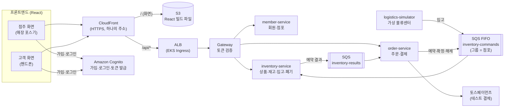
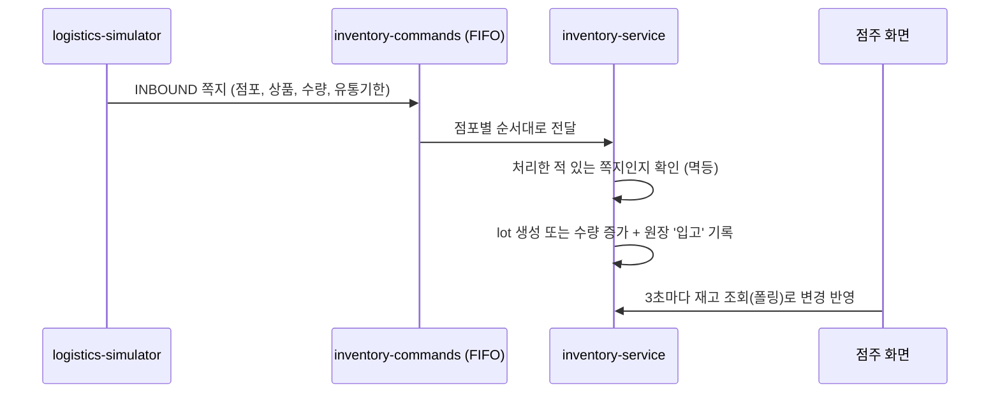
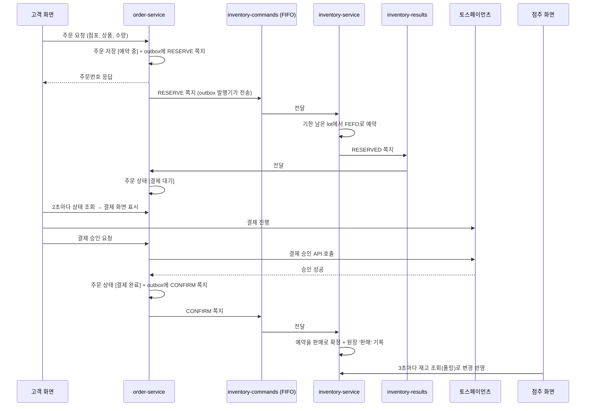
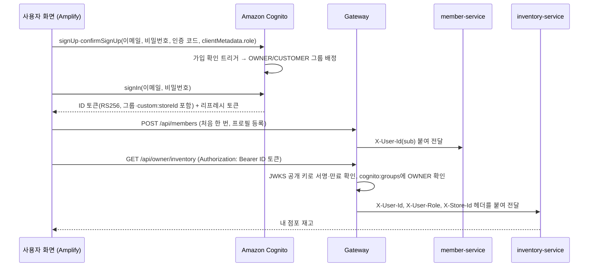

# FreshLink MVP 기획안 및 설계도

> 원본은 김진아 PC의 [기획안-및-설계도.md](./기획안-및-설계도.md). 팀원이 볼 수 있게 Markdown으로 옮겼다. 기능·흐름·담당·데이터 모델·메시지 명세를 다룬다. AWS 리소스·비용(인프라 산정)은 [aws-리소스-계획.md](aws-리소스-계획.md)에 있다.

작성일: 2026-10-08 · 개발 기간: 5주 · 인원: 3명

이번 프로젝트는 **1순위(MVP) 기능만 개발**한다. 이 문서는 MVP에서 무엇을 만들고, 기능들이 어떻게 이어지며, 누가 무엇을 맡는지를 정리한 것이다. 개발이 처음인 팀원도 이 문서 하나로 전체 그림을 잡을 수 있도록 썼다.

---

## 1. MVP 한눈에 보기

### 1-1. 우리가 만드는 것

편의점 점주와 고객이 **같은 재고 데이터**를 보는 서비스다. 핵심 약속은 두 가지다.

1. 고객이 결제하면 점주 화면의 재고가 **정확하게** 줄어든다. 동시에 여러 명이 사도 재고가 음수가 되지 않는다.
2. **유통기한이 지난 상품은 고객에게 팔리지 않는다.**

### 1-2. MVP가 완성되면 이렇게 동작한다

> 새벽 5시, 물류 시뮬레이터가 역삼점에 컵라면 20개(유통기한 10월 20일)와 우유 10개(유통기한 10월 9일) 입고 정보를 보낸다.
> 
> 
> 점주가 출근해 로그인하면 재고 화면에 상품이 **유통기한별로** 들어와 있고, 변동 이력에 '입고 +20'이 찍혀 있다. 임박 목록에서 오늘이 기한인 우유를 확인하고 2개를 폐기 처리하면 재고에서 빠진다.
> 
> 점심시간, 고객이 핸드폰으로 가입한 뒤 '역삼점'을 검색한다. 상품 목록에는 유통기한이 남은 수량만 보인다. 컵라면 1개를 주문하고 결제하면 주문 상태가 '결제 완료'가 된다. 같은 순간 점주 화면의 컵라면 재고가 20에서 19로 바뀌고, 신규 주문 목록에 주문이 뜬다.
> 
> 재고보다 많이 주문하면 거절되고, 결제에 실패하거나 10분 안에 결제하지 않으면 잡아 두었던 재고가 자동으로 돌아온다.
> 

### 1-3. MVP에서 하지 않는 것

장바구니(바로 구매만), 배송(매장 픽업만), 주문 취소·주문 내역, 점주의 주문 상태 변경, 알림 푸시, 매출 분석·추천 발주, 선착순 이벤트, 대용량 부하 테스트는 하지 않는다. 전체 목록은 [FreshLink 전체 기능 리스트업] 문서의 2·3순위와 보류 항목에 있다.

---

## 2. 먼저 알아둘 용어

처음 보는 단어가 많을 수 있다. 개발하면서 계속 나오는 말이니 이것만은 꼭 익히고 시작한다.

| 용어 | 쉬운 설명 | 우리 프로젝트에서는 |
| --- | --- | --- |
| lot (로트) | 같은 상품이라도 **유통기한이 같은 묶음** | '컵라면, 10월 20일까지, 20개'가 lot 하나 |
| FEFO | 유통기한이 **빨리 끝나는 것부터** 판다 (First Expired, First Out) | 주문이 오면 기한이 가장 가까운 lot부터 뺀다 |
| 재고 예약 | 결제 전에 상품을 **잠깐 잡아 두는 것** | 주문 → 예약 → 결제 성공 시 확정, 실패 시 예약 해제 |
| 원장 (ledger) | 재고가 **왜 바뀌었는지** 남기는 기록장 | 입고 +20, 판매 −1, 폐기 −2 같은 이력 |
| 메시지 큐 (SQS) | 서비스끼리 일을 **쪽지로 주고받는 우체통**. 받는 쪽은 자기 속도로 꺼내 처리 | 주문 서비스가 "재고 1개 예약해 줘" 쪽지를 재고 서비스 우체통에 넣는다 |
| FIFO 큐·메시지 그룹 | 넣은 **순서대로** 꺼내 주는 큐. 같은 그룹의 쪽지는 한 번에 하나씩만 처리 | 그룹 = 점포. 같은 점포 재고는 한 줄로 서서 처리되니 꼬이지 않는다 |
| Saga | 여러 서비스에 걸친 작업을 **단계별로 진행하고, 중간에 실패하면 앞 단계를 되돌리는** 방식 | 예약 → 결제 → 확정. 결제 실패 시 예약 해제 |
| Outbox | DB 저장과 쪽지 보내기를 **함께 성공시키는** 방법. 쪽지를 먼저 DB 표에 적어 두고, 별도 일꾼이 꺼내 보낸다 | 주문은 저장됐는데 쪽지가 안 가는 사고를 막는다 |
| 멱등 처리 | 같은 쪽지가 **두 번 와도 한 번만** 반영되게 하는 것 | 처리한 쪽지 번호를 기록해 두고, 이미 처리한 번호면 무시 |
| DLQ | 여러 번 처리에 실패한 쪽지를 **따로 모아 두는 우체통** | 이상한 쪽지 때문에 전체가 멈추지 않게 한다 |
| 폴링 | 화면이 **일정 간격으로 서버에 다시 물어보는** 방식 | 점주 재고 화면은 3초마다, 고객 주문 상세는 2초마다 다시 조회해 새로고침 없이 갱신된다 |

---

## 3. 시스템 구성

### 3-1. MVP 구성도

MVP는 

- 서비스 3개
- 시뮬레이터 1개
- 게이트웨이 1개로 구성한다.

사용자는 하나의 주소(CloudFront)로 접속하고, 화면 파일은 S3에서, API는 EKS에서 받는다.


    

**가장 중요한 규칙: 재고를 바꾸는 일은 전부 `inventory-commands` 큐를 거친다.** 

입고, 예약, 확정, 해제, 폐기 모두 쪽지로 들어와서, 점포별로 한 줄로 서서 처리된다. 

그래서 DB 락 없이도 같은 점포 재고가 꼬이지 않는다.

### 3-2. 서비스별 역할

| 서비스 | 하는 일 | 가진 데이터 |
| --- | --- | --- |
| CloudFront + S3 | 화면(React 빌드 파일)을 S3에 올리고 CloudFront로 전 세계에 빠르게 전달한다. `/api/*` 요청은 EKS로 넘긴다 | React 빌드 파일 |
| Amazon Cognito | 회원가입·로그인·로그인 토큰(JWT) 발급. AWS 관리형이라 클러스터 밖에서 돈다 | 계정(이메일, 비밀번호), 그룹(OWNER/CUSTOMER) |
| Gateway | 모든 API 요청의 입구. Cognito가 발급한 로그인 토큰(JWT)을 확인하고 사용자 정보를 뒤 서비스에 넘긴다 | 없음 |
| member-service | 회원 프로필, 점포 정보·점포 검색 (비밀번호와 토큰은 다루지 않는다) | 회원 프로필, 점포 |
| inventory-service | 상품·재고 조회, 입고·예약·확정·해제·폐기 처리, 유통기한 확인, 점주 재고 조회 | 상품, lot, 예약, 원장, 입고 |
| order-service | 주문 생성, 결제, 주문 상태 관리, Saga 진행 | 주문, 결제 |
| logistics-simulator | 물류센터 역할. 점포별 입고 쪽지를 큐에 넣는다 | 없음 (더미 입고 데이터 생성) |

### 3-3. 기획안 대비 MVP에서 단순화한 것

기획안은 2순위까지 고려한 구조다. MVP에서는 처음 개발하는 팀원 기준으로 아래처럼 줄였다. 2순위를 하게 되면 그때 다시 나눈다.

| 기획안 | MVP | 이유 |
| --- | --- | --- |
| payment-service 별도 | order-service 안에서 결제 | 서비스 수를 줄이고, 토스 결제 승인 API 호출만 하면 된다 |
| notification-service 별도 | 두지 않음 | 알림 기능 자체가 2순위 |
| store-query-service (CQRS) | inventory-service가 고객 조회까지 처리 | 조회 폭주 대응은 2순위 |
| SNS로 여러 서비스에 전파 | SQS 큐 2개로 충분 | 예약 결과를 받는 곳이 order-service 하나뿐 |
| ElastiCache(Redis) | 사용 안 함 | 선착순·조회 캐시가 2순위 |
| 고객 주문 상태 실시간 푸시 | 2초마다 주문 상태 조회(폴링) | 단순하고 MVP 시연에 충분 |

---

## 4. 전체 흐름

### 4-1. 입고: 물류센터 → 재고



### 4-2. 주문 성공: 예약 → 결제 → 확정



### 4-3. 주문 실패: 세 가지 경우

| 경우 | 무슨 일이 일어나나 | 결과 |
| --- | --- | --- |
| 재고 부족 | inventory-service가 예약 실패(RESERVE_FAILED) 쪽지를 보낸다 | 주문 상태 [재고 부족으로 취소], 고객 화면에 안내 |
| 결제 실패 | order-service가 해제(RELEASE) 쪽지를 보낸다 | 예약 재고 복원, 주문 상태 [결제 실패] |
| 10분 안에 결제 안 함 | order-service 스케줄러가 오래된 [결제 대기] 주문을 찾아 RELEASE 쪽지를 보낸다 | 예약 재고 복원, 주문 상태 [시간 초과 취소] |

### 4-4. 유통기한·폐기

1. inventory-service 스케줄러가 매일 자정(시연 중에는 1분마다)에 lot을 확인한다.
2. 유통기한이 **24시간 이내**면 '임박', **지났으면** '경과'로 표시한다.
3. 경과 lot은 고객 화면의 구매 가능 수량에서 빠진다. 예약할 때도 제외된다.
4. 점주가 임박·경과 lot을 골라 폐기하면, inventory-service가 DISPOSE 쪽지를 큐에 넣고 처리한다. 원장에 '폐기'가 기록된다.

**재고 계산 공식**: 고객에게 보이는 구매 가능 수량 = 유통기한이 지나지 않은 lot들의 (수량 − 예약된 수량) 합계.

---

### 3-4. 기술 스택

| 영역 | 기술 |
| --- | --- |
| 프론트엔드 | React (점주 화면 `/owner`, 고객 화면 `/customer`를 한 앱에서 라우팅으로 분리) |
| 프론트 배포 | S3(비공개 버킷) + CloudFront(OAC), ACM 인증서로 HTTPS |
| 백엔드 | Java 21, Spring Boot 4.0.x, Spring Data JPA, Spring Security(OAuth2 Resource Server), Spring Cloud Gateway(Spring Cloud 2025.1.x), Spring Cloud AWS 4.x(SQS), Jackson 3 |
| 인증 | Amazon Cognito User Pool (가입·로그인·토큰 발급), 프론트는 AWS Amplify Auth, Gateway는 Cognito 공개 키(JWKS)로 RS256 검증 (자세한 이유는 [기술스택과 선택이유.md](%EA%B8%B0%EC%88%A0%EC%8A%A4%ED%83%9D%EA%B3%BC%20%EC%84%A0%ED%83%9D%EC%9D%B4%EC%9C%A0.md) 3-7) |
| DB | Amazon RDS MySQL (서비스마다 스키마 분리, 서로의 표를 직접 조회하지 않는다) |
| 메시징 | Amazon SQS (FIFO 1개, 표준 1개, 각각 DLQ) |
| 결제 | 토스페이먼츠 테스트 키 |
| 백엔드 배포 | AWS EKS, AWS Load Balancer Controller(ALB Ingress), Terraform, GitHub Actions, ArgoCD |
| 로컬 개발 | Docker Compose (MySQL + LocalStack으로 SQS 흉내) |
| 관측성 | Prometheus(지표) + Grafana(화면) + Loki(로그) + Zipkin(분산 추적). 서비스는 Spring Boot Actuator·Micrometer로 지표를 내보내고, Micrometer Tracing으로 Zipkin에 추적을 보낸다. 로그는 Grafana Alloy가 모아 Loki로 보낸다 (자세한 이유는 [기술스택과 선택이유.md](%EA%B8%B0%EC%88%A0%EC%8A%A4%ED%83%9D%EA%B3%BC%20%EC%84%A0%ED%83%9D%EC%9D%B4%EC%9C%A0.md) 3-5) |

### 3-5. 프론트엔드 배포 구조 (CloudFront + S3)

React는 빌드하면 HTML·JS·CSS 정적 파일만 남는다. 정적 파일은 서버를 띄울 필요 없이 **S3에 올리고 CloudFront로 전달하는 것이 AWS의 정석 구성**이다. 서버 관리가 없고, 비용이 적고, HTTPS와 캐싱이 기본으로 된다.

| 경로 | 보내는 곳 | 설정 |
| --- | --- | --- |
| `/*` (기본) | S3 버킷 | 버킷은 비공개, CloudFront만 읽을 수 있게 OAC 설정. 정적 파일은 캐싱 |
| `/api/*` | ALB → EKS Gateway | 캐싱 끔, 로그인 토큰 헤더·쿼리 그대로 전달 |

화면과 API를 **같은 CloudFront 주소**로 묶으면 CORS 설정이 필요 없고, HTTPS 인증서도 한 곳에서 관리한다.

설정할 때 주의할 점은 두 가지다.

1. **화면 주소 새로고침:** `/owner/inventory`에서 새로고침하면 S3에 그런 파일이 없어 오류가 난다. CloudFront Function으로 확장자 없는 경로를 `/index.html`로 바꿔 준다. CloudFront의 '사용자 정의 오류 응답'은 API 오류까지 바꿔 버리므로 쓰지 않는다.
2. **배포:** GitHub Actions에서 `npm run build` → S3 업로드 → CloudFront 캐시 무효화(`/index.html`) 순서로 실행한다. CloudFront용 ACM 인증서는 us-east-1 리전에서 발급한다.

---

### 3-6. 로그인과 토큰 검증

한 줄로 말하면 **Amazon Cognito가 JWT를 발급하고, Gateway가 그 JWT를 검증한다.**

> **변경 (2026-10-13):** 처음에는 member-service가 비밀번호를 저장하고 HS256 JWT를 직접 발급하기로 했으나, AWS 관리형 인증 서비스인 Cognito로 바꿨다. Keycloak도 검토했지만 AWS 관리형이 아니라 EKS에 직접 띄워야 하고(메모리 1 GiB 이상 + 전용 DB), 노드가 빠듯하고 주말마다 클러스터를 지우는 구조와 맞지 않았다. 비교와 이유는 [기술스택과 선택이유.md](%EA%B8%B0%EC%88%A0%EC%8A%A4%ED%83%9D%EA%B3%BC%20%EC%84%A0%ED%83%9D%EC%9D%B4%EC%9C%A0.md) 3-7.

|  | 가입·로그인 (Cognito, 화면은 김경우) | 검증 (Gateway, 김진아) |
| --- | --- | --- |
| 언제 | 처음 한 번 (이후 토큰 갱신은 Amplify가 자동으로) | 그 뒤 모든 API 요청마다 |
| 받는 것 | 이메일 + 비밀번호 | 요청 헤더의 ID 토큰 (`Authorization: Bearer ...`) |
| 하는 일 | 비밀번호를 확인하고, 맞으면 Cognito 개인 키로 서명한 JWT(RS256)를 발급 | Cognito 공개 키(JWKS)로 서명이 위조되지 않았는지, 만료되지 않았는지 확인 |
| DB 조회 | Cognito가 자기 사용자 저장소를 본다. 우리 DB는 보지 않는다 | 안 함 (공개 키만 있으면 됨) |

비유하면 로그인은 놀이공원 매표소(신분증 확인 후 손목띠 채우기), 검증은 놀이기구 입구 직원(손목띠가 진짜인지, 오늘 날짜인지만 확인)이다. 매표소를 우리가 직접 운영하지 않고 AWS에 맡긴 셈이다.


    

**ID 토큰에서 쓰는 정보**: `sub`(Cognito 사용자 ID, UUID), `cognito:groups`(OWNER/CUSTOMER), `custom:storeId`(점주만), `aud`(앱 클라이언트 ID), `exp`(만료 시각). `custom:storeId`가 ID 토큰에만 들어가므로 API에는 ID 토큰을 보낸다. 비밀번호 같은 민감 정보는 들어가지 않는다. JWT 내용은 누구나 열어 볼 수 있고, 서명은 '위조 방지'만 해 준다.

**Gateway가 하는 일**

1. **라우팅:** `/api/members/**`, `/api/stores`는 member, `/api/owner/inventory/**`·`/api/stores/{id}/products`·`/api/owner/disposals`는 inventory, `/api/orders/**`·`/api/owner/orders`는 order로 보낸다.
2. **공개 경로 예외:** 점포 검색, 점포 상품 목록은 토큰 없이 통과시킨다. 회원가입·로그인은 브라우저가 Cognito로 바로 가므로 Gateway를 거치지 않는다.
3. **토큰 검증:** Cognito 공개 키(JWKS)로 RS256 서명, 만료, 발급자(`iss`), `token_use = id`, `aud`(= 앱 클라이언트 ID)를 확인하고, 잘못되면 401을 돌려준다. 공개 키는 받아서 캐시해 두므로 요청마다 Cognito에 묻지 않는다.
4. **역할 1차 확인:** `/api/owner/**`는 `cognito:groups`에 OWNER가 있어야 통과시키고, 아니면 403을 돌려준다.
5. **사용자 정보 전달:** 토큰에서 꺼낸 정보를 `X-User-Id`(=`sub`), `X-User-Role`(=그룹), `X-Store-Id`(=`custom:storeId`) 헤더로 붙여 넘긴다. `X-User-Id`는 UUID 문자열이므로 다른 서비스의 사용자 ID 칸은 `VARCHAR(36)`으로 둔다.
6. **위조 헤더 제거:** 클라이언트가 보낸 `X-User-*`, `X-Store-Id` 헤더는 먼저 지우고 다시 채운다. 이걸 빠뜨리면 다른 사람인 척 요청할 수 있다.
**각 서비스가 하는 일 (소유권 확인)**: Gateway는 '로그인한 점주인지'까지만 안다. '이 lot이 내 점포 것인지', '이 주문이 내 주문인지'는 각 서비스가 헤더 값과 DB를 비교해 확인하고, 아니면 403을 돌려준다. 점주 API는 점포 ID를 요청 주소로 받지 않고 항상 `X-Store-Id`를 쓴다.

**1주 차에 김경우와 김진아가 정할 것**

| 항목 | MVP 결정안 |
| --- | --- |
| 발급 | Amazon Cognito User Pool `freshlink-users` (Terraform `cognito` 모듈, 유지 묶음). member-service는 토큰을 발급하지 않는다 |
| 서명 방식 | RS256. Cognito가 개인 키로 서명하고 Gateway는 공개 키(JWKS)로 검증한다. 공유하는 비밀 키가 없다 |
| 역할·점포 | 그룹 `OWNER`/`CUSTOMER`. 화면이 `signUp`·`confirmSignUp`에 `clientMetadata.role`로 넘기면 가입 확인 트리거가 배정한다. 점주의 점포는 사용자 속성 `custom:storeId`(ID 토큰에 들어간다) |
| 보내는 토큰 | ID 토큰 (`Authorization: Bearer`). Gateway는 `aud`가 앱 클라이언트 ID인지 확인한다 |
| 만료 시간 | ID 토큰 1시간, 리프레시 토큰 1일. 갱신은 Amplify가 자동으로 한다 |
| 로그아웃 | Amplify `signOut()`. 리프레시 토큰은 무효가 되고, 이미 받은 ID 토큰은 만료까지 유효하다 |
| 토큰 보관 | Amplify 기본값(localStorage) (MVP 기준 단순화) |
| 프론트 라이브러리 | AWS Amplify Auth (`aws-amplify`). 가입·로그인 화면은 우리가 직접 만든다. 환경 변수 `VITE_COGNITO_USER_POOL_ID`, `VITE_COGNITO_CLIENT_ID` |

--
### 8-1. 담당 영역

한 사람이 **서비스 하나를 화면부터 DB까지 끝까지** 책임진다. 그래야 기능이 어디서 막혔는지 바로 알 수 있고, 각자 '내가 만든 서비스'를 설명할 수 있다.

| 담당 | 서비스 | 화면 | 기능 ID |
| --- | --- | --- | --- |
| 김진아 (팀장·인프라) | Gateway(라우팅·JWT 검증), Cognito User Pool(Terraform·Lambda 트리거), logistics-simulator, 공통 모듈(Outbox 발행기·멱등 처리), 인프라 전체 | 공통 레이아웃·라우팅 | C-03, E-03, E-04, E-12, E-13, I-01, I-02, I-03, I-09, I-10, I-11 |
| 이태우 | inventory-service | 점주 재고·lot 상세·이력·임박·폐기, 고객 점포 상품 목록 | S-10, S-11, S-13, S-15, S-20, S-30~32, U-10, E-01, E-09 |
| 김경우 | member-service, order-service | 로그인·가입(Amplify Auth), 고객 홈(점포 검색), 고객 주문·결제·주문 상세, 점주 신규 주문 목록 | C-01, C-02, U-01, U-21~23, U-31, S-50, E-02 |

**인증은 둘로 나눴다.** 

1. 토큰 **발급**은 Amazon Cognito가 한다(2026-10-13 변경). User Pool·그룹·Lambda 트리거를 Terraform으로 만드는 일은 인프라라 김진아가 맡는다.
2. 가입·로그인 **화면**(Amplify Auth)과 회원 프로필·점포를 다루는 member-service는 김경우가 맡는다. member-service는 비밀번호와 토큰을 다루지 않고 Cognito `sub`를 키로 프로필만 저장한다.
3. 모든 요청에서 토큰을 **검증**하고 서비스로 길을 나눠 주는 일(Gateway)은 ALB·CloudFront 경로 설계와 맞물려 있어 김진아가 맡는다. 김경우와 김진아는 1주 차에 토큰에서 쓸 정보(그룹, `storeId` 클레임)를 함께 확정한다(3-6 결정안).
4. 이태우는 기능 개수가 가장 많지만 대부분 조회 화면이다. 
5. 김경우는 회원 기능이 쉬운 CRUD인 대신 결제 연동과 Saga 실패 처리처럼 흐름이 까다로운 부분을 맡는다. 
6. 김진아는 인프라 전체와, 모두가 쓰는 공통 모듈을 맡는다.
7. 이태우와 김경우는 서비스 사이가 쪽지로 이어져 있어 **메시지 명세(5장)를 같이 정하고 같이 테스트**한다. 
8. 김진아의 공통 모듈(Outbox·멱등 처리)은 이태우와 김경우가 그대로 가져다 쓰므로 2주 차 안에 먼저 끝낸다.

### 8-2. 같이 지킬 규칙

- **브랜치:** `main`(배포) ← `dev`(통합) ← `feat/기능ID-설명`(예: `feat/S-32-disposal`). `main`에 직접 올리지 않는다.
- **PR:** 필수가 아니다. MSA라 각자 자기 레포를 끝까지 책임지고, 담당자가 `main`·`dev`에 직접 push한다. 리뷰가 필요하면 PR을 열어 요청하고, 쪽지 형식이 바뀌는 변경은 상대 담당자에게 꼭 알린다.
- **API 명세:** 각 서비스는 Swagger로 API 문서를 자동 생성한다. 프론트는 이 문서를 보고 개발한다.
- **메시지 명세:** 쪽지 형식을 바꾸면 이 문서 5장을 먼저 고치고 상대 담당자에게 알린다.
- **막히면:** 30분 넘게 혼자 막혀 있으면 팀 채널에 질문한다. 막힌 것을 공유하는 것도 진행 상황이다.

--
'완료 기준'을 모두 만족해야 그 기능이 끝난 것으로 본다. '담당'은 그 기능의 화면·API·DB를 끝까지 책임지는 사람이다. 화면이 없는 기능은 API나 로그로 확인한다.

### 6-1. 회원·점포 (member-service, Gateway)

| ID | 기능 | 담당 | 화면 | API | 완료 기준 |
| --- | --- | --- | --- | --- | --- |
| C-01 | 회원가입 | 김경우 | 공통 가입 화면 | Cognito `signUp`·`confirmSignUp` (Amplify), `POST /members`(프로필 등록) | 점주/고객 유형을 골라 가입하고 이메일 인증 코드로 확인된다. 유형에 맞는 그룹(OWNER/CUSTOMER)에 들어간다. 이메일 중복 가입은 Cognito가 막는다 |
| C-02 | 로그인·로그아웃 | 김경우 | 공통 로그인 화면 | Cognito `signIn`·`signOut` (Amplify) | 로그인하면 Cognito 토큰을 받고, 그룹에 따라 점주·고객 화면으로 이동한다. 로그아웃하면 토큰이 지워진다 |
| C-03 | 역할별 권한 분리 | 김진아 | 전체 | Gateway | 고객이 점주 API를 부르면 403이 나온다. 로그인 없이, 또는 위조·만료된 토큰으로 부르면 401이 나온다 |
| U-01 | 점포 검색 | 김경우 | 고객 홈 | `GET /stores?keyword=` | 점포명·주소 일부로 검색하면 목록이 나온다 |
| E-12 | 더미 데이터 | 김진아 | 없음 | 초기 SQL + Cognito 시드 스크립트 | 점포 3개, 상품 30개, 점주 계정 3개가 기본으로 들어가 있다. 점주 계정은 Cognito에 OWNER 그룹·`custom:storeId`와 함께 만들어져 있다 |

### 6-2. 재고·입고·폐기 (inventory-service)

| ID | 기능 | 담당 | 화면 | API | 완료 기준 |
| --- | --- | --- | --- | --- | --- |
| S-10 | 재고 목록 조회 | 이태우 | 점주 재고 화면 | `GET /owner/inventory` | 내 점포 상품별 총 수량·예약 수량·구매 가능 수량이 나온다 |
| S-11 | lot별 재고 조회 | 이태우 | 점주 재고 상세 | `GET /owner/inventory/{productId}/lots` | 상품을 누르면 유통기한별 수량이 나온다 |
| S-13 | 재고 변동 이력 | 이태우 | 점주 이력 화면 | `GET /owner/inventory/ledger` | 입고·판매·폐기가 시간순으로 나오고, 이력 합계가 현재 재고와 같다 |
| S-15 | 실시간 재고 반영 | 이태우 | 점주 재고 화면 | `GET /owner/inventory` (3초 폴링) | 고객 결제·입고·폐기 후 3초 안에 점주 화면이 새로고침 없이 바뀐다 |
| S-20 | 입고 처리 | 이태우 | 없음 (이력에서 확인) | INBOUND 쪽지 | 쪽지를 받으면 lot이 생기고 원장에 '입고'가 남는다. 같은 shipmentId는 두 번 반영되지 않는다 |
| S-30 | 임박 목록 | 이태우 | 점주 임박 화면 | `GET /owner/inventory/expiring` | 유통기한 24시간 이내·경과 lot이 구분되어 나온다 |
| S-31 | 기한 경과 판매 차단 | 이태우 | 고객 상품 목록 | 내부 로직 | 경과 lot은 구매 가능 수량에서 빠지고, 예약에도 쓰이지 않는다 |
| S-32 | 폐기 처리 | 이태우 | 점주 임박 화면 | `POST /owner/disposals` | 폐기하면 해당 lot 수량이 줄고 원장에 '폐기'가 남는다 |
| U-10 | 점포 상품 목록 | 이태우 | 고객 점포 화면 | `GET /stores/{storeId}/products` | 상품명, 가격, 구매 가능 수량이 나온다. 0개인 상품은 '품절'로 표시된다 |
| E-01 | 점포별 순서 처리 | 이태우 | 없음 | FIFO 큐 소비 | 같은 점포에 동시에 예약 100건을 넣어도 재고가 음수가 되지 않는다 |
| E-09 | 유통기한 스케줄러 | 이태우 | 없음 | 스케줄러 | 정해진 주기마다 lot의 임박·경과 상태가 갱신된다 |

### 6-3. 주문·결제 (order-service)

| ID | 기능 | 담당 | 화면 | API | 완료 기준 |
| --- | --- | --- | --- | --- | --- |
| U-21 | 주문 생성 | 김경우 | 고객 상품 화면 [바로 구매] | `POST /orders` | 주문이 [예약 중]으로 저장되고 RESERVE 쪽지가 나간다 |
| U-22 | 결제 | 김경우 | 고객 결제 화면 | `POST /orders/{id}/payment/confirm` | 토스 테스트 결제가 승인되면 [결제 완료]가 되고 CONFIRM 쪽지가 나간다 |
| U-23 | 재고 부족 시 거절 | 김경우 | 고객 주문 화면 | 내부 로직 | 재고보다 많이 주문하면 [재고 부족으로 취소]와 안내 문구가 나온다 |
| U-31 | 주문 상태 확인 | 김경우 | 고객 주문 상세 | `GET /orders/{id}` | 예약 중 → 결제 대기 → 결제 완료(또는 취소) 상태가 화면에 보인다 |
| S-50 | 신규 주문 목록 | 김경우 | 점주 주문 화면 | `GET /owner/orders` | 결제 완료된 주문이 최신순으로 나온다 |
| E-02 | 주문 Saga | 김경우 | 없음 | 쪽지 흐름 | 결제 실패·10분 미결제 시 RELEASE가 나가고 예약 재고가 돌아온다 |

### 6-4. 공통 모듈·인프라

| ID | 기능 | 담당 | 완료 기준 |
| --- | --- | --- | --- |
| E-03 | Outbox 발행기 | 김진아 | 서비스는 쪽지를 outbox 표에 저장만 하고, 발행기가 1초마다 꺼내 보낸다. 보낸 건은 '발행 완료'로 바뀐다 |
| E-04 | 멱등 처리 | 김진아 | 같은 messageId 쪽지를 두 번 보내도 재고·주문이 한 번만 바뀐다 |
| E-13 | logistics-simulator | 김진아 | 명령 한 번으로 점포 3곳에 입고 쪽지를 보낼 수 있다. 시연 시 버튼이나 API로 실행한다 |
| I-01 | 인프라 코드화 | 김진아 | Terraform 명령으로 VPC·EKS·RDS·IRSA가 생성·삭제된다 |
| I-10 | 메시징 인프라 | 김진아 | Terraform으로 SQS 큐 2개와 DLQ 2개가 생성된다 |
| I-02 | CI/CD | 김진아 | main 브랜치에 합치면 이미지 빌드 후 EKS에 자동 배포된다 |
| I-11 | 프론트엔드 배포 | 김진아 | CloudFront 주소로 접속하면 React 화면이 뜨고, `/api/*` 요청이 EKS로 전달된다. 새로고침해도 `/owner/inventory` 같은 화면 주소가 깨지지 않는다. `main`에 합치면 S3 업로드와 캐시 무효화가 자동으로 된다 |
| I-09 | 비용 알림 | 김진아 | 정한 금액을 넘으면 팀원 메일로 알림이 온다 |
| I-03 | 관측성 | 김진아 | Grafana 한 화면에서 서비스별 요청 수·응답 시간·에러율과 JVM 메모리를 보고, 서비스 로그를 검색하고, 로그의 traceId를 눌러 주문 한 건이 Gateway → order → inventory를 지나간 흐름을 Zipkin에서 확인할 수 있다 |

---

## 7. 데이터 모델

서비스마다 자기 표만 가진다. 다른 서비스의 데이터가 필요하면 API나 쪽지로 받는다.

| 서비스 | 표 | 주요 컬럼 |
| --- | --- | --- |
| member | member | sub(PK, Cognito 사용자 ID), email, name, role(OWNER/CUSTOMER), created_at. 비밀번호는 Cognito에만 있고 여기에는 없다 |
| member | store | id, store_code, name, address, owner_id(=member.sub) |
| inventory | product | id, product_code, name, category, price |
| inventory | inventory_lot | id, store_id, product_id, expiry_date, quantity, reserved_quantity |
| inventory | reservation | id, order_id, lot_id, quantity, status(RESERVED/CONFIRMED/RELEASED) |
| inventory | ledger | id, store_id, lot_id, type(INBOUND/SALE/DISPOSE), quantity, ref_id, created_at |
| inventory | inbound | id, shipment_id(유니크), store_id, received_at |
| order | orders | id, customer_id(=Cognito sub), store_id, product_id, quantity, amount, status, created_at |
| order | payment | id, order_id, payment_key, amount, status |
| inventory, order 공통 | outbox | id, queue_name, group_id, payload, published(true/false), created_at |
| inventory, order 공통 | processed_message | message_id(PK), processed_at |

주문 상태는 `RESERVING`(예약 중) → `PAYMENT_WAITING`(결제 대기) → `PAID`(결제 완료)로 진행한다. 실패하면 `OUT_OF_STOCK`, `PAYMENT_FAILED`, `EXPIRED` 중 하나로 끝난다.

--

## 5. 메시지 명세

모든 쪽지는 JSON이며, 공통으로 `messageId`(중복 확인용), `type`, `createdAt`(ISO-8601 `+09:00`)을 가진다. 필드 타입과 DTO 구성은 [백엔드-공통작업-인수인계.md](백엔드-공통작업-인수인계.md) 3-3이 기준이다.

`storeId`는 숫자 `store.id`(BIGINT)다. 쪽지·토큰 `custom:storeId`·DB·URL 모두 같은 값을 쓰고, FIFO `MessageGroupId`에 쓸 때만 문자열로 변환한다.

| 큐 | 종류 | type | 보내는 곳 | 내용 |
| --- | --- | --- | --- | --- |
| `inventory-commands.fifo` | SQS FIFO, 그룹 = storeId | INBOUND | logistics-simulator | storeId, shipmentId, 상품코드, 수량, 유통기한 목록 |
|  |  | RESERVE | order-service | orderId, storeId, productId, 수량 |
|  |  | CONFIRM | order-service | orderId, storeId |
|  |  | RELEASE | order-service | orderId, storeId, 사유(`PAYMENT_FAILED`·`EXPIRED`) |
|  |  | DISPOSE | inventory-service | disposalId, storeId, lotId, 수량, 요청한 점주(requestedBy) |
| `inventory-results` | SQS 표준 | RESERVED | inventory-service | orderId, storeId, productId, 수량, 단가, 예약된 lot 목록 |
|  |  | RESERVE_FAILED | inventory-service | orderId, storeId, productId, 사유(`OUT_OF_STOCK`·`PRODUCT_NOT_FOUND`·`INVALID_QUANTITY`), 가능 수량 |
| `*-dlq` | 각 큐의 DLQ | 원본 그대로 | 3번 실패 시 자동 이동 | 담당자가 원인 확인 |

예시 (RESERVE):

```json
{
  "messageId": "b3f1c2e0-7a1d-4c55-9e0a-1f2a3b4c5d6e",
  "type": "RESERVE",
  "orderId": 1024,
  "storeId": 1,
  "productId": 15,
  "quantity": 1,
  "createdAt": "2026-10-08T12:30:00+09:00"
}
```

---
# 인프라 산정 (AWS 리소스·비용)

AWS 리소스의 종류·크기·수량, 노드·RDS 산정, 네트워크, 비용, 켜고 끄는 일정, Terraform 모듈 구성은 [aws-리소스-계획.md](aws-리소스-계획.md)로 옮겼다. 결론만 적으면 **환경(dev·prod)마다 EKS 워커 노드 t3.large 2대 + RDS db.t4g.small 1대**이고, 두 환경 합계는 5주에 약 205~240 USD(지원금 50만 원 안)다.
