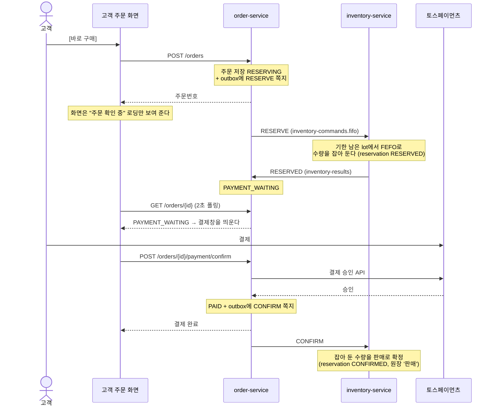

# 주문·결제 흐름과 재고 예약

작성: 김진아 · 2026-10-14 · 대상: order-service·고객 주문 화면 담당(김경우)과 그 Claude

> **한 줄 요약:** 고객은 **"주문하고 결제한다"**만 경험한다. **재고 예약(RESERVE)은 결제하는 동안 다른 사람이 같은 재고를 가져가지 않도록 시스템이 수량을 잠깐 잡아 두는 내부 단계**이고, 고객 화면·고객용 문구에는 나오지 않는다.

기준 문서는 [기획안-및-설계도.md](기획안-및-설계도.md) 4-2·4-3(흐름), 5장(메시지 명세), 7장(주문 상태)이다. 이 문서는 그 내용을 **고객이 보는 것**과 **백엔드 안에서 일어나는 것**으로 나눠 다시 적은 것이다. 겹치는 사실이 다르면 기획안이 맞다.

---

## 1. 고객이 보는 흐름

고객에게는 "예약"이라는 단계가 없다. FreshLink는 **매장 픽업 + 바로 구매**만 있고 장바구니·예약 구매 기능은 없다(기획안 1-3).

```
상품 화면 [바로 구매] → (잠깐 로딩) → 결제창(토스) → 결제 완료 화면 → 매장에서 픽업
```

| 고객이 하는 일 | 화면에 보이는 것 |
| --- | --- |
| [바로 구매]를 누른다 | 로딩 표시 "주문을 확인하고 있어요" (보통 1~2초) |
| 결제창이 뜬다 | 토스 결제창, 안내 "10분 안에 결제하지 않으면 주문이 취소돼요" |
| 결제한다 | "결제 완료" + 주문번호 |
| 재고가 모자랐다 | "재고가 부족해 주문이 취소됐어요" |
| 결제에 실패했다 | "결제에 실패했어요" |
| 10분 동안 결제하지 않았다 | "결제 시간이 지나 주문이 취소됐어요" |

## 2. 백엔드에서 일어나는 일



실패하면 잡아 둔 수량을 돌려놓는다(Saga 보상).

| 경우 | 백엔드 동작 | 주문 상태 |
| --- | --- | --- |
| 재고 부족 | inventory가 `RESERVE_FAILED`를 보낸다. 잡은 수량이 없으니 되돌릴 것도 없다 | `OUT_OF_STOCK` |
| 결제 실패 | order가 `RELEASE`(reason `PAYMENT_FAILED`)를 보낸다 | `PAYMENT_FAILED` |
| 10분 미결제 | order 스케줄러(ShedLock)가 오래된 `PAYMENT_WAITING`을 찾아 `RELEASE`(reason `EXPIRED`)를 보낸다 | `EXPIRED` |

## 3. 용어: 코드 이름과 화면 문구

**왼쪽 열은 코드·쪽지·DB 안에서만 쓰고, 고객에게는 오른쪽 열 문구만 보여 준다.**

| 내부 이름 (코드·쪽지·DB) | 뜻 | 고객 화면 문구 |
| --- | --- | --- |
| 주문 상태 `RESERVING` | 주문은 저장됐고 재고를 잡는 중 | "주문 확인 중" (로딩) |
| 주문 상태 `PAYMENT_WAITING` | 재고를 잡았고 결제를 기다림. 10분 타이머가 돈다 | "결제 대기" + 10분 안내, 결제창 |
| 주문 상태 `PAID` | 결제 승인됨 | "결제 완료" |
| 주문 상태 `OUT_OF_STOCK` | 재고를 못 잡음 | "재고 부족으로 취소" |
| 주문 상태 `PAYMENT_FAILED` | 결제 실패, 잡은 재고 반환 | "결제 실패" |
| 주문 상태 `EXPIRED` | 10분 미결제, 잡은 재고 반환 | "시간 초과로 취소" |
| 쪽지 `RESERVE` / `RESERVED` / `RESERVE_FAILED` | 재고 잡기 요청 / 성공 / 실패 | 보이지 않음 |
| 쪽지 `CONFIRM` | 잡은 재고를 판매로 확정 | 보이지 않음 |
| 쪽지 `RELEASE` | 잡은 재고를 되돌림 | 보이지 않음 |
| inventory `reservation`, `reserved_quantity` | 잡아 둔 기록·수량 | 고객에게는 보이지 않음. **점주** 재고 화면(S-10)에는 "예약 수량"으로 나온다 |

점주는 재고 화면에서 "총 수량 · 예약 수량 · 구매 가능 수량"을 본다(S-10). 그래서 "예약"이라는 말은 **점주 재고 화면에서만** 쓴다. 고객 화면에서는 쓰지 않는다.

## 4. Claude 작업 규칙

```
✅ 고객 화면(src/customer/**)의 문구·버튼·토스트에는 3장 "고객 화면 문구"만 쓴다
✅ RESERVING은 화면에서 로딩 상태로만 다룬다. 고객이 따로 누르거나 기다리는 단계로 설계하지 않는다
✅ PAYMENT_WAITING이 되면 바로 토스 결제창을 띄운다. 10분 안내 문구를 함께 보여 준다
✅ 상태 enum 이름(RESERVING 등)은 기획안 7장 그대로 쓴다. 바꾸지 않는다 (API 응답·쪽지와 맞물려 있다)
✅ 상태 → 고객 문구 변환은 프론트 한 곳(주문 화면 폴더의 함수 하나)에서 한다
⛔ 고객 화면에 "예약", "예약 중", "예약 완료", "예약 취소"를 쓰지 않는다
⛔ "예약하기" 버튼, 예약 목록, 예약 내역, 예약 후 나중에 결제 같은 기능을 만들지 않는다 (MVP에 없다)
⛔ 고객용 새 API 경로·필드에 reservation/reserve를 넣지 않는다 (예: POST /reservations, reservationId ✗ → POST /orders, orderId)
⛔ order-service가 inventory DB의 재고·예약을 직접 읽거나 고치지 않는다. 쪽지(RESERVE·CONFIRM·RELEASE)로만 요청한다
⛔ "주문"과 "예약"을 같은 것으로 다루지 않는다. 주문(orders)은 order-service의 것, 예약(reservation)은 inventory-service의 것이다
```

헷갈리면 이렇게 생각한다: **예약은 결제창이 떠 있는 동안 재고에 붙여 두는 "찜 표시"다.** 결제하면 판매로 바뀌고(CONFIRM), 안 하면 떼어 낸다(RELEASE). 고객은 이 표시를 볼 일이 없다.
