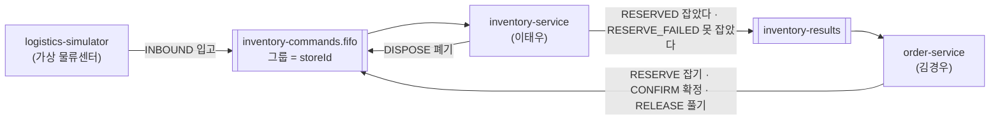
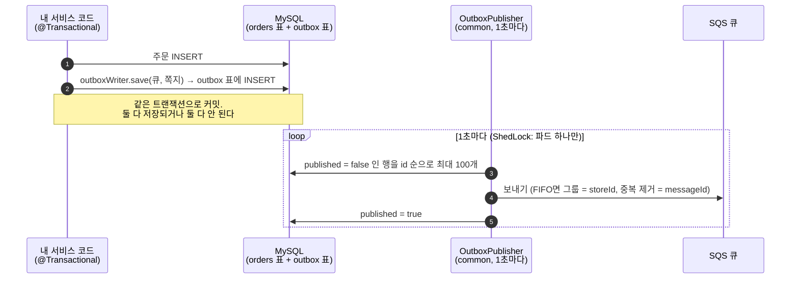
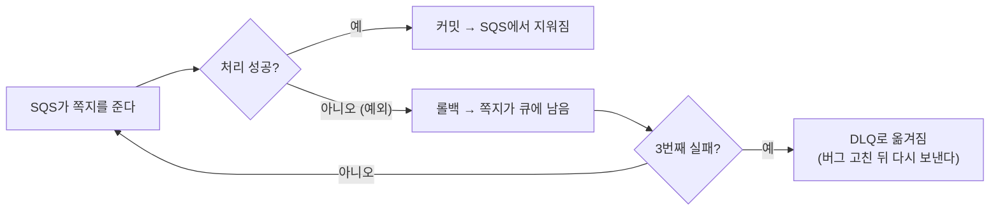

# 팀원 가이드 1. common 이해하기 (쪽지·오류 응답·Outbox·멱등)

작성: 김진아 · 2026-10-17 · 대상: 이태우(inventory-service), 김경우(member-service·order-service)

> **한 줄 요약:** `common`은 세 서비스가 **같은 모양의 쪽지와 같은 모양의 오류 응답**을 쓰게 해 주는 라이브러리다. v0.2.0부터는 "DB 저장과 쪽지 보내기를 한 묶음으로 처리하는 장치(Outbox)"와 "같은 쪽지를 두 번 처리하지 않게 거르는 장치(멱등)"도 들어 있다. 여러분은 클래스를 **가져다 부르기만** 하면 된다.

이 문서를 다 읽으면 아래 네 가지를 말로 설명할 수 있어야 한다. 맨 끝 [12장](#12-스스로-점검)에 확인 질문이 있다.

1. 내 서비스가 어떤 쪽지를 보내고 받는지
2. 오류가 났을 때 응답이 어떤 모양으로 나가고, 오류 코드를 어떻게 더하는지
3. Outbox가 왜 필요하고 어떻게 동작하는지
4. 멱등 처리가 왜 필요하고 어떻게 동작하는지

배포·AWS 이야기는 [팀원 가이드 2. 인프라와 배포 이해하기](팀원-가이드-2-인프라-배포.md)에 있다.

---

## 목차

0. [먼저 알아 둘 말](#0-먼저-알아-둘-말)
1. [common은 무엇이고 왜 따로 있나](#1-common은-무엇이고-왜-따로-있나)
2. [처음 한 번: common을 가져올 준비](#2-처음-한-번-common을-가져올-준비)
3. [쪽지 DTO 7종](#3-쪽지-dto-7종)
4. [공통 오류 응답](#4-공통-오류-응답)
5. [왜 Outbox와 멱등이 필요한가](#5-왜-outbox와-멱등이-필요한가)
6. [Outbox는 이렇게 동작한다](#6-outbox는-이렇게-동작한다)
7. [멱등 처리는 이렇게 동작한다](#7-멱등-처리는-이렇게-동작한다)
8. [내 서비스에 붙이기 (inventory·order)](#8-내-서비스에-붙이기-inventoryorder)
9. [혼자 시험해 보기](#9-혼자-시험해-보기)
10. [자주 나는 오류](#10-자주-나는-오류)
11. [지금 상태 (2026-10-17)](#11-지금-상태-2026-10-17)
12. [스스로 점검](#12-스스로-점검)
13. [더 볼 문서](#13-더-볼-문서)

---

## 0. 먼저 알아 둘 말

| 말 | 쉬운 뜻 |
| --- | --- |
| 쪽지(메시지) | 서비스끼리 주고받는 JSON 한 덩어리. "점포 1에 컵라면 20개 들어왔다" 같은 내용 |
| 큐 (SQS) | 쪽지를 넣어 두는 우편함. 보내는 쪽은 넣고 가고, 받는 쪽은 자기가 준비됐을 때 꺼낸다. 받는 서비스가 잠깐 꺼져 있어도 쪽지는 우편함에 남는다 |
| FIFO 큐 | 이름이 `.fifo`로 끝나는 큐. **같은 그룹 안에서는 넣은 순서대로** 꺼내진다. 우리는 그룹 = 점포 ID라서 "한 점포의 재고 명령은 순서대로" 처리된다 |
| DLQ | Dead Letter Queue. 3번 꺼내서 3번 다 처리에 실패한 쪽지가 옮겨지는 "실패 보관함" |
| DTO | 데이터를 담기만 하는 클래스. 우리 쪽지 클래스는 Java `record`다 |
| 트랜잭션 | "전부 되거나 전부 안 되거나". `@Transactional` 메서드 안에서 DB에 쓴 것은 메서드가 예외 없이 끝나야 한꺼번에 저장(커밋)되고, 예외가 나면 전부 없던 일(롤백)이 된다 |
| 멱등 | 같은 일을 두 번 해도 결과가 한 번 한 것과 같은 성질. "같은 쪽지가 두 번 와도 재고는 한 번만 줄어든다" |
| Outbox | "보낼 쪽지함" 표. 쪽지를 바로 보내지 않고 DB 표에 먼저 적어 두면, 별도 일꾼이 꺼내서 보낸다 |
| ShedLock | 파드가 2개 떠 있어도 정해진 작업을 **한 파드만** 하게 하는 잠금. DB `shedlock` 표에 "지금 내가 한다"를 적는 방식 |
| GitHub Packages | GitHub에 있는 라이브러리 창고. `common`은 여기에 버전을 붙여 올라가고, 서비스는 Gradle로 받아 간다 |

---

## 1. common은 무엇이고 왜 따로 있나

order-service가 inventory-service에 "재고 잡아 줘(RESERVE)"라는 쪽지를 보낸다고 하자. 두 사람이 쪽지 클래스를 각자 만들면 한쪽은 `productId`, 다른 쪽은 `itemId`라고 이름을 붙이는 일이 생긴다. 그러면 받는 쪽이 쪽지를 못 읽는다.

그래서 **쪽지 양식을 한 곳에서 한 번만** 만들고, 모두가 같은 버전을 가져다 쓴다. 그 한 곳이 [`common`](https://github.com/sesac-freshlink/common) 레포다. 관공서에서 모두가 같은 신청서 양식을 쓰는 것과 같다.

| 들어 있는 것 | 패키지 | 누가 쓰나 |
| --- | --- | --- |
| 쪽지 DTO 7종 + JSON 변환기 | `com.freshlink.common.message` | inventory, order, logistics-simulator |
| 공통 오류 응답 | `com.freshlink.common.error` | member, inventory, order |
| Outbox (v0.2.0) | `com.freshlink.common.outbox` | inventory, order |
| 멱등 처리 (v0.2.0) | `com.freshlink.common.idempotency` | inventory, order |

- `common`은 실행되는 앱이 아니라 **라이브러리(jar)** 다. 혼자 뜨지 않는다.
- 관리는 김진아가 한다. 고칠 게 보이면 직접 고치지 말고 김진아에게 말하거나 `common`에 PR을 올린다. 쪽지 형식이 바뀌는 PR은 두 사람에게 먼저 알린다.
- member-service는 쪽지를 쓰지 않는다. **오류 응답(4장)만** 쓴다.

---

## 2. 처음 한 번: common을 가져올 준비

GitHub Packages는 **읽을 때도 토큰**이 필요하다. 내 PC에서 한 번만 하면 된다. (GitHub Actions 안에서는 토큰이 자동으로 들어가서 할 일이 없다.)

**준비물:** GitHub 계정, IntelliJ, Windows PowerShell.

1. GitHub 오른쪽 위 프로필 사진 → **Settings** → 왼쪽 맨 아래 **Developer settings** → **Personal access tokens** → **Tokens (classic)** → **Generate new token (classic)** 을 누른다.
2. Note에 `freshlink-packages`, Expiration은 `90 days`, 권한은 **`read:packages` 하나만** 체크하고 **Generate token** 을 누른다. 나온 토큰을 복사한다(다시 볼 수 없다).
3. PowerShell을 열고 아래를 친다. `내GitHub아이디`와 `복사한토큰`은 바꿔 넣는다.

   ```powershell
   setx GITHUB_ACTOR "내GitHub아이디"
   setx GITHUB_TOKEN "복사한토큰"
   ```

   `SUCCESS: Specified value was saved.`가 두 번 나오면 성공이다.
4. IntelliJ를 **완전히 껐다가** 다시 켠다. 환경 변수는 새로 연 프로그램에만 보인다.
5. 확인: **새** PowerShell 창에서 아래를 친다.

   ```powershell
   echo $env:GITHUB_ACTOR    # 내 아이디가 나오면 성공
   ```

6. IntelliJ 오른쪽 **Gradle** 창에서 새로고침(🔄)을 누른다. 코드에 `import com.freshlink.common.message.command.ReserveMessage;`를 쳤을 때 빨간 줄이 없으면 성공이다.

> 토큰은 코드, `gradle.properties`, 커밋 어디에도 넣지 않는다. 90일 뒤 만료되면 1~5를 다시 한다.

서비스 `build.gradle`에는 이미 아래가 들어 있다. 고칠 것은 맨 아래 **버전 숫자뿐**이다.

```groovy
repositories {
    mavenCentral()
    maven {
        url = uri("https://maven.pkg.github.com/sesac-freshlink/common")
        credentials {
            username = System.getenv("GITHUB_ACTOR")   // 위에서 넣은 환경 변수
            password = System.getenv("GITHUB_TOKEN")
        }
    }
}
dependencies {
    implementation 'com.freshlink:common:0.1.0'   // ← 11장을 보고 올린다
}
```

---

## 3. 쪽지 DTO 7종

### 3-1. 큐 두 개와 쪽지가 오가는 길

큐는 두 종류뿐이다. 모든 명령은 `inventory-commands.fifo`로 inventory-service에 가고, 예약 결과만 `inventory-results`로 order-service에 돌아온다.



실제 큐 이름 앞에는 환경별 **접두사**가 붙는다. 코드에는 접두사를 쓰지 않고 환경 변수 `QUEUE_PREFIX`로 받는다.

| 어디서 도나 | `QUEUE_PREFIX` | 명령 큐 실제 이름 |
| --- | --- | --- |
| dev 클러스터 | `dev-` | `dev-inventory-commands.fifo` |
| 이태우 PC | `dev-taewoo-` | `dev-taewoo-inventory-commands.fifo` |
| 김경우 PC | `dev-kyungwoo-` | `dev-kyungwoo-inventory-commands.fifo` |
| prod (10/19 이후) | `prod-` | `prod-inventory-commands.fifo` |

PC에서는 **반드시 개인 접두사**를 쓴다. `dev-`를 쓰면 dev 클러스터에 떠 있는 서비스와 쪽지를 나눠 가져가서, 내가 보낸 쪽지가 내 PC로 안 올 수 있다.

### 3-2. 7종 한눈에 보기

모든 쪽지는 공통으로 `messageId`(UUID 문자열), `type`, `createdAt`(한국 시각 `+09:00`), `storeId`를 갖는다.

| type | 클래스 (`...message.command` / `...message.result`) | 보내는 곳 → 받는 곳 | 그 밖의 칸 | 뜻 |
| --- | --- | --- | --- | --- |
| `INBOUND` | `InboundMessage` | simulator → inventory | `shipmentId`, `items[]`(`productCode`, `quantity`, `expiryDate`) | 물건이 들어왔다. lot을 만든다 |
| `RESERVE` | `ReserveMessage` | order → inventory | `orderId`, `productId`, `quantity` | 결제하는 동안 이 수량을 잡아 둬 |
| `CONFIRM` | `ConfirmMessage` | order → inventory | `orderId` | 결제됐다. 잡아 둔 수량을 판매로 확정해 |
| `RELEASE` | `ReleaseMessage` | order → inventory | `orderId`, `reason`(`PAYMENT_FAILED`, `EXPIRED`) | 결제 실패·10분 초과. 잡아 둔 수량을 돌려놔 |
| `DISPOSE` | `DisposeMessage` | inventory → inventory | `disposalId`, `lotId`, `quantity`, `requestedBy` | 이 lot을 폐기해 (점포 순서를 지키려고 같은 큐를 탄다) |
| `RESERVED` | `ReservedMessage` | inventory → order | `orderId`, `productId`, `productName`, `quantity`, `unitPrice`, `lots[]` | 잡았다. 이름과 가격도 같이 보낸다 |
| `RESERVE_FAILED` | `ReserveFailedMessage` | inventory → order | `orderId`, `productId`, `reason`(`OUT_OF_STOCK` 등), `availableQuantity` | 못 잡았다 |

**내 쪽지만 보면 된다:**

| 사람 | 보내는 쪽지 | 받는 쪽지 |
| --- | --- | --- |
| 이태우 (inventory) | `RESERVED`, `RESERVE_FAILED`, `DISPOSE` | `INBOUND`, `RESERVE`, `CONFIRM`, `RELEASE`, `DISPOSE` |
| 김경우 (order) | `RESERVE`, `CONFIRM`, `RELEASE` | `RESERVED`, `RESERVE_FAILED` |
| 김경우 (member) | 없음 | 없음 |

주문 한 건에서 쪽지가 오가는 순서와 주문 상태는 [주문-결제-흐름과-재고-예약.md](주문-결제-흐름과-재고-예약.md) 2장 그림에 있다. 고객 화면에는 "예약"이라는 말이 나오지 않는다는 규칙도 거기 있다.

### 3-3. 코드로 쓰는 법

**만들기:** 클래스마다 `of(...)`가 있다. `messageId`와 `createdAt`은 `of`가 알아서 채운다. 직접 `new` 하지 않는다.

```java
ReserveMessage m = ReserveMessage.of(orderId, storeId, productId, quantity);
```

**JSON으로 바꾸기 / JSON에서 읽기:** `MessageJson` 하나로 한다.

```java
String body = MessageJson.toJson(m);                 // 보낼 때

BaseMessage received = MessageJson.fromJson(body);   // 받을 때: type을 보고 맞는 클래스로 만들어 준다
if (received instanceof ReserveMessage r) {
    // r.orderId(), r.quantity() ...
} else if (received instanceof ConfirmMessage c) {
    // ...
}
```

알아 두면 좋은 규칙:

- **모르는 칸이 와도 읽힌다.** 나중에 common이 칸을 하나 더해도 옛 버전 서비스가 깨지지 않는다.
- 유통기한 `expiryDate`에 날짜만 오면(`"2026-10-20"`) **그날 23:59:59 한국 시각**으로 읽는다.
- FIFO 큐로 보낼 때 그룹 ID는 `m.messageGroupId()`(= storeId 문자열), 중복 제거 ID는 `m.deduplicationId()`(= messageId)다. Outbox(6장)를 쓰면 이것도 알아서 넣어 준다.

---

## 4. 공통 오류 응답

### 4-1. 모든 서비스의 오류 응답은 같은 모양

프론트는 어느 서비스가 실패했든 같은 방식으로 오류를 읽는다.

```json
{ "code": "ORDER_NOT_FOUND", "message": "주문이 없습니다", "traceId": "" }
```

| 칸 | 뜻 |
| --- | --- |
| `code` | 프론트가 분기할 때 보는 이름. 오류 enum의 이름 그대로 |
| `message` | 사람이 읽는 한국어 문장 |
| `traceId` | 요청 하나를 따라가는 번호. 지금은 빈 문자열이고, 관측성 작업(할 일 16, 10/19) 뒤에 채워진다 |

### 4-2. 역할 나누기: 모양은 common, 목록과 처리기는 서비스

| 무엇 | 어디 | 누가 고치나 |
| --- | --- | --- |
| `ErrorCode`(인터페이스), `BusinessException`, `ErrorResponse` | common | 김진아 |
| 오류 목록 enum (`InventoryErrorCode`, `OrderErrorCode`, `MemberErrorCode`) | 각 서비스 `common/error/` 폴더 | **각자** |
| `GlobalExceptionHandler` (예외를 위 JSON으로 바꾸는 곳) | 각 서비스 `common/error/` 폴더 | 이미 다 만들어져 있다. 손대지 않는다 |

세 서비스 모두 이 뼈대가 **이미 들어가 있다**(10/16 병합). 여러분이 할 일은 두 가지뿐이다.

**① 오류 종류가 새로 생기면 enum에 한 줄 더한다.**

```java
public enum OrderErrorCode implements ErrorCode {
    ORDER_NOT_FOUND(404, "주문이 없습니다"),
    OUT_OF_STOCK(409, "재고가 부족합니다"),
    STORE_CLOSED(409, "영업 중인 점포가 아닙니다");   // ← 이렇게 한 줄
    ...
}
```

**② 서비스 코드에서 던진다.**

```java
Order order = orderRepository.findById(id)
        .orElseThrow(() -> new BusinessException(OrderErrorCode.ORDER_NOT_FOUND));
```

그러면 `GlobalExceptionHandler`가 알아서 `404` + `{"code":"ORDER_NOT_FOUND", ...}`로 응답한다. 컨트롤러에서 `try-catch`로 응답을 직접 만들 필요가 없다.

처리기가 대신 해 주는 것:

| 상황 | 상태 | code |
| --- | --- | --- |
| `BusinessException` | enum에 적은 숫자 | enum 이름 |
| `@Valid` 검사 실패 | 400 | `VALIDATION_ERROR` (message에 "필드: 사유") |
| 없는 경로, 허용 안 된 메서드 | 404, 405 … | `NOT_FOUND`, `METHOD_NOT_ALLOWED` … |
| 그 밖의 모든 예외 | 500 | `INTERNAL_ERROR` (원인은 로그에만 남고 응답에는 안 나간다) |

로그인 안 함(401)·권한 없음(403)은 서비스까지 오지 않는다. **gateway가 먼저 막고** 같은 모양으로 응답한다(가이드 2의 5장).

---

## 5. 왜 Outbox와 멱등이 필요한가

order-service가 주문을 만드는 코드를 가장 단순하게 쓰면 이렇다.

```java
@Transactional
public Order create(...) {
    Order order = orderRepository.save(...);           // ① DB에 주문 저장
    sqsTemplate.send(queue, ReserveMessage.of(...));   // ② 바로 쪽지 보내기
    return order;
}
```

여기엔 구멍이 두 개 있다.

| 사고 | 무슨 일이 생기나 |
| --- | --- |
| ②는 성공했는데 그 뒤에 예외가 나서 ①이 롤백됐다 | DB엔 주문이 **없는데** 재고는 잡혔다. 아무도 풀어 주지 않는다 |
| ①은 커밋됐는데 ②에서 네트워크가 끊겼다 | 주문은 **있는데** 쪽지는 안 갔다. 주문이 영원히 "주문 확인 중"에 멈춘다 |

DB와 SQS는 서로 다른 시스템이라 **한 트랜잭션으로 묶을 수가 없다.** 이걸 푸는 방법이 Outbox다.

그리고 Outbox를 써도 아주 드물게 **같은 쪽지가 두 번** 나갈 수 있다(6장 끝). SQS 자체도 "적어도 한 번" 배달을 약속할 뿐 "딱 한 번"을 약속하지 않는다. 받는 쪽이 같은 쪽지를 두 번 처리하면 재고가 두 번 빠진다. 이걸 막는 것이 멱등 처리다.

> **Outbox(보내는 쪽) + 멱등(받는 쪽) = 쪽지가 "정확히 한 번 반영"된다.** 둘은 항상 짝이다.

---

## 6. Outbox는 이렇게 동작한다

비유: 편지를 우체통에 바로 넣지 않고 **회사 "보낼 편지함"** 에 넣는다. 우편 담당자가 1초마다 편지함을 비우며 부친다. 편지함에 넣는 일은 업무 서류 처리와 같이 결재되므로, 서류가 반려되면 편지도 같이 사라진다.



1. 서비스 코드는 `outboxWriter.save(큐이름, 쪽지)`만 부른다. 실제로 SQS에 보내지 않고 `outbox` 표에 한 줄 적는다.
2. 이 줄은 주문 저장과 **같은 트랜잭션**이다. 주문이 롤백되면 쪽지 줄도 롤백된다. 사고 ①이 사라진다.
3. common 안의 `OutboxPublisher`가 1초마다 아직 안 보낸 줄을 꺼내 SQS로 보내고, 보낸 줄은 `published = true`로 바꾼다. SQS가 잠깐 안 되면 다음 1초에 다시 보낸다. 사고 ②가 사라진다.
4. 보내다가 한 줄이 실패하면 그 회차를 거기서 멈추고, 다음 회차에 **그 줄부터** 다시 보낸다. 그래서 점포 안 순서가 뒤집히지 않는다.
5. 파드가 2개라도 ShedLock 잠금(`freshlink-outbox-publisher`) 덕분에 **한 파드만** 보낸다.

**남는 틈:** 3에서 SQS에 보낸 직후, `published = true`를 적기 전에 파드가 죽으면 다음 회차에 같은 쪽지가 한 번 더 나간다. 그래서 받는 쪽 멱등(7장)이 반드시 필요하다.

`OutboxWriter`를 트랜잭션 밖(`@Transactional`이 없는 메서드)에서 부르면 **바로 예외**가 난다. 실수로 묶지 않는 것을 막으려는 장치다.

---

## 7. 멱등 처리는 이렇게 동작한다

비유: 우편물을 받으면 **접수 대장**에 등기번호를 먼저 적는다. 이미 적힌 번호면 "이미 처리했다"고 보고 그냥 버린다.

```java
@Transactional
public void handle(BaseMessage message) {
    if (!processedMessages.markIfNew(message.messageId())) {
        return;                       // 이미 처리한 쪽지 → 아무것도 안 하고 끝
    }
    // 여기부터 실제 처리 (재고 줄이기 등)
}
```

- `markIfNew(messageId)`는 `processed_message` 표에 그 번호를 적어 본다. **처음 보는 번호면 `true`**, 이미 있으면 `false`.
- 이 기록도 실제 처리와 **같은 트랜잭션**이다. 처리 중 예외가 나면 대장 기록까지 같이 롤백되므로, SQS가 쪽지를 다시 줄 때 "처음 보는 쪽지"로 다시 처리된다. 실패한 쪽지가 "처리됨"으로 남아 사라지는 일이 없다.
- 트랜잭션 밖에서 부르면 예외가 난다(Outbox와 같은 이유).

쪽지가 처리에 실패하면 어떻게 되나:



DLQ에 쌓인 쪽지를 보고 다시 보내는 명령은 [개발환경-접속.md](개발환경-접속.md) 4-2에 있다.

---

## 8. 내 서비스에 붙이기 (inventory·order)

member-service는 이 장을 건너뛴다. common v0.2.0은 이미 배포됐으니(11장) 아래 순서대로 한다. 작업 브랜치 하나(`feat/E-03-outbox` 처럼)에서 하고 `dev`로 PR을 올린다.

### 단계 1. `build.gradle` 의존성

common은 Spring·SQS·ShedLock을 **가져오지 않는다**(쓰지 않는 서비스가 무거워지지 않게). 쓰는 서비스가 직접 넣는다. 버전이 없는 줄은 Spring Boot가 맞춘다.

```groovy
dependencies {
    implementation 'com.freshlink:common:0.2.0'
    implementation 'org.springframework.boot:spring-boot-starter-jdbc'   // data-jpa가 있으면 이미 들어 있다
    implementation platform('io.awspring.cloud:spring-cloud-aws-dependencies:4.2.0')
    implementation 'io.awspring.cloud:spring-cloud-aws-starter-sqs'      // SqsTemplate, @SqsListener
    implementation 'net.javacrumbs.shedlock:shedlock-spring:7.10.1'
    implementation 'net.javacrumbs.shedlock:shedlock-provider-jdbc-template:7.10.1'
}
```

### 단계 2. 표 만들기 (Flyway 파일)

`src/main/resources/db/migration/`에 다음 번호 파일을 하나 만든다. 예: 지금 `V1__init.sql`까지 있으면 `V2__outbox_processed_message.sql`. 이미 적용된 V 파일은 고치지 않는다.

```sql
CREATE TABLE outbox (
    id           BIGINT AUTO_INCREMENT PRIMARY KEY,
    message_id   VARCHAR(36)  NOT NULL,
    message_type VARCHAR(30)  NOT NULL,
    queue_name   VARCHAR(200) NOT NULL,
    group_id     VARCHAR(64)  NULL,
    payload      TEXT         NOT NULL,
    trace_parent VARCHAR(55)  NULL,
    published    BOOLEAN      NOT NULL DEFAULT FALSE,
    created_at   DATETIME(6)  NOT NULL,
    published_at DATETIME(6)  NULL,
    UNIQUE KEY uk_outbox_message_id (message_id),
    KEY idx_outbox_unpublished (published, id)
);

CREATE TABLE processed_message (
    message_id   VARCHAR(36) PRIMARY KEY,
    processed_at DATETIME(6) NOT NULL
);

-- 스케줄러에 ShedLock을 이미 쓰고 있어 shedlock 표가 있으면 이 부분은 뺀다
CREATE TABLE shedlock (
    name       VARCHAR(64)  NOT NULL PRIMARY KEY,
    lock_until TIMESTAMP(3) NOT NULL,
    locked_at  TIMESTAMP(3) NOT NULL DEFAULT CURRENT_TIMESTAMP(3),
    locked_by  VARCHAR(255) NOT NULL
);
```

### 단계 3. ShedLock 잠금 빈 하나

`config` 패키지 아무 `@Configuration` 클래스에 넣는다. **이게 없으면 앱이 뜨다가 멈춘다**(일부러 그렇게 만들었다. 두 파드가 같은 쪽지를 같이 보내는 걸 막으려고).

```java
@Bean
LockProvider lockProvider(DataSource dataSource) {
    return new JdbcTemplateLockProvider(JdbcTemplateLockProvider.Configuration.builder()
            .withJdbcTemplate(new JdbcTemplate(dataSource))
            .usingDbTime()
            .build());
}
```

같은 빈을 10분 미결제 스케줄러(order)·유통기한 스케줄러(inventory)의 `@SchedulerLock`도 같이 쓴다.

### 단계 4. `application.yml`

```yaml
freshlink:
  messaging:
    enabled: true          # 이 줄이 있어야 OutboxWriter·ProcessedMessages가 생긴다. 기본 false

app:
  queue:
    commands: ${QUEUE_PREFIX}inventory-commands.fifo
    results: ${QUEUE_PREFIX}inventory-results
```

- 큐 이름은 코드에 직접 쓰지 않고 이 설정 값으로 받는다(`@Value("${app.queue.commands}")`).
- `QUEUE_PREFIX`는 dev 클러스터에선 gitops가 `dev-`를 넣어 주고, PC에선 IntelliJ 실행 구성에 내 접두사를 넣는다(3-1 표).

### 단계 5. 코드

**받는 쪽** (inventory가 명령을 받는 경우, order가 결과를 받는 경우도 모양이 같다)

```java
// 리스너는 얇게: 문자열을 쪽지로 바꿔 서비스로 넘기기만 한다
@SqsListener("${app.queue.commands}")
void onCommand(String body) {
    reservationService.handle(MessageJson.fromJson(body));
}

// 실제 처리는 @Transactional 서비스 메서드에서
@Transactional
public void handle(BaseMessage message) {
    if (!processedMessages.markIfNew(message.messageId())) {
        return;
    }
    if (message instanceof ReserveMessage r) {
        // 유통기한 빠른 lot부터(FEFO) 수량을 잡는다 ...
        outboxWriter.save(resultsQueue, ReservedMessage.of(/* ... */));   // 결과 쪽지도 같은 트랜잭션
    }
}
```

**보내기만 하는 쪽** (order가 주문을 만들며 RESERVE를 보내는 경우)

```java
@Transactional
public Order create(...) {
    Order order = orderRepository.save(...);
    outboxWriter.save(commandsQueue, ReserveMessage.of(order.getId(), storeId, productId, quantity));
    return order;
}
```

규칙 세 개만 기억한다.

1. `SqsTemplate.send`를 직접 부르지 않는다. **항상 `outboxWriter.save`.**
2. 받는 메서드는 **맨 처음에 `markIfNew`.**
3. 둘 다 `@Transactional` 메서드 안에서.

### 단계 6. 확인

로컬에서 띄워(9장) 로그에 `Started ...Application`이 나오고, DB에 `outbox`·`processed_message`·`shedlock` 표가 생기면 성공이다. PR을 `dev`에 합치면 CI가 이미지를 만들어 dev 클러스터에 올린다(가이드 2의 6장). 클러스터 파드가 큐에 접근하는 권한은 김진아가 이미 넣어 두었다.

---

## 9. 혼자 시험해 보기

**준비:** [개발환경-접속.md](개발환경-접속.md) 1~3장을 끝내서 내 서비스가 dev RDS에 붙어 뜨는 상태. RDS는 평일 09:00부터 21:00까지만 켜져 있다.

IntelliJ 실행 구성 환경 변수(이태우 예시, 김경우는 자기 값):

```
SPRING_PROFILES_ACTIVE=dev
AWS_PROFILE=freshlink-dev
AWS_REGION=ap-northeast-2
DB_URL=jdbc:mysql://127.0.0.1:3306/inventory
DB_USERNAME=inventory_app
DB_PASSWORD=<Secrets Manager에서 복사>
QUEUE_PREFIX=dev-taewoo-
```

### 9-1. 내 큐에 쪽지 하나 넣어 보기 (이태우)

PowerShell 새 창에서:

```powershell
$env:AWS_PROFILE = "freshlink-dev"
$id = [guid]::NewGuid().ToString()
@"
{"messageId":"$id","type":"INBOUND","createdAt":"2026-10-17T10:00:00+09:00","storeId":1,"shipmentId":"SHP-TEST-001","items":[{"productCode":"P016","quantity":20,"expiryDate":"2026-10-20"}]}
"@ | Set-Content inbound.json -Encoding Ascii

$q = aws sqs get-queue-url --queue-name dev-taewoo-inventory-commands.fifo --query QueueUrl --output text
aws sqs send-message --queue-url $q --message-body file://inbound.json --message-group-id 1 --message-deduplication-id $id
```

`MessageId`가 나오면 보낸 것이다. 내 서비스 로그에 처리 로그가 찍히고 DB에 lot이 생기면 성공.

### 9-2. 멱등 확인: 같은 쪽지를 한 번 더

FIFO 큐는 5분 안에 같은 중복 제거 ID가 오면 큐 단계에서 버린다. 그래서 **중복 제거 ID만 바꿔서** 같은 `messageId`를 다시 보낸다.

```powershell
aws sqs send-message --queue-url $q --message-body file://inbound.json --message-group-id 1 --message-deduplication-id ([guid]::NewGuid().ToString())
```

lot이 **늘지 않고** 그대로면 성공이다. `processed_message` 표에는 그 `messageId`가 한 줄만 있다.

### 9-3. 김경우: 결과 쪽지 받아 보기

inventory가 아직 없어도 order가 `RESERVED`를 받는지 시험할 수 있다. 위와 같은 방법으로 `dev-kyungwoo-inventory-results`에 보낸다. 이 큐는 FIFO가 아니라서 그룹 ID·중복 제거 ID를 빼고 보낸다.

```powershell
$env:AWS_PROFILE = "freshlink-dev"
$id = [guid]::NewGuid().ToString()
@"
{"messageId":"$id","type":"RESERVED","createdAt":"2026-10-17T10:00:00+09:00","orderId":1,"storeId":1,"productId":16,"productName":"순한 컵라면 110g","quantity":2,"unitPrice":1500,"lots":[{"lotId":1,"quantity":2,"expiryDate":"2026-10-20"}]}
"@ | Set-Content reserved.json -Encoding utf8

$q = aws sqs get-queue-url --queue-name dev-kyungwoo-inventory-results --query QueueUrl --output text
aws sqs send-message --queue-url $q --message-body file://reserved.json
```

`RESERVING`이던 주문 1번이 `PAYMENT_WAITING`으로 바뀌면 성공이다(주문 1번을 먼저 만들어 두고, `orderId`를 그 번호로 맞춘다).

### 9-4. API를 gateway 없이 직접 부르기

PC에서 띄운 서비스는 gateway를 거치지 않는다. 그래서 gateway가 붙여 줄 헤더를 **직접** 붙여서 부른다.

```powershell
curl.exe -s -H "X-User-Id: 11111111-2222-3333-4444-555555555555" -H "X-User-Role: OWNER" -H "X-Store-Id: 1" http://localhost:8080/owner/inventory
```

- 경로에 `/api`가 없다. gateway가 `/api`를 떼고 넘기기 때문에 서비스 컨트롤러 경로에는 `/api`를 쓰지 않는다.
- `X-User-Id`는 숫자가 아니라 UUID 문자열이다(Cognito `sub`). DB 칸은 `VARCHAR(36)`.
- 헤더 뜻은 가이드 2의 5장.

---

## 10. 자주 나는 오류

| 증상 | 원인 | 해결 |
| --- | --- | --- |
| Gradle에서 `401 Unauthorized` (maven.pkg.github.com) | 토큰 환경 변수가 없거나 만료 | 2장 다시. IntelliJ 완전 재시작 |
| `Could not find com.freshlink:common:0.2.0` | 버전 숫자 오타, 또는 토큰 문제 | `0.2.0` 철자와 2장 토큰 확인 |
| 앱이 뜨다가 `LockProvider` 관련 오류로 멈춤 | 8장 단계 3 빈이 없다 | `lockProvider` 빈 추가 |
| `OutboxWriter` 빈이 없다(`NoSuchBeanDefinition`) | `freshlink.messaging.enabled: true`가 없다 | 8장 단계 4 |
| `IllegalTransactionStateException` 비슷한 "트랜잭션 밖" 예외 | `outboxWriter.save`나 `markIfNew`를 `@Transactional` 밖에서 불렀다 | 서비스 메서드에 `@Transactional`. 같은 클래스 안에서 자기 메서드를 부르면 `@Transactional`이 안 먹는다는 점도 확인 |
| `Table 'outbox' doesn't exist` | Flyway 파일이 없거나 번호가 틀렸다 | 8장 단계 2 |
| 쪽지를 보냈는데 내 PC 서비스가 안 받는다 | `QUEUE_PREFIX`가 `dev-`다 (클러스터가 가져감) | 개인 접두사로 |
| 같은 쪽지가 계속 다시 온다 | 처리 중 예외 → 롤백 → 재배달 | 서비스 로그의 예외를 고친다. 3번 넘으면 DLQ |
| `QueueDoesNotExist` | 큐 이름 오타, 또는 `AWS_PROFILE`·`AWS_REGION`이 없다 | 실행 구성 환경 변수 확인 |

---

## 11. 지금 상태 (2026-10-17)

| 항목 | 상태 | 여러분이 할 일 |
| --- | --- | --- |
| common v0.1.1 (RESERVED에 `productName`) | 배포됨 | 세 서비스가 아직 `0.1.0`이다. member는 `0.2.0`으로 숫자만 올리면 된다(오류 응답은 그대로) |
| common v0.2.0 (Outbox·멱등) | 배포됨 (10/17, `v0.2.0` 태그, GitHub Packages) | 8장대로 붙인다. 김경우는 OR-01(10/19) 전, 이태우는 INBOUND(10/21) 전 |
| v0.3.0 (쪽지 너머까지 traceId 잇기) | 할 일 16에서 | 바뀌는 것이 생기면 그때 알린다. 표의 `trace_parent` 칸은 미리 만들어 두는 것 |

---

## 12. 스스로 점검

아래를 말로 답할 수 있으면 이 문서는 끝이다.

1. order-service가 보내는 쪽지 3개와, 받는 쪽지 2개는?
2. `inventory-commands.fifo`의 그룹 ID가 storeId인 이유는?
3. 새 오류 "점포가 영업 중이 아님"을 응답하려면 어디에 무엇을 더하나?
4. 주문 저장 뒤 `SqsTemplate.send`를 바로 부르면 생기는 사고 두 가지는?
5. Outbox를 써도 같은 쪽지가 두 번 갈 수 있는 순간은? 받는 쪽은 그걸 어떻게 거르나?
6. 처리 중 예외가 나면 그 쪽지는 어떻게 되나? 세 번 실패하면?
7. PC에서 띄울 때 `QUEUE_PREFIX`를 `dev-`로 두면 안 되는 이유는?

---

## 13. 더 볼 문서

| 문서 | 내용 |
| --- | --- |
| [common README](https://github.com/sesac-freshlink/common/blob/dev/README.md) | 클래스·버전 규칙 원본 |
| [common-v0.2.0-인수인계.md](common-v0.2.0-인수인계.md) | Outbox·멱등 설계 이유 |
| [백엔드-공통-규칙.md](백엔드-공통-규칙.md) | 오류 처리(6장), 서비스 간 통신(7장), common 가져오기(8장) |
| [백엔드-공통작업-인수인계.md](백엔드-공통작업-인수인계.md) 3-3 | 쪽지 형식의 원본 표 |
| [주문-결제-흐름과-재고-예약.md](주문-결제-흐름과-재고-예약.md) | 주문 한 건의 쪽지 순서와 주문 상태 |
| [개발환경-접속.md](개발환경-접속.md) | dev RDS 접속, 개인 큐, DLQ |
| [팀원 가이드 2. 인프라와 배포](팀원-가이드-2-인프라-배포.md) | AWS 구조, 배포 흐름, 켜고 끄는 일정 |
