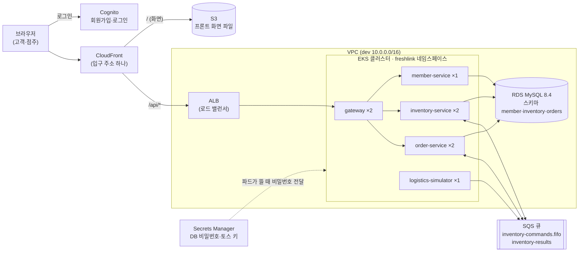
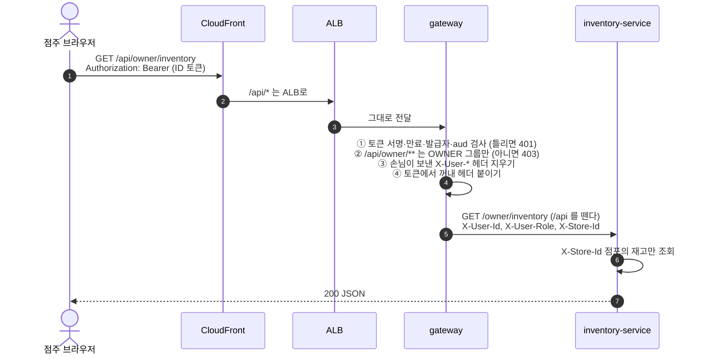
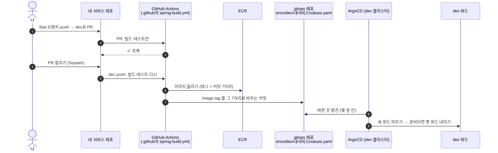

# 팀원 가이드 2. 인프라와 배포 이해하기 (AWS·CI·GitOps·켜고 끄기)

작성: 김진아 · 2026-10-17 · 대상: 이태우(inventory-service), 김경우(member-service·order-service)

> **한 줄 요약:** 여러분은 **코드를 `dev` 브랜치에 합치기만** 하면 된다. 그 뒤는 자동이다. GitHub Actions가 테스트하고 이미지를 만들어 AWS 창고(ECR)에 올리고, "이 버전을 띄워라"를 `gitops` 레포에 적는다. 클러스터 안의 ArgoCD가 그 메모를 보고 새 버전을 띄운다. 인프라(AWS 리소스)는 김진아가 Terraform으로 만들고 관리한다.

이 문서를 다 읽으면 아래를 말로 설명할 수 있어야 한다. 맨 끝 [11장](#11-스스로-점검)에 확인 질문이 있다.

1. dev와 prod가 무엇이 같고 무엇이 다른지
2. 우리가 쓰는 AWS 리소스 각각이 무슨 일을 하는지
3. 내 코드가 `dev`에 합쳐진 뒤 파드로 뜨기까지 무슨 일이 일어나는지
4. dev 환경이 언제 켜져 있고 언제 꺼지는지

common 라이브러리(쪽지·오류 응답·Outbox·멱등)는 [팀원 가이드 1. common 이해하기](1-common.md)에 있다.

---

## 목차

0. [먼저 알아 둘 말](#0-먼저-알아-둘-말)
1. [한 장으로 보는 전체 그림](#1-한-장으로-보는-전체-그림)
2. [레포 10개, 누가 무엇을](#2-레포-10개-누가-무엇을)
3. [dev와 prod](#3-dev와-prod)
4. [AWS 리소스 하나씩](#4-aws-리소스-하나씩)
5. [요청 하나가 지나가는 길 (gateway)](#5-요청-하나가-지나가는-길-gateway)
6. [배포 흐름 A부터 Z까지](#6-배포-흐름-a부터-z까지)
7. [켜고 끄는 일정](#7-켜고-끄는-일정)
8. [비밀값 다루기](#8-비밀값-다루기)
9. [문제가 생기면](#9-문제가-생기면)
10. [지금 상태와 앞으로](#10-지금-상태와-앞으로)
11. [스스로 점검](#11-스스로-점검)
12. [더 볼 문서](#12-더-볼-문서)

---

## 0. 먼저 알아 둘 말

| 말 | 쉬운 뜻 |
| --- | --- |
| 리전 | AWS 데이터센터 묶음. 우리는 서울 `ap-northeast-2` 하나만 쓴다 |
| VPC | AWS 안에 만든 우리 전용 사설 네트워크. 아파트 단지 담장이라고 보면 된다 |
| 서브넷 | VPC를 나눈 구역. 바깥과 통하는 구역(public), 앱 구역(app), DB 구역(db) 세 층이 있다 |
| NAT | 앱 구역 안의 서버가 **밖으로 나가는** 문(예: Cognito 공개 키 받기). 밖에서 안으로는 못 들어온다 |
| 컨테이너 이미지 | 내 앱과 Java 실행 환경을 통째로 묶은 파일. 어디서 실행해도 똑같이 돈다 |
| ECR | 이미지를 보관하는 AWS 창고 |
| EKS (쿠버네티스) | 컨테이너를 여러 서버(노드)에 알아서 배치하고, 죽으면 다시 띄워 주는 관리자 |
| 노드 | 컨테이너가 실제로 도는 서버. 우리는 t3.large 2대 |
| 파드 | 쿠버네티스가 띄운 내 앱 한 벌. order-service 파드 2개 = 앱 두 벌이 동시에 떠 있다 |
| Helm 차트 | 파드를 띄우는 설정 묶음의 틀. 서비스 5개가 같은 틀(`spring-service`)을 쓰고 값만 다르게 준다 |
| CI | 코드를 올리면 자동으로 테스트·빌드하는 것. 우리는 **GitHub Actions** |
| GitOps | "클러스터에 무엇이 떠 있어야 하는가"를 git 레포에 적어 두고, 그 레포대로 클러스터를 맞추는 방식 |
| ArgoCD | 클러스터 안에서 `gitops` 레포를 지켜보다가, 바뀌면 클러스터를 그대로 맞추는 프로그램 |
| IRSA | 파드에 AWS 키를 넣지 않고 "이 파드는 이 권한" 역할을 붙이는 방법 |
| Terraform | AWS 리소스를 코드로 만드는 도구. `infra` 레포에 있고 김진아만 실행한다 |

---

## 1. 한 장으로 보는 전체 그림



- 사용자가 아는 주소는 **CloudFront 하나**다. 화면 파일은 S3에서, `/api/`로 시작하는 요청은 ALB를 거쳐 gateway로 간다.
- gateway만 바깥과 닿는다. 나머지 4개 서비스는 클러스터 안에서만 불린다.
- 서비스끼리 "상태를 바꾸는 명령"은 SQS 쪽지로, "지금 답이 필요한 조회"는 HTTP로 한다. 지금 설계에는 서비스 간 HTTP 호출이 하나도 없다([백엔드-공통-규칙.md](../규칙/백엔드-공통-규칙.md) 7장).
- 번호를 따라가며 보는 큰 구조도는 [architecture/README.md](../기획/architecture/README.md)에 있다.

---

## 2. 레포 10개, 누가 무엇을

조직: [github.com/sesac-freshlink](https://github.com/sesac-freshlink)

| 레포 | 무엇 | 담당 | 여러분이 고치나 |
| --- | --- | --- | --- |
| `member-service` | 회원·점포 API | 김경우 | ✅ |
| `order-service` | 주문·결제 API | 김경우 | ✅ |
| `inventory-service` | 재고·폐기 API | 이태우 | ✅ |
| `frontend` | 화면 (React) | 화면: 이태우(상품 목록)·김경우(주문·결제), 배포 설정: 김진아 | ✅ 자기 화면 + 공통 로직(레이아웃·라우팅·`shared`)도 자유롭게 |
| `common` | 공통 라이브러리 | 김진아 | PR로 제안 |
| `gateway` | 입구. 토큰 검사·라우팅 | 김진아 | ❌ |
| `logistics-simulator` | 가상 물류센터 (입고 쪽지) | 김진아 | ❌ |
| `infra` | AWS 리소스 (Terraform) | 김진아 | ❌ |
| `gitops` | 클러스터에 띄울 것 (Helm 값) | 김진아 (이미지 태그는 CI가 자동 커밋) | ❌ |
| `.github` | 팀 문서, 공용 CI(`spring-build.yml`), 공용 Dockerfile | 김진아 | 문서 PR 환영 |

모든 변경은 **PR로** 올린다. CI가 초록이면 합친다. AI 리뷰(CodeRabbit)는 선택이고, 사람 승인은 필요 없다. 김진아에게는 인프라·백엔드 공통 문제만 묻는다(`CONTRIBUTING.md` 8장). 자세한 규칙: [git-계획.md](../기획/git-계획.md), [CONTRIBUTING.md](../../CONTRIBUTING.md).

브랜치는 이렇게 흐른다.

```
feat/<기능ID>-<설명>  ──(PR, Squash)──▶  dev  ──(release PR, Merge commit)──▶  main
                                         │                                     │
                                    dev 환경에 자동 배포                    prod로 승격 (할 일 15)
```

---

## 3. dev와 prod

두 환경은 **같은 Terraform 모듈, 같은 Helm 차트**로 만든다. 다른 것은 **값**뿐이다. 그래야 "dev에서 됐으면 prod에서도 된다"가 맞다.

| | dev | prod |
| --- | --- | --- |
| 용도 | 매일 개발하고 같이 붙여 보는 곳 | 릴리스 확인, 리허설, 시연 |
| 무엇이 뜨나 | 서비스 레포 `dev` 브랜치 최신 | dev에서 확인한 **바로 그 이미지** (다시 빌드 안 함) |
| 이름 | `freshlink-dev-…`, 큐 `dev-…` | `freshlink-prod-…`, 큐 `prod-…` |
| 네트워크 | `10.0.0.0/16` | `10.1.0.0/16` |
| 개발자별 큐 | 있음 (`dev-taewoo-`, `dev-kyungwoo-`) | 없음 |
| Spring 프로필 | `dev` | `prod` |
| 켜 두는 시간 | 평일 09:00부터 21:00까지 (7장) | 평소 꺼 두고 필요한 날만 |
| 여러분 권한 | dev 리소스만 읽고 쓸 수 있다 | **읽기도 안 된다** |
| 지금 | 만들어져 있다 | 아직 없다. 할 일 14(10/19)에서 만든다 |

여러분은 **dev만** 신경 쓰면 된다. 서비스의 `application-dev.yml`과 `application-prod.yml`은 키가 같고 값만 다르며, 값은 전부 환경 변수로 들어온다. 설정 파일에 주소·비밀번호를 쓰지 않는다.

---

## 4. AWS 리소스 하나씩

### 4-1. 네트워크 (VPC)

- 가용 영역(데이터센터 건물) 2곳(`2a`, `2c`)에 서브넷 3층씩, 모두 6개.
- **public**: ALB, NAT, DB 접속용 작은 서버(t4g.nano). **app**: EKS 노드. **db**: RDS.
- DB 구역은 바깥과 통하는 길이 아예 없다. 그래서 PC에서 DB에 붙을 때 SSM 포트 포워딩(4-2)을 쓴다.

### 4-2. DB (RDS MySQL 8.4)

| 서비스 | 스키마 | 앱 사용자 | 비밀 이름 (Secrets Manager) |
| --- | --- | --- | --- |
| member-service | `member` | `member_app` | `freshlink-dev-member-db` |
| inventory-service | `inventory` | `inventory_app` | `freshlink-dev-inventory-db` |
| order-service | `orders` | `order_app` | `freshlink-dev-order-db` |

- DB 서버는 **하나**고, 서비스마다 스키마와 사용자가 따로다. 내 사용자는 내 스키마만 볼 수 있다. 다른 서비스 표를 직접 읽는 코드는 만들 수 없다(필요하면 쪽지나 API로).
- 표는 각 서비스의 **Flyway** 파일(`db/migration/V1__init.sql`…)이 앱 기동 때 만든다. 사람이 SQL로 표를 만들지 않는다.
- PC에서 붙는 길: 내 PC `127.0.0.1:3306` → SSM(AWS의 안전한 터널) → 접속용 nano 서버 → RDS. 명령은 [팀원-가이드/0-개발환경-접속.md](0-개발환경-접속.md) 2장.
- dev 시드 데이터: 점포 1·2·3(서울), 상품 30개(ID 1부터 30, 코드 `P001`부터 `P030`), 점주 계정 3개. 두 분의 Flyway V1이 dev DB에 들어간 뒤 김진아가 넣는다.

### 4-3. 큐 (SQS)

| 접두사 | 누가 쓰나 | 명령 (FIFO) | 결과 |
| --- | --- | --- | --- |
| `dev-` | dev 클러스터의 파드 | `dev-inventory-commands.fifo` | `dev-inventory-results` |
| `dev-taewoo-` | 이태우 PC | `dev-taewoo-inventory-commands.fifo` | `dev-taewoo-inventory-results` |
| `dev-kyungwoo-` | 김경우 PC | `dev-kyungwoo-inventory-commands.fifo` | `dev-kyungwoo-inventory-results` |

- 큐마다 실패 보관함(DLQ, 이름 끝 `-dlq`)이 있다. 3번 처리에 실패한 쪽지가 옮겨진다.
- 2차 (2026-10-28): DLQ에 쪽지가 쌓이면 CloudWatch 경보가 웹훅으로 온다. 원인을 고친 뒤 SQS 콘솔 "Start DLQ redrive"로 원래 큐에 다시 넣는다(여러분 `freshlink-dev` 권한으로 dev 큐는 할 수 있다). 절차는 김진아가 문서로 남긴다. 알림 큐 `dev-notification-events`(+DLQ)도 생긴다.
- 쪽지 내용과 Outbox·멱등은 가이드 1.

### 4-4. 비밀 보관함 (Secrets Manager)

| 비밀 | 내용 | 파드에 들어가는 이름 |
| --- | --- | --- |
| `freshlink-dev-member-db` 등 3개 | DB 주소·사용자·비밀번호 | `DB_URL`, `DB_USERNAME`, `DB_PASSWORD` |
| `freshlink-dev-toss` | 토스 테스트 비밀 키 | `TOSS_SECRET_KEY` (order만) |
| `freshlink-dev-seed-accounts` | 시드 계정 이메일·비밀번호 | (사람이 시험할 때만 꺼내 본다) |

클러스터에서는 **External Secrets Operator**가 이 값을 꺼내 쿠버네티스 Secret으로 만들고, 파드 환경 변수로 넣어 준다. 그래서 `gitops` 레포에도, 코드에도 비밀번호가 없다.

### 4-5. 로그인 (Cognito)

- User Pool `freshlink-dev-users`. 그룹 3개: `CUSTOMER`(고객), `OWNER`(점주), `ADMIN`(관리자).
- 고객이 회원가입하면 가입 확인 Lambda가 자동으로 `CUSTOMER` 그룹에 넣는다. 점주·관리자는 스스로 가입하지 못하고 김진아가 만든다.
- 점주 계정에는 `custom:storeId`(점포 번호)가 있다. 시드 점주 `owner1@freshlink.test`부터 `owner3@freshlink.test`까지가 점포 1·2·3의 점주다.
- 로그인은 브라우저가 Cognito와 직접 한다. **백엔드 서비스는 로그인 코드를 만들지 않는다.** gateway가 토큰을 검사하고 사용자 정보를 헤더로 넘겨준다(5장).
- User Pool ID와 앱 클라이언트 ID는 10/16에 전달했다.
- **2차 (2026-10-28 결정): BFF로 바꾼다.** gateway가 로그인·가입·토큰 갱신을 대신 Cognito에 요청하고 토큰을 HttpOnly 쿠키로 내려 준다. 서버용 `bff` 앱 클라이언트(시크릿 있음)를 새로 만들고, 시크릿은 Secrets Manager에서 gateway로 들어간다. 그래도 **member·inventory·order 서비스는 로그인 코드를 만들지 않는다**(gateway만 바뀐다). 인프라는 김진아, gateway·프론트 로직은 김경우.

### 4-6. 클러스터 (EKS)

- 클러스터 `freshlink-dev-eks`, 노드 t3.large 2대(필요하면 3대).
- 네임스페이스 `freshlink`에 앱 파드 8개가 뜬다.

  | 서비스 | 파드 수 | 메모리 요청 / 상한 |
  | --- | --- | --- |
  | gateway | 2 | 512Mi / 768Mi |
  | member-service | 1 | 512Mi / 768Mi |
  | inventory-service | 2 | 640Mi / 1Gi |
  | order-service | 2 | 512Mi / 768Mi |
  | logistics-simulator | 1 | 256Mi / 512Mi |

- 2차에 notification-service(파드 1개)가 더해지고, order-service는 SSE 때문에 처음에 파드 1개로 시작한다(2026-10-28).
- **파드가 2개인 서비스(inventory·order)는 스케줄러가 두 번 돈다.** 유통기한 스케줄러·10분 미결제 스케줄러에 반드시 ShedLock `@SchedulerLock`을 붙인다.
- 모든 서비스는 포트 **8080** 하나. 쿠버네티스가 `/actuator/health/readiness`(받을 준비 됐나)와 `/actuator/health/liveness`(살아 있나)를 주기적으로 찔러 본다. 이미 `application.yml`에 켜져 있으니 지우지 않는다.
- 그 밖에 시스템 프로그램(ArgoCD, 로드 밸런서 컨트롤러, External Secrets, metrics-server)이 같이 떠 있다.
- 클러스터를 직접 만지는 권한(`kubectl`)은 김진아에게만 있다. 여러분은 클러스터를 볼 필요 없이 6장의 확인 방법을 쓴다.

### 4-7. 이미지 창고 (ECR)

- 서비스마다 창고 하나(`gateway`, `member-service`, `inventory-service`, `order-service`, `logistics-simulator`). dev와 prod가 같이 쓴다.
- 이미지 이름표(태그)는 **git 커밋 앞 7자리**다. 예: `order-service:24dd806`. 같은 태그를 덮어쓸 수 없고 `latest`는 쓰지 않는다. 그래서 "지금 떠 있는 게 어느 커밋인가"가 항상 분명하다.

### 4-8. 화면 (S3 + CloudFront)

- 빌드한 React 파일을 비공개 S3 버킷에 올리고, CloudFront가 그 파일을 사용자에게 준다.
- 같은 CloudFront 주소의 `/api/*`는 ALB로 넘긴다. 화면과 API가 같은 주소라 CORS 설정이 필요 없다. `Authorization`·`Idempotency-Key` 헤더와 쿠키도 그대로 넘어간다(2차 BFF는 쿠키를 쓴다).
- 2차에 Route 53 도메인과 ACM 인증서를 붙여 주소가 바뀌고, 응답 헤더 정책(CSP 등)이 걸린다(김진아).
- `frontend` 레포 `dev` 브랜치에 합치면 Actions(`frontend-deploy.yml`)가 dev 버킷에 올린다.
- dev CloudFront 주소는 김진아가 따로 알려 준다.

### 4-9. 여러분 AWS 계정으로 할 수 있는 것

프로필 `freshlink-dev`(설정법: [팀원-가이드/0-개발환경-접속.md](0-개발환경-접속.md) 1장)로:

| 할 수 있다 | 할 수 없다 |
| --- | --- |
| `dev-`로 시작하는 큐 보내기·받기·DLQ 다시 보내기 | prod 리소스 (읽기도) |
| `freshlink-dev-` 비밀 읽기 | 리소스 만들기·지우기 |
| dev Cognito 사용자·그룹 조회 | 클러스터(`kubectl`) |
| SSM 포트 포워딩으로 dev DB 접속 | 서버 접속(셸) |

---

## 5. 요청 하나가 지나가는 길 (gateway)

점주가 재고 화면을 열면:



서비스가 받는 헤더:

| 헤더 | 값 | 예 |
| --- | --- | --- |
| `X-User-Id` | Cognito `sub` (UUID 문자열, 숫자 아님) | `0a1b2c3d-...` |
| `X-User-Role` | 그룹 이름. 여럿이면 쉼표 | `OWNER` |
| `X-Store-Id` | 점주의 점포 번호. **점주가 아니면 헤더 자체가 없다** | `1` |

서비스가 할 일과 안 할 일:

- **안 한다:** 토큰 검사, 로그인 여부 확인, "점주인가" 1차 확인. gateway가 이미 했다.
- **한다:** "이 lot이 이 점포 것인가", "이 주문이 이 고객 것인가" 같은 **소유권 확인**. 헤더 값과 DB 값을 비교해서, 아니면 403(`BusinessException`).
- 컨트롤러 경로에는 `/api`를 쓰지 않는다. `@GetMapping("/owner/inventory")`.

gateway 라우팅 표(어떤 경로가 어느 서비스로 가는지, 무엇이 공개인지)는 [gateway README](https://github.com/sesac-freshlink/gateway#3-하는-일) 3장에 있다. **새 API 경로가 표에 없는 모양이면** 김진아에게 알린다. 표에 없는 경로는 gateway가 막는다.

---

## 6. 배포 흐름 A부터 Z까지

### 6-1. 전체 흐름



| 단계 | 누가 | 여러분이 할 일 |
| --- | --- | --- |
| A. 코드 쓰고 PR | 나 | `dev`로 PR |
| B. PR 검사 | Actions (`ci`) | 빨간 X면 고친다 |
| C. 합치기 | 나 | CI 초록 → Squash merge (CodeRabbit은 선택) |
| D. 이미지 만들기·올리기 | Actions | 없음 |
| E. gitops에 태그 적기 | Actions | 없음 |
| F. 파드 바꾸기 | ArgoCD | 없음 |

여러분이 손으로 하는 것은 **A와 C뿐**이다. 서비스 레포의 `.github/workflows/ci.yml`은 이미 들어가 있고(10/17), 그 안은 "공용 `spring-build.yml`을 불러라" 한 줄이라 고칠 일이 없다.

### 6-2. 각 단계가 하는 일 (조금 더 자세히)

- **빌드·테스트:** `gradlew build`. 테스트가 하나라도 실패하면 거기서 멈춘다. 이미지도 안 만든다. 테스트는 Testcontainers MySQL을 쓰므로 Actions에서도 그대로 돈다.
- **이미지:** `.github` 레포의 공용 Dockerfile로 만든다. 모든 서비스가 같은 Java 21 기반이고, JVM 메모리를 컨테이너의 75%로 맞춘다(넘어서 강제 종료되는 것을 막는다).
- **AWS 로그인:** Actions는 AWS 키를 저장하지 않는다. GitHub가 "이건 sesac-freshlink의 이 레포 dev 브랜치 실행이다"라는 증명서(OIDC)를 주면 AWS가 확인하고 ECR 올리기 권한만 잠깐 빌려준다.
- **gitops 커밋:** `chore(order-service): image 24dd806` 같은 커밋이 [gitops 커밋 목록](https://github.com/sesac-freshlink/gitops/commits/main)에 생긴다.
- **ArgoCD:** gitops와 클러스터를 비교해서 다르면 맞춘다. 새 파드가 readiness를 통과해야 옛 파드를 내리므로, **뜨다가 죽는 버전은 사용자 요청을 받지 않는다.** 옛 버전이 계속 일한다.

### 6-3. 내 배포가 됐는지 확인하기

1. 내 레포 **Actions** 탭 → 맨 위 `ci` 실행이 초록인지 본다.
2. [gitops 커밋 목록](https://github.com/sesac-freshlink/gitops/commits/main)에 `chore(<내 서비스>): image <내 커밋 7자리>`가 있는지 본다. 내 커밋 7자리는 서비스 레포 커밋 목록 오른쪽에 나온다.
3. 몇 분 뒤 dev CloudFront 주소로 화면이나 API를 써 본다.
4. 그래도 바뀐 게 안 보이면 김진아에게 **서비스 이름과 커밋 7자리**를 알려 준다. 김진아가 ArgoCD 화면과 파드 로그를 본다.

파드 로그·지표를 여러분이 직접 보는 화면(Grafana)은 할 일 16(10/19)에서 생긴다.

### 6-4. prod로 올리기 (할 일 15, 예정)

- 서비스 레포 `dev` → `main` release PR을 합치면, Actions가 **새로 빌드하지 않고** `envs/dev`에 있던 태그를 `envs/prod`로 복사하는 커밋만 만든다. prod ArgoCD가 그 이미지를 띄운다.
- 다시 빌드하지 않는 이유: dev에서 시험한 **바로 그 이미지**가 prod에 올라가야 "검증했다"는 말이 맞다.
- release는 김진아가 날을 정해 같이 한다. MVP 첫 release(main 머지·GitHub 릴리스·prod 통합 확인)가 2차에서 김진아의 가장 급한 일이다(2026-10-28).
- **release PR은 꼭 "Create a merge commit"으로 합친다.** Squash로 합치면 dev 이미지와 이어지지 않아 승격이 "ECR에 없다"로 멈춘다. 그때는 release PR을 한 번 더 만들어 Merge commit으로 합친다(infra README 4-13). 합치면 레포에 git 태그 `v2026.10.xx`와 GitHub Release가 생긴다.

### 6-5. 되돌리기 (롤백)

- **dev는 되돌리지 않는다.** 잘못된 버전이 올라갔으면 고친 커밋을 다시 `dev`에 합친다. 새 이미지로 덮인다.
- **prod는 김진아가 되돌린다.** gitops `envs/prod/<서비스>/values.yaml`의 승격 커밋을 `git revert`해서 `image.tag`를 이전 7자리로 돌리면 ArgoCD가 이전 이미지로 맞춘다.

### 6-6. 배포 실패 알림이 오면 (2026-10-28)

배포가 끝나면 디스코드 채널로 성공·실패 알림이 온다(`DEPLOY_WEBHOOK_URL`, 서비스는 공통 `spring-build.yml`, 프론트는 `frontend-deploy`). 알림에 서비스 이름, 환경, 결과, 커밋 7자리, 실행 링크가 있다.

알림 줄마다의 뜻, 실패 단계별로 누가 고치는지, DLQ 채널 알림 대응은 [팀원 가이드 6. 디스코드 알림](6-디스코드-알림.md)에 모았다.

**dev가 실패하면 그 서비스 담당자가 직접 본다.**

1. 알림의 실행 링크로 **Actions 로그**를 연다. 빌드·테스트 실패면 대부분 여기서 끝난다.
2. Actions는 초록인데 안 뜨면 **ArgoCD 화면**에서 그 서비스의 상태와 이벤트를 본다.
3. 파드가 떴다가 죽으면 **Grafana → Loki**에서 그 서비스 로그를 본다([팀원-가이드/4-관측성.md](4-관측성.md)).
4. 원인을 고친 PR을 `dev`에 다시 합친다. 되돌리기는 하지 않는다(6-5).
5. 원인이 인프라 쪽(ECR push 실패, `Could not assume role` 같은 OIDC 오류, gitops 커밋 실패, ArgoCD 동기화 실패)이면 **김진아**에게 알림 링크와 함께 말한다.

**prod는 김진아가 맡는다.** release를 김진아가 하므로 prod 실패도 김진아가 보고, 필요하면 6-5대로 되돌린다. 원인을 고친 PR은 `dev`로 올려 다음 release로 다시 내보낸다. release PR은 꼭 **Create a merge commit**으로 합친다(6-4, [infra README 4-13](https://github.com/sesac-freshlink/infra/blob/main/README.md#4-13-prod-승격기준-데이터-복사-할-일-15-김진아)).

---

## 7. 켜고 끄는 일정

지원금 안에서 돌리려고 **안 쓰는 시간에는 끈다.** 시각은 모두 한국 시각.

| 언제 | 무엇이 | 어떻게 |
| --- | --- | --- |
| 월 08:40 | dev 클러스터를 새로 만든다 (노드 2대, ArgoCD가 서비스를 다시 띄운다) | 자동 |
| 월·화·수·목·금 09:00 | RDS와 DB 접속용 서버를 켠다 | 자동 |
| 화·수·목·금 09:00 | NAT를 만든다 | 자동 |
| 화·수·목·금 09:10 | 노드를 2대로 | 자동 |
| 월·화·수·목 21:00 | 노드를 0대로, RDS를 끈다 | 자동 |
| 월·화·수·목 21:10 | NAT를 지운다 | 자동 |
| 금 21:00 | **dev 클러스터를 통째로 지운다** (RDS 데이터·큐·계정은 남는다) | 자동 |
| 매일 23:00 | 혹시 켜져 있으면 한 번 더 끈다 | 자동 |

**그래서 여러분은:**

- **평일 09:00부터 21:00까지** 개발한다. 이 시간 밖에는 DB 포트 포워딩이 `TargetNotConnected`로 실패하고, dev 화면·API도 안 된다.
- 아침 09:00 직후 몇 분은 서버가 켜지는 중이다. 09:15쯤부터 쓰면 편하다.
- 금요일 21:00 전에 dev에서 확인할 것을 끝낸다.
- 주말에 꼭 필요하면 [팀원 가이드 5](5-주말-dev-켜기.md)대로 직접 켜고, 다 쓰면 반드시 끈다. 평일 밤에 필요하면 김진아에게 미리 말한다.
- 클러스터를 지워도 **DB 데이터, 큐, 이미지, 회원 계정은 남는다.** 월요일에 다시 만들면 gitops에 적힌 버전 그대로 다시 뜬다.

왜 매일이 아니라 주말에만 클러스터를 지우는지는 [기획/기술스택과-선택이유.md](../%EA%B8%B0%ED%9A%8D/%EA%B8%B0%EC%88%A0%EC%8A%A4%ED%83%9D%EA%B3%BC-%EC%84%A0%ED%83%9D%EC%9D%B4%EC%9C%A0.md) 3-6에 있다.

---

## 8. 비밀값 다루기

- DB 비밀번호, 토스 비밀 키, GitHub 토큰, AWS 키는 **코드·`application*.yml`·`.env`·커밋·PR·채팅 어디에도** 쓰지 않는다.
- PC에서는 IntelliJ 실행 구성 환경 변수에만 둔다. 비밀번호는 Secrets Manager에서 클립보드로 꺼낸다([팀원-가이드/0-개발환경-접속.md](0-개발환경-접속.md) 3장).
- 클러스터에서는 External Secrets가 넣어 준다(4-4). 새 비밀이 필요하면 김진아에게 말한다.
- 레포는 공개라서, 한 번 올라간 비밀은 지워도 이미 새어 나간 것으로 본다. 실수로 올렸으면 바로 김진아에게 알린다(비밀번호를 바꿔야 한다).
- 토스 **클라이언트** 키(`VITE_TOSS_CLIENT_KEY`)는 화면용 공개 값이라 비밀이 아니다.

---

## 9. 문제가 생기면

| 증상 | 어디서 | 원인과 해결 |
| --- | --- | --- |
| PR의 `ci`가 빨간색, 로그에 테스트 실패 | Actions | 내 테스트가 실패했다. 로컬에서 `gradlew build`로 재현해서 고친다 |
| `ci` 로그에 `401 Unauthorized` (maven.pkg.github.com) | Actions | common 패키지를 못 읽었다. 김진아에게 알린다 |
| `ci` 로그에 `Could not assume role` | Actions | `dev`가 아닌 브랜치에서 수동 실행했다. PR 검사는 이 단계까지 안 간다 |
| `ci`는 초록인데 gitops 커밋이 없다 | gitops | PR 검사였을 수 있다(PR은 빌드·테스트만). `dev`에 합친 실행인지 본다 |
| gitops 커밋은 있는데 화면이 그대로 | dev | 몇 분 기다린다. 그래도면 6-3의 4번 |
| 서비스가 dev에서 뜨다 계속 재시작 | dev | 대부분 DB(21:00 이후 꺼짐)나 환경 변수 이름 불일치. 커밋 7자리와 함께 김진아에게 |
| 내 PC에서 DB 연결 실패 `Communications link failure` | PC | 포트 포워딩 창이 꺼졌거나 RDS가 꺼진 시간 |
| `TargetNotConnected` | PC | 21:00부터 09:00 사이이거나 주말. 시간 안이면 김진아에게 |
| API가 `401` | dev | 토큰이 없거나 만료(1시간). 다시 로그인 (2차 BFF 뒤에는 쿠키가 없거나 갱신 실패) |
| API가 `403` | dev | 역할이 맞지 않다(예: 고객 계정으로 `/api/owner/…`). 또는 우리 서비스의 소유권 확인 |
| API가 `404`인데 코드엔 있다 | dev | 컨트롤러 경로에 `/api`를 붙였거나, 아직 배포 전, 또는 gateway 라우팅 표에 없는 경로 |

물어볼 때는 **무엇을 했고, 어디서(PC·dev), 무슨 메시지가 나왔는지, 커밋 7자리**를 같이 보낸다.

---

## 10. 지금 상태와 앞으로

| 할 일 | 내용 | 상태 (10/17) |
| --- | --- | --- |
| 1~5 | AWS 계정·팀원 IAM, dev VPC·RDS·SQS·비밀, 접속 가이드 | 완료 |
| 6 | dev Cognito, 시드 계정 | 완료. DB 시드는 두 분 Flyway V1 뒤 |
| 7 | dev 클러스터 + 켜고 끄기 자동화 | 완료 |
| 8·9·10 | CI, gitops 배포, gateway | 완료. 서비스 5개가 dev에 떠 있다 |
| 11 | common v0.2.0 (Outbox·멱등) | 완료. `0.2.0` 배포됨 (가이드 1의 8장) |
| 12 | logistics-simulator 입고 | 완료 |
| 13 | dev 화면 배포 (S3·CloudFront) | 코드 합침. 월요일 클러스터가 다시 뜬 뒤 주소 공유 |
| 14 | prod 환경 만들기 | 10/19 |
| 15 | dev → prod 승격 | 10/19 |
| 16 | 관측성: Grafana(지표), Loki(로그 검색), Zipkin(요청 추적), JSON 로그 | 10/19. 이후 오류 응답의 `traceId`가 채워진다 |

13번의 팀 시나리오(입고 → 주문 → 결제 → 점주 화면 반영)는 inventory·order 기능이 들어오면 같이 돌린다. 팀 전체 시험은 10/29·10/30이다.

**2차 (2026-10-28 멘토링 후, 11/3까지):** MVP main 머지·릴리스·prod 확인, BFF 전환, 알림 서비스(SSE), 선착순 대기열(Redis), 매출 대시보드·판매 순위, 배포 실패 대응, 재시도·DLQ 재처리, 도메인·ACM·CSP. 사람별 할 일은 [할일/2차-사람별-할-일.md](../할일/2차-사람별-할-일.md). k6 같은 대형 부하 테스트는 11/3 이후 다시 정한다.

---

## 11. 스스로 점검

아래를 말로 답할 수 있으면 이 문서는 끝이다.

1. dev와 prod에서 같은 것 두 가지, 다른 것 세 가지는?
2. 브라우저가 `/api/orders`를 부르면 어떤 순서로 무엇을 거쳐 order-service에 닿나? order-service가 받는 헤더 3개는?
3. 내 PR을 `dev`에 합친 뒤 파드가 바뀌기까지 일어나는 일 다섯 가지는? 그중 내가 하는 것은?
4. 이미지 태그가 `latest`가 아니라 커밋 7자리인 이유는?
5. DB 비밀번호는 dev 파드에 어떤 길로 들어가나?
6. inventory·order 스케줄러에 ShedLock이 꼭 필요한 이유는?
7. 수요일 22:00에 dev DB에 붙으면 어떻게 되나? 금요일 21:00 뒤에 클러스터가 지워지면 무엇이 남나?

---

## 12. 더 볼 문서

| 문서 | 내용 |
| --- | --- |
| [팀원-가이드/0-개발환경-접속.md](0-개발환경-접속.md) | 설치, AWS 로그인, DB 포트 포워딩, IntelliJ 설정, 개인 큐 |
| [팀원 가이드 1. common](1-common.md) | 쪽지, 오류 응답, Outbox, 멱등 |
| [팀원 가이드 6. 디스코드 알림](6-디스코드-알림.md) | 배포·DLQ 알림이 오면 할 일 |
| [gitops README](https://github.com/sesac-freshlink/gitops#readme) | 배포 흐름, 공용 차트 규칙, 파드 계획 원본 |
| [infra README](https://github.com/sesac-freshlink/infra#readme) | AWS 리소스와 켜고 끄기 원본 |
| [gateway README](https://github.com/sesac-freshlink/gateway#readme) | 라우팅 표, 토큰 규칙 |
| [aws-리소스-계획.md](../기획/aws-리소스-계획.md) | 노드 산정, 서브넷, 비용 |
| [기획/기술스택과-선택이유.md](../%EA%B8%B0%ED%9A%8D/%EA%B8%B0%EC%88%A0%EC%8A%A4%ED%83%9D%EA%B3%BC-%EC%84%A0%ED%83%9D%EC%9D%B4%EC%9C%A0.md) | 기술을 고른 이유 |
| [git-계획.md](../기획/git-계획.md) | 브랜치·PR·커밋 규칙 |
