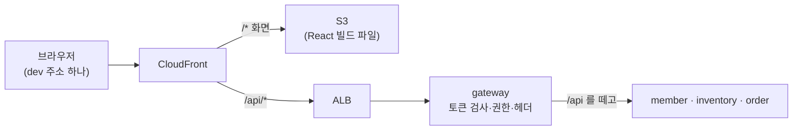
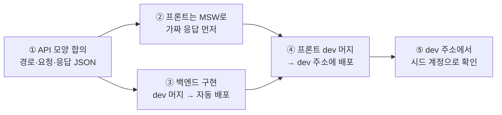

# 팀원 가이드 3. dev 프론트 주소와 백엔드 연동하기

작성: 김진아 · 2026-10-19 · 대상: 이태우(inventory-service), 김경우(member-service·order-service), 프론트 담당

> **한 줄 요약:** dev 화면과 API는 주소 하나 **https://dywjl1yyfi1z1.cloudfront.net** 로 연다. 화면은 S3에서, `/api/...`는 gateway를 거쳐 여러분 서비스로 간다. 백엔드는 컨트롤러 경로를 gateway 라우팅 표에 맞춰 만들고 `dev`에 합치면 되고, 프론트는 같은 주소에서 상대 경로 `/api/...`로 부르기만 하면 연동이 끝난다. CORS 설정은 필요 없다.

이 문서를 다 읽으면 아래를 할 수 있어야 한다.

1. dev 프론트 주소로 들어가 시드 계정으로 로그인한다
2. 내 API가 브라우저에서 서비스까지 어떤 길로 가는지 설명한다
3. 새 API를 만들고 dev 화면에서 실제로 불러지는지 확인한다
4. 401·403·404·502가 나왔을 때 어디를 볼지 안다

인프라 전체 그림은 [팀원 가이드 2](2-인프라-배포.md), common(오류 응답·쪽지)은 [팀원 가이드 1](1-common.md)에 있다.

> **2차에 바뀌는 것 (2026-10-28 결정): 로그인이 BFF로 바뀐다.** 이 가이드는 지금(Amplify) 방식이다. 전환이 끝나면 ① 프론트는 Cognito·Amplify를 부르지 않고 `/api/auth/*`(로그인·가입·갱신·로그아웃·`me`)를 부른다, ② 토큰은 `Authorization` 헤더가 아니라 HttpOnly 쿠키(`fl_id`)로 자동으로 간다, ③ 상태를 바꾸는 요청에는 `X-Requested-With: freshlink` 헤더를 붙인다(없으면 403), ④ `.env.local`의 `VITE_COGNITO_*`가 없어진다. 백엔드 서비스는 바뀌지 않는다(헤더는 그대로). 자세한 규칙은 김진아가 쓰는 `docs/인수인계/BFF.md`, 구현은 김경우. 2차에는 화면 알림(`/api/notifications/**`, SSE)과 점주 실시간 매출 SSE도 생긴다(9장).

---

## 목차

1. [dev 프론트 주소](#1-dev-프론트-주소)
2. [시드 계정으로 로그인하기](#2-시드-계정으로-로그인하기)
3. [요청이 지나가는 길](#3-요청이-지나가는-길)
4. [백엔드: API를 만들 때 지킬 것](#4-백엔드-api를-만들-때-지킬-것)
5. [연동 순서 (API 하나를 화면에 붙이기까지)](#5-연동-순서-api-하나를-화면에-붙이기까지)
6. [내 PC에서 미리 맞춰 보기](#6-내-pc에서-미리-맞춰-보기)
7. [확인하는 법](#7-확인하는-법)
8. [문제가 생기면](#8-문제가-생기면)
9. [2차: BFF·SSE 연동 미리 보기](#9-2차-bffsse-연동-미리-보기-2026-10-28)
10. [스스로 점검](#10-스스로-점검)

---

## 1. dev 프론트 주소

| 항목 | 값 |
| --- | --- |
| dev 주소 | **https://dywjl1yyfi1z1.cloudfront.net** |
| 화면 | `/`, `/owner/inventory` 같은 화면 경로는 모두 S3의 화면 파일(React)이 받는다. 새로 고침해도 404가 나지 않는다 |
| API | `/api/...`는 CloudFront → ALB → gateway → 각 서비스로 간다 |
| 언제 되나 | **평일 09:15 ~ 21:00.** 화면은 늘 열리지만, API는 dev 클러스터가 켜져 있을 때만 된다([가이드 2의 7장](2-인프라-배포.md#7-켜고-끄는-일정)) |
| 주소가 바뀌나 | 안 바뀐다. 금요일에 클러스터를 지우고 월요일에 다시 만들어도 같은 주소다 |
| prod 주소 | 할 일 15에서 따로 생긴다(아직 없음) |

- 도메인을 사지 않아서 `*.cloudfront.net` 기본 주소를 쓴다. HTTPS는 CloudFront가 붙여 준다. 2차에 Route 53 도메인을 사서 주소를 바꾼다(예: dev `dev.<도메인>`, 김진아). 바뀌면 팀 채널에 알리고, 바꾸는 동안 지금 주소도 계속 열린다.
- 프론트 코드가 `frontend` 레포 `dev` 브랜치에 합쳐지면 Actions `frontend-deploy`가 빌드해서 이 주소에 올린다. 1~2분 뒤 브라우저를 새로 고침하면 보인다.

## 2. 시드 계정으로 로그인하기

dev Cognito에 시험용 계정 4개가 있다. 이메일은 받을 수 없는 `.test` 주소이고, 비밀번호는 영구 비밀번호라 바꾸라는 화면 없이 바로 들어간다.

| 계정 | 그룹 | 점포 |
| --- | --- | --- |
| `admin@freshlink.test` | ADMIN | 없음 |
| `owner1@freshlink.test` | OWNER | 1 |
| `owner2@freshlink.test` | OWNER | 2 |
| `owner3@freshlink.test` | OWNER | 3 |

**비밀번호 보기.** 비밀번호는 문서·채팅에 적지 않는다. Secrets Manager에서 직접 꺼내 본다(여러분 `freshlink-dev` 프로필로 읽을 수 있다).

```powershell
aws secretsmanager get-secret-value --secret-id freshlink-dev-seed-accounts --region ap-northeast-2 --profile freshlink-dev --query SecretString --output text | ConvertFrom-Json | Format-Table email, password
```

**로그인.** 브라우저로 dev 주소를 열고 로그인 화면에서 위 이메일과 비밀번호를 넣는다. 고객(CUSTOMER) 계정은 시드가 없다. 회원 가입으로 만들면 가입 확인 코드가 메일로 가므로 메일을 받을 수 있는 진짜 주소를 쓴다.

- 점포·회원(member) DB 시드는 두 분의 Flyway V1이 dev DB에 돈 뒤에 넣는다. 그 전에는 로그인은 되지만 `GET /api/members/me`가 404이고 화면이 비어 있을 수 있다. 정상이다.

## 3. 요청이 지나가는 길



1. 프론트는 로그인하면 Cognito **ID 토큰**을 받고, API를 부를 때 `Authorization: Bearer <ID 토큰>`을 붙인다(`src/shared/api/client.ts` 한 곳에서 한다). (2차 BFF부터는 gateway가 로그인을 대신하고 ID 토큰을 `fl_id` 쿠키로 내려 주므로, 프론트는 토큰을 붙이지 않는다. 브라우저가 쿠키를 자동으로 보낸다.)
2. CloudFront는 `/api/*`를 **캐시하지 않고** ALB로 넘긴다. `Authorization`, `Idempotency-Key` 같은 헤더와 쿼리 문자열은 그대로 간다.
3. gateway가 토큰을 검사하고(틀리면 401), 경로별 권한을 보고(점주 경로에 고객이면 403), `X-User-Id`·`X-User-Role`·`X-Store-Id` 헤더를 붙여 서비스로 넘긴다. 이때 **앞의 `/api`를 뗀다.**
4. 서비스는 헤더를 믿고 일한다. 토큰을 다시 검사하지 않는다.

ALB는 CloudFront에서 오는 요청만 받는다. **ALB 주소(`k8s-freshlin-gateway-...elb.amazonaws.com`)로 바로 부르면 막힌다**(시간 초과). dev 백엔드는 PowerShell·Postman에서도 CloudFront 주소의 `/api/...`로 부른다.

화면과 API가 **같은 주소**라서 브라우저 입장에서는 같은 출처(origin)다. 그래서 **CORS 설정이 필요 없다.** 서비스에 `@CrossOrigin`이나 CORS 설정을 넣지 않는다.

헤더 값과 gateway가 하는 일은 [가이드 2의 5장](2-인프라-배포.md#5-요청-하나가-지나가는-길-gateway)에 더 자세히 있다.

## 4. 백엔드: API를 만들 때 지킬 것

| 지킬 것 | 예 |
| --- | --- |
| 컨트롤러 경로에 `/api`를 쓰지 않는다 | 프론트 `GET /api/owner/inventory` → 서비스 `@GetMapping("/owner/inventory")` |
| 경로는 gateway 라우팅 표에 있는 모양으로 만든다 | 아래 표. 표에 없는 경로는 gateway가 막아서 404가 난다 |
| 사용자·점포는 헤더로 받는다 | `@RequestHeader("X-User-Id") String userId`, `@RequestHeader(value = "X-Store-Id", required = false) Long storeId` |
| 소유권은 서비스가 확인한다 | "이 lot이 이 점포 것인가"를 DB와 비교해서 아니면 403 |
| 오류는 common 공통 오류 응답으로 | `BusinessException` → `{"code": ..., "message": ...}` ([가이드 1](1-common.md)) |
| 같은 요청이 두 번 올 수 있는 쓰기 API는 `Idempotency-Key` 헤더를 받는다 | 주문 생성. CloudFront·gateway가 이 헤더를 그대로 넘긴다 |
| CORS 설정, 토큰 검사 코드를 넣지 않는다 | gateway가 이미 했다 |

**gateway 라우팅 표 (지금, `gateway` `dev` 기준)**

| 프론트가 부르는 경로 | 가는 곳 | 누가 |
| --- | --- | --- |
| `GET /api/stores/{storeId}/products` | inventory-service | 누구나(로그인 없이) |
| `GET /api/stores` | member-service | 누구나 |
| `/api/members/**` | member-service | 로그인(닉네임 중복 확인만 누구나) |
| `/api/admin/**` | member-service | ADMIN |
| `/api/owner/inventory/**`, `/api/owner/disposals` | inventory-service | OWNER |
| `/api/owner/orders` | order-service | OWNER |
| `/api/orders/**` | order-service | 로그인(고객인지는 서비스가 확인) |
| `/api/auth/**` (2차 BFF) | gateway가 직접 처리 | login·signup·confirm·refresh·google·callback은 누구나, logout·me는 로그인 |
| `/api/notifications/**` (2차) | notification-service | 로그인. `/stream`은 SSE |

정확한 표와 공개 경로 목록은 [gateway README](https://github.com/sesac-freshlink/gateway#3-하는-일) 3장이 진실이다. **새 API가 이 표의 어느 줄에도 맞지 않으면** 코드를 합치기 전에 김진아에게 알린다. gateway 라우트를 먼저 넣어야 한다.

## 5. 연동 순서 (API 하나를 화면에 붙이기까지)



1. **API 모양을 먼저 정한다.** 경로, 메서드, 요청·응답 JSON, 오류 코드를 서비스 README의 API 표에 적고 프론트 담당과 맞춘다. 경로가 4장 라우팅 표에 맞는지 본다.
2. **프론트는 기다리지 않는다.** 정한 응답 모양대로 `src/mocks/handlers.ts`에 MSW 가짜 응답을 넣고 화면을 만든다. 프론트 코드는 처음부터 진짜와 똑같이 `api.get('/owner/inventory')`(= `/api/owner/inventory`)로 부른다.
3. **백엔드는 구현해서 `dev`에 합친다.** 합치면 `ci` → ECR 이미지 → gitops 태그 커밋 → ArgoCD가 dev에 띄운다(3~5분). 배포 확인은 [가이드 2의 6-3](2-인프라-배포.md#6-3-내-배포가-됐는지-확인하기).
4. **프론트를 `dev`에 합친다.** `frontend-deploy`가 빌드해서 dev 주소에 올린다. 배포된 화면에서는 MSW가 꺼져 있어서 진짜 API를 부른다. 프론트 코드에서 바꿀 것은 없다.
5. **dev 주소에서 확인한다.** 시드 계정으로 로그인해서 화면이 진짜 데이터로 뜨는지 본다(7장).

응답 모양이 바뀌면 백엔드와 프론트가 같은 PR 주기에 맞춰 바꾼다. 백엔드만 먼저 바꾸면 dev 화면이 깨진다.

## 6. 내 PC에서 미리 맞춰 보기

dev에 합치기 전에 PC에서 프론트와 서비스를 붙여 보고 싶을 때.

| 방법 | 어떻게 | 언제 |
| --- | --- | --- |
| A. 가짜 API(MSW) | `frontend`에서 `npm run dev`. 기본으로 MSW가 `/api`를 가로챈다 | 백엔드 없이 화면 만들 때 |
| B. 내 PC의 gateway + 서비스 | `frontend`의 `.env.local`에 `VITE_API_MOCK=false`와 dev Cognito 값 2개를 넣고 `npm run dev`. Vite가 `/api`를 `http://localhost:8080`(gateway)로 넘긴다 | 화면과 내 서비스를 같이 고칠 때 |
| C. dev 주소 | 백엔드를 `dev`에 합친 뒤 dev 주소에서 본다 | 최종 확인 |

B 방법에서 필요한 것:

- `frontend/.env.local` (커밋하지 않는다)

  ```
  VITE_API_MOCK=false
  VITE_COGNITO_USER_POOL_ID=<김진아에게 받은 User Pool ID>
  VITE_COGNITO_CLIENT_ID=<김진아에게 받은 Client ID>
  ```

- (2차 BFF 전환 뒤에는 `VITE_COGNITO_*` 두 줄이 필요 없다. 대신 PC의 gateway에 `COGNITO_USER_POOL_ID`·`COGNITO_CLIENT_ID`(bff)·`COGNITO_CLIENT_SECRET`을 준다. 값은 `docs/인수인계/BFF.md`.)
- gateway를 PC에서 8080으로 띄우고, 서비스는 다른 포트로 띄운 뒤 gateway에 서비스 주소를 넘긴다. 예: inventory를 8082로 띄웠으면 gateway 실행 설정에 `INVENTORY_SERVICE_URI=http://localhost:8082`. gateway도 `COGNITO_ISSUER_URI`·`COGNITO_CLIENT_ID`가 있어야 토큰을 검사한다.
- 서비스를 dev RDS·개인 큐에 붙이는 법은 [팀원-가이드/0-개발환경-접속.md](0-개발환경-접속.md)에 있다.

## 7. 확인하는 법

**브라우저로 (가장 쉬움)**

1. dev 주소에서 로그인한다.
2. `F12` → **Network** 탭 → 화면을 새로 고친다.
3. `/api/...` 줄을 눌러 **Status**(200인지), **Request Headers**(`Authorization: Bearer ...`가 있는지), **Response**(JSON 모양)를 본다.

**PowerShell로 (토큰 없이 길만 확인)**

```powershell
$url = "https://dywjl1yyfi1z1.cloudfront.net"
(Invoke-WebRequest "$url/owner/inventory").StatusCode                                      # 200: 화면이 뜬다
try { Invoke-RestMethod "$url/api/members/me" } catch { $_.Exception.Response.StatusCode.value__ }   # 401: gateway까지 닿았다
```

401이 나오면 CloudFront → ALB → gateway 길은 살아 있는 것이다. 토큰을 붙여 부르는 예시는 infra README 4-7(9·10 확인)에 있다.

**서비스 로그로**

```powershell
kubectl -n freshlink logs deploy/inventory-service --tail=50
```

(클러스터 접속이 안 되면 김진아에게 로그를 부탁한다.)

## 8. 문제가 생기면

| 증상 | 뜻 | 할 일 |
| --- | --- | --- |
| 화면은 뜨는데 모든 API가 502·503·504 | dev 클러스터가 꺼져 있거나 막 켜지는 중, 또는 CloudFront가 옛 ALB를 가리킨다 | 평일 09:15~21:00인지 본다. 시간 안인데도 계속이면 김진아에게(`api-origin` 다시 맞추기) |
| API가 XML로 된 403 (`AccessDenied`) | CloudFront `/api/*`가 아직 S3를 가리킨다(클러스터를 새로 만든 직후) | 김진아에게 |
| ALB 주소(`...elb.amazonaws.com`)로 부르면 응답 없이 시간 초과 | 정상이다. ALB는 CloudFront에서 오는 요청만 받는다 | CloudFront 주소의 `/api/...`로 부른다 |
| 401 | 토큰이 없거나 만료됐다 | 다시 로그인. Network 탭에서 `Authorization` 헤더가 붙는지 본다. (2차 BFF 뒤에는 요청에 `fl_id` 쿠키가 붙는지, `/api/auth/refresh`가 한 번 불렸는지 본다) |
| 403 (2차 BFF, POST·PUT·PATCH·DELETE만) | `X-Requested-With: freshlink` 헤더가 없다 | `src/shared/api/client.ts`를 거쳐 부르는지 본다 |
| 403 (JSON) | 권한이 없다(고객이 점주 경로 등) 또는 서비스의 소유권 확인에서 막혔다 | 로그인한 계정의 그룹과 경로의 "누가" 칸을 비교한다 |
| 404 (gateway) | gateway 라우팅 표에 없는 경로다 | 4장 표를 본다. 새 경로면 김진아에게 |
| 404 (서비스) | 서비스 컨트롤러 경로가 다르다. 흔한 실수: 컨트롤러에 `/api`를 붙였다 | `@GetMapping`에서 `/api`를 뗀다 |
| `GET /api/members/me` 404 | member 행이 아직 없다(DB 시드 전) | 시드가 들어간 뒤 다시 본다 |
| 내 코드가 반영이 안 됐다 | 배포가 아직이거나 CI가 실패했다 | 서비스 레포 Actions `ci`가 초록인지, gitops에 `chore(<서비스>): image <7자리>` 커밋이 생겼는지 본다 |
| 프론트 수정이 안 보인다 | 브라우저 캐시 또는 `frontend-deploy` 실패 | 강력 새로 고침(`Ctrl+Shift+R`), `frontend` Actions 확인 |

그래도 모르겠으면 증상, 시각, 부른 경로, 상태 코드를 적어서 팀 채널에 올린다.

## 9. 2차: BFF·SSE 연동 미리 보기 (2026-10-28)

| 무엇 | 프론트가 할 일 | 백엔드·인프라 |
| --- | --- | --- |
| BFF 로그인 (김경우) | `bffClient.ts`로 `/api/auth/*`를 부른다. 401이면 `/api/auth/refresh`를 **한 번만** 부르고 원래 요청을 다시 보낸다(동시에 여러 401이면 갱신은 하나만). 갱신도 실패하면 로그인 화면으로 | gateway `AuthController`(김경우), Cognito `bff` 클라이언트·시크릿·IRSA(김진아) |
| 화면 알림 (김진아) | 공통 헤더에서 `new EventSource('/api/notifications/stream')`. 쿠키라 따로 인증할 것이 없다. 끊기면 브라우저가 다시 붙는다 | notification-service, gateway SSE 경로 타임아웃·버퍼링 설정 |
| 점주 실시간 매출 (김경우) | 대시보드에서 order의 매출 SSE를 연다. 다시 붙을 때 현재 합계를 한 번 받아 온다 | order SSE 엔드포인트, gateway 설정은 김진아 |
| 선착순 대기 화면 (김경우) | 내 순번을 2~3초마다 조회(폴링), 차례가 오면 주문 화면으로 | order 대기열(Redis) |

- SSE는 20초마다 빈 이벤트(heartbeat)가 온다. Network 탭에서 `EventStream` 탭으로 이벤트를 볼 수 있다.
- CSP를 걸면(2차, 김진아) 허용하지 않은 주소로의 연결이 콘솔에 빨간 줄로 나온다. 새 외부 주소(지도 API 등)를 쓰려면 김진아에게 알린다.

## 10. 스스로 점검

1. dev 프론트 주소는 무엇이고, 금요일에 클러스터를 지우면 바뀌는가?
2. 프론트가 `GET /api/owner/inventory`를 부르면 inventory-service의 컨트롤러 경로는 무엇이어야 하는가?
3. 서비스에 CORS 설정을 넣지 않아도 되는 이유는?
4. 점주 번호(점포 ID)는 서비스가 어디서 얻는가?
5. 새 API 경로가 gateway 라우팅 표에 없으면 어떻게 되고, 누구에게 알려야 하는가?
6. 백엔드가 아직 안 끝났을 때 프론트는 무엇으로 화면을 만드는가?
7. 화면은 뜨는데 API가 모두 504면 무엇부터 의심하는가?
