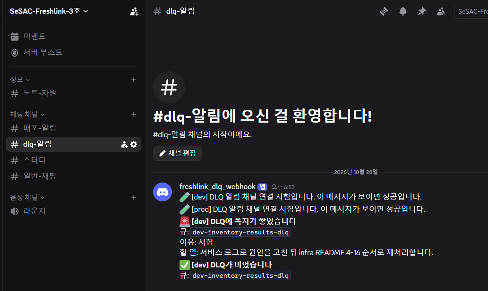
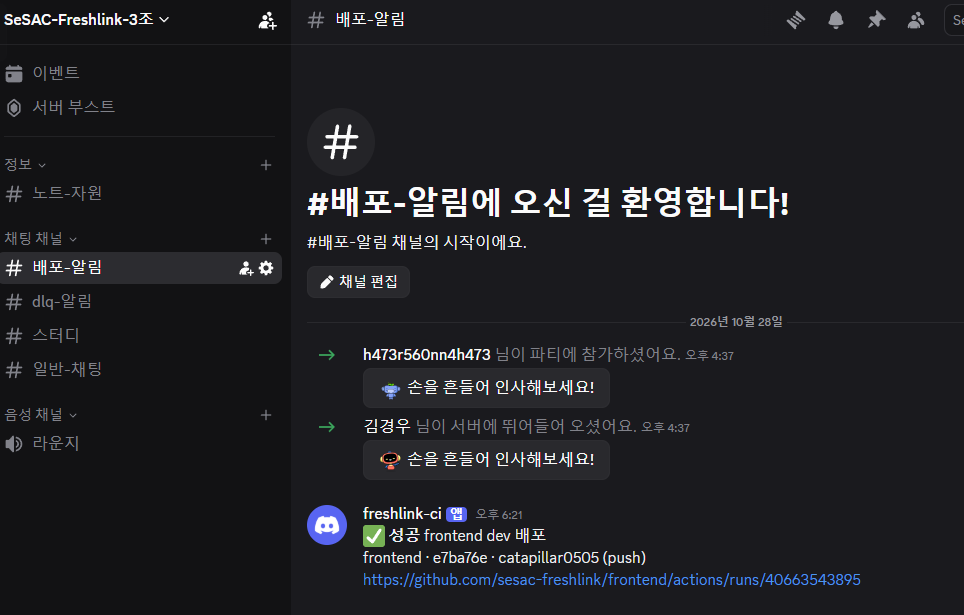
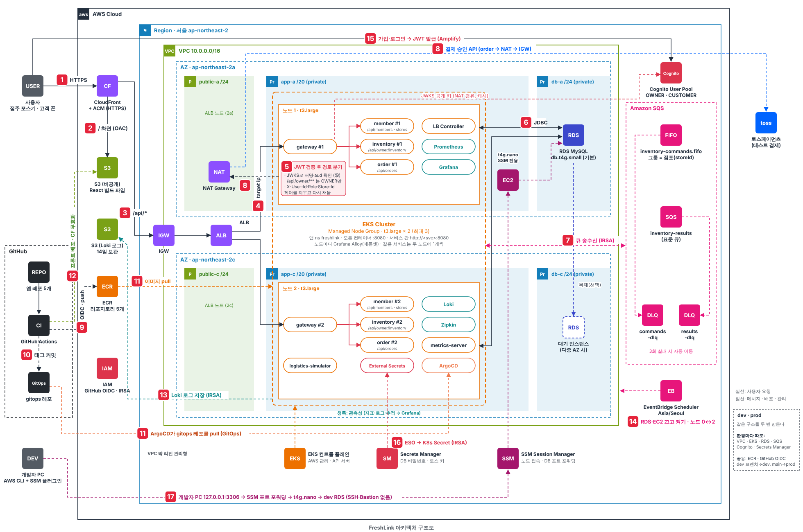

# FreshLink 🥬

**편의점 점주와 고객이 같은 재고를 실시간으로 보는 서비스**

고객이 핸드폰으로 근처 편의점 상품을 주문·결제하면, 그 순간 점주 화면의 재고가 줄어든다. 동시에 여러 명이 사도 재고는 음수가 되지 않고, 유통기한이 지난 상품은 고객에게 팔리지 않는다.

> SeSAC 팀 프로젝트 · 5주 MVP · 3명 · 2026 · 최신 릴리스 `v2026.11.05`

**prod 데모:** [https://getfreshlink.com](https://getfreshlink.com)은 **매일 09:00–21:00(한국 시각, 주말 포함)** 열린다. 서울 30개 점포에 손대지 않아도 매일 입고·주문·결제·픽업이 쌓인다.

---

## 핵심 약속

### 백엔드: 재고는 틀리지 않는다

1. **정확한 재고:** 결제하면 점주 화면 재고가 정확하게 줄어든다. 동시 주문 100건에도 음수가 되지 않는다.
2. **유통기한 안전:** 기한이 지난 lot은 구매 가능 수량과 예약에서 빠진다.

어떻게? **재고를 바꾸는 모든 일(입고·예약·확정·해제·폐기)을 SQS FIFO 큐 하나로 보내고, 점포를 메시지 그룹으로 삼아 점포별로 한 줄씩 처리**한다. DB 락 없이 순서가 보장된다.

### 인프라: 정해진 돈과 메모리 안에서 돌린다

3. **비용:** dev·prod 두 환경을 10/19\~11/20(33일)에 **약 310\~340 USD**로 운영한다. 그냥 켜 두면 약 765 USD다. 지원금(약 360 USD) 안이다.
4. **메모리:** 노드는 **t3.large 2대**뿐이다. 앱·시스템·관측성 파드 40개가 메모리 할당 가능량의 **65%** 안에 들어간다.

#### 💰 비용: 765 USD → 약 305 USD, 60% 줄인다

> 기간 10/19(월)\~11/20(금) 33일 · dev + prod 두 환경 · 서울 리전 온디맨드 단가로 계산

**원래는** 두 환경을 계속 켜 두면 **약 765 USD**가 든다. 그런데 실제로 개발하는 시간은 평일 09:00\~21:00, 전체 792시간 중 **300시간(38%)** 뿐이다.

**그래서** 안 쓰는 시간에 아래 4가지를 끈다.

| 안 쓰는 시간에 하는 일 | 언제 | 줄어드는 돈 |
| --- | --- | --- |
| ① 노드 0대로 줄이고 RDS 중지 | 밤 21:00\~09:00 (dev는 주말도) | 약 260 USD |
| ② NAT Gateway 삭제 | 밤 (dev는 주말도) | 약 65 USD |
| ③ EKS 클러스터 삭제 | 일주일에 한 번 (dev 금 21:05\~월 08:40. prod는 11/13부터 지우지 않음) | 약 65 USD |
| ④ prod는 11/5 전까지 필요한 날만 켜기, 그 뒤 데모용으로 매일 12시간 | prod | 약 70 USD |
| **합계** |  | **약 460 USD** |

①\~③은 dev·prod 둘 다에, ④는 prod에만 건다. 자세한 계산은 [비용 계산](https://github.com/sesac-freshlink/.github/blob/main/docs/기획/비용-계산.md)에 있다.

**그 결과** 765 USD에서 약 460 USD를 줄여 약 305 USD가 된다. 여기에 2차에 더한 선착순용 ElastiCache(Valkey)·도메인 약 30 USD를 더해 **약 310\~340 USD**다.

> ### 🎯 33일 동안 dev + prod 합계 약 310\~340 USD (지원금 약 360 USD 안)

- **사람 대신 일정이 끈다.** API 한 번이면 되는 일은 EventBridge Scheduler가 한다. 09:00에 RDS를 켜고 21:00에 끄며, 노드 그룹은 09:10에 2대, 21:00에 0대로 바꾼다. Terraform이 필요한 일은 EventBridge가 정시에 GitHub Actions를 부른다. 클러스터는 월 08:40에 만들고 일주일에 한 번 지우며, NAT Gateway는 아침에 만들고 21:10에 지운다. 매일 23:00에 남은 것을 한 번 더 끈다.

| 환경 | 켜는 시간 | 클러스터 다시 만들기 |
| --- | --- | --- |
| dev | 평일 09:00\~21:00 | 금 21:05 삭제 → 월 08:40 생성 |
| prod | **주말 포함 매일** 09:00\~21:00 (11/5부터) | 지우지 않음 (11/13부터, 시연 11/20까지) |

- **주말 삭제가 곧 재현성 검증이다.** Terraform을 유지 묶음(VPC·RDS·Cognito·SQS·CloudFront)과 클러스터 묶음(EKS·NAT)으로 나눠, 데이터는 남기고 클러스터만 매주 지웠다 다시 만든다. 지우기 전에 Ingress·볼륨을 먼저 지우고 남은 ALB·EBS·ENI·NAT가 없는지 확인해서, 지운 줄 알았던 리소스에 요금이 나가지 않게 한다.
- **prod는 데모 환경이다.** 11/5 전에는 릴리스 확인·리허설 날에만 켰다. 11/5부터는 누가 언제 열어 봐도 보이도록 dev와 같은 켜고 끄기를 **주말 포함 매일**로 건다. 필요한 날만 켤 때보다 11/6–11/20에 약 61 USD가 더 들지만 지원금 안이고, 매일 비용 메일로 본다.
- **쓴 돈은 매일 본다.** 매일 09:00에 어제 비용, 이번 달 누계와 예산 대비 비율, 많이 쓴 서비스 5개를 팀 세 명에게 메일로 보낸다(Lambda + Cost Explorer). AWS Budgets는 월 예산의 50·80·100%를 넘거나 100%를 넘을 것으로 예측되면, 비용 이상 탐지는 서비스별로 평소보다 10 USD 이상 튀면 메일을 보낸다.
- **관리형 서비스로 노드를 아낀다.** 인증을 Keycloak 대신 Cognito로, 메시징을 Kafka 대신 SQS로 해서 클러스터 안에 띄울 것이 줄었다. ECR 이미지는 S3 게이트웨이 엔드포인트로 받아 NAT 데이터 요금이 붙지 않는다.

#### 🧠 메모리: 노드 2대에 다 들어가게 설계했다

이 프로젝트는 CPU보다 **JVM 메모리가 먼저 찬다.** 그래서 메모리를 기준으로 노드를 골랐다.

| 묶음 | 메모리 요청 |
| --- | --- |
| 앱 (Spring 서비스 6개, 파드 8개) | 약 4.1 GiB |
| 시스템 (ArgoCD, LB Controller, External Secrets 등) | 약 2.2 GiB |
| 관측성 (Prometheus, Grafana, Loki, Zipkin) | 약 2.9 GiB |
| **합계 / t3.large 2대 할당 가능량** | **9.2 / 14.2 GiB (65%)** |

- **t3.large를 고른 이유:** 같은 vCPU의 t3.medium보다 메모리가 2배, 노드당 파드 한도도 17 → 35개다.
- **OOMKilled 방지:** 파드마다 메모리 상한을 두고 JVM에 `-XX:MaxRAMPercentage=75`를 줘 상한 안에서만 힙을 쓴다.
- **배포 여유 확보:** 앱 CPU 요청을 250m → 150m로 낮춰 롤링 배포 때 새 파드가 뜰 자리(약 0.75 vCPU)를 남겼다.
- **밀려날 순서를 정했다:** 관측성 파드는 우선순위를 낮게 줘서, 자리가 모자라면 Grafana·Zipkin이 먼저 빠지고 앱은 남는다.

> 근거와 계산: [비용 계산](https://github.com/sesac-freshlink/.github/blob/main/docs/기획/비용-계산.md) · [AWS 리소스 계획](https://github.com/sesac-freshlink/.github/blob/main/docs/기획/aws-리소스-계획.md) 3장(노드 산정)

#### 🔔 알림: 문제와 배포 결과는 디스코드로 바로 온다

채널을 세 개로 나눠, 무엇이 왔는지만 보고 누가 볼지 안다.

- **DLQ:** 처리 못 한 쪽지가 DLQ에 쌓이면 `#dlq-알림`에 큐 이름·이유·할 일이 오고, 비워지면 다시 알려 준다(dev·prod).
- **배포:** dev·prod에 머지되면 배포 성공·실패가 `#배포-알림`에 커밋·작성자·실행 링크와 함께 온다.
- **오류 (prod, 11/5):** 데모 환경이 혼자 돌다가 깨지면 오류 채널로 바로 온다. 두 길이 있다.
  - **AWS 인프라:** CloudWatch 경보 → SNS → Lambda. RDS CPU·남은 저장 공간·연결 수, 노드 상태 검사, ALB 5xx, 켜고 끄기 Lambda·워크플로 실패, 비용 이상(5 USD 이상)
  - **배포 상태:** ArgoCD Notifications. 동기화 실패, Health Degraded, Missing (메시지에 환경·앱·리비전)

| 알림 기준 (prod 오류 채널) | 값 |
| --- | --- |
| RDS CPU | 80% 이상이 15분 |
| RDS 남은 저장 공간 / 연결 수 | 2 GiB 미만 / 120개 이상이 10분 |
| 노드 상태 검사 실패 | 10분 |
| ALB 5xx | 5분에 10개 이상 |
| 비용 이상 | 5 USD 이상 |

밤에 RDS·노드가 꺼질 때는 지표가 없으므로 정상으로 보고 울리지 않는다. 웹훅 주소는 레포·Terraform state 어디에도 없고 Secrets Manager 한 곳에서 Lambda와 External Secrets가 읽는다. 경보는 DLQ 경보와 합쳐 prod 9개, 월 약 1.1 USD다.

| #dlq-알림 | #배포-알림 |
| --- | --- |
|  |  |

> 설정 방법: [팀원 가이드 6 디스코드 알림](https://github.com/sesac-freshlink/.github/blob/main/docs/팀원-가이드/6-디스코드-알림.md) · 오류 채널 적용 순서: [infra README 4-24](https://github.com/sesac-freshlink/infra/blob/main/README.md#4-24-인프라-오류를-discord-오류-채널로-알리기-3차-할-일-김진아)

### 데모: prod를 켜 두면 하루 장사가 저절로 쌓인다 (11/5)

prod를 남에게 보여 줄 때 점주 대시보드(주문 내역·매출·판매 순위)와 알림이 비어 있으면 데모가 안 된다. 그래서 데모 데이터를 **한 번 채우고**, 그 뒤로는 **매일 시나리오**가 쌓는다. 대형 부하 테스트가 아니라 하루 100\~200건 정도의 작은 시나리오다.

**한 번 채우기 (시드)**

| 무엇 | 얼마나 |
| --- | --- |
| 점포 | 서울 30곳, 모두 위도·경도. 10곳은 시연 장소(영등포구 문래동) 근처 |
| 계정 | 점주 30명, 가상 고객 100명 (한국 이름, 고객마다 단골 점포 1\~2곳). 이메일·이름 어디에도 "test"가 없다 |
| 지난 30일 기록 | 주문·결제 약 3,859건, 재고 lot 약 3,873개, 재고 원장(입고·판매·폐기). 원장 합계와 lot 수량 불일치 0건 |

판매 순위·통계는 inventory 원장의 판매 기록으로 계산한다. 그래서 order 표만 채우지 않고 **같은 주문 ID로 order와 inventory 원장을 같이 채웠다.** 계정 비밀번호는 Secrets Manager에만 둔다.

**매일 시나리오 (logistics-simulator)**

| 시각 | 일어나는 일 | 화면에 생기는 것 |
| --- | --- | --- |
| 켜질 때 + 09:20 | 30개 점포 아침 입고. 일부는 오늘·어제 마감 | 상품 목록, 점주 재고, 유통기한 임박·경과 알림 |
| 10:00\~20:00 | 가상 고객이 단골 점포에서 주문 → 결제 완료 (점포당 하루 3\~6건, 점심·저녁에 많이) | 점주 새 주문 알림, 매출 대시보드, 판매 순위 |
| 결제 5\~20분 뒤 | 픽업 준비 완료, 그 10\~40분 뒤 픽업. 약 10%는 노쇼, 약 5%는 결제 안 함 | 고객 픽업 준비 알림, 주문 내역 |

- **토스를 부르지 않는다.** 시뮬레이터 주문만 order-service의 내부 API(`/ops/orders/{id}/simulated-payment`, 설정으로 켜는 환경에만 열림, gateway 라우트 없음)가 결제 완료로 바꾼다. 결제 키를 `SIM-`으로 구분해, 환불할 때도 토스를 건너뛴다.
- **다시 돌려도 같다.** 입고 `shipmentId`를 `SHP-<날짜>-AM-S<점포>`로 고정해 같은 날 두 번 보내도 한 번만 받고, 주문 계획은 날짜로 정한 난수라 파드가 다시 떠도 같다.

## 아키텍처

번호별 흐름 설명: [docs/기획/architecture](https://github.com/sesac-freshlink/.github/tree/main/docs/기획/architecture)

## 레포지토리

| 레포 | 내용 | 담당 |
| --- | --- | --- |
| [gateway](https://github.com/sesac-freshlink/gateway) | Spring Cloud Gateway, 라우팅·JWT 검증 (Cognito JWKS), BFF(로그인·토큰 갱신·HttpOnly 쿠키) | 김진아 (BFF 로직은 김경우) |
| [member-service](https://github.com/sesac-freshlink/member-service) | 회원 프로필·점포 (가입·로그인은 Amazon Cognito) | 김경우 |
| [inventory-service](https://github.com/sesac-freshlink/inventory-service) | 상품·재고(lot)·입고·예약·폐기 | 이태우 |
| [order-service](https://github.com/sesac-freshlink/order-service) | 주문·결제·Saga·선착순 대기열 | 김경우 |
| [logistics-simulator](https://github.com/sesac-freshlink/logistics-simulator) | 가상 물류센터 입고 쪽지 발행, prod 데모 매일 시나리오(입고·주문·픽업) | 김진아 |
| [notification-service](https://github.com/sesac-freshlink/notification-service) | 화면 알림 (SQS로 이벤트를 받아 SSE로 전달) | 김진아 |
| [frontend](https://github.com/sesac-freshlink/frontend) | React (점주 `/owner`, 고객 `/customer`) | 공통 |
| [common](https://github.com/sesac-freshlink/common) | Outbox 발행기, 멱등 처리, 메시지 DTO | 김진아 |
| [infra](https://github.com/sesac-freshlink/infra) | Terraform (persistent / cluster) | 김진아 |
| [gitops](https://github.com/sesac-freshlink/gitops) | Helm 차트, 서비스별 values, ArgoCD | 김진아 |

## 기술 스택

| 영역 | 기술 |
| --- | --- |
| 프론트엔드 | React · S3 + CloudFront(OAC) · Route 53 도메인 + ACM · CSP 응답 헤더 |
| 백엔드 | Java 21 · Spring Boot 4.0 · Spring Data JPA · Spring Security(OAuth2 Resource Server) · Spring Cloud Gateway · Spring Cloud AWS |
| 인증 | Amazon Cognito User Pool (그룹 OWNER·CUSTOMER·ADMIN) · RS256 JWT를 JWKS로 검증 · gateway BFF + HttpOnly 쿠키 (MVP의 Amplify Auth에서 2차에 전환) |
| 데이터 | Amazon RDS MySQL (인스턴스 1대, 서비스별 스키마 분리) · ElastiCache for Valkey (선착순 대기열) |
| 메시징 | Amazon SQS (FIFO 1 + 표준 1 + 알림 큐 1, 각각 DLQ) · Outbox · 멱등 처리 · Saga · DLQ 재처리 |
| 실시간 | SSE (화면 알림, 점주 실시간 매출) |
| 결제 | 토스페이먼츠 (테스트) |
| 플랫폼 | AWS EKS (t3.large × 2) · AWS Load Balancer Controller · IRSA |
| IaC | Terraform (유지 묶음 / 클러스터 묶음 분리) |
| CI / CD | GitHub Actions (OIDC) / ArgoCD (GitOps) |
| 관측성 | Prometheus (지표) · Grafana (화면, CloudWatch 지표 포함) · Loki + Alloy (로그) · Zipkin (분산 추적) · Actuator·Micrometer |
| 운영 알림 | Discord: 배포(GitHub Actions) · DLQ(CloudWatch → SNS → Lambda) · prod 오류(CloudWatch·비용 이상 → SNS → Lambda, ArgoCD Notifications) |
| 환경 | AWS dev · prod (같은 Terraform 모듈). prod는 데모용으로 매일 09:00\~21:00 |

## 설계에서 고민한 것

- **SQS FIFO로 재고 동시성 해결** — Kafka 대신 관리형 SQS, 메시지 그룹 = 점포로 DB 락 없이 순서 보장
- **Outbox + 멱등 처리** — DB 저장과 메시지 발행을 함께 성공시키고, 중복 메시지는 한 번만 반영
- **CI는 GitHub Actions, CD는 ArgoCD** — CI가 클러스터에 손대지 않는 GitOps 구조라 Jenkins 서버를 운영할 이유가 없다
- **켜고 끄는 시각은 EventBridge가 지킨다** — GitHub 예약 실행이 몇 시간 늦거나 빠진 일(10/19\~10/20)이 있어, 시각은 EventBridge Scheduler가 정하고 Terraform 실행만 GitHub Actions에 맡긴다
- **데모 결제는 토스 없이** — 시뮬레이터 주문만 내부 API로 결제 완료 처리하고 `SIM-` 키로 구분한다. 실제 결제 흐름(재고 확정·알림·매출)은 그대로 탄다

## 팀

| 이름 | 역할 |
| --- | --- |
| 김진아 | 팀장 · 인프라(Terraform, EKS, CI/CD) · gateway · logistics-simulator · common · 알림 서비스 · BFF·Redis 인프라 · (3차) prod 데모 데이터·매일 시나리오·오류 알림 |
| 이태우 | inventory-service · 점주 재고 화면 · (2차) 상품별 판매 순위 |
| 김경우 | member-service · order-service · 로그인·주문 화면 · (2차) BFF 로직 · 매출 대시보드 · 선착순 대기열 |
| 문영훈 | 지원(10/14\~10/16) · 서비스 4개 Spring 뼈대 · common v0.1.0·v0.1.1(쪽지 DTO 7종, 공통 오류 응답) · 오류 처리 |
